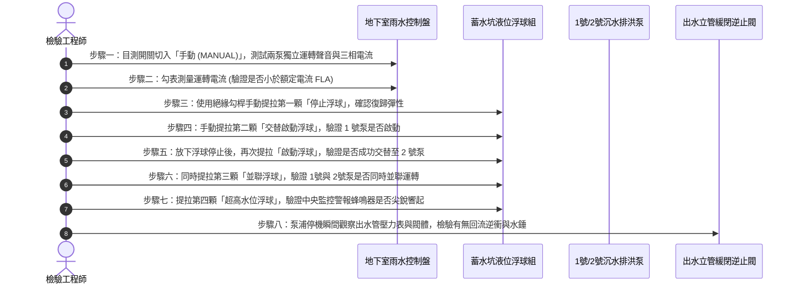

# 全案購屋實戰第五百八十一部：中古大樓社區地下室筏基雨水沉水泵自動交替切換浮球開關油污卡阻逆止閥回流與防洪淹水體檢工序全書

---

## 壹、前言與核心體檢宗旨

集合住宅地下室最底層之「筏基坑（Raft Foundation Pit）」與「雨水積水槽」，肩負著整座社區暴雨、颱風防汛排洪與地盤微量滲水抽除之最關鍵樞紐任務。

在屋齡 20～35 年之中古大樓中，暴雨期間地下室發生倒灌淹水、淹沒變電室發電機或浸泡住戶百萬名車之慘劇，超過 80% 並非市政主幹管回溢，而是社區內部「筏基雨水沉水排洪泵浦系統」長期隱匿以下致命暗病：
1. **液位浮球開關（Float Level Switch）油污淤泥纏繞卡阻**：重油油泥附著使浮球無法自由沉浮，水位暴漲時觸點無法閉合，沉水泵無法自動啟動，造成無聲滅頂。
2. **自動交替切換控制器（Alternating Relay / PLC 控制盤）接點燒蝕卡滯**：雙泵無法自動交替運轉，或一號泵跳脫後二號備用泵無法即刻並聯跳起。
3. **沉水泵出水鑄鐵揚水管逆止閥（Check Valve）破裂洩漏回流**：止回閥閥舌卡死或密封墊圈沖蝕，抽出的高壓雨水沿管路逆向狂灌回筏基坑，泵浦陷入「抽上來又流回去」的無效空轉熱當死循環。
4. **管路法蘭橡膠墊片老化穿孔與接地漏電**：長時間泡水震動導致電纜防水護套龜裂，引發漏電斷路器跳脫（ELCB Trip）而全線癱瘓。

本工序全書提供一套標準、具可操作性之沉水排洪系統深層體檢標準工序，守護地下室機電心臟與家庭資產安全。

---

## 貳、筏基雨水沉水泵系統結構與排洪連鎖原理

```mermaid
flowchart TD
    A["基地周邊雨水截水溝 / 坡道落水口 / 牆體滲水"] --> B["筏基坑雨水蓄水池 (Sump Pit)"]
    B --> C["沉水式雨水排洪泵 1號泵 (Submersible Pump No.1)"]
    B --> D["沉水式雨水排洪泵 2號泵 (Submersible Pump No.2)"]
    
    E["液位浮球開關組"] -->|低水位停止 (Stop)| F["地下室雨水分電控制盤"]
    E -->|中水位啟動 (Start-Alternate)| F
    E -->|高水位雙泵並聯 (High-Parallel)| F
    E -->|極限超高水位警報 (Alarm)| G["中央防災監控室火警/機電主機 (警報蜂鳴)"]
    
    F -->|交替繼電器 (24V)| C
    F -->|並聯啟動器| D
    
    C --> H["揚水鍍鋅鋼管 + 緩閉式逆止閥 + 閘閥"]
    D --> I["揚水鍍鋅鋼管 + 緩閉式逆止閥 + 閘閥"]
    H --> J["市政雨水箱涵 / 社區專用雨水放流管路"]
    I --> J
```

---

## 參、中古社區現場五大常見致命病徵與工程成因

| 病徵分類 | 現場常見故障現象 | 工程深層成因分析 | 對家庭置產之潛在危害 |
| :--- | :--- | :--- | :--- |
| **一、浮球纏繞卡死** | 水池已滿至池頂，浮球浮在水面但泵浦不轉動；或泵浦抽乾後持續乾轉燒毀 | 車道洗車廢水、底坑青苔與沉砂油泥包裹浮球連桿，使其在管線支架間打結卡死。 | 暴雨時無法自動排洪，地下室車位淹水，住戶愛車泡水全損。 |
| **二、交替控制失效** | 永遠只有 1 號泵在抽，2 號泵長年不動導致軸心生鏽抱死 | 控制盤內交替繼電器（Alternating Relay）內部電磁線圈燒毀或微動機械齒輪磨損。 | 單泵過載燒毀時，無備用泵接替，系統瞬間完全癱瘓。 |
| **三、逆止閥回流空轉** | 泵浦停止運轉瞬間，出水管傳來沉重撞擊聲，隨後看到排水池水面劇烈翻滾冒泡 | 鑄鐵旋啟式逆止閥閥舌軸銷斷裂或橡膠密封墊圈遭砂石卡阻，高壓水流逆流洩漏。 | 抽水效率降低 70% 以上，泵浦長時間連續運轉過熱燒毀。 |
| **四、電纜護套龜裂** | 只要泵浦一啟動，分電盤總無熔絲開關（NFB）或漏電斷路器立即跳脫 | 橡膠沉水電纜長年浸泡於油污微酸性廢水中，外皮塑化劑析出脆裂，水氣滲入芯線接地。 | 整棟社區地下室排水系統斷電跳脫，修復前毫無防洪能力。 |
| **五、葉輪砂石卡阻** | 泵浦啟動時馬達發出低頻嗡嗡聲（Hums），電流表飆升至額定值 3~5 倍但無出水 | 筏基坑沉砂池未定期清淤，泥沙碎石被吸入泵浦渦流室，卡死半開式鑄鐵葉輪。 | 馬達線圈高溫燒熔，產生焦臭味，甚至引發控制盤接點融化火花。 |

---

## 肆、標準筏基雨水沉水泵八步體檢工序法



### 關鍵檢驗數據與判定標準：
1. **三相運轉平衡度（Current Unbalance Ratio）**：
   $$I_{\text{unbalance}} = \frac{|I_{\max} - I_{\text{avg}}|}{I_{\text{avg}}} \times 100\% \le 5\%$$
   - 若三相電流不平衡度超過 5%，代表馬達線圈匝間短路或接觸器接觸電阻過大。
2. **絕緣電阻測試（Megger Test）**：
   - 使用 500V 兆歐表測量馬達繞組對地絕緣阻抗，合格標準值應 **$\ge 20\ \text{M}\Omega$**。
   - 若阻抗低於 **$2\ \text{M}\Omega$**，代表電纜或馬達防水油封（Mechanical Seal）已嚴重進水，必須預防性吊起更換。
3. **交替切換成功率（Alternation Reliability）**：
   - 連續手動觸發交替測試 5 次，必須達成 100% 準確交替跳開，無任何卡滯黏著。

---

## 伍、買方地下室看屋 5 分鐘自我防洪查驗表

| 查驗位置 | 實地觀察重點 | 合格健康特徵 | 致命隱患警訊（高危險扣分項） |
| :--- | :--- | :--- | :--- |
| **1. 控制盤面板燈號** | 檢查地下室牆面「雨水排水控制箱」 | 「自動（AUTO）」指示燈亮綠燈，無故障紅燈 | 切在「手動（MANUAL）」或「停止（OFF）」，或閃爍黃色故障警告燈 |
| **2. 蓄水池人孔蓋** | 打開或檢視筏基坑孔蓋周邊 | 密合良好、無腐蝕異味、周圍乾燥 | 人孔邊緣滿布黃褐色泥漿乾涸水痕，顯示過去曾嚴重溢流漫水 |
| **3. 浮球電纜下垂狀態** | 強光手電筒照射池內懸掛浮球 | 浮球表面光滑、垂直懸掛、彼此間隔無打結 | 浮球被大量塑膠袋、保麗龍、黑油泥膏層層包裹，電纜糾纏成球 |
| **4. 揚水鐵管壁外觀** | 觀察從坑內向上延伸的綠色或黑色水管 | 防鏽漆完好，法蘭螺栓無銹瘤、逆止閥乾淨 | 管身嚴重紅鏽剝落、法蘭縫隙長滿白色碳酸鈣鐘乳石水垢（漏水痕跡） |
| **5. 排水溝底泥淤積** | 車道坡道底部截水溝蓋板下方 | 截水溝底乾淨無砂石，出水口暢通 | 溝內淤積黑泥超過半個溝深，雜草菸蒂塑膠垃圾堵塞落水口 |

---

## 陸、購屋特約防禦條款：地下防洪公共設施保障範本

> **地下防洪排難設備妥善率擔保特約：**  
> 「賣方擔保本標的物社區地下室公共防洪排水系統（包含車道截水溝、筏基雨水蓄水池、沉水排洪主備泵浦組及自動交替液位控制器）功能正常運作，且於近十二個月內無因泵浦故障造成地下室淹水情事。  
> 點交日前若經實地檢驗發現沉水泵絕緣阻抗低於 $2\ \text{M}\Omega$、自動交替失效、逆止閥回流或控制盤故障，賣方應於交屋前敦促管理委員會修復完畢；若未能於點交前改善，賣方同意提撥新台幣 **參萬元至伍萬元整** 作為地下公共機電安全擔保款，交由履約保證專戶保管，待管委會出具機電保養廠商檢驗合格證明後結清。」

---

## 柒、結語

地下室是整棟社區的基石與資產重鎮。車道截水與筏基雨水泵浦，看似深埋地底無聲無息，實為守護全體住戶財產安全的定海神針。買房置產務必深入地下室最底層，透過工程數據與控制盤細節，透視管委會真正的維護實力與防洪韌性！
