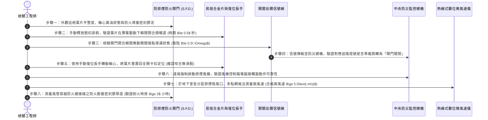

# 全案購屋實戰第五百八十九部：中古大樓社區地下室機械通風防排煙風管防火閘門熔斷手動復位卡死微動開關定位失效與風量衰減體檢工序全書

---

## 壹、前言與核心體檢宗旨

在現代集合住宅高層建築（屋齡 20～35 年）之公共安全體系中，地下室停車場、梯廳排煙室與緊急昇降機間之「機械通風與防排煙風管系統（Mechanical Ventilation & Smoke Control System）」，是當地下室或各樓層突發火警時，抽除致命劇毒濃煙、供應逃生動線新鮮空氣、阻止火勢藉由風管孔道向上延燒之最重要消防生命防線。

依據我國《建築技術規則》建築設計施工編及各類場所消防安全設備設置標準，穿透防火區劃牆體之金屬風管，必須配置具備耐燃防火時效之「防火閘門（Fire Damper / F.D.）」與「防排煙防火閘門（Smoke & Fire Damper / S.F.D.）」。

然而，在諸多中古集合住宅大樓中，因長年缺乏正統「閘門脫扣實測與風量風壓動態流場體檢」，導致以下**四項極其致命的機電消防暗病**長年隱匿未被察覺：
1. **易熔金屬片（Fusible Link）熔斷機構手動復位卡死**：風門軸心金屬套筒長年受潮生鏽，加上排風管內油污積塵凝固成膠狀，閘門在測試或誤動作後卡在半開半閉位置，既無法提供正常排煙，又無法在火災時徹底緊閉阻絕火舌。
2. **微動極限開關（Micro Switch）定位接觸點氧化失效**：閘門開啟或關閉之電氣狀態無法回傳至中央防災監控總機，監控面板顯示「常開正常」，實際上現場閘門早已因重力或彈簧疲勞垂落閉合，形成嚴重的「假安全」欺騙訊號。
3. **風管鍍鋅鋼板咬接縫開裂與嚴重漏風衰減**：地下室通風風管長達數十米，長期承受送風震動與吊架下垂應力，管段法蘭（TDF / TDC）墊片風化脫落，排風量在輸送過程中漏損高達 40%～60%，末端吸風口形同虛設。
4. **防排煙風機聯動控制接觸器積碳燒蝕**：火警感知器觸發後，防排煙風機控制箱電磁接觸器因老舊接觸不良無法吸合，風機馬達跳脫罷工，地下室瞬間被濃煙淹沒。

本工序全書旨在深入剖析防排煙風道流力阻抗、防火閘門機械連動架構與微動開關信號反饋，提供買方與社區完整的檢驗指引。

---

## 貳、防排煙風管與防火閘門連鎖控制架構

```mermaid
flowchart TD
    A["火災初期產生濃煙與高溫熱氣 (地下室車位/管道間)"] --> B["防排煙風口 (Smoke Exhaust Register)"]
    B --> C["鍍鋅鋼板排煙風管幹管 (厚度 $\ge 1.2\text{ mm}$ + 保溫隔熱層)"]
    
    C --> D["防排煙防火閘門 (S.F.D.)"]
    D --> E["感溫熔斷元件 (Fusible Link $72^\circ\text{C} / 280^\circ\text{C}$)"]
    D --> F["彈簧扭力驅動閉合機構 (Spring-Loaded Closure)"]
    D --> G["微動確認開關 (Auxiliary Limit Switch)"]
    
    G -->|閉合信號反饋 (Dry Contact)| H["中央防災監控室火警主機 (Graphic Panel)"]
    H -->|連鎖關閉對應送風機| I["地下室進氣通風機 (Fresh Air Fan)"]
    H -->|連鎖啟動高速排煙| J["屋頂/地下室耐高溫排煙風機 (Smoke Extract Fan)"]
    
    D --> K["穿越建築物防火區劃牆 (Fire Wall 2小時耐火時效)"]
    K --> L["排煙專用垂直豎井 (Smoke Shaft) 直通戶外大氣"]
```

---

## 參、中古社區現場五大常見致命病徵與工程成因

| 病徵分類 | 現場常見故障現象 | 工程深層成因分析 | 對住戶家庭置產之潛在危害 |
| :--- | :--- | :--- | :--- |
| **一、閘門軸心生鏽卡死** | 防火閘門葉片卡在 30°~45° 傾斜位置，用手撥動紋絲不動 | 葉片轉軸黃銅襯套長年缺乏二硫化鉬潤滑，廢氣油泥與水氣交織形成硬化結垢。 | 火災時火舌順著風管延燒貫穿不同樓層與防火分區，造成整棟大樓陷入火海。 |
| **二、易熔片疲勞斷裂** | 社區平時通風風機全開，但地下室特定區域依然悶熱潮濕、空氣凝滯 | 易熔金屬片（Fusible Link）因環境溫度交替循環產生金屬蠕變，無火災時自動斷裂跳脫關閉。 | 通風管路實質斷路，平日廢氣累積危害健康，緊急排煙時完全無排風抽力。 |
| **三、微動開關假信號** | 監控主機面板顯示「全區防火閘門開啟良好」，現場實際檢視卻有多處閉合 | 微動開關觸點彈簧疲勞失效，或微動按掣被蛛網泥垢固定在常態位置，無法反映真實閥瓣狀態。 | 防災人員誤判現場排煙動線，延誤逃生與救災黃金決策時間。 |
| **四、風管法蘭嚴重漏風** | 排煙風機在機房咆哮運轉，但地下室吸風口衛生紙條連動都不動 | 矩形風管共板法蘭（TDC）角碼螺栓鬆脫、密封密封膠泥硬化脫落，風管接縫裂開數公分。 | 排煙效能衰減 70% 以上，火災產生之致命一氧化碳與氰化氫毒煙滯留無法排出。 |
| **五、排煙風機逆向打滑** | 排煙風機運轉聲音極大但排風量極小，出風口風向紊亂 | 驅動皮帶（V-Belt）長年未換嚴重鬆弛打滑，或電機接線相序反接導致葉輪反轉。 | 毒煙不退反進，甚至將外界濃煙倒灌壓回住戶逃生梯間。 |

---

## 肆、標準防火閘門與排煙風量八步精密體檢工序



### 關鍵檢驗數據與判定標準表：

| 檢驗參數 | 法定標準與健康正常值 | 臨界警戒數值 | 致命故障特徵（一票否決） |
| :--- | :--- | :--- | :--- |
| **1. 閘門脫扣關閉時間** | 脫扣後瞬間閉合 $\le 0.5$ 秒 | 閉合時間 $0.6 \sim 1.5$ 秒 | 葉片卡在半途、或需人工外力拍打始能閉合 |
| **2. 葉片閉合密合度** | 葉片邊緣與框架間隙 $\le 2.0\text{ mm}$ | 間隙 $2.1\text{ mm} \sim 5.0\text{ mm}$ | 間隙 $>5.0\text{ mm}$，葉片扭曲透光嚴重（火舌必穿透） |
| **3. 排煙吸風口面風速** | 風口平均風速 $\ge 5.0\text{ m/s}$ | 風速 $3.0\text{ m/s} \sim 4.9\text{ m/s}$ | 風速 $< 2.0\text{ m/s}$（風管斷開漏損或風機反轉） |
| **4. 微動開關接觸電阻** | 開關閉合導通電阻 $\le 0.5\ \Omega$ | 電阻 $0.6\ \Omega \sim 2.0\ \Omega$ | 電阻無窮大（內部斷線）或假信號短路 |
| **5. 易熔合金片熔斷溫度** | 標稱 $72^\circ\text{C} \pm 2^\circ\text{C}$（排煙兼排風為 $280^\circ\text{C}$） | 表面微裂氧化 | 熔斷片被鐵絲、束帶私自死捆固定（完全失去保護） |
| **6. 風機馬達三相平衡** | 運轉電流不平衡率 $\le 5\%$ | 不平衡率 $6\% \sim 10\%$ | 馬達電流破額定值 $1.2$ 倍，伴隨刺鼻漆包線焦味 |

---

## 伍、買方看屋現場地下室 3 分鐘排煙通風實戰快檢表

| 查驗步驟 | 操作手法與觀察重點 | 合格健康特徵 | 致命隱患警訊（高危險折價項） |
| :--- | :--- | :--- | :--- |
| **1. 抬頭檢視風管外觀** | 強光手電筒仰角照射地下室天花板鍍鋅鐵皮風管 | 風管平直無凹陷，法蘭吊架緊固，無破損破洞 | 風管大面積下垂變形，接頭處裂開膠帶脫落，漏風嘶嘶作響 |
| **2. 檢查穿牆防火填塞** | 觀察風管穿越樓梯間水泥牆壁的穿牆孔周圍 | 穿牆孔四周塗滿紅色或灰色防火泥（膨脹密封膠），完全封堵 | 孔洞周圍空洞敞開透光，甚至塞滿廢紙箱、保麗龍等易燃雜物 |
| **3. 觀察防火閘門拉桿** | 檢視風管外露之金屬復位重錘連桿與拉手 | 連桿表面光亮微油，標示「F.D. / S.F.D.」銘牌清晰 | 連桿被厚重蛛網油泥包覆，甚至被住戶私接水管、電線壓迫擋住 |
| **4. 吸風口風感簡易測試** | 在排風運轉時，手持薄紙巾靠近吸風百葉窗面 | 紙巾被強烈氣流牢固吸附在風口格柵上，無掉落現象 | 紙巾垂垂下掛、毫無吸附力，地下室瀰漫潮濕汽機車廢氣惡臭 |
| **5. 監控總機燈號核對** | 檢視管理室消防火警監控面板之防排煙區段 | 全部防火閘門指示燈亮「綠燈（常開）」，無閃爍故障紅燈 | 面板多處閃爍黃色故障警告燈，或排煙風機按鈕被轉至「手動停止」 |

---

## 陸、購屋特約條款範本：公共消防防排煙妥善率擔保

> **社區地下室防排煙與防火閘門系統效能擔保特約：**  
> 「賣方保證本買賣標的所屬社區之公共地下室機械通風、防排煙風管系統、防火區劃防火閘門（F.D.）及中央連鎖控制設備處於合規妥善運作狀態，符合現行消防與建築法規安全標準。  
> 點交日前若經實地檢驗發現防火閘門軸心卡死無法復位、穿牆防火填塞破壞、微動開關定位信號失真或排煙吸風量不足標準值之百分之六十等重大公產消防安全缺失，賣方應於交屋日前督促管理委員會及消防保養廠商修復改善完畢；若未能於期限內修復，賣方同意提撥新台幣 **參萬元整** 作為公共消防機電修繕暫扣款，自本買賣尾款中扣留，待管委會複驗合格後始得撥付。」

---

## 柒、結語

火災中最致命的殺手，不是高溫明火，而是能在數十秒內奪人性命的劇毒濃煙。
一套運作精準的防排煙風管與防火閘門系統，是將致命毒煙迅速抽離建築、為無辜住戶爭取寶貴黃金逃生時間的守護巨龍。
買房不僅要看明亮乾淨的生活空間，更要昂首審視幽暗天花板上的每一段風管與每一座閘門，用嚴格的工程數據確保家人無論身處何種危難，都能暢享源源不斷的安全呼吸！
