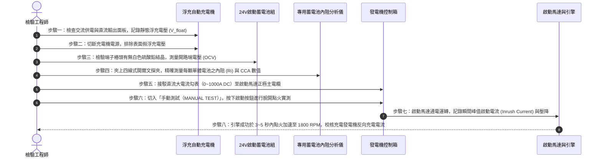

# 全案購屋實戰第五百八十二部：中古大樓社區地下室緊急發電機蓄電池浮充老化內阻劇增啟動馬達電磁閥咬死與斷電黑燈癱瘓體檢工序全書

---

## 壹、前言與核心體檢宗旨

在現代集合住宅高層建築之機電體系中，當台電外部高壓電網遭遇天然災害（如強烈颱風吹倒電桿、雷擊引發變電所跳脫）或區域性大停電時，整座大樓之生命支持系統——包含：
1. **緊急升降機（消防救災電梯）**；
2. **梯廳、地下室與逃生樓梯安全防排煙風機**；
3. **各樓層緊急避難照明與指示燈**；
4. **消防加壓主泵浦與地下室雨水排洪沉水泵**；

完全仰賴地下室設置之「緊急柴油發電機組（Emergency Diesel Generator Set）」於 **10 至 15 秒之內** 自行完成起步、建立轉速與送出穩定 380V/220V 電源。

然而，諸多屋齡 20～35 年之中古集合住宅，因缺乏正統「蓄電池電化學特性監測」與「啟動馬達電氣機械雙重體檢」，導致大樓平時看似正常，一遇重大斷電災難時，發電機卻傳來微弱的「噠、噠、噠」電磁閥空響，隨後徹底陷入死寂黑燈，造成電梯受困、防排煙失效與地下室水淹滅頂。

本工序全書旨在深入剖析發電機蓄電池組衰退、充電機浮充電壓漂移、啟動馬達大電流直流接觸器燒蝕等關鍵致命病徵，提供一套精準的實務體檢與驗收指引。

---

## 貳、緊急柴油發電機啟動電氣與控制系統原理

```mermaid
flowchart TD
    A["台電外部高壓供電 (22.8kV / 11.4kV)"] -->|正常供電| B["自動切換開關 (ATS - Auto Transfer Switch)"]
    B --> C["大樓各樓層緊急動力與消防照明迴路"]
    
    A -.->|突發斷電 (Power Outage)| D["ATS 電壓偵測繼電器 (Under Voltage Relay)"]
    D -->|發送啟動乾接點信號 (2~3秒延遲)| E["發電機自動控制盤 (Generator Control Panel)"]
    
    F["浮充充電機 (Float Battery Charger 110V/220V AC)"] -->|平時直流恆壓浮充| G["起動蓄電池組 (24V DC / 鉛酸或膠體電池)"]
    G -->|大電流迴路 (300A~800A 瞬時脈衝)| H["啟動馬達電磁接觸器 (Starter Solenoid)"]
    
    E -->|閉合起動繼電器| H
    H -->|驅動齒輪齒合| I["飛輪齒圈 (Flywheel Ring Gear)"]
    I -->|拖動柴油引擎運轉| J["曲軸旋轉壓縮點火 (Cranking 400~600 RPM)"]
    J -->|轉速達標| K["調速器 (Governor) 鎖定 1800 RPM (60Hz)"]
    K -->|AVR 建立激磁電壓| L["發電機輸出端建立 380V/220V 交流電"]
    L -->|信號就緒| B
    B -->|切換至緊急發電機側 (0.5秒內)| C
```

---

## 參、中古社區現場五大常見致命病徵與工程成因

| 病徵分類 | 現場常見故障現象 | 工程深層成因分析 | 對住戶家庭置產之潛在危害 |
| :--- | :--- | :--- | :--- |
| **一、電池內阻劇增** | 斷電測試時，發電機只發出「喀喀」微弱跳脫聲，啟動馬達完全轉不動 | 鉛酸蓄電池極板硫化（Sulfation）、活性物質脫落，內阻自正常的 $2\sim 4\ \text{m}\Omega$ 暴增至 $20\sim 50\ \text{m}\Omega$，大電流輸出時電壓瞬間驟降歸零。 | 遇颱風天台電斷電時，救災電梯停擺、地下室排污沉水泵失去電力，大樓瞬間變孤島。 |
| **二、浮充電壓漂移** | 蓄電池外殼鼓脹凸起、電解液乾涸、樁頭布滿厚重白色結晶粉末 | 充電機浮充電壓調整不當（如 24V 系統被長年施加 >28.5V 之過充高壓），導致電解液大量失水分解、熱失控。 | 電池內部氫氣累積，啟動火花瞬間極易引發蓄電池爆炸，炸裂機房並噴濺強酸。 |
| **三、電磁閥觸點燒蝕** | 控制盤顯示「Cranking」信號已發出，但啟動馬達無任何機械動作 | 啟動馬達電磁開關內部大電流銅觸點，經歷年頻繁試車高溫電弧侵蝕，氧化積碳甚至熔融凹陷，形成開路。 | 發電機組空有柴油與引擎本體，卻因幾百元的接觸點故障而無法起跑。 |
| **四、飛輪齒合打滑** | 啟動馬達高速空轉旋轉尖叫，但柴油引擎曲軸毫無動靜 | 單向超越離合器（Bendix Gear）滑槽油泥凝固乾涸、回位彈簧疲勞，驅動齒輪無法順利前推咬合飛輪齒圈。 | 引擎無法被帶動旋轉，控制盤在 3 次試點失敗後鎖定報警（Overcrank Failure）。 |
| **五、接地線阻抗過大** | 啟動過程中控制盤儀表燈號劇烈閃爍、微電腦控制器狂跳當機重啟 | 直流啟動大迴路之搭鐵地線（Grounding Cable）螺栓鏽蝕鬆動，數百安培強電流造成參考地電位浮動。 | 邏輯控制基板因電壓突波燒毀，無法維持燃油電磁閥（Solenoid Valve）供油。 |

---

## 肆、標準發電機蓄電池與啟動電氣八步精密體檢工序



### 關鍵檢驗數據與判定標準表：

| 檢驗參數 | 標準健康值（24V 鉛酸系統） | 臨界警告值 | 致命故障特徵（必須立即更換） |
| :--- | :--- | :--- | :--- |
| **1. 靜態浮充電壓** | $27.0\ \text{V} \sim 27.6\ \text{V}$ | $26.4\ \text{V} \sim 26.9\ \text{V}$ | $< 25.0\ \text{V}$（充電機損壞）或 $> 28.8\ \text{V}$（過充高溫） |
| **2. 開路單體端電壓** | $\ge 12.6\ \text{V}$（每顆 12V 電池） | $12.2\ \text{V} \sim 12.4\ \text{V}$ | $< 12.0\ \text{V}$（極板短路或斷格） |
| **3. 單體內部阻抗 (Ri)** | $\le 4.5\ \text{m}\Omega$ | $4.6\ \text{m}\Omega \sim 8.0\ \text{m}\Omega$ | $> 8.0\ \text{m}\Omega$（內阻過高，帶不動大電流） |
| **4. 冷啟動電流 (CCA)** | $\ge 85\%\ \text{標稱額定 CCA}$ | $60\% \sim 84\%\ \text{標稱 CCA}$ | $< 60\%\ \text{標稱 CCA}$（啟動能力枯竭） |
| **5. 啟動瞬間壓降 (V_crank)** | 啟動瞬間最低電壓 $\ge 18.0\ \text{V}$ | $16.0\ \text{V} \sim 17.9\ \text{V}$ | $< 15.0\ \text{V}$（控制盤必跳當機重置） |
| **6. 啟動峰值電流** | $350\ \text{A} \sim 650\ \text{A}$（依馬力大小） | 偏離基準值 $\pm 25\%$ | 湧浪電流 $> 900\ \text{A}$（馬達轉子卡死或接地） |

---

## 伍、買方看屋現場地下室 3 分鐘快速查驗法

買方在仲介帶看參觀中古大樓公設地下室時，無須攜帶複雜電工儀器，僅憑「望、聞、查」即可迅速洞悉發電機維護妥善率：

| 查驗動作 | 觀察核心與手法 | 合格優質現象 | 致命隱患警訊（高危險折價項） |
| :--- | :--- | :--- | :--- |
| **一、看充電器面板** | 檢視掛在發電機旁的「全自動充電機」儀表 | 交流電源指示燈恆亮，浮充電壓指針穩定在 27V 左右，浮充電流指針趨近於 0A（已充飽維持）。 | 指針為 0V（充電機無電源跳脫）、指針狂指 30V 破表，或充電器外殼燙手發出嗡嗡異音。 |
| **二、看電池出廠日期** | 檢視蓄電池本體上的標籤或刻印烙印（如 `2024/05`） | 電池更換在 **2 年以內**（發電機電池法定建議壽命為 2~3 年）。 | 超過 **3 年以上** 未換（甚至看到 5~8 年前舊標籤），外殼膨脹變形。 |
| **三、看電池端子與引線** | 檢視正負極金屬接柱螺栓 | 塗抹有紅色或黃色凡士林保護油膏，螺栓緊固光亮，無結晶。 | 端子被如白雪般的硫酸鉛白色結晶覆蓋滿溢，銅排嚴重發黑綠鏽。 |
| **四、聞現場氣味** | 靠近蓄電池周邊輕嗅空氣味道 | 空氣正常微帶柴油機械味，無刺鼻氣味。 | 飄散明顯的硫磺味、臭雞蛋酸氣，代表內部電解液已沸騰蒸發溢出。 |
| **五、看保養紀錄卡** | 檢視掛在機身旁的「每月定期維修保養檢查表」 | 每個月皆有機電顧問簽名，且標註「有負載測試」或「無負載試車 10 分鐘」。 | 紀錄表空白長達半年以上，或勾選欄位全數筆跡一致一次性補簽造假。 |

---

## 陸、購屋特約條款範本：發電機公共電力妥善率防禦

> **社區緊急發電設備效能擔保與公共維護特約條款：**  
> 「賣方保證本社區地下室緊急柴油發電機組本體、自動充電機、蓄電池組及自動切換開關（ATS）處於隨時可正常啟動送電之妥善狀態。  
> 點交日前，賣方應提出最近一期由合格機電顧問公司出具之完整保養檢測紀錄，證明發電機手動及自動模擬斷電起步於十五秒內順利送電。  
> 若檢驗發現蓄電池出廠超過三年且內阻衰退超過安全標準、充電機故障或啟動馬達無法帶動引擎點火，賣方應促使管理委員會於交屋日前更換修復完畢；若未改善，賣方同意提撥新台幣 **貳萬元整** 作為公共機電修繕抵扣保留款，自本買賣尾款中扣除。」

---

## 柒、結語

一座建築的安全底線，不在於大廳水晶吊燈多麼奢華，而在於漆黑斷電降臨的瞬間，地下室那台柴油發電機是否能如咆哮的雄獅般準時轟鳴跳起。
深入發電機的核心，從一顆看似微不足道的蓄電池與啟動電路著手，就是買方保護全家人避開高空停電受困、守護生命財產安全的最高智慧！
