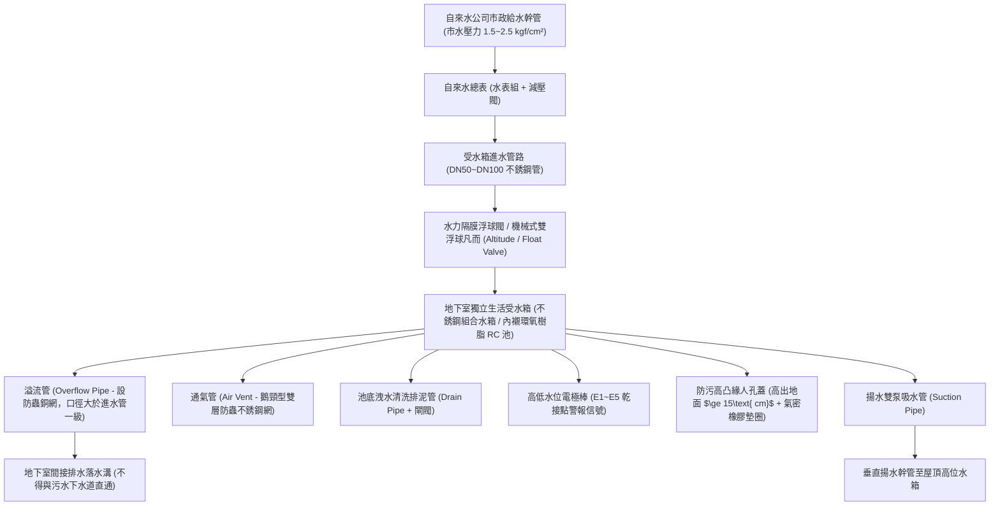
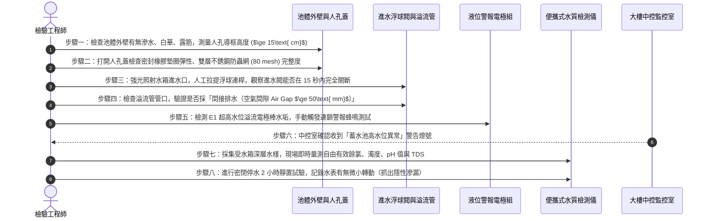

# 全案購屋實戰第五百八十八部：中古大樓社區地下室生活自來水受水箱蓄水池池體裂縫滲水進水浮球閥卡阻無效溢流管防蟲網破裂與水質二次污染體檢工序全書

---

## 壹、前言與核心體檢宗旨

生活自來水是集合住宅維持全體住戶飲用、洗滌、烹飪與衛生的最基本生存命脈。在台灣 20～35 年之中古大樓中，自來水供水架構皆遵循自來水事業法規，先將市政自來水引流至「地下室生活自來水受水箱（蓄水池，Ground / Basement Water Cistern）」，再透過揚水泵浦將池水抽升至屋頂水塔。

然而，地下室受水箱因深埋於地下最底層陰暗潮濕、人跡罕至的密閉角落，且多數大樓僅每年委由水電行進行形式上的清洗水塔，導致以下**四項極其致命的隱形公衛與機電暗病**長年隱匿未被察覺：
1. **鋼筋混凝土池體裂縫與地下污水滲入**：筏基反潮、地盤沉陷或地震剪力拉扯，使受水箱 RC 側壁或底板產生結構性微裂縫，外部高水壓之地下污水、土壤重金屬或化糞池滲漏液經由裂縫滲透進入乾淨自來水中，引發嚴重的慢性水質二次污染。
2. **進水浮球閥（水力隔膜進水閥）水垢卡阻失效**：市政進水端浮球連桿軸銷銹死或水力導閥小孔被泥沙淤塞，水位滿溢時主閥無法徹底緊閉關斷，自來水日夜 24 小時不間斷狂流注水，導致公產水費每月暴增數萬元。
3. **溢流管與通氣管防蟲網破損風化**：池頂溢流管及換氣呼吸管之不銹鋼防蟲紗網長年受潮腐蝕破洞，蟑螂、老鼠、蛾蚋、甚至地下室飛蟻直接爬入池內溺死腐爛，形成大腸桿菌群與總菌落數嚴重超標之「屍水池」。
4. **人孔蓋（Manhole）防污水凸起導框不足與密封膠條脆化**：受水箱人孔蓋直接平貼於地下室走道地面，地下室洗車廢水或暴雨倒灌水直接自人孔蓋縫隙倒灌滲入池內。

本工序全書旨在深入剖析地下室受水箱之衛生防護物理邊界、進水閥流力截斷機制與水質現場化驗標準，為家庭置產築起最堅固的健康飲水防線。

---

## 貳、地下室受水箱給水架構與衛生防護邊界

---

## 參、中古社區現場五大常見致命病徵與工程成因

| 病徵分類 | 現場常見故障現象 | 工程深層成因分析 | 對家庭置產之潛在危害 |
| :--- | :--- | :--- | :--- |
| **一、池體裂縫滲水** | 受水箱外牆長年冒出白華結晶（壁癌），或抽水停滯時水位竟莫名微幅上升 | 地震應力撕裂 RC 池壁、環氧樹脂（Epoxy）塗層剝落龜裂，外部地下水壓大於內部水頭，污水逆向滲入。 | 自來水大腸桿菌群暴增，住戶飲用洗滌引發全家慢性腸胃炎、皮膚過敏潰爛。 |
| **二、進水閥卡阻溢流** | 溢流管日夜不停排出嘩啦嘩啦流水聲，公共水費帳單突然暴增數倍 | 水力隔膜進水閥內部橡膠膜片硬化穿孔，或銅導閥過濾網被自來水砂石卡死，無法利用水壓關閉主閥。 | 公共管理費基金被暴增水費侵吞掏空，水箱長期溢流漫淹地下室變電室與發電機。 |
| **三、防蟲網破爛腐蝕** | 水龍頭濾嘴拆開常發現細小黑點、蛾蚋蟲屍碎片甚至微小紅線蟲 | 溢流管與通氣管裝設劣質塑膠網或薄鐵網，長年受潮生鏽穿孔，地下室害蟲侵入繁殖溺斃。 | 蓄水池淪為病媒害蟲溫床，水體散發死水腥臭味，生活品質降至冰點。 |
| **四、地表污水倒灌** | 地下室車道清洗地板或暴雨過後，住戶自來水立刻變得混濁泛黃帶泥沙 | 人孔蓋未依標準高出地面 15 公分以上，密封墊圈脆裂，地表含泥沙機油之廢水直接由縫隙注入。 | 機械泵浦葉輪被泥沙磨損卡死，家庭全棟淨水濾芯在一天內完全泥濘報廢。 |
| **五、底部死水淤泥** | 水箱底部沉積厚達數公分的黏稠黑泥，水箱抽水吸入口周圍長滿黏滑生物膜 | 水箱未設計斜坡排泥坑（Sump Pit），吸水管口離池底過近（$<10\text{ cm}$），清洗時未排盡底泥。 | 重金屬砷、鉛、錳與懸浮物長年吸附於底泥中，抽水擾動時直接送入各家各戶。 |

---

## 肆、標準地下室受水箱八步精密體檢工序

### 關鍵檢驗數據與判定標準表：

| 檢驗參數 | 法定與工程健康標準 | 臨界警戒值 | 致命污染特徵（一票否決） |
| :--- | :--- | :--- | :--- |
| **1. 人孔導框凸起高度** | 高出地面 $\ge 150\text{ mm}$ | $50\text{ mm} \sim 149\text{ mm}$ | $< 50\text{ mm}$ 或與地面齊平（平貼地排） |
| **2. 自由有效餘氯** | $0.2\ \text{mg/L} \sim 1.0\ \text{mg/L}$ | $0.05\sim 0.19\ \text{mg/L}$ | $0\ \text{mg/L}$（氯已完全消耗，細菌大量孳生） |
| **3. 濁度 (Turbidity)** | $\le 2.0\ \text{NTU}$ | $2.1 \sim 4.0\ \text{NTU}$ | $> 5.0\ \text{NTU}$（肉眼可見明顯混濁或微粒） |
| **4. 水質酸鹼度 (pH)** | $6.5 \sim 8.5$ | $6.0\sim 6.4$ 或 $8.6\sim 9.0$ | $< 5.5$（呈酸性，管壁銅鉛腐蝕溶出） |
| **5. 浮球閥關閉時效** | 連桿提平後 $\le 15$ 秒完全滴水不漏 | 關閉需 $16 \sim 60$ 秒 | 浮球提至最高處，主閥仍持續以全開出水噴射 |
| **6. 溢流管防蟲網規格** | 304 不銹鋼網 $\ge 80\ \text{mesh}$ | 銅網局部氧化變色 | 紗網破損撕裂、或完全無網孔洞敞開 |

---

## 伍、買方看屋現場 3 分鐘給水水源實戰快檢表

| 查驗步驟 | 操作手法與觀察重點 | 合格健康特徵 | 致命隱患警訊（高危險折價項） |
| :--- | :--- | :--- | :--- |
| **1. 廚房冷水透明度檢驗** | 以透明玻璃杯盛裝廚房自來水，對光檢驗 | 水質澄澈透明、無色、無懸浮雜質顆粒 | 水質泛微黃色、杯底靜置 1 分鐘後沉積細微黑點或鐵鏽屑 |
| **2. 水質氣味快嗅** | 湊近杯口輕嗅自來水散發氣味 | 微帶極淡自來水消毒水味（正常餘氯揮發） | 帶有發霉土腥味、下水道酸腐氣味、或強烈死水油污味 |
| **3. 檢視地下室水箱外壁** | 陪同仲介至地下室，檢視受水箱周邊外圍 | 箱體四周走道乾燥明亮，混凝土無壁癌結晶 | 水箱底周長年積水潮濕、青苔蔓生，外牆佈滿白色鐘乳石狀結晶 |
| **4. 溢流管排水口聆聽** | 走向地下室排水溝，觀察水箱溢流引出管 | 管口乾燥無滴水、周圍乾淨乾涸 | 即使在非尖峰用水時段，管口依然「嘩啦啦」源源不絕持續噴水 |
| **5. 查閱洗水塔紀錄貼紙** | 檢視受水箱人孔旁或電梯公佈欄洗水塔貼紙 | 每半年清洗一次，最近一次清洗在 6 個月以內 | 紀錄空白超過 1 年以上，或已泛黃發霉無法辨識日期 |

---

## 陸、購屋特約條款範本：生活蓄水公共衛生妥善率擔保

> **社區生活自來水儲存設備衛生與防漏擔保特約條款：**  
> 「賣方保證本買賣標的所屬社區地下室生活自來水受水箱蓄水池結構完整、無滲水及受外部地下水污染之虞，進水水力浮球閥、通氣孔防蟲網及液位警報連鎖系統運作正常，自來水水質符合我國行政院環境保護署『飲用水水質標準』。  
> 點交日前若經採樣檢驗發現自由有效餘氯為零、大腸桿菌群超標、水力浮球閥卡阻無效持續溢流、或池壁有外水滲透結晶等重大衛生機電缺失，賣方應督促社區管理委員會於交屋日前完成清洗消毒與閥門修復更換；若逾期未改善，賣方同意提撥新台幣 **參萬元整** 作為公共衛生設備修繕保留款，交由買賣價金履約保證專戶保管，待管委會完成複驗合格後始得撥付。」

---

## 柒、結語

水質清純與否，直接刻畫著居住在同一屋簷下家人的免疫力與生命健康。
一棟外觀富麗堂皇的社區，其真正的文明高度，往往取決於地下最深處、無人注視的自來水蓄水池有多乾淨。
身為買方，透過專業流力防護與水質檢驗標準，看清受水箱的每一道接縫、每一只閥門與每一片防蟲網，方能真正確保迎入一個水質純淨甘甜、無時無刻守護全家人長壽健康的真金宅邸！
