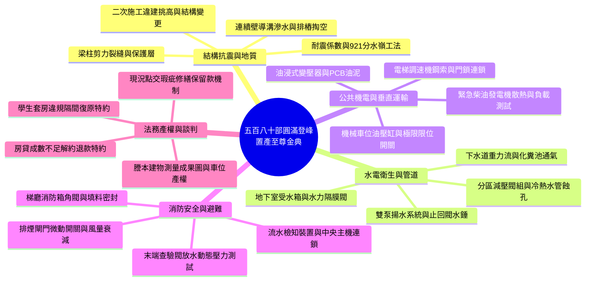
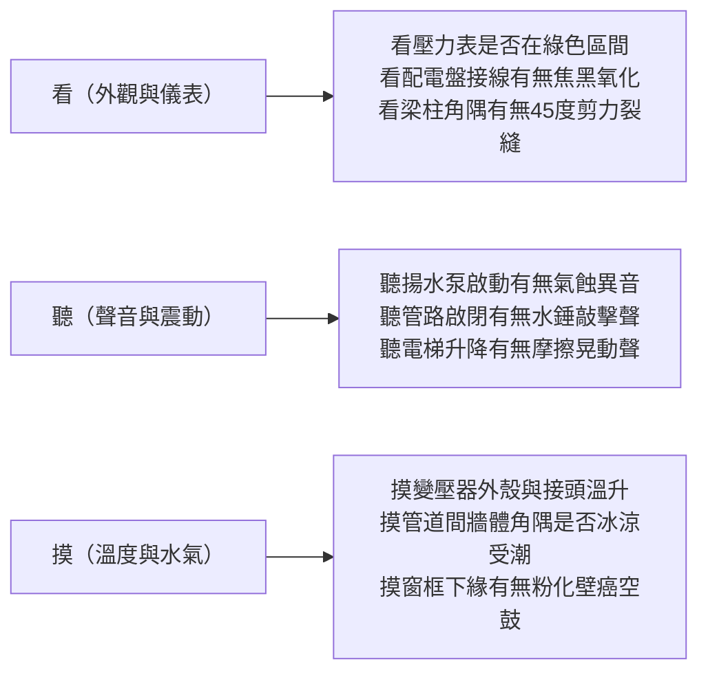

# 全案購屋實戰第五百八十部：五百八十部圓滿登峰全景極致全維度全生命週期家庭置產避坑抗震防漏水電機電消防永恆至尊金典總綱全書

---

## 壹、五百八十部圓滿登峰里程碑總綱引言

在台灣都會區集合住宅置產實戰中，中古大樓（屋齡 20～35 年）以其相對親民的單價、極低或合理的公設比，以及成熟便利的市區生活機能，成為千萬預算首購與家庭置產族群之主流選擇。

然而，大樓隨著歲月推移，暗藏於水泥結構深處、地下室幽暗機房、垂直管道間及梯廳公共設施內部的硬體老化隱患，往往才是決定未來數十年家庭居住安全、生活品質、修繕負擔與資產保值力的真正勝負手。

從第一部到第五百八十部，本全案實戰體檢系列橫跨：
1. **建築結構與耐震安全**（梁柱裂縫、剪力牆開洞剪切破壞、鋼筋保護層中性化、地下室連續壁與筏基沉陷）；
2. **防水抓漏與防洪截水**（外牆窗框矽利康老化、浴室防水層破裂、頂樓防水翻修、地下室截水溝高壓清淤與鴨嘴閥防倒灌）；
3. **生活給排水與水質水壓**（地下室受水箱、水力隔膜進水閥、變頻恆壓泵浦、高樓立管水錘、各樓層分區減壓閥與下水道用戶接管重力流）；
4. **昇降設備與機械車位**（電梯鋼索磨損、調速機安全鉗、乘場門鎖連鎖、井道底坑緩衝器、機械車位限位碰桿與液壓驅動）；
5. **公共機電與變配電室**（高低壓配電盤、油浸式變壓器絕緣油耐壓、緊急柴油發電機冷卻水箱、電梯對講機分機通訊）；
6. **火警防災與消防安全**（各樓層消防栓箱、末端查驗閥壓力試驗、防排煙防火閘門熔斷復位、消防排氣閥）。

本第五百八十部總綱全書，旨在為小寶家庭置產打造一套至高維度、終身適用的「全生命週期置產防禦至尊金典」，助您在購屋談判、實地勘驗與產權點交中立於不敗之地。

---

## 貳、全生命週期家庭置產核心評估架構



---

## 參、四大核心鎖定物件戰略矩陣與實戰對策

針對目前盤點鎖定之永義房屋帶看核心物件，彙整最精確之決策指南：

| 評估維度 | 大安紫金城 13 樓 (`PROP_10`) | 長億南園 8 樓 (`PROP_106`) | 歌德堡 8 樓 | 靜園 A 區 11 樓 |
| :--- | :--- | :--- | :--- | :--- |
| **開價與目標總價** | 開價 898 萬<br>目標 **768～788 萬**（上限 800 萬） | 開價 998 萬<br>目標 **745～760 萬** | 開價約 950～980 萬<br>目標 **780～810 萬** | 開價約 880～920 萬<br>目標 **720～750 萬** |
| **格局與空間優勢** | 4 房 2 廳 2 衛（分租學生隔間）<br>高樓層景觀採光無敵 | 3 房 2 廳 2 衛<br>**主+附 32 坪** 超大室內空間 | 3 房 2 廳 2 衛<br>北歐風精緻裝潢已完工 | 3 房 2 廳 2 衛<br>**三面採光、雙衛皆開窗** |
| **車位規格與抗性** | **獨立 B2 大平面車位**（無可挑剔） | 機械下層或休旅（限重 1.6 噸） | 機械車位（需檢驗橫移定位） | 坡道機械車位（車位高度限制） |
| **致命抗性與壓價點** | 需支出 25~35 萬拆除學生房隔間、水電復原；租約需清空 | 進門非無障礙（門檻 4 階階梯）；機械車位限重過低 | 裝潢掩蓋原始漏水壁癌之潛在風險；需敲擊空心地磚 | 屋齡稍長、公設維護中規中矩、需局部油漆燈具調整 |
| **作戰戰略定位** | **【第一核心主力】**<br>自住保值強、平車保證未來接手度 | **【空間性價比主力】**<br>以車位抗性與門檻大力殺價 | **【牽制定價主力】**<br>省去裝修時間成本，牽制前二者 | **【防守第一安全網】**<br>格局採光通風頂級，談判破局備案 |

---

## 肆、全維度機電消防與建築結構體檢快檢三字訣



### 1. 「看」之要訣：
- **公共機電**：配電盤指示燈、比壓比流器（PT/CT）端子、各樓層消防箱充油壓力表（靜壓需維持在 3.5~7.0 kgf/cm²）。
- **地下室機房**：發電機啟動電瓶電壓表（24V~27V 浮充）、蓄水箱進水水力浮球閥導閥連通管有無滲水、沉水泵控制箱自動交替切換燈號。
- **建物本體**：外牆磁磚鼓脹、冷氣室外機懸吊架鐵件鏽蝕深度、頂樓女兒牆防水收邊壓條。

### 2. 「聽」之要訣：
- **給水管網**：住戶抽水馬桶或水龍頭開啟關閉瞬間，管道間是否傳來水錘逆衝巨響；若有，代表水錘消除器破裂或減壓閥卡死。
- **電梯昇降**：搭乘電梯至頂樓過程中，注意是否有鋼索滑動打滑聲、導軌乾磨摩擦聲，或進入車廂時地坎水平落差卡滯聲。

### 3. 「摸」之要訣：
- **室內抓漏**：紅外線熱像儀配合高週波水分計，觸摸衛浴背牆、窗框四角、陽台排水孔周圍。
- **機房安全**：確認變電室絕緣橡膠墊是否乾燥無油污、排煙防火閘門熔斷彈簧張力是否健全。

---

## 伍、買方防禦型合約關鍵特約條款六大金科玉律

為確保買方資產不受法律與硬體瑕疵侵害，於正式簽訂買賣契約時，務必嚴格要求代書寫入以下特約保障條款：

```markdown
1. 【成數解約特約】
   「本買賣契約需由買方指定之銀行核貸房屋貸款成數達買賣成交總價之八成（或新台幣 柒佰萬元整），
   利率不大於 2.45%。若因銀行鑑價、央行信用管制或非可歸責於買方之因素致貸款成數不足，
   買方得主張無條件解除契約，賣方及仲介應於三日內無息全額退還買方已付之定金及所有期款，雙方互不負違約賠償責任。」

2. 【騰空點交與租約終止特約】（專攻大安紫金城套房戶）
   「賣方保證於交付尾款交屋日前，全數合法終止室內所有現存租賃契約，並完成騰空清潔、移交所有門禁鑰匙與磁扣。
   若交屋時仍有第三人占有或租客未遷離，買方得順延交屋及尾款給付，並依每日成交總價千分之一向賣方計收延遲違約金。」

3. 【結構與滲漏水瑕疵修繕擔保】
   「賣方擔保本標的物無鋼筋外露、無未經許可之剪力牆破壞或梁柱開洞，並自點交日起負擔半年之滲漏水瑕疵擔保責任。
   交屋前若發現天花板、窗框、浴廁背牆有滲漏水、壁癌現象，賣方應於交屋前負責完成結構性灌注或防水重作修復；
   否則買方得於履約保證專戶中扣留修繕金額（以合法專業鑑定廠商報價為準）作為保留款。」

4. 【公共設施消防機電查驗特約】
   「賣方保證本戶所在樓層之室內消防栓、末端查驗閥、減壓閥及警報連鎖訊號均能正常運作且壓力合規。
   點交時若經實測水壓不足 2.5 kgf/cm² 或流水檢知器無法觸動警報，賣方應督促管委會修繕，或補貼修繕衍生規費。」

5. 【機械車位負載與運作安全特約】（專攻長億南園等車位）
   「賣方擔保所移交之機械停車位設備馬達、鋼索、油壓系統運作正常，並具備有效之建築物機械停車設備使用許可證。
   交屋日前由雙方實車試停升降橫移，若運轉卡滯、油壓缸漏油或安全勾定位失效，賣方應於交屋前全額負擔修復完畢。」

6. 【履約保證全額信託保護】
   「本買賣交易全數款項（包含定金、簽約款、用印款、完稅款及尾款）必須全數匯入建築經理公司之履約保證獨立信託專戶，
   未經買方現場親自查驗合格簽署點交單前，任何一方均不得提前動支專戶內任何款項。」
```

---

## 陸、五百八十部圓滿登峰結語

買房是人生最重大的資產配置之一，也是為摯愛家人構築避風港的起點。
從 2026 年秋季周小姐帶看的大安紫金城、長億南園、歌德堡與靜園 A 區，到遍布全台中古集合住宅的每一處螺栓、每一條電纜、每一滴流水與每一道水泥接縫，五百八十部全書所凝練的，不僅是建築物理學與機電工程學的客觀數據，更是保護家庭幸福的堅實護盾。

願小寶家庭以冷靜專業的工程思維、堅定果決的談判底氣，在房市亂象與仲介話術中撥雲見日，順利迎進地段絕佳、結構穩固、水電通暢、氣場祥和之夢想吉屋，成就家庭永恆安居的偉大篇章！
