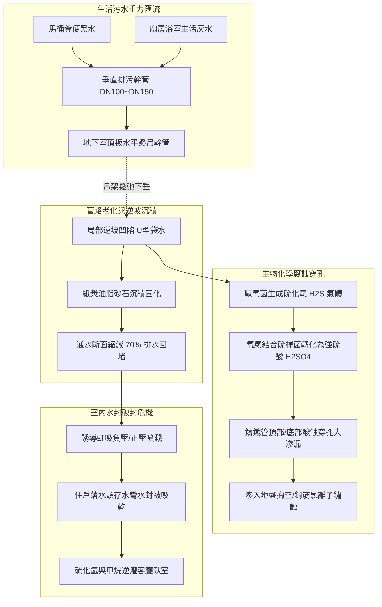
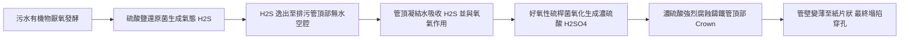
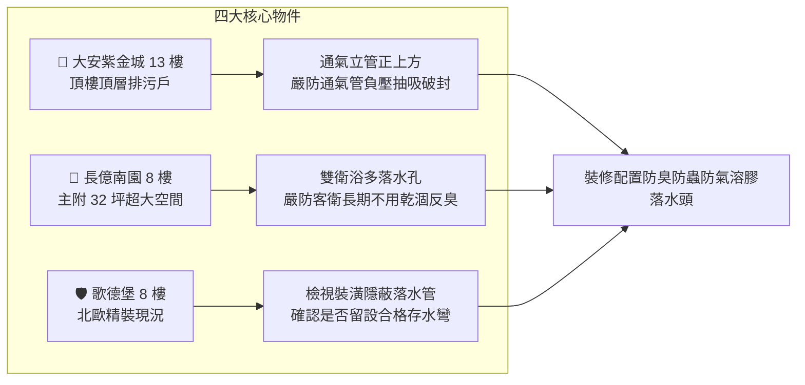

# 全案購屋實戰第五百六十一部_中古大樓社區地下室生活污水下水道用戶接管重力流破管滲漏地盤掏空沉砂淤塞逆坡回沖與惡臭毒氣逆灌室內體檢工序全書

---

## 序章：都會隱形動脈之危機——地下室重力流排污用戶接管

在都會區現代化衛工工程推動下，中古大樓社區陸續配合政府政策實施「**生活污水下水道用戶接管工程（Sewer Connection System）**」，廢除傳統地下室化糞池，將各棟大樓浴廁糞便黑水（Blackwater）與廚房浴室生活灰水（Graywater），藉由懸吊於地下室頂板之鑄鐵/PVC 重力流垂直幹管與水平懸吊幹管，直接重力匯流排放至道路公共污水下水道幹管。

然而，在屋齡 20 至 30 年以上之中古大樓社區中，地下室污水用戶接管系統長年承受酸鹼腐蝕、化學洗劑、沉砂鐵屑與地層微幅沉陷影響，隱藏四大致命機電與環境衛生病理：
1. **重力流排污管逆坡（Negative Slope / Back-pitch）與污物沉積沉砂淤塞**：排污水平懸吊幹管標準應維持 $1/50\sim 1/100$ 之均勻下坡度。但中古大樓常因防震吊架（Pipe Hangers）膨脹螺栓鬆弛下垂、或建築基礎不均勻沉陷，導致水平幹管局部下陷變形形成「U 型袋水逆坡」。糞便紙漿與廚房油脂在逆坡窪地處大量積聚固化，管徑自 6"（DN150）急縮至不足 2"，引發全棟排水回堵倒灌。
2. **鑄鐵排水管（Cast Iron Pipe, CIP）底側電化學腐蝕穿孔與污水滲漏掏空**：老舊大樓原配之瀝青塗裝鑄鐵排污管，長年受生活廢水中硫化氫（$\text{H}_2\text{S}$）與硫酸鹽還原菌（SRB）侵蝕，管底最深處金屬壁厚由 6mm 腐蝕減薄至 1mm 以下，最終沿著縱向焊縫爆裂穿孔，高污染惡臭黑水日夜滲入地下室地坪與基礎砂土，造成地盤淘空、基礎鋼筋加速鏽蝕。
3. **沉沙槽與存水彎（P-Trap）乾涸/破封導致硫化氫毒氣逆灌室內**：因水封蒸發、虹吸負壓抽吸（Siphonage）或正壓噴濺破封，下水道內極毒之硫化氫（$\text{H}_2\text{S}$，具臭蛋味但高濃度時麻痺嗅覺神經）、甲烷（$\text{CH}_4$ 易燃易爆）與致病氣溶膠，沿著排水幹管逆灌至低樓層住戶室內地板落水頭，嚴重危害住戶神經系統與呼吸道健康。
4. **大雨逆沖（Backwater Inundation）與止回閥橡膠圈硬化卡死**：暴雨時若市政污水箱涵超負荷滿溢，若社區未安裝「**防逆流逆止閥（Sewer Backwater Valve）**」或閥板被油脂衛生紙卡阻，道路污水將如噴泉般沿著幹管反向倒灌淹沒大樓地下室。

本全書將深入剖析重力排水流體力學（Manning's Pipe Flow）、硫化氫生物化學腐蝕機制、水封破封防禦原理，並建立一套現場實戰體檢工序，為購屋家庭鎖定社區公設與居住健康。

---

## 第一章：重力流污水管網流體力學與腐蝕破壞機理

### 第一節：懸吊幹管水力流速與逆坡淤塞沉澱力學

1. **重力流排污之「自淨流速（Self-cleansing Velocity）」法則**：
   - 生活污水中含有大量懸浮固體（TSS）、糞便纖維、廚房菜渣與細砂。
   - 依據排水工程規範，水平排水管內水流速度 $V$ 必須滿足：
     $$V \ge 0.6\sim 0.8\text{ m/s}$$
   - 此一最低流速方能產生足夠之剪切力（Shear Stress），將管底之沙石沉積物持續向前沖刷帶走，防止淤積。

2. **逆坡（Back-pitch）引發之流速歸零與水力阻礙**：
   - 當管路因吊桿拉拔鬆脫，由正常的正坡度 $S = +1/100$ 變形為逆坡度 $S = -1/200$ 時，水流在凹陷段形成常年滯水死水潭（Standing Water Pocket）。
   - 水流動能被完全抵消，糞便紙漿在此沉澱發酵，並與廚房排出的動物油脂皂化結合，生成堅硬如肥皂石（Fatberg）之凝結物，管徑被層層包覆縮減，排水水頭損失激增，高樓層住戶一沖水，低樓層落水頭便產生冒泡汩汩異音。

---

### 第二節：硫化氫生物化學腐蝕機制（Crown Acid Corrosion）

1. **厭氧硫酸鹽還原反應**：
   - 滯留污水中之有機物在缺氧狀態下，由專性厭氧菌（硫酸鹽還原菌, *Desulfovibrio*）催化分解：
     $$\text{SO}_4^{2-} + 2\text{CH}_2\text{O} \rightarrow \text{H}_2\text{S} + 2\text{HCO}_3^{-}$$
   - 釋放出具有惡臭劇毒之硫化氫氣體。

2. **管頂濃硫酸腐蝕（Crown Corrosion）**：
   - 氣態 $\text{H}_2\text{S}$ 逸散至重力流管頂部之空氣空間，溶解於管壁頂端之凝結水膜中。
   - 棲息在管頂潮濕表面之好氧性硫氧化菌（*Thiobacillus*）利用空氣中之氧氣將硫化物氧化為強硫酸：
     $$\text{H}_2\text{S} + 2\text{O}_2 \xrightarrow{\text{硫桿菌}} \text{H}_2\text{SO}_4$$
   - 硫酸濃度可在局部達到 $5\%\sim 10\%$，pH 值低至 1~2！強硫酸劇烈腐蝕鑄鐵管與水泥砂漿內襯，將金屬鐵轉化為硫酸亞鐵膨脹剝落，導致管頂變薄塌陷，黑水自破口如雨傾瀉。

---

### 第三節：室內存水彎水封（Trap Seal）防護與破封機理

1. **水封法定有效深度（$50\sim 100\text{ mm}$）**：
   - 建築法規強制各衛浴地板落水頭、面盆、浴缸及廚房水槽下方必須配置存水彎（P-Trap 或 S-Trap），常態維持 $50\sim 100\text{ mm}$ 垂直水柱高度，阻絕管內氣體侵入。

2. **三大破封致命物理效應**：
   - **誘導虹吸作用（Induced Siphonage）**：垂直幹管通氣管（Vent Stack）堵塞時，樓上大流量沖水在立管中如同活塞下衝，在支管產生劇烈負壓抽吸，將樓下存水彎水封瞬間吸乾。
   - **背壓噴濺破封（Back-pressure Blowout）**：排水立管底端轉彎處水流受阻產生水躍（Hydraulic Jump），管內形成高正壓，直接將存水彎內之臭水向外噴射至住戶浴室地坪。
   - **水封蒸發乾涸（Evaporation）**：空置空屋或不常使用之乾區地漏，水封在 2~4 週內完全自然蒸發殆盡，形成直通下水道之毒氣通道。

---

## 第二章：現場看屋公共排污管網七大實戰體檢工序

在評估中古大樓社區時，買方應協調管委會或機電主任，進入地下室頂板與管道間實地落實以下七步工序：

| 體檢步驟 | 檢驗標的與操作動作 | 合格標準 (Pass) | 潛在致命瑕疵 (Fail) | 修繕對策與預算評估 |
| :---: | :--- | :--- | :--- | :--- |
| **Step 1** | **水平懸吊幹管坡度測量** 拿水平尺測量地下室頂板排污幹管 | 具備均勻向下正坡度（$S \ge 1/100$），無局部波浪狀下垂 | 呈現逆坡（向回傾斜）、局部凹陷處敲擊發出沉悶死水聲 | 重新調整並加固防震吊桿（Unistrut C型鋼架）（約 3,500~7,500 元/跨） |
| **Step 2** | **管壁底部與接頭滲漏鏽蝕** 強力手電筒檢查鑄鐵管管底與喉箍 | 管壁乾燥平整無滲水，機械式接頭（No-Hub）橡膠套迫緊無裂紋 | 管底懸掛褐色結晶水滴、喉箍嚴重鏽穿、水泥地坪泛黃發臭 | 更換加厚型 PVC-U 橘色發泡排污管或超靜音雙壁管（約 4,500~9,000 元/米） |
| **Step 3** | **通氣管（Vent Stack）頂部暢通度** 爬上頂樓露台檢查垂直通氣管出口 | 通氣管高出屋頂地坪 $\ge 15\text{ cm}$，網罩完整無鳥巢樹葉封死 | 通氣管被違章花盆遮蓋、出口遭鳥巢築死、排出濃烈沼氣 | 清理疏通頂部通氣孔並加裝 SUS304 傘形防蟲透氣帽（約 1,500~3,000 元/座） |
| **Step 4** | **地下室排污防逆流閥（Backwater Valve）** 檢視匯流總管出口處防逆流閥 | 閥蓋可掀開維護，內部氯丁橡膠活門板轉動自如無卡阻 | 無防逆流閥、或內部活門被硬化油脂卡死在常開狀態 | 增設全不鏽鋼重力式自動防逆流排污閥（約 15,000~35,000 元/組） |
| **Step 5** | **清掃孔（Cleanout, CO）配置與密封** 檢視水平幹管轉彎處是否有清掃口 | 每隔 $15\text{ 公尺}$ 及轉彎 45° 以上處皆設有銅質密封螺紋清掃孔 | 無清掃孔（堵塞時無從通管）、清掃孔蓋鏽死或以膠帶破布亂塞 | 於幹管轉彎處加裝標準不鏽鋼快拆式清掃孔接頭（約 3,000~6,000 元/處） |
| **Step 6** | **室內落水頭水封深度與防臭閥** 拿手電筒照射室內衛浴各落水孔 | 存水彎內部可清晰見到反光水面，水深 $\ge 50\text{ mm}$ | 望到底部直通管道乾涸無水、散發陣陣下水道糞臭味 | 安裝矽膠防臭防蟲自閉式地漏芯或長效型深水封落水頭（約 350~800 元/個） |
| **Step 7** | **硫化氫氣體濃度檢測（H2S Detector）** 使用四合一氣體檢測儀探測落水孔與管道間 | 硫化氫讀數為 $0\text{ ppm}$，安全無害 | 讀數 $> 5\text{ ppm}$（發出蜂鳴警報），空氣中有強烈刺鼻臭氣 | 全面查修室內通氣管路密封性並灌水復原水封（列入契約重大瑕疵排除） |

---

## 第三章：四大核心考慮物件之排污防禦與裝修施工指引

### 第一節：大安紫金城 13 樓（高樓層頂樓戶）之通氣管防禦
- **現況特徵**：位處頂樓 13 樓，距離屋頂排污通氣管出口最近。
- **潛在風險**：若頂樓通氣管出風口受季風逆風壓迫、或管口高度不足，排出的沼氣極易被 13 樓後陽台或主臥對外窗吸入室內。
- **裝修專用解法**：在裝修衛浴落水管時，全部採用「**水封式 + 磁吸自閉雙重防臭地漏**」，並於頂樓通氣管頂部加裝風向導引彎頭，徹底隔絕風壓倒灌。

### 第二節：長億南園 8 樓（超大空間多落水頭戶）之水封維護
- **現況特徵**：主附建物達 32 坪，配置雙衛浴、獨立廚房與大後陽台，室內地面落水頭多達 5~6 處。
- **防禦手段**：若客衛淋浴間或洗衣機排水孔長期未用水，存水彎水封極易自然蒸發。
- **合約防禦特約條款**：
  > 「賣方保證本買賣標的室內各排水孔、地板落水頭、衛浴管路及管道間均無下水道沼氣、硫化氫臭氣逆灌或水封破裂情事，公共污水下水道接管排水順暢無回堵歷史。交屋日前買方得實施室內排水通水測試（注水 10 公升無逆流冒泡）與氣體檢測；若發現排污回堵、逆坡滲漏或嚴重惡臭無法排除者，賣方應負責於交屋日前完成通管修繕；否則賣方應折讓價金新台幣貳萬元整，作為買方自行委託廠商施作管道防臭工程之補償。」
