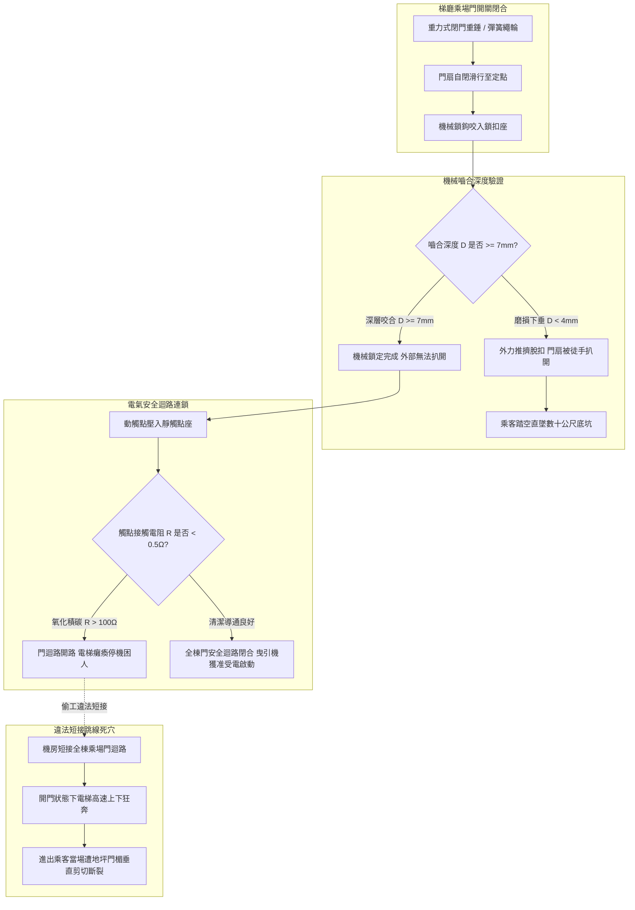
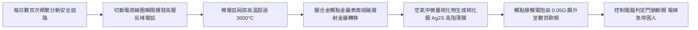
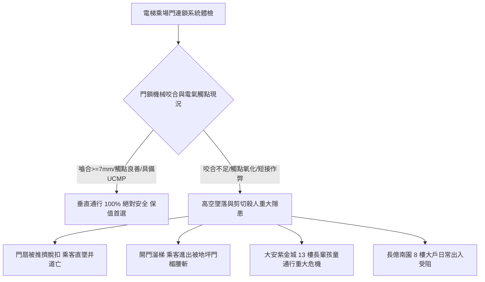

# 全案購屋實戰第五百六十七部_中古大樓社區各樓層電梯乘場門門鎖裝置機械咬合嚙合深度不足電氣安全觸點氧化積碳與剪切夾人事故體檢工序全書

---

## 序章：電梯安全的第一道鬼門關——乘場門連鎖裝置之生死防禦

在都會高層集合住宅大樓與中古社區中，電梯昇降設備（Traction Elevator System）是住戶每日出入頻率最高、卻也最容易發生致命意外之特種設備。據國內外特種設備安全事故統計分析，**超過 75% 以上的電梯重大傷亡事故，皆發生於「電梯門系統（Door System）」——尤其是位於各樓層梯廳之「乘場門（Landing Door / Hall Door）」**。

乘場門長年擔負著阻隔梯廳乘客墜入深達數十公尺深邃井道之防護重任。為確保絕對安全，電梯法規（CNS 10594 與 EN 81-20/50）強制規定各樓層乘場門必須配置「**機械電氣連鎖門鎖裝置（Landing Door Interlock / Hook Lock Device）**」，必須同時達成兩大嚴苛條件電梯始得受電啟動：
1. **機械連鎖（Mechanical Interlock）**：重型鎖鉤（Locking Hook / Latch）必須與鎖扣座深度嚙合，嚙合深度依法不得小於 **$7\text{ mm}$**，防止任何人在梯廳外徒手或以工具強行扒開門扇。
2. **電氣連鎖（Electrical Interlock）**：在機械鎖鉤達到法定嚙合深度之後，鎖鉤背部之電氣安全觸點（Door Safety Contacts）方得閉合，將 110V/220V 電氣安全迴路導通。只要全棟任何一層乘場門未完全關閉鎖死，電梯曳引機電源將被硬體強制截斷，電梯嚴禁運行。

然而，在屋齡 20 至 30 年以上之中古大樓社區中，各樓層乘場門長年承受住戶推車撞擊、開關門頻繁震動、清潔拖地水氣與梯廳穿堂風壓吸扯，隱藏四大致命機電與力學病理：
1. **機械鎖鉤偏磨與鎖扣嚙合深度不足（Engaging Depth $< 7\text{ mm}$）**：偏心滾輪與導向滑塊磨損，門鎖鉤下垂，嚙合深度自正常的 12mm 磨損至不足 3~4mm。在強風吹拂或外力推擠下，鎖鉤極易滑脫脫扣，門扇瞬間被扒開，形成敞開直通數十公尺黑洞之墜落深淵。
2. **電氣安全觸點表面氧化積碳與電弧燒蝕（Contact Pitting）**：乘場門電氣觸點每棟每日開合數百次，在切斷電感性負載瞬間產生微電弧，銀合金觸點表面迅速形成黑褐色氧化銀與碳化層，接觸電阻激增，引發電梯頻繁「誤報門故障停機困人」。
3. **無良保養人員違法跨接「短接門迴路（Door Lock Jumpering）」之剪切殺人陷阱**：由於某樓層門鎖觸點接觸不良頻繁跳機，少數缺乏職業道德之維保人員為求交差，竟私自於機房控制盤內使用跳線將「全樓層門鎖安全迴路直接短接」！此舉使電梯喪失門鎖防護，電梯能在「乘場門大開」狀態下載人高速升降，一旦乘客在此時跨步進出，將當場遭受電梯地坪與門楣之**殘酷剪切（Shearing Accident）腰斬慘劇**！
4. **門導靴（Door Shoes / Gibs）磨損脫槽與門扇擺動晃動**：門底滑槽（Sill Groove）積滿沙石毛髮，塑膠導靴磨耗殆盡，門扇下端失去約束，徒手用力推擠門下端即可將門扇向井道內推開形成大縫。

本全書將深入剖析乘場門鎖連鎖運動學、觸點電弧放電物理學、開門溜梯剪切力學，並建立一套現場實戰體檢工序，為購屋家庭鎖定社區電梯出入之終極安全防線。

---

## 第一章：乘場門機械電氣連鎖機制與剪切夾人破壞機理

### 第一節：機械鎖鉤嚙合深度力學方程式與防脫扣幾何學

1. **鎖鉤偏心旋轉幾何學與最小嚙合量**：
   - 乘場門鎖由安裝在門扇之擺動鎖鉤（Locking Latch）與固定在門框之上鎖扣盒（Keeper Box）組成。
   - 鎖鉤垂直咬合深度 $D$ 必須滿足法規強制要求：
     $$D \ge 7.0\text{ mm}$$
   - 正常新梯調校標準通常落在 $D = 10.0\sim 12.0\text{ mm}$。

2. **門懸掛滑輪（Hanger Rollers）偏磨引發之嚙合塌陷**：
   - 乘場門上方依靠兩只聚氨酯或尼龍滑輪掛在門導軌（Hanger Track）上行走。
   - 歷經 20 年之開閉磨損，滑輪外圈橡膠嚴重偏磨脫落，導致整扇門下沉 $3\sim 5\text{ mm}$；加上門框地腳螺栓因地坪震動微幅鬆脫，鎖鉤相對於鎖扣盒向上抬升。
   - 實際嚙合深度 $D$ 衰減至不足 $2\sim 3\text{ mm}$。此時鎖鉤僅以微小邊緣勉強搭接在鎖扣邊緣，梯廳只要有孩童碰撞或強風壓迫，鎖鉤瞬間滑脫脫扣，門扇霍然大開，直面黑洞般之昇降路。

---

### 第二節：電氣安全觸點電弧燒蝕與氧化積碳微觀物理學

1. **反向感應電動勢（Back EMF）與電弧能量**：
   - 電梯門安全迴路通常串聯機房主安全接觸器（Safety Relays）與制動器線圈（Brake Coils），迴路具備顯著之電感 $L$。
   - 門鎖斷開瞬間，電感產生反向自感高壓：
     $$V_{\text{arc}} = -L \cdot \frac{di}{dt}$$
   - 觸點微隙間空氣被擊穿，產生數千度高溫之放電電弧（Spark Arcing）。

2. **金屬轉移與硫化銀結晶絕緣薄膜**：
   - 電弧高溫使銀合金觸點（Silver Nickel Alloy / AgNi）表面金屬熔融汽化，陰陽極之間發生金屬遷移，表面形成凹凸不平之燒蝕坑。
   - 地下室與梯間潮濕水氣中的硫化氫（$\text{H}_2\text{S}$）與銀反應生成硫化銀（$\text{Ag}_2\text{S}$）。硫化銀為絕緣半導體，接觸電阻激增數千倍。
   - 當動觸點壓入時，信號電壓降過大，主機板誤判門鎖未閉合，造成電梯無預警急煞、將乘客關在半空中。

---

### 第三節：開門走梯（Uncontrolled Car Movement, UCM）與垂直剪切力學

1. **違法短接跳線（Jumpering）之致命本質**：
   - 當社區管委會催促保養廠商排除「門鎖故障停機」時，部分偷工減料之維修工若未逐層檢修更換磨損之門鎖零件，而是直接在控制盤內將門鎖迴路用銅線短路跨接。
   - 短接後，主機板永遠接收到「門已完全鎖死」之虛假信號，電梯在乘場門大開時仍能隨意接收外召與內指令全速升降！

2. **人體剪切（Shearing Injury）之毀滅性破壞力**：
   - 一部載重 $1,000\text{ kg}$ 之電梯乘廂，總運動質量（含乘廂、對重與鋼索）高達 $3,000\sim 4,000\text{ kg}$。
   - 當電梯以 $1.5\text{ m/s}$ 速度升降時，乘廂地坪與樓層乘場門橫樑（Header）之間形成一把巨大的「動態鋼鐵剪刀」。
   - 若乘客正跨步邁入電梯，電梯突然非預期移動，乘廂地坪邊緣將人體強行擠壓至門楣金屬邊框，剪切擠壓力可在 $0.1\text{ 秒}$ 內衝破數噸力，人體胸腔、脊椎骨骼被瞬間粉碎切斷，當場死亡。

---

## 第二章：現場看屋電梯乘場門七大實戰體檢工序

在評估中古大樓社區時，買方應協調管委會與合法電梯維護廠商技師陪同，於各目標樓層實地落實以下七步檢驗：

| 體檢步驟 | 檢驗標的與操作動作 | 合格標準 (Pass) | 潛在致命瑕疵 (Fail) | 修繕對策與預算評估 |
| :---: | :--- | :--- | :--- | :--- |
| **Step 1** | **徒手推擠門扇鎖定檢驗** 於各樓層門外，用雙手用力推拉門扇 | 門扇完全紋絲不動，左右縫隙 $\le 3\text{ mm}$，鎖鉤牢牢咬死 | 稍用力推拉門扇即可扒開 $5\sim 10\text{ cm}$ 大縫、甚至整扇脫扣扒開 | 重新調校偏心輪與鎖扣座，更換重型機械門鎖總成（約 4,500~8,500 元/層） |
| **Step 2** | **機械鎖鉤咬合深度實測** 利用梯廳三角鑰匙開門目視測量鎖鉤 | 鎖鉤深入鎖扣座垂直重疊深度 $D \ge 7.0\text{ mm}$（標準 $10\text{ mm}$） | 咬合深度 $< 4.0\text{ mm}$，鎖鉤邊緣磨損發亮、僅勉強搭扣 | 調整門掛輪偏心軸抬升門扇，重新校準鎖扣咬合深度（約 1,800~3,500 元/層） |
| **Step 3** | **電氣觸點行程超程量（Overtravel）** 檢視機械鎖鉤閉合時電氣觸點壓縮量 | 觸點接觸後，動觸點彈簧仍有 $\ge 3\text{ mm}$ 之壓縮超程量 | 鎖鉤閉合後觸點剛好碰上（無超程彈力），稍有震動即斷路跳脫 | 重新調整觸點銅片支架，更換高彈性鍍銀觸點組（約 1,200~2,200 元/組） |
| **Step 4** | **觸點表面燒蝕與氧化積碳** 手電筒照射門鎖盒內動靜觸點金屬面 | 觸點表面光滑平整呈亮銀色，無金屬熔損凹坑或黑垢 | 觸點表面佈滿黑褐色氧化物、金屬燒融變形、發出打火火花 | 以專用金屬清潔劑除碳，更換耐高溫銀氧化鎘（AgCdO）抗電弧觸點（約 1,500~2,500 元） |
| **Step 5** | **門導靴（Door Gibs）間隙與磨損** 用腳輕踢乘場門扇下端邊緣 | 門底導靴在踏板槽內滑順無晃動，前後擺動量 $< 2\text{ mm}$ | 門底前後劇烈晃動 $> 15\text{ mm}$（導靴磨損脫槽，隨時被踹入井道） | 更換超耐磨加厚型不鏽鋼/尼龍自潤滑門導靴（約 600~1,200 元/扇） |
| **Step 6** | **重錘/自閉彈簧重力自閉功能** 手動將門扇拉開 20cm 後完全放手 | 門扇依靠重力自閉機構平穩滑順自動關閉並完全鎖死 | 門扇停在原地不動、或關閉到一半卡住不鎖死 | 更換自閉重錘不鏽鋼鋼索繩輪、或更換高彈力自閉彈簧（約 1,500~3,000 元/層） |
| **Step 7** | **開門防走梯保護（UCMP）查驗** 調閱電梯控制盤 UCMP 煞車認證合格標籤 | 具備合格獨立雙向制動器與 UCMP 未預期移動防護模組 | 梯齡超過 25 年且無 UCMP 升級改造、未具備雙重抱閘檢知 | 責成管委會配合特檢要求全面加裝 UCMP 模組（約 120,000~250,000 元/台） |

---

## 第三章：門鎖系統安全對四大核心物件之戰略決策

### 第一節：四大核心考慮物件之門鎖安全深度評估
1. **大安紫金城 13 樓（PROP_10，第一首選）**：
   - 頂樓 13 樓若乘場門鎖嚙合不足，一旦外力誤撞脫扣，下方直通 13 層樓（垂直落差逾 40 公尺）之深邃井道，絕對是一票否決級之生命安全隱患。
   - **實地必查要點**：務必在 13 樓梯廳，用雙手稍微用力推拉兩側乘場門扇，確認門扇鎖死無大縫隙晃動；並向管理室確認該棟電梯是否曾發生「門鎖誤報急煞停機」歷史。
2. **長億南園 8 樓（PROP_106，空間之王）**：
   - 8 樓住戶家庭成員多，頻繁使用電梯。
   - **談判籌碼**：若各樓層乘場門鎖普遍存在導靴磨耗、門縫晃動超標或觸點氧化，買方應當場以「公設電梯全棟各樓層乘場門鎖老化，需動用數十萬元專款全數抽換門鎖機構與導靴」為由，向賣方大砍價金 **15 至 25 萬元**。

### 第二節：成屋買賣合約電梯門鎖安全特約保障條款範本
> 「賣方保證本買賣標的所屬大樓之各樓層電梯乘場門及乘廂門系統（包含機械鎖鉤咬合深度、電氣安全連鎖觸點、自閉機構及門導靴），均符合國家特種設備安全標準（機械咬合深度達 7mm 以上），且絕無非法短接跨接門鎖安全迴路之情事。若交屋前查明社區電梯存在門鎖嚴重磨損鬆脫、徒手可推開門扇、或安檢單位列管門系統重大缺失者，賣方應負責協調管委會於交屋前完成修繕校正；否則買方得主張自價金中扣留新台幣參萬元整於履約保證專戶，作為買方承擔公共安全風險之補償。」
