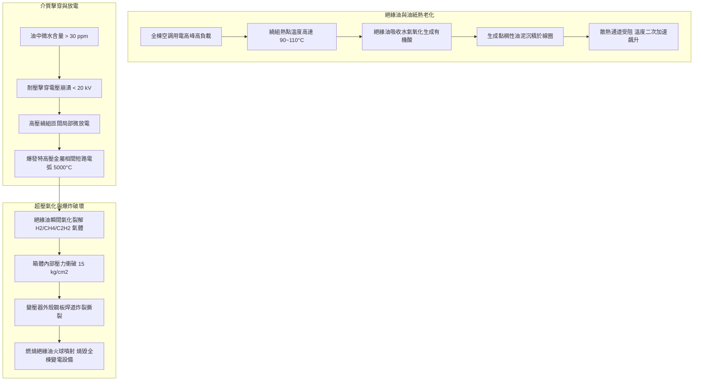
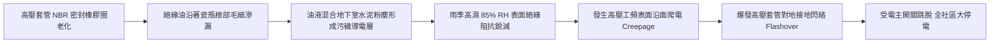
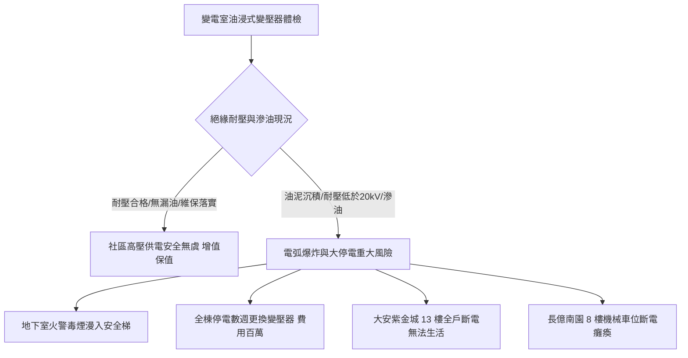

# 全案購屋實戰第五百六十三部_中古大樓社區地下室變電室油浸式變壓器絕緣油耐壓劣化油泥碳化PCB多氯聯苯殘留油封滲漏與高溫爆炸體檢工序全書

---

## 序章：高壓電能中樞之定時炸彈——油浸式配電變壓器之隱患

在現代高層住宅大樓與中古社區之電氣機電架構中，「**地下室電氣變電室（Electrical Substation / Transformer Vault）**」是全社區最核心、危險等級最高之高壓電能轉換樞紐。台電輸配電線路通常以 **11.4 kV 或 22.8 kV** 之特高壓交流電引入大樓受電盤，再經由變電室內之「**配電變壓器（Distribution Transformers）**」降壓為 380V/220V（供電梯、加壓水泵、排煙風機等動力設備）及 220V/110V（供各住戶室內照明與插座用電）。

在屋齡 20 至 30 年以上之中古大樓社區中，受限於早期建造成本與規範，絕大多數大樓仍廣泛沿用「**油浸式變壓器（Oil-immersed Transformer）**」，而非現代安全性較高之「乾式變壓器（Cast Resin Dry-type Transformer）」。油浸式變壓器內部注滿數百公升至上千公升之可燃性高絕緣礦物油（Mineral Insulating Oil），用於絕緣繞組與散熱冷卻。

然而，歷經 20~30 年不間斷高負荷運轉，油浸式變壓器常年隱藏四大毀滅性機電與公共安全病理：
1. **絕緣油熱氧化、油泥沉積與介電強度（Dielectric Breakdown Voltage）崩潰**：變壓器內部溫度長期處於 60°C~90°C，絕緣油接觸空氣中的氧氣與水氣發生熱裂解酸化，生成高阻抗酸性油泥（Sludge），沉積於高壓繞組線圈縫隙阻礙散熱；油中微量水份使耐壓強度自標準之 $> 30\text{ kV}$ 暴跌至 $< 15\text{ kV}$，引發繞組匝間局部放電（Partial Discharge）甚至相間弧光短路。
2. **禁錮半世紀之劇毒環境荷爾蒙——PCB（多氯聯苯）殘留危機**：早期台灣製造或進口之變壓器絕緣油常添加多氯聯苯（Polychlorinated Biphenyls, PCBs）以增強阻燃性。台灣雖於 1980 年代禁用，但許多中古大樓在歷次維修濾油過程中，誤混入含 PCB 之回收油，一旦發生滲漏或火災，PCB 受熱裂解為劇毒致癌物「戴奧辛（Dioxin）」，整棟大樓將遭受不可逆之化學毒害污染。
3. **箱體丁腈橡膠密封墊圈（NBR Gasket）硬化龜裂與慢性滲油**：變壓器高低壓絕緣套管（Bushings）、油位計、放油閥與頂蓋法蘭密封膠圈長年受熱烘烤硬化，絕緣油沿著箱體接縫持續微滲，滴落在無防油堤（Oil Retention Dike）之變電室地坪，遇短路電弧極易引發大火。
4. **內部電弧引發箱體超壓爆炸（Catastrophic Transformer Explosion）**：一旦內部發生匝間短路，數千安培之短路電弧高溫（高達 3,000°C~5,000°C）瞬間將周遭絕緣油氣化為大量氫氣（$\text{H}_2$）、甲烷（$\text{CH}_4$）與乙炔（$\text{C}_2\text{H}_2$）等爆炸性可燃氣體，內部壓力在數毫秒內飆破數十個大氣壓，直接炸裂鋼板箱體，千度燃燒絕緣油噴射而出，引發吞噬地下室與切斷全棟供電之滅頂之災。

本全書將深入剖析油浸式變壓器電磁熱力學、絕緣油氣相色譜溶解氣體分析（DGA）、油箱防爆波力學，並建立現場實戰體檢工序，為購屋家庭鎖定社區電氣核心之終極安全。

---

## 第一章：油浸式變壓器絕緣劣化與內部短路爆炸機理

### 第一節：絕緣油老化之物理化學反應與 DGA 溶解氣體分析

1. **油泥生成與酸價（Acid Neutralization Number）超標**：
   - 礦物絕緣油主要成分為環烷烴與烷烴混合物。在銅、鐵金屬催化劑與高溫存在下，油分子氧化生成過氧化物、醇、醛，最終縮合為不溶性樹脂狀酸性油泥（Sludge）。
   - 當油品酸價超過 $0.2\text{ mg KOH/g}$（正常新油 $< 0.03\text{ mg KOH/g}$）時，油泥開始在變壓器波紋散熱片（Corrugated Cooling Fins）內壁沉澱，散熱係數衰減超過 50%。
   - 酸性物質進一步腐蝕浸油牛皮絕緣紙（Kraft Paper），使絕緣紙的聚合度（Degree of Polymerization, DP）由正常的 1,000~1,200 斷裂至 200 以下，絕緣紙脆化如落葉，一遇地震晃動即剝落露銅。

2. **氣相色譜溶解氣體分析（Dissolved Gas Analysis, DGA）判定準則**：
   - 依據國際電工委員會 IEC 60599 與 IEEE C57.104 標準，變壓器內部不同性質之電氣或熱故障，會產生特定特徵氣體：
     - **低溫過熱（$< 300^\circ\text{C}$）**：主要產生甲烷（$\text{CH}_4$）與乙烷（$\text{C}_2\text{H}_6$）。
     - **高溫過熱（$> 700^\circ\text{C}$）**：主要產生乙烯（$\text{C}_2\text{H}_4$）。
     - **局部放電（Partial Discharge）**：主要產生氫氣（$\text{H}_2$）。
     - **特高壓短路電弧放電（Arcing）**：**乙炔（$\text{C}_2\text{H}_2$）極限飆升**！只要絕緣油中檢測出乙炔濃度 $> 5\text{ ppm}$，即代表內部已存在極度危險之金屬電弧打火，隨時可能爆發大爆炸。

---

### 第二節：絕緣套管（Bushings）油封老化滲漏與爬電閃絡

1. **密封墊圈彈性疲勞與熱降解**：
   - 變壓器高壓（11.4kV/22.8kV）與低壓（220V/380V）端子引出線依靠高強陶瓷絕緣套管（Porcelain Bushings）與箱體隔離，套管底座採用丁腈橡膠（NBR）或氟橡膠（FKM）墊圈迫緊密封。
   - 橡膠在長達 20 年之熱氧老化下，增塑劑析出，彈性恢復率降至不足 20%，墊圈斷裂產生毛細透油縫隙。

2. **污穢閃絡（Pollution Flashover）機制**：
   - 滲出之絕緣油具有極強黏性，附著於陶瓷套管傘裙（Sheds）表面，捕捉地下室流動之碳黑粉塵與水泥微粒。
   - 在潮濕反潮天候下，粉塵中之可溶性鹽類溶解電離，套管表面形成高電導率之水膜。當外加電場強度超過臨界爬電梯度（$0.5\sim 1.0\text{ kV/cm}$）時，空氣分子被電離，引發強烈之對地相間閃絡電弧，瞬間炸碎陶瓷套管，高壓電弧直擊變壓器箱體金屬外殼。

---

### 第三節：PCB 多氯聯苯殘留法規與危害防禦

1. **多氯聯苯（PCBs）之化學穩定性與致癌性**：
   - PCB 屬於持久性有機污染物（POPs），化學性質極其穩定，不燃、耐高溫、絕緣性極佳，早期商品名稱為 Aroclor 或 Askarel。
   - 但 PCB 具備強烈之脂溶性與生物蓄積性，會干擾人體免疫系統、神經系統與生殖內分泌，屬於國際癌症研究機構（IARC）列管之第一類確定致癌物。

2. **法規列管標準（$< 50\text{ ppm}$）**：
   - 依據台灣環境部《廢棄物清理法》與《多氯聯苯管制標準》，變壓器絕緣油中 PCB 含量嚴禁超過 **$50\text{ ppm}$**（現行高標準檢驗甚至要求 $< 2\text{ ppm}$ 方得認定為無 PCB 設備）。
   - 若中古大樓變壓器被環保機關抽檢出 PCB 超標，社區管委會將面臨數十萬元罰鍰，且整台變壓器與廢油必須以極其昂貴之高溫電漿焚化專案銷毀，每台處理費用高達 **20 至 50 萬元**，由全體住戶依產權持分強制分攤！

---

## 第二章：現場看屋變電室油浸式變壓器七大實戰體檢工序

在評估中古大樓社區時，買方應協調管委會聘任之特約高壓電氣設備檢驗員（領有經濟部甲級電匠或甲種電氣工程執照技師）陪同，實地進入地下室變電室檢驗：

| 體檢步驟 | 檢驗標的與操作動作 | 合格標準 (Pass) | 潛在致命瑕疵 (Fail) | 修繕對策與預算評估 |
| :---: | :--- | :--- | :--- | :--- |
| **Step 1** | **油位計指示與油色外觀** 檢視變壓器側面玻璃管油位計（Oil Gauge） | 油位介於 $20^\circ\text{C}\sim 40^\circ\text{C}$ 刻度區間，油色透明淺黃色 | 油位低於最低刻度（假油位/漏油）、油色深黑混濁如焦油 | 補充合格絕緣油，或全面抽油更換新絕緣油（約 15,000~35,000 元/台） |
| **Step 2** | **箱體與散熱片接縫滲漏檢查** 強力手電筒檢查套管根部與波紋散熱片 | 箱體金屬表面乾燥清潔，無任何微滲油漬或油滴附著 | 套管根部滲出大灘油漬、散熱鰭片底部懸掛黑色油污滴入地坪 | 重新更換全套耐高溫氟橡膠套管密封墊圈（約 18,000~38,000 元/台） |
| **Step 3** | **運轉聲音與鐵芯電磁雜音** 站在距變壓器 1 公尺處聆聽運轉聲 | 平穩均勻之 120Hz 純淨電磁嗡鳴聲，無爆裂聲或異音 | 發出高分貝尖銳金屬震顫、伴隨「啪滋、啪滋」內部放電打火聲 | 檢修緊固鐵芯穿心螺栓，或全面吊芯進行大修（約 35,000~80,000 元） |
| **Step 4** | **矽膠乾燥呼吸器（Silica Gel Breather）** 檢視吸濕器內部變色矽膠顆粒顏色 | 矽膠顆粒呈鮮豔亮藍色，底部油封杯油位正常 | 矽膠顆粒完全吸水飽和變為粉紅色/白色、油封杯乾涸 | 更換高效能變色藍色矽膠乾燥劑並補充油封油（約 800~1,500 元） |
| **Step 5** | **箱體表面運轉溫度紅外線掃描** 紅外線熱像儀掃描高低壓套管接頭與油箱 | 油箱頂部最高溫 $\le 65^\circ\text{C}$，三相套管接頭溫差 $< 5^\circ\text{C}$ | 箱壁局部熱點 $> 85^\circ\text{C}$、套管接頭因接觸電阻過熱發紫發黑 | 停電緊固端子螺栓，以砂紙打磨接觸面塗抹導電膏（約 3,500~7,000 元） |
| **Step 6** | **法定期末高壓電氣檢驗報告** 調閱管委會每年由台電核備之定期檢驗紀錄 | 絕緣油耐壓強度 $\ge 30\text{ kV}$，絕緣電阻 $\ge 1,000\text{ M}\Omega$，PCB $< 50\text{ ppm}$ | 無法提供報告、耐壓強度 $< 20\text{ kV}$ 且未執行濾油脫水 | 責成管委會限期聘請電氣檢驗所實施濾油檢驗（列入簽約前置條件） |
| **Step 7** | **變電室防油堤與專用滅火系統** 檢查變壓器基座四周是否有水泥擋油檻 | 設有高度 $\ge 15\text{ cm}$ 防油堤，配備氣體滅火器（$\text{CO}_2$/FM-200） | 地坪平整無擋油堤（油漏出直通排水溝）、滅火器過期失壓 | 加設水泥防油堤與專用二氧化碳自動滅火系統（約 45,000~120,000 元） |

---

## 第三章：變電室安全風險對四大核心物件之戰略決策

### 第一節：四大核心考慮物件之供電安全評估
1. **大安紫金城 13 樓（PROP_10，第一首選）**：
   - 本大樓屋齡約 28 年，總戶數較多，地下室變電室配置多台大型配電變壓器。
   - **實地必查要點**：務必查閱管委會近 2 年向經濟部能源署或台電提報之「**用電場所及電氣技術人員定期檢驗紀錄表**」，確認變壓器絕緣油耐壓值是否維持在 $30\text{ kV}$ 以上，並確認無 PCB 檢出超標。
   - **生活影響**：頂樓 13 樓極度依賴加壓水泵與電梯，若變壓器爆炸燒毀，將面臨長達 1~2 週全棟無電、無水、無法搭電梯之極端困境。

2. **長億南園 8 樓（PROP_106，空間之王）**：
   - 社區基地規模大，公共機電負載包含二次加壓水泵與大量機械車位。
   - **談判籌碼**：若變電室存在變壓器滲油或缺乏年度絕緣油耐壓合格報告，買方應當場以「公設高壓電力設備面臨大修更換乾式變壓器之百萬特別公費分攤」為由，向賣方爭取折讓價金 **20 至 30 萬元**。

### 第二節：成屋買賣高壓變電設備安全特約條款範本
> 「賣方保證本買賣標的所屬大樓地下室之高壓變電室、油浸式變壓器及配電盤設備，均依法由合格電氣技術人員完成年度安全檢驗，且最近一期絕緣油耐壓檢驗強度達國家安全標準（不低於 $30\text{ kV}$），無多氯聯苯（PCB）殘留超標或內部嚴重滲油之情事。若交屋前查明社區變壓器絕緣油耐壓不足、油箱嚴重滲漏或經主管機關通知限期改善而未改善者，賣方應負責促成管委會於交屋前完成濾油或修繕；否則買方得扣留價金新台幣參萬元整於履約保證專戶，作為買方承擔公共用電安全風險之補償。」
