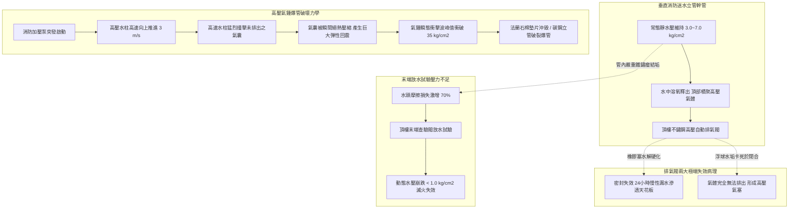
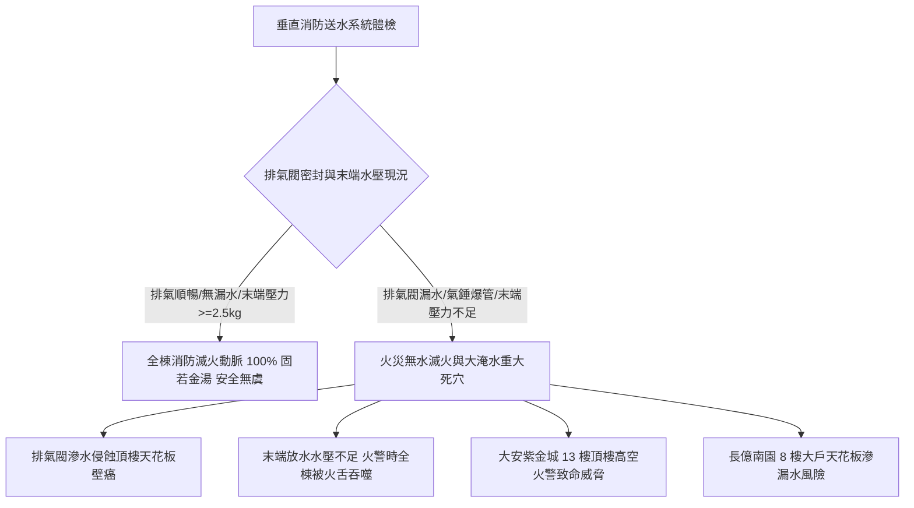

# 全案購屋實戰第五百六十九部_中古大樓社區各樓層消防送水幹管排氣閥橡膠塞老化洩漏立管水錘震盪末端放水試驗壓力不足與管壁穿孔體檢工序全書

---

## 序章：高樓滅火生命動脈之隱疾——垂直消防送水幹管與排氣閥

在都會集合住宅與高層中古大樓社區中，火災防護之成敗，完全取決於「**室內消防栓系統（Fire Hose Reel System）**」與「**自動撒水滅火系統（Automatic Fire Sprinkler System）**」之加壓給水管網。當火災發生時，頂樓消防水箱或地下室消防專用加壓泵浦（Fire Booster Pump）瞬間受電啟動，將高壓消防水高速注入貫穿全棟 1 樓至 15~25 樓之「垂直消防送水立管幹管（Vertical Fire Main Riser）」，確保各樓層消防栓水帶與天花板撒水頭噴出強大高壓射流撲滅火勢。

為防止垂直消防管網在常態待機時積存高壓空氣囊、或注水瞬間產生毀滅性之水錘震盪，消防工程技術規範（NFPA 13/14 與消防設備安全法規）強制要求在各垂直消防立管的最頂端（通常位於頂樓屋突層或管道間頂部）安裝「**高壓自動排氣閥（Automatic Air Release Valve, ARV）**」；並於各分區樓層最不利點設置「**末端查驗放水閥組（Inspector's Test Connection）**」。

然而，在屋齡 20 至 30 年以上之中古大樓社區中，垂直消防管網常年處於靜態封閉受壓狀態，隱藏四大致命機電與水動力力學病理：
1. **頂樓自動排氣閥三元乙丙橡膠密封塞（EPDM Seal Plug）老化水解硬化與慢性微洩漏**：排氣閥內部之浮球連桿密封橡膠墊，歷經 20 年高溫烘烤與死水腐蝕，橡膠硬化龜裂失去彈性，密封面無法緊密貼合。消防水日夜自微孔滲出，沿著頂樓管道間外壁流淌，浸潤次頂樓與頂樓住戶天花板，造成難以根治之公共壁癌漏水。
2. **管網內部積聚「氣塞（Air Pockets）」引發注水時高壓氣錘爆管（Air Slam Phenomenon）**：若排氣閥浮球水垢卡死無法排氣，垂直幹管頂部積存數十公升之高壓壓縮氣體。當消防泵浦啟動時，高壓水柱以數公尺/秒之速度高速衝擊壓縮氣囊，氣體被瞬間劇烈絕熱壓縮後引發劇烈之壓力波反彈反衝，管底與轉彎處瞬態爆發高達 **$30\sim 40\text{ kg/cm}^2$** 之高壓氣錘巨響，直接震斷管路膨脹螺栓吊架，震裂管道間法蘭金屬接縫。
3. **末端查驗放水試驗（Inspector's Test）動態放水壓力不足（Dynamic Pressure $< 1.7\text{ kg/cm}^2$）**：法規強制頂樓最不利點消防栓放水壓力至少必須達到 $1.7\text{ kg/cm}^2$（放水量 $\ge 130\text{ L/min}$）。但在老舊大樓中，常因管壁內積存厚達數公分的赤褐色鐵鏽瘤（Tubercles）、或地下室消防加壓泵葉輪鏽蝕磨損，末端放水時壓力錶崩跌至不足 $0.5\text{ kg/cm}^2$，水流微弱如自來水洗手，火警時根本無法出水滅火！
4. **碳鋼消防立管（Sch 40 Steel Pipe）管底厭氧酸蝕穿孔與全棟大淹水**：消防管內部常年處於死水狀態，自來水中的氯離子、硫酸根離子與硫酸鹽還原菌在管底沉積物下繁殖，產生嚴重的「點蝕穿孔（Pitting Corrosion）」。老舊鍍鋅鋼管壁厚由 5.0mm 腐蝕至不足 1.0mm，一旦消防泵試車加壓，管壁瞬間爆裂穿孔，高壓黑水噴湧淹沒電梯機房與梯廳。

本全書將深入剖析消防立管兩相流水錘力學方程、自動排氣閥浮力節流熱力學、末端放水水力水頭損失計算，並建立現場實戰體檢工序，為購屋家庭鎖定社區消防滅火之終極安全防線。

---

## 第一章：消防送水幹管排氣閥流力力學與水錘穿孔破壞機理

### 第一節：自動排氣閥（Air Release Valve）浮力密封方程式與微洩漏病理

1. **浮球式排氣閥之流體靜力學平衡**：
   - 排氣閥由不鏽鋼閥體、槓桿機構、SUS304 浮球（Float Ball）與三元乙丙橡膠（EPDM）微孔排氣塞組成。
   - 當風管內積聚氣體時，液位下降，浮球重力 $W_f$ 克服內部水壓產生的推力，通過槓桿拉開微孔排氣塞（孔徑僅 $1.5\sim 2.5\text{ mm}$），將高壓氣體排出：
     $$\sum M = W_f \cdot L_1 - P \cdot A_{\text{orifice}} \cdot L_2 > 0$$
   - 當氣體排盡、水流湧入時，浮球浮力 $F_b$ 頂推槓桿，將橡膠塞緊緊壓在微孔閥座上閉合截水。

2. **橡膠塞硬化熱水解與毛細洩漏機制**：
   - 頂樓屋突層夏季鐵皮內部溫度高達 50°C~60°C，排氣閥橡膠密封塞長期浸泡於死水中，增塑劑揮發析出，橡膠硬度由 Shore A 60° 飆升至 85° 以上，表面龜裂失去回彈性。
   - 自來水中的微細鐵鏽微粒嵌塞於橡膠塞與黃銅微孔閥座之間，破壞了線接觸密封。
   - 消防水在數個大氣壓之靜水壓推動下，沿著微隙持續向外滴漏。由於排氣閥常安裝於管道間隱蔽處，每日洩漏數十公升之微漏不易被察覺，大水滲透樓板混凝土，造成 13 樓或頂樓住戶天花板鋼筋嚴重腐蝕膨脹發霉。

---

### 第二節：氣錘衝擊（Air Slam）非線性水動力學破壞

1. **氣體絕熱壓縮方程（Adiabatic Compression）**：
   - 當高壓水柱高速注入未排氣之立管時，頂部封閉空氣腔之壓縮過程極其迅速（時間 $< 0.1\text{ 秒}$），熱量來不及散失，符合絕熱壓縮定律：
     $$P_1 \cdot V_1^\gamma = P_2 \cdot V_2^\gamma \quad (\text{空氣絕熱指數 } \gamma \approx 1.4)$$
   - 當空氣體積被壓縮至原始體積之 $1/10$ 時，氣體內部瞬態壓力可暴增至原始壓力的 $10^{1.4} \approx 25.1\text{ 倍}$！

2. **氣錘反射衝擊破壞力學**：
   - 被極度壓縮之高壓氣囊如同被壓縮至極限之強力剛性彈簧，隨即爆發劇烈之反向膨脹反彈。
   - 反向高速膨脹之氣囊猛烈撞擊迎面而來之後續水柱，兩者在管道轉角彎頭處發生極端剛性碰撞，水動力學壓力波峰值（Pressure Surge Peak）可在瞬間突破 **$35.0\sim 45.0\text{ kg/cm}^2$**，遠遠超過普通 Sch 40 鋼管或管配件之安全承壓極限（$20\text{ kg/cm}^2$）。
   - 巨大的衝擊波將固定在混凝土牆上的重型管夾（Riser Clamps）膨脹螺栓瞬間剪斷，立管跳動位移，法蘭墊片撕裂，高壓水如瀑布般噴湧而出。

---

### 第三節：末端查驗閥水力水頭損失與鐵鏽瘤（Tuberculation）

1. **達西-威斯巴赫水頭損失公式（Darcy-Weisbach Equation）**：
   - 消防送水立管之水頭摩擦損失 $h_f$ 為：
     $$h_f = f \cdot \frac{L}{D} \cdot \frac{v^2}{2g}$$
     其中 $f$ 為管壁摩擦阻力係數，$L$ 為立管長度，$D$ 為管道內徑。

2. **鐵鏽瘤引發之有效內徑縮減與粗糙度暴增**：
   - 中古大樓未落實定期水質防腐處理，立管內壁生成大量半球狀之硬質赤褐色「鐵鏽瘤（Tubercles）」。
   - 鐵鏽瘤使管道絕對粗糙度 $\epsilon$ 由新管之 $0.045\text{ mm}$ 飆升至 $3.0\sim 5.0\text{ mm}$，阻力係數 $f$ 增加數倍；且有效內徑 $D$ 自 100mm 縮減至不足 65mm。
   - 當頂樓末端查驗閥全開進行放水試驗時，沿程巨大之摩擦阻力吃掉了大部分壓頭，末端動態壓力由設計之 $2.5\text{ kg/cm}^2$ 斷崖式暴跌至 $< 0.8\text{ kg/cm}^2$，消防水帶噴水距離不足 3 公尺，全棟自動撒水頭完全無法爆裂噴水滅火！

---

## 第二章：現場看屋垂直消防送水系統七大實戰體檢工序

在評估中古大樓社區時，小寶與家人應要求房仲與管委會陪同，協調社區機電維護主任或消防設備士，進入頂樓屋突層管道間與各樓層消防箱，實地落實以下七步工序：

| 體檢步驟 | 檢驗標的與操作動作 | 合格標準 (Pass) | 潛在致命瑕疵 (Fail) | 修繕對策與預算評估 |
| :---: | :--- | :--- | :--- | :--- |
| **Step 1** | **頂樓排氣閥外觀與微滲水** 強力手電筒檢查頂樓消防立管頂部排氣閥 | 閥體外殼乾燥無水痕，微孔排氣嘴無水滴懸掛，周邊水泥無水漬 | 排氣嘴日夜不停滴水、閥體長滿綠色銅鏽、管道間地坪積水發霉 | 更換全不鏽鋼高壓耐腐蝕排氣閥總成（約 3,500~7,500 元/座） |
| **Step 2** | **排氣閥前置隔離閥開關狀態** 檢視排氣閥下方之黃銅閘閥或球閥 | 隔離閥處於「全開常通狀態」，手柄以鐵絲或鉛封鎖定 | 隔離閥被管委會因漏水而擅自關閉（蓄意封閉排氣防線） | 立即更換排氣閥並重新將隔離閥全開鉛封鎖定（約 4,500~8,000 元） |
| **Step 3** | **頂樓末端查驗放水壓力測試** 開啟頂樓最不利點末端查驗放水閥 | 動態放水壓力 $\ge 1.7\text{ kg/cm}^2$（標準 $2.5\text{ kg/cm}^2$），水流噴射強勁 | 動態壓力 $< 1.0\text{ kg/cm}^2$，水流微弱、壓力錶指針劇烈抖動 | 清洗管網鐵鏽泥、檢修地下室消防主泵葉輪或調整減壓閥（約 15,000~35,000 元） |
| **Step 4** | **消防泵啟動瞬間管路水錘聽診** 於管道間旁聆聽消防加壓泵啟動注水 | 僅聽見平順水流聲與輕微金屬流體聲，立管穩定無晃動 | 爆發「轟！砰！」驚雷般金屬撞擊巨響，立管劇烈抖動跳躍 | 於立管頂部加裝氣囊式高壓水錘吸收器、全面檢修排氣閥（約 18,000~38,000 元） |
| **Step 5** | **立管外壁腐蝕與管夾固定間距** 檢查管道間 Sch 40 鋼管管壁與吊架 | 管壁塗覆鮮豔紅色防鏽漆，管夾間距 $\le 3.5\text{ 公尺}$ 且膨脹螺栓緊固 | 管壁嚴重生鏽起皮剝落、管夾螺栓鬆脫懸空、接頭處滲水 | 管壁除鏽重刷環氧防鏽漆，重新補打高強膨脹螺栓管夾（約 2,500~5,000 元/處） |
| **Step 6** | **各樓層消防箱水帶與瞄子檢驗** 打開目標物件該樓層之室內消防栓箱 | 水帶平整無發霉發黑，橡膠內襯無老化粘連，瞄子配件齊全 | 水帶破裂發霉、橡膠內襯硬化碎裂、水閥開關鏽死轉不動 | 全面更換通過消防署認證之輕量化高壓耐磨消防水帶（約 1,800~3,500 元/條） |
| **Step 7** | **管委會法定消防安全申報書** 調閱管委會每年向消防局申報之檢檢紀錄 | 消防栓、撒水泵浦、末端放水壓力全數判定合格無缺失列管 | 申報書列管「消防栓水壓不足、排氣閥洩漏」超過半年未修 | 責成管委會限期聘請合格消防公司全面檢修複驗（列入交屋前提） |

---

## 第三章：消防立管安全對四大核心物件之戰略決策

### 第一節：四大核心考慮物件之消防安全深度評估
1. **大安紫金城 13 樓（PROP_10，第一首選）**：
   - 頂樓 13 樓正處於全棟垂直消防管網的最頂端！
   - **雙重致命風險**：
     - 若頂樓自動排氣閥橡膠塞老化洩漏，滲漏的水直接沿著管道間外壁漫入 13 樓天花板與主臥角隅，造成頑固壁癌漏水。
     - 13 樓距離頂樓消防水箱最近，屬於全棟「最不利點」，自然水壓最低。若地下室加壓泵故障或管線結垢，13 樓室內消防栓與撒水頭將首先「無水可用」，火災時面臨高空滅火無援之絕境。
   - **實地必查要點**：看屋時務必至 13 樓管道間與屋突層，親眼檢視排氣閥是否漏水，並要求實測 13 樓室內消防栓之放水動態水壓。
2. **長億南園 8 樓（PROP_106，空間之王）**：
   - 8 樓緊鄰公共消防管道間，室內面積達 32 坪。
   - **談判籌碼**：若公共管道間消防立管存在氣錘震盪敲擊巨響、或排氣閥關閉導致天花板微滲水漬，買方應當場以「公設垂直消防送水管網老化氣阻，需動用專款全面抽換排氣閥與水錘消除器」為由，向賣方大砍價金 **10 至 15 萬元**。

### 第二節：成屋買賣合約消防給水系統特約保障條款範本
> 「賣方保證本買賣標的所屬大樓之室內消防栓系統、自動撒水系統、垂直消防送水幹管及頂樓自動排氣閥組，均符合國家消防法規安全標準，且於最近一次消防機關定期安全申報中無任何重大缺失列管，末端放水試驗動態壓力達合格標準（不低於 $1.7\text{ kg/cm}^2$）。若交屋前查明頂樓排氣閥存在嚴重滲漏水侵害標的物室內天花板、或消防幹管水壓嚴重不足無法出水滅火者，賣方應負責協調管委會於交屋前完成修繕更新；否則買方得主張自價金中扣留新台幣參萬元整於履約保證專戶，作為買方承擔公共消防安全風險之補償。」
