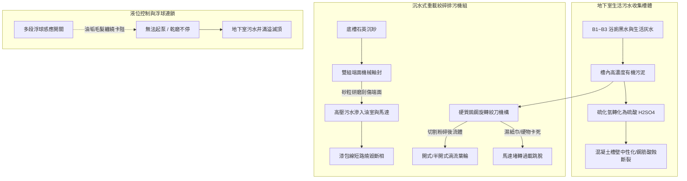
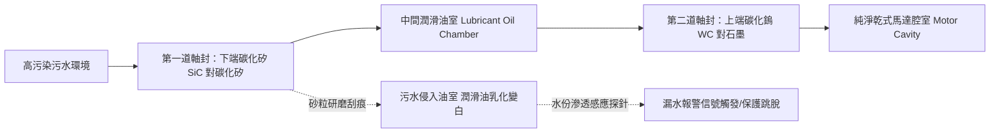
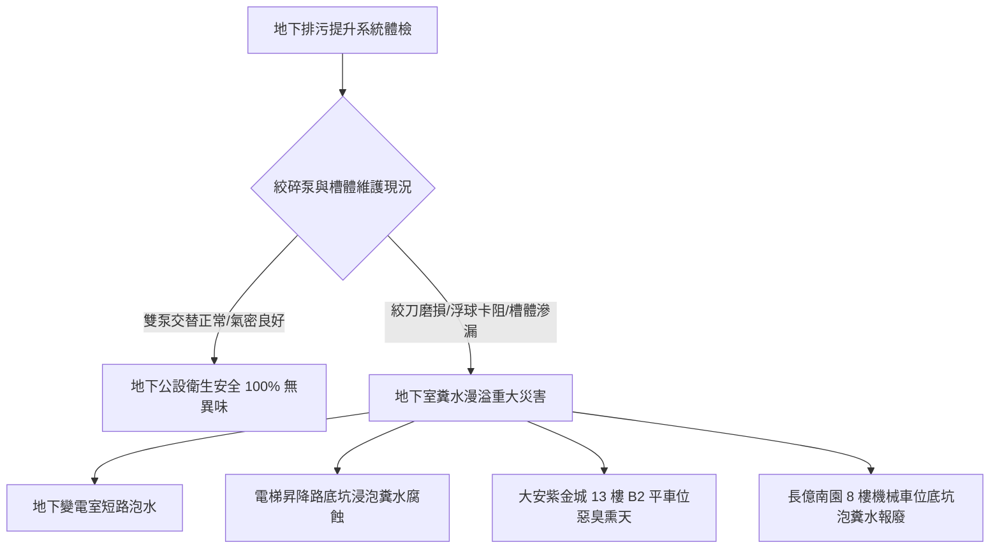

# 全案購屋實戰第五百六十二部_中古大樓社區地下室生活污水下水道用戶接管沉水式絞碎型排污泵浦氣化空蝕機械軸封砂石刮傷與化糞池槽體酸化滲漏體檢工序全書

---

## 序章：地底深處之隱形心臟——沉水排污絞碎泵與槽體結構防線

在都會集合住宅大樓中，儘管公共污水下水道接管工程陸續普及，但對於地下室各層（B1~B3/B4）之生活雜排水、機房洗地廢水、以及地勢低於道路公共污水幹管之低樓層污水，依然無法僅依賴重力流自然排出，必須匯流至地下最底層之「**地下生活污水收集池（Sewage Wet Well / Sump Pit）**」或由舊化糞池改建之污水儲坑，再透過「**沉水式絞碎型排污泵浦（Submersible Grinder Sewage Pumps）**」強力提升加壓輸送至地面層之市政污水幹管。

沉水排污絞碎泵長年浸泡於含有強酸鹼化學洗劑、排泄物、油脂、毛髮抹布及沉澱石英砂之極端惡劣環境中，其運作良窳直接攸關全社區地下室是否會遭受「糞水滅頂」之重大衛生災害。在屋齡 20 至 30 年以上之中古大樓社區中，地下排污提升系統隱藏四大致命機電與結構病理：
1. **沉水排污泵葉輪氣化空蝕（Cavitation）與排氣不良氣阻（Air Binding）**：收集池水位過低時泵浦吸入空氣，或進水高差過大引發劇烈紊流氣泡，高速葉輪在微氣泡潰滅之微射流（Micro-jet）衝擊下，金屬葉片迅速產生海綿狀蜂窩孔洞與葉尖剝落，提升揚程崩塌腰斬。
2. **鎢鋼旋轉絞刀（Tungsten Carbide Cutter）鈍化與砂石刮傷機械軸封（Mechanical Seal）**：住戶誤將濕紙巾、衛生棉、塑膠刷毛沖入馬桶，導致高速旋轉絞刀卡阻堵轉；底槽沉澱之硬質石英砂微粒更會強行鑽入碳化矽/碳化鎢雙機械軸封端面，將拋光鏡面刮出深深溝痕，高污染污水長驅直入電機馬達內部，引發線圈相間短路燒毀。
3. **老舊化糞池/污水坑混凝土槽體硫化酸化穿孔滲漏（Acid Attack）**：污水厭氧發酵產生的高濃度硫化氫與硫酸，常年侵蝕未施作耐酸鹼聚脲或玻璃纖維（FRP）防護之水泥槽壁，混凝土中之游離石灰被完全溶解，骨料碎石裸露、結構鋼筋被酸蝕斷裂，污水日夜滲漏淘空大樓地基土壤。
4. **液位浮球感應開關（Float Switches）纜線被油垢纏繞誤動作**：浮球開關表面附著厚達數公分之堅硬浮渣（Scum）與毛髮油脂，重力失衡無法隨液位浮起或下沉，導致「水滿不啟動造成溢流淹水」或「無水不停機引發乾磨燒毀」。

本全書將深入剖析沉水絞碎泵浦之流體剪切力學、雙端面機械密封保護機制、混凝土槽體酸蝕劣化化學方程，並建立現場實戰體檢工序，為購屋家庭鎖定社區地下最深處之公共安全防線。

---

## 第一章：沉水排污絞碎泵浦與污水槽體腐蝕破壞機理

### 第一節：高速剪切絞刀機構（Cutter Mechanism）之磨損與堵轉力學

1. **旋轉絞刀與固定切削環之微米級間隙**：
   - 沉水絞碎泵在入口處配置一組高硬度鎢鉻合金鋼（Rockwell C 硬度達 HRC 55~60）之旋轉絞刀（Rotating Cutter）與固定切削環（Stationary Shredding Ring）。
   - 兩者之間的軸向剪切間隙（Shearing Clearance）必須精確維持在：
     $$\delta = 0.05\sim 0.10\text{ mm}$$
   - 此一極微小間隙方能如鋒利剪刀般，在 3,450 RPM 高速旋轉下將衛生棉、抹布、毛巾及塑膠纖維瞬間剪切成小於 $5\text{ mm}$ 之微細碎片，防止堵塞下游管路。

2. **砂石磨耗引發間隙增大與纖維纏繞堵轉（Jamming）**：
   - 自來水管沉砂、浴室毛髮與洗衣廢水中之細砂具有高度磨蝕性。在砂粒長期研磨下，絞刀刀刃變鈍、切削環邊緣倒角，剪切間隙 $\delta$ 擴大至 $0.3\text{ mm}$ 以上。
   - 當現代堅韌之不織布濕紙巾（Non-woven Wet Wipes）被吸入時，絞刀不再是剪斷纖維，而是將纖維強行「楔入」絞刀與切削環之隙縫中。
   - 纖維緊密纏繞產生巨大之機械制動力矩（Braking Torque），瞬間超過馬達額定轉矩的 3~4 倍，馬達轉速驟降至 0，轉子發生堵轉（Locked Rotor）。此時堵轉電流飆升至額定電流的 6~8 倍，若控制盤過載保護熱動電驛（Thermal Relay）未及時跳脫，馬達線圈將在數秒內發熱冒煙燒毀。

---

### 第二節：雙端面機械軸封（Double Mechanical Seals）與油室防護

1. **碳化矽摩擦副（SiC/SiC）之自潤滑與砂粒研磨**：
   - 排污泵採用串聯之「**雙端面機械軸封（Tandem Double Mechanical Seals）**」，兩道密封之間充滿食品級無毒白色石蠟潤滑油（White Mineral Oil），負責帶走摩擦熱並維持微觀油膜。
   - 外側（下端）軸封直接接觸高磨蝕性污水，端面採用極高硬度之碳化矽（Silicon Carbide, SiC）對碳化矽材質。
   - 若底槽沉砂過多且未定期清淤，硬度高於碳化矽之微細剛玉或石英砂粒（Quartz Sand）在水流湍流下被夾入密封端面，將鏡面級接觸面（粗糙度 $Ra < 0.2\mu\text{m}$）刮劃出深槽。

2. **油室乳化與馬達進水短路災難**：
   - 下端軸封失效後，高壓污水滲入油室。原本清澈透明之潤滑油在高速攪拌下與污水乳化成混濁之乳白色液體（Mayonnaise Emulsion），油品之介電強度（Dielectric Strength）自 $> 30\text{ kV}$ 暴跌至 $< 5\text{ kV}$。
   - 污水隨即突破第二道軸封滲入電機馬達內部，浸泡定子繞組線圈（Stator Winding），造成漆包線絕緣電阻崩潰，引發相間短路或接地故障，整台泵浦報廢。

---

### 第三節：化糞池混凝土槽壁硫酸腐蝕（Acid Attack）與掏空地基

1. **硫化氫向生物強硫酸之轉化化學方程式**：
   - 封閉式地下污水池頂部空氣區充滿厭氧分解產生之高濃度 $\text{H}_2\text{S}$ 氣體。
   - 水泥混凝土之主要水化產物為氫氧化鈣 $\text{Ca(OH)}_2$ 與水化矽酸鈣（C-S-H 膠體），呈現強鹼性（$\text{pH} \approx 12.5\sim 13.5$）。
   - 當管壁凝結水膜中的好氧性硫桿菌將 $\text{H}_2\text{S}$ 氧化為硫酸 $\text{H}_2\text{SO}_4$ 後，強酸與水泥基體發生強烈化學中和侵蝕：
     $$\text{Ca(OH)}_2 + \text{H}_2\text{SO}_4 \rightarrow \text{CaSO}_4 \cdot 2\text{H}_2\text{O} \quad (\text{生石膏生成，體積膨脹 124\%})$$
     $$\text{CaSO}_4 \cdot 2\text{H}_2\text{O} + 3\text{CaO} \cdot \text{Al}_2\text{O}_3 \cdot 3\text{CaSO}_4 \cdot 32\text{H}_2\text{O} \quad (\text{鈣礬石膨脹，體積膨脹 227\%})$$

2. **混凝土碎裂粉化與結構穿孔滲漏**：
   - 膨脹性礦物結晶在混凝土微觀孔隙中產生數十個大氣壓之微觀結晶壓力，使緻密的混凝土由外向內逐層軟化、粉化剝落，形成豆腐渣狀之石膏泥層。
   - 槽壁厚度每年以 $2\sim 5\text{ mm}$ 速度持續被酸蝕剝蝕，原配之熱軋竹節鋼筋直接暴露於高濃度酸液中迅速鏽斷。
   - 當槽體完全被酸穿時，數十噸之高濃度糞便黑水日夜滲入大樓基礎筏基底層，軟化周圍地盤沙土，導致局部土壤流失淘空，對整棟大樓之耐震平衡造成無可逆轉之內傷。

---

## 第二章：現場看屋地下室排污機組七大實戰體檢工序

在評估中古大樓社區時，買方應協調管委會機電人員陪同，至地下室污水提升坑現場實地落實以下七步工序：

| 體檢步驟 | 檢驗標的與操作動作 | 合格標準 (Pass) | 潛在致命瑕疵 (Fail) | 修繕對策與預算評估 |
| :---: | :--- | :--- | :--- | :--- |
| **Step 1** | **污水坑人孔蓋氣密與氣味** 靠近污水提升坑人孔蓋嗅聞氣味 | 採用防臭氣密型人孔蓋，周圍緊固無絲毫惡臭沼氣外洩 | 鐵蓋嚴重鏽穿、未加密封膠條、地下室散發濃烈刺鼻糞臭 | 更換重型球墨鑄鐵雙層氣密防臭人孔蓋（約 15,000~28,000 元/座） |
| **Step 2** | **絞碎泵手動啟動運轉聲診** 控制盤切換至手動手動運轉 10 秒 | 運轉聲音低沉平穩，僅有水流旋轉聲，無金屬尖叫異音 | 發出「卡啦卡啦」金屬刮磨碎裂聲、劇烈抖動跳躍 | 吊起泵浦拆解更換鎢鋼旋轉絞刀與切削環（約 8,000~16,000 元/台） |
| **Step 3** | **馬達運轉電流平衡度測試** 鉤錶測量運轉時三相馬達電流 | 三相電流完全平衡，數值在馬達銘板額定滿載電流以內 | 單相電流超標 $> 20\%$、或電流劇烈擺盪（葉輪被纏繞堵轉） | 吊泵清除卡死之布料纖維，檢查馬達絕緣電阻（約 4,500~9,000 元） |
| **Step 4** | **油室漏水感應探針警報檢驗** 檢查控制盤上之「軸封漏水（Seal Leak）」指示燈 | 漏水指示燈熄滅，繼電器信號迴路阻抗正常（無漏水） | 漏水指示燈常亮報警（下端機械軸封已穿孔、油室乳化） | 立即吊泵進行油室換油與全套雙端面機械軸封翻新（約 12,000~25,000 元） |
| **Step 5** | **浮球液位控制開關靈活度** 用長木桿手動撥動高低水位浮球 | 浮球表面無厚重硬化油膏，撥起瞬間控制盤精準啟泵/停泵 | 浮球被大量毛髮油渣包裹硬化卡死、電纜斷裂泡水短路 | 清理浮球油脂，更換耐油耐酸鹼全密封不銹鋼浮球開關（約 3,500~6,500 元/組） |
| **Step 6** | **雙泵自動輪流交替切換測試** 連續手動觸發兩次起泵程序 | 第一次運轉 1 號泵，第二次啟動自動無縫切換至 2 號備用泵 | 備用泵卡死無反應、或雙泵同時啟動造成總開關跳脫 | 檢修控制盤交替控制器與交流接觸器接點（約 4,500~8,500 元） |
| **Step 7** | **坑體混凝土酸蝕與外水滲漏** 強力防爆手電筒照射污水坑內壁 | 槽壁平整無露筋，內襯耐酸鹼防護塗層完整無脫落 | 混凝土大面積粉化碎裂、碎石剝落、鋼筋裸露鏽蝕斷裂 | 抽乾清淤後全池重新施作高分子耐酸鹼聚脲/玻璃鋼塗裝（約 80,000~180,000 元） |

---

## 第三章：四大核心考慮物件之地下排污風險評估與防禦

### 第一節：大安紫金城 13 樓（PROP_10，第一首選）之防禦要點
- **資產重點**：本物件配備「**獨立 B2 大平面車位**」。
- **查驗關鍵**：大安紫金城地下室設有集中污水坑，若排污泵浦因絞刀卡死跳脫、或人孔蓋無氣密密封，B2 地下停車場將瀰漫濃烈惡臭，且一旦污水溢流，B2 地坪之平面車位首當其衝受災。看屋時務必實地走到 B2 最底層污水坑旁檢視地面乾燥度與氣味。

### 第二節：長億南園 8 樓（PROP_106，空間之王）之防禦要點
- **資產重點**：本物件配有「**機械停車位**」。
- **死穴警示**：機械停車設備之底坑深達地下 $1.5\sim 2.0\text{ 公尺}$，地勢比全棟任何一處都要低！一旦地下排污提升泵浦失靈導致溢流，積存的污水黑水將首先灌入機械車位底坑，將下層車台之鏈條、油壓缸、馬達與限位開關徹底浸泡泡爛。
- **談判籌碼**：以此潛在公設重大修繕風險為由，強勢向屋主砍價 **20 至 30 萬元**。

### 第三節：成屋買賣合約地下排污設備特約保障條款範本
> 「賣方保證本買賣標的所屬大樓地下室之生活污水收集池、沉水絞碎型排污泵浦機組、液位浮球控制開關及公共排污管道，均處於合格正常運作狀態，且本大樓在賣方持有期間無任何污水漫溢地下室或坑體嚴重酸蝕滲漏之歷史紀錄。若交屋前查明社區排污泵浦存在絞刀卡死、軸封漏水或雙泵自動交替控制器故障未修復情事，賣方應負責協調管委會於交屋前完成修繕更新；否則買方得扣留買賣價金新台幣貳萬元整於履約保證專戶，作為買方承擔公共衛生安全風險之補償。」
