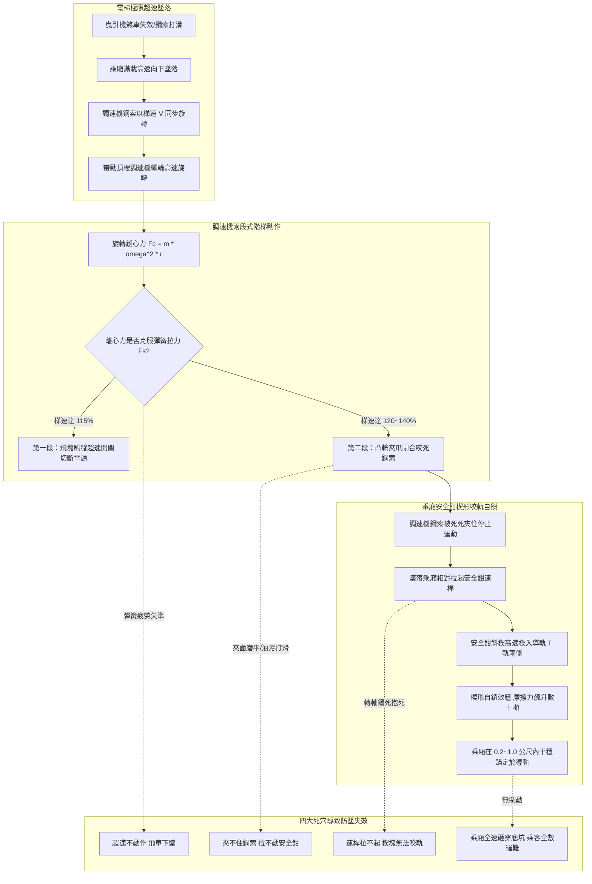
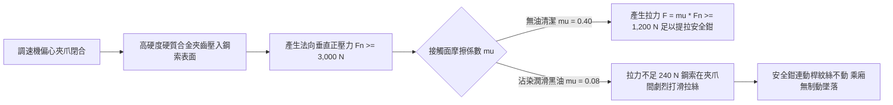
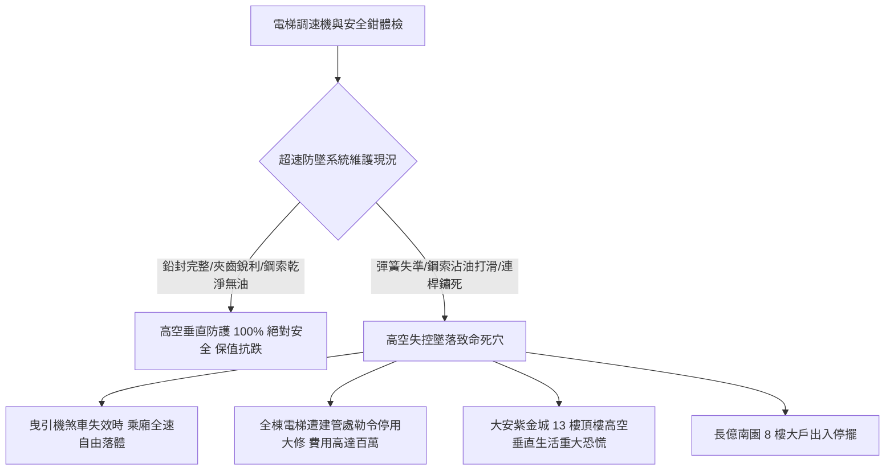

# 全案購屋實戰第五百六十八部_中古大樓社區各樓層電梯調速機夾繩鉗磨損飛塊離心彈簧疲勞失準與超速溜梯下墜體檢工序全書

---

## 序章：高空失控墜落之機械守護神——電梯超速調速機與安全鉗連鎖防線

在集合住宅與中古大樓社區中，電梯垂直高速升降運行之安全，完全建立在以「**超速調速機（Overspeed Governor, OSG）**」為感測大腦、以「**乘廂安全鉗（Safety Gear）**」為機械剎車肌肉之機械連鎖制動系統（Governor-Safety Gear System）之上。

當電梯因曳引鋼索斷裂、主機減速箱蝸輪蝸桿齒崩、或電磁抱閘線圈斷電機構卡死而發生非受控之「超速向下墜落（Free Fall Downward）」或「超速衝頂（Overspeed Upward）」時，**調速機是全棟唯一不依賴任何外部電力、純粹依據離心力物理定律觸發之最後機械救命裝置**。

依據中華民國國家標準 CNS 10594 與國際電梯規範 EN 81-20，調速機必須具備「兩段式階梯防護」：
1. **第一段電氣超速保護（Electrical Tripping Speed）**：當梯速達到額定速度之 **115%** 時，離心飛塊甩開觸動電氣安全微動開關，硬體切斷曳引機主電源並使主抱閘強制閉合制動。
2. **第二段機械超速夾繩動作（Mechanical Tripping Speed）**：若電磁抱閘失效梯速持續失控飆升至額定速度之 **120%~140%**（例如額定速度 $1.75\text{ m/s}$ 達到 $2.10\sim 2.45\text{ m/s}$）時，調速機內部之機械夾繩鉗（Rope Gripper / Wedge Clamp）必須以數噸夾緊力死死咬住調速機鋼索（Governor Rope）。被咬死之鋼索藉由拉桿機構拉起乘廂兩側之安全鉗楔塊（Safety Wedges），楔塊如鐵楔般狠狠楔入兩側導軌（Guide Rails），利用劇烈之金屬乾摩擦在數十公分滑行距離內，將數噸重之墜落乘廂硬生生卡死錨定在導軌鋼樑上！

然而，在屋齡 20 至 30 年以上之中古大樓社區中，調速機常年安裝於頂樓電梯機房角落，隱藏四大致命機械與物理力學病理：
1. **調速機離心飛塊平衡彈簧（Flyweight Calibration Spring）金屬疲勞與剛度退化**：調速機依賴精密的對稱螺旋拉伸彈簧平衡離心力。長年承受交變應力與機房高溫烘烤，彈簧剛度（Spring Rate, $k$）產生塑性衰退，導致機械動作速度點大幅漂移——要麼「超速時不動作導致乘廂直接砸向底坑」，要麼「正常額定運轉時誤動作觸發安全鉗造成電梯半空急煞傷人」。
2. **夾繩鉗齒紋（Gripper Teeth）嚴重偏磨磨平與油污打滑**：夾繩偏心凸輪或楔形夾塊表面之高硬度淬火齒紋，在經歷數次年檢試車或因鋼索晃動乾磨後被完全磨平；加上機房曳引機噴濺之黑機油污染鋼索，夾繩摩擦係數由 0.4 暴跌至不足 0.1，超速夾繩時鋼索在鉗口內高速打滑撕裂，根本無法拉動乘廂下方的安全鉗。
3. **調速機鋼索直徑磨損變細與底坑張力輪（Tension Pulley）卡死**：$\Phi 8\text{ mm}$ 之專用無油航空調速機鋼索，因井道風壓摩擦與導輪偏擺，外層鋼絲斷絲磨損，直徑縮減至不足 7mm；底坑重錘張力輪滑道生鏽卡死，鋼索失去法定數十公斤之垂直張緊力，整條鋼索如同鬆弛麻繩，在井道內劇烈抽打波浪晃動，完全喪失傳遞拉力之剛性。
4. **安全鉗提拉連桿機構（Safety Gear Linkage）轉軸鏽死抱死**：安裝在乘廂底部樑架之安全鉗連動曲柄軸（Synchronizing Shaft），長年受乘廂下方潮濕水氣侵蝕，青銅襯套與轉軸完全鏽結咬死，即使調速機鋼索成功夾緊，拉桿依然被卡死拉不動，安全鉗楔塊無法抬起咬軌，整套防墜防線徹底瓦解！

本全書將深入剖析調速機離心動力學旋轉方程式、安全鉗楔形自鎖力學、夾繩鋼索摩擦磨耗極限，並建立一套現場實戰體檢工序，為購屋家庭鎖定社區電梯垂直高空防墜之最高工程防線。

---

## 第一章：調速機離心動力學與安全鉗楔形咬軌力學機制

### 第一節：調速機離心力平衡方程式與動作轉速精確標定

1. **離心飛塊力學旋轉方程式**：
   - 調速機旋轉體上對稱鉸接一組偏心飛塊（Flyweights），質量各為 $m$。當調速機繩輪半徑為 $R$、電梯運行速度為 $v$ 時，調速機旋轉角速度 $\omega = v / R$。
   - 飛塊重心所承受之向外離心力 $F_c$ 為：
     $$F_c = m \cdot \omega^2 \cdot r = m \cdot \left(\frac{v}{R}\right)^2 \cdot r$$
     其中 $r$ 為飛塊旋轉半徑。
   - 抑制飛塊甩開之力量為對稱校準拉伸彈簧之初張力 $F_0$ 與剛度拉力：
     $$F_s = F_0 + k \cdot \Delta x$$

2. **彈簧剛度衰退（Stiffness Degradation）引發之臨界轉速漂移**：
   - 彈簧長年處於拉伸受載狀態，材料內部晶格產生微觀塑性滑移，彈簧剛度 $k$ 衰減 $15\%\sim 30\%$，初張力 $F_0$ 鬆弛。
   - 臨界平衡條件 $F_c = F_s$ 遭到破壞。若彈簧拉力變小，動作速度點下移，導致電梯在滿載快速下降時，正常動態速度稍微波動即觸發安全鉗，將乘廂重重急煞在半空，造成乘客挫傷；反之，若轉軸油泥卡阻，動作速度點向後大幅漂移超過 $160\%$ 以上，當真正墜落時調速機形同虛設，電梯以自由落體直插底坑！

---

### 第二節：夾繩鉗摩擦自鎖與鋼索咬合物理極限

1. **安全鉗提拉觸發之最小拉力閾值**：
   - 依據 CNS 10594 法規，調速機動作時，調速機鋼索在夾繩機構中所產生之摩擦拉力 $F_{\text{pull}}$，**至少必須為提起安全鉗所需拉力加上連桿彈簧力之 2 倍，且不得小於 $300\text{ N}$（實務大型客梯要求 $\ge 1,000\sim 1,500\text{ N}$）**。
   - 夾繩拉力計算式為：
     $$F_{\text{pull}} = 2 \cdot \mu \cdot F_n$$
     其中 $\mu$ 為夾塊齒面與鋼索之摩擦係數，$F_n$ 為夾繩楔形力矩產生之法向壓緊力。

2. **鋼索沾油打滑與磨耗拉絲致命效應**：
   - 調速機鋼索嚴禁塗抹任何潤滑黃油或機油，必須常態保持乾燥清潔。
   - 但在中古大樓機房中，主曳引機齒輪箱滲漏之高黏度齒輪油、或保養人員不慎將潤滑油滴落在調速機繩輪上，油液滲透至鋼索麻芯與鋼絲表面，使摩擦係數 $\mu$ 由 $0.40$ 急遽暴跌至不足 $0.08$。
   - 當夾繩鉗咬合瞬間，法向力無法轉化為足夠之垂直拉力，直徑 8mm 的鋼索在齒牙間以數公尺/秒之相對速度劇烈摩擦滑動，鋼絲瞬間被刮成鋼絲絨粉末（拉絲斷股），夾繩完全失效！

---

### 第三節：漸進式安全鉗（Progressive Safety Gear）楔形自鎖力學

1. **楔塊自鎖幾何條件（Self-locking Angle）**：
   - 額定速度 $> 0.63\text{ m/s}$ 之客梯必須使用漸進式安全鉗（彈簧緩衝滾子式或楔塊式）。
   - 楔塊斜面角度 $\alpha$ 必須小於材料之摩擦角 $\phi$（即 $\tan\alpha \le \mu_w$）。
   - 當連桿將楔塊向上提起接觸導軌表面後，導軌對楔塊產生向下之相對摩擦力，此摩擦力自動將楔塊如鐵楔般愈拉愈緊、深嵌於導軌與安全鉗基座斜面之間，產生高達數十噸之夾軌法向力。

2. **盤形彈簧（Disc Spring / Belleville Spring）彈力控制制動力矩**：
   - 漸進式安全鉗依靠後方一組厚達數公分的重型盤形彈簧組提供恆定之彈性夾緊力，使制動減速度精準控制在 $0.2\text{ g}\sim 1.0\text{ g}$ 之間，確保乘廂平穩減速制動而不至於將乘客拋飛撞擊天花板。
   - 若盤形彈簧長年受潮生鏽斷裂，安全鉗將退化為「瞬時式剛性碰撞」，夾軌瞬間產生超過 $5.0\text{ g}$ 之破壞性衝擊，直接將乘廂底樑撕裂扭曲！

---

## 第二章：現場看屋電梯調速機與安全鉗七大實戰體檢工序

在評估中古大樓社區時，買方應協調管委會與合法電梯昇降設備技術士陪同，進入頂樓電梯機房與乘廂頂部，實地落實以下七步工序：

| 體檢步驟 | 檢驗標的與操作動作 | 合格標準 (Pass) | 潛在致命瑕疵 (Fail) | 修繕對策與預算評估 |
| :---: | :--- | :--- | :--- | :--- |
| **Step 1** | **調速機鉛封與銘板參數檢驗** 檢視調速機校準螺栓鉛封完整性 | 鉛封完整無拆動破壞，銘板清晰標註額定速度、電氣與機械動作速度 | 鉛封遺失被擅自調整、無銘板、校準螺母鬆脫鏽死 | 拆卸調速機送回原廠或檢驗機構進行動態校驗重新鉛封（約 8,000~15,000 元/台） |
| **Step 2** | **離心飛塊與彈簧外觀檢測** 手電筒檢查飛塊鉸鏈與對稱拉簧 | 飛塊活動關節無油垢泥封，彈簧無鏽斑、螺距均勻無塑性變形 | 飛塊被厚黑油泥完全黏死、彈簧鏽蝕發黑發斑、手撥卡死不動 | 徹底以煤油溶劑清洗關節，加注專用儀表潤滑油，更換原廠拉簧（約 3,500~7,000 元） |
| **Step 3** | **夾繩鉗齒面磨耗與乾淨度** 目視調速機夾繩偏心輪或夾塊齒面 | 夾齒鋒利分明無崩齒，表面乾爽無油污，與鋼索間隙約 $2\sim 3\text{ mm}$ | 齒紋完全磨平呈光滑弧面、夾槽塞滿黑黃機油與棉絮 | 更換淬火高碳合金鋼夾繩鉗塊，以除油劑徹底清洗（約 4,500~9,000 元/組） |
| **Step 4** | **調速機專用鋼索直徑與油污** 以游標卡尺測量鋼索直徑並撫摸表面 | 鋼索直徑 $\Phi \ge 7.8\text{ mm}$（標稱 8mm），表面完全乾燥無油脂無斷絲 | 直徑磨損 $< 7.2\text{ mm}$、表面沾滿黏稠黑機油、有毛刺斷絲刺手 | 全面抽換原廠合格無油抗拉航空用電梯調速機專用鋼索（約 8,000~16,000 元/條） |
| **Step 5** | **底坑張力輪（Tension Pulley）狀態** 至井道底坑檢視張力輪滑道與重錘 | 張力輪水平不偏擺，配重鐵塊懸空 $\ge 100\text{ mm}$，斷繩開關接點正常 | 張力輪托底沉在底坑地上（鋼索拉伸超標）、軸承咬死滑動導軌鏽穿 | 截短調速機鋼索重新固定、更換張力輪高精度深溝球軸承（約 4,500~8,500 元） |
| **Step 6** | **安全鉗提拉連桿手動靈活度** 在乘廂頂部手動用力上提安全鉗拉桿 | 輕易手動提起拉桿，兩側楔塊同步平穩升起，放手後瞬間彈回原位 | 拉桿重如泰山完全拉不動、或提昇後卡死在上方無法回彈復位 | 拆卸安全鉗同步扭軸除鏽拋光，更換耐磨青銅襯套加注潤滑脂（約 12,000~25,000 元） |
| **Step 7** | **超速電氣安全微動開關測試** 手動撥動調速機超速碰桿觸發開關 | 電氣開關瞬間跳脫，電梯控制盤主安全接觸器立即斷電釋放 | 開關卡滯無響應、觸點氧化阻抗超標、或電線被違法短接跳線 | 更換 IP65 防水防塵自鎖型雙斷點安全極限開關並重新接線（約 2,000~4,000 元/只） |

---

## 第三章：調速機與防墜防禦對四大核心物件之戰略決策

### 第一節：四大核心考慮物件之防墜安全深度評估
1. **大安紫金城 13 樓（PROP_10，第一首選）**：
   - 頂樓 13 樓垂直高度高達 40 公尺以上，乘廂運行額定速度通常為 $1.5\sim 1.75\text{ m/s}$。
   - **防墜核心**：高樓層電梯在高速下行時，一旦主機機械抱閘失靈，若調速機夾繩鉗沾油打滑、或安全鉗連桿卡死拉不動，整部乘廂將在不到 3 秒內衝破極限速度直接撞擊底坑！
   - **實地必查要點**：看屋時務必登上頂樓電梯機房，親眼檢視調速機上之檢驗鉛封是否完好無損，並用手觸摸調速機鋼索，確認鋼索乾爽絕無沾染黑機油。
2. **長億南園 8 樓（PROP_106，空間之王）**：
   - 8 樓居住人口多，電梯使用頻率極高。
   - **談判籌碼**：若機房調速機積滿油污黑泥、底坑張力輪拖地卡死，買方應當場以「公設電梯調速機防墜系統長年失修，面臨全套更換調速機、鋼索與安全鉗大修特別公費」為由，向賣方大砍價金 **15 至 25 萬元**。

### 第二節：成屋買賣合約電梯防墜安全設備特約保障條款範本
> 「賣方保證本買賣標的所屬大樓之各部電梯超速調速機（OSG）、調速機專用鋼索、底坑張力輪組及乘廂漸進式安全鉗連動機構，均依法取得有效之安全檢查合格證，且機械與電氣超速保護功能均處於正常合格運作狀態，絕無夾繩鉗嚴重磨損打滑、鋼索嚴重沾油、連桿鏽死或安全開關違法短接之情事。若交屋前查明社區電梯存在調速機防墜功能喪失、鋼索超標磨耗或被主管機關列管限期大修者，賣方應負責協調管委會於交屋前完成檢修與原廠動態校驗；否則買方得主張自買賣價金中扣留新台幣參萬元整於履約保證專戶，作為買方承擔公共安全風險之補償款。」
