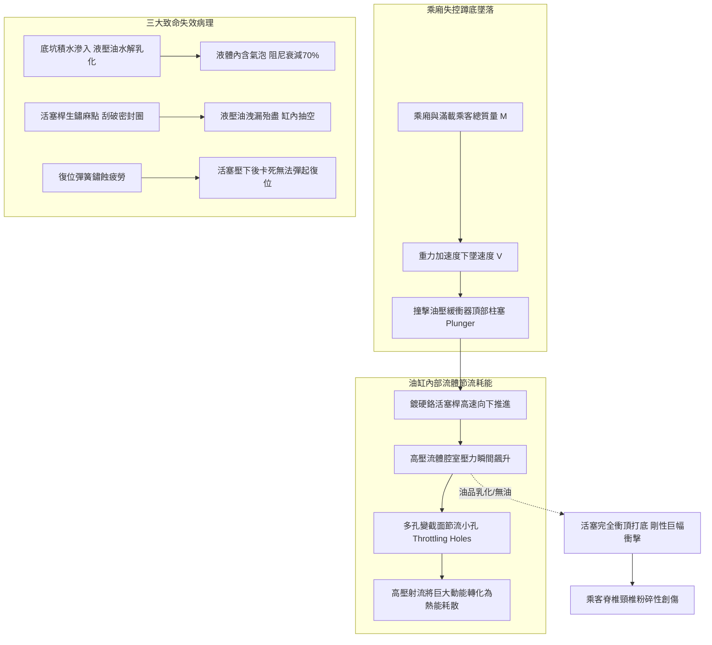
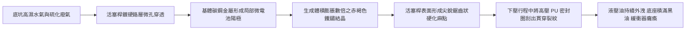
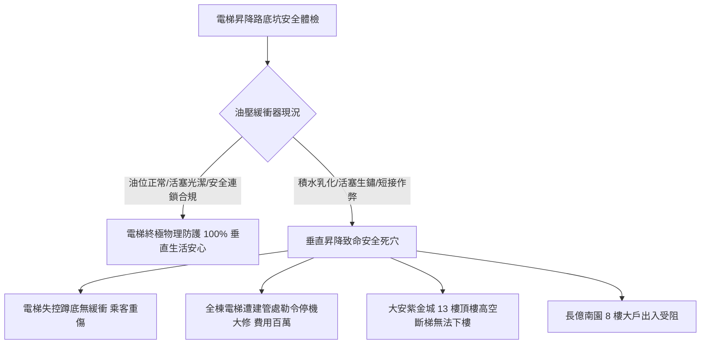

# 全案購屋實戰第五百六十六部_中古大樓社區各樓層電梯昇降路井道底坑油壓緩衝器液壓油乳化活塞桿鏽蝕微動極限開關接觸不良與安全防護體檢工序全書

---

## 序章：垂直昇降之最後物理防線——電梯底坑緩衝器之生死防衛

在集合住宅與高層中古大樓社區中，電梯昇降設備（Traction Elevator System）是全體住戶每日垂直通行的關鍵命脈。當電梯乘廂（Elevator Car）或對重側（Counterweight）因曳引機電磁煞車失效、主鋼索打滑失控、超速調速機夾繩延遲或極限開關失靈而發生「極端失控蹲底（Bottom Buffer Striking）」事故時，位於昇降路井道最底部（Pit 底坑）之「**油壓緩衝器（Oil Buffer / Hydraulic Buffer）**」，即為整座電梯保護乘客免於遭受致命衝擊加速度之最後一道不可被突破之物理吸收防線。

依據特種設備安全法規與 CNS 10594 電梯規範，額定速度超過 $1.0\text{ m/s}$ 之電梯必須強制安裝蓄能耗能型油壓緩衝器。油壓緩衝器內部注有高阻尼液壓油，藉由活塞受壓向下壓縮時將流體強行擠過特定節流孔孔道，將乘廂墜落之巨大動能（Kinetic Energy）完全轉換為熱能耗散。

然而，在屋齡 20 至 30 年以上之中古大樓社區中，昇降路底坑常年深藏於地下室最底層陰暗潮濕之處，隱藏四大致命機電與流體力學病理：
1. **底坑滲水受潮引發緩衝器液壓油乳化（Oil Emulsification）與阻尼崩潰**：地下室連續壁微裂隙滲漏水、或機械停車位洗車廢水滲入電梯底坑，積水淹沒緩衝器底座。水氣透過老化之活塞防塵封圈（Dust Wiper）侵入油缸內部，使專用抗磨液壓油（ISO VG 46/68）嚴重水解乳化，油體由清澈琥珀色轉化為白濁泡沫狀。乳化油之黏度指數與體積彈性模量（Bulk Modulus）暴跌，阻尼係數失真；當乘廂高速衝撞時，緩衝器無法產生設計計算之節流阻力，活塞瞬間「打底金屬硬碰硬撞擊」，造成乘客脊椎與頸椎嚴重粉碎性骨折。
2. **鍍硬鉻活塞桿（Piston Rod）生鏽麻點刮傷高壓油封引發液壓油外洩**：活塞桿表面長年暴露在潮濕酸性氣體中，鍍鉻層產生針孔狀電化學點蝕（Pitting Rust）。粗糙之鐵鏽麻點如同挫刀般，在每次微小行程中將高壓聚氨酯（PU）活塞油封刮出深深溝槽，液壓油沿著活塞桿日夜滲漏流失，缸內油位過低，緩衝器內部形成空腔氣室，完全喪失緩衝功能。
3. **電氣安全微動開關（Safety Switch）觸點氧化積碳與斷線**：法規強制緩衝器頂部必須設置「壓縮復位電氣檢知微動開關」。當緩衝器被壓縮後若內部復位彈簧（Return Spring）疲勞無法在 90 秒內完全彈回全行程原位時，開關必須切斷電梯安全迴路，禁止電梯再次受電運轉。但中古大樓之微動開關常因潮濕鏽蝕短路、或被保養人員便宜行事直接以電線「短接跨接」，導致緩衝器活塞卡死在底部時電梯依然帶病運行。
4. **緩衝器頂部防撞緩衝橡膠墊硬化碎裂**：直接承受乘廂底樑撞擊之高彈性橡膠衝擊墊（Rubber Bumper Buffer Cap）長期受油污浸泡溶脹、塑化龜裂，厚度自 30mm 壓縮至不足 5mm，金屬外露。

本全書將深入剖析油壓緩衝器節流耗能力學方程式、流體阻尼計算、活塞桿電化學腐蝕機制，並建立一套現場實戰體檢工序，為購屋家庭鎖定社區電梯公設之最極致安全底線。

---

## 第一章：油壓緩衝器流體節流力學與衝擊吸收破壞機理

### 第一節：多孔變截面節流管耗能物理學與減速度計算

1. **理想減速度與緩衝行程公式**：
   - 依據國際安全規範，油壓緩衝器作用時，乘廂之平均減速度嚴禁超過 $1.0\text{ g}（9.81\text{ m/s}^2）$；而在超過 $2.5\text{ g}$ 之峰值減速度持續時間嚴禁大於 $0.04\text{ 秒}$。
   - 額定速度為 $v$ 之電梯，油壓緩衝器之最小設計行程 $S$ 必須滿足：
     $$S = 0.0674 \cdot v^2 \quad (\text{行程以公尺計})$$
   - 例如額定梯速 $v = 1.75\text{ m/s}$ 之大樓電梯，緩衝器有效壓縮行程 $S \ge 0.0674 \times (1.75)^2 \approx 0.206\text{ m} = 206\text{ mm}$。

2. **節流流體阻尼力方程（Fluid Damping Force）**：
   - 活塞下壓時，液壓油被迫穿過內襯套管上分佈的一系列遞減微孔節流孔。流體阻尼阻力 $F_d$ 為：
     $$F_d = \frac{1}{2} \cdot \rho \cdot A_p^3 \cdot \left(\frac{v_p}{C_d \cdot A_o(x)}\right)^2$$
     其中 $\rho$ 為液壓油密度，$A_p$ 為活塞截面積，$v_p$ 為活塞瞬態下行速度，$C_d$ 為節流流量係數，$A_o(x)$ 為隨行程 $x$ 遞減之節流孔總通水斷面積。
   - 當油品乳化含有大量空氣微氣泡時，氣體之可壓縮性使油品有效密度 $\rho$ 與黏度劇降，節流阻尼力 $F_d$ 瞬間崩塌衰減，無法在有限行程內將動能耗盡，造成活塞在行程末端以巨大殘餘動能猛烈撞擊油缸底座金屬！

---

### 第二節：活塞桿電化學點蝕（Pitting Corrosion）與油封撕裂

1. **鍍鉻層微裂隙（Micro-cracks）電位差腐蝕**：
   - 緩衝器活塞桿基體為 45 號優質碳素結構鋼，表面電鍍 $20\sim 30\mu\text{m}$ 之硬質鉻（Hard Chrome）。
   - 電鍍工藝本身存在微觀網狀裂紋。在底坑相對濕度高達 90%~95% RH、且充斥著化糞池或積水溝揮發之硫化物與氯離子時，水氣滲入微裂隙抵達底層碳鋼。
   - 鐵（$\text{Fe}$，標準電位 $-0.44\text{V}$）與鉻（$\text{Cr}$，標準電位 $-0.74\text{V}$ 在鈍化態時高達 $+0.2\text{V}$）形成微觀原電池反應，鐵作為陽極被強烈氧化溶解，生成氧化鐵紅鏽（$\text{Fe}_2\text{O}_3 \cdot n\text{H}_2\text{O}$）。

2. **鐵鏽晶體脹破鉻層與高壓油封撕裂**：
   - 鐵鏽體積比原始鐵金屬膨脹 3~6 倍，將外部鍍鉻層強行頂起爆裂，表面形成如砂紙般粗糙尖銳之凹凸麻坑。
   - 當緩衝器偶爾被壓縮或震動時，高速下行的鏽蝕活塞桿直接研磨聚氨酯（PU）U 型唇形高壓密封圈。密封唇邊在數次摩擦後被徹底切削撕裂，缸體內之抗磨液壓油在自重與重力毛細作用下沿著活塞桿不斷向外漫溢流失，最終油缸見底抽空。

---

### 第三節：復位安全開關（Reset Safety Switch）連鎖防護失效

1. **復位彈簧（Return Spring）應力鬆弛與卡滯**：
   - 油壓緩衝器內部配置有一根重型鉻釩鋼壓縮復位彈簧，當乘廂被曳引機吊離後，彈簧負責在法規規定的 **90 秒以內**，將數十公斤之活塞桿與阻尼柱塞推回最頂端之原始滿行程位置。
   - 長期浸泡在乳化油泥中，彈簧受氫脆（Hydrogen Embrittlement）影響彈力衰減，或因活塞桿導向滑套（Bronze Bushing）受沙塵卡死，活塞無法彈回原位，長年停留在「半壓縮或全壓縮」死穴。

2. **微動安全開關短接作弊之極端危險**：
   - 安全法規規定，緩衝器柱塞頂端必須壓合一只常閉（NC）防護開關。當活塞未完全復位時，開關呈斷路狀態，電梯主機板安全迴路（Safety Circuit）被切斷，電梯禁止開門與運轉。
   - 許多老舊社區因電梯頻繁因緩衝器未復位而停機報警，無良或不專業之機電保養人員為圖省事，竟直接在控制箱或底坑接線盒內，用一截跨接銅線將該微動開關之兩端「直接短接（Jumper Shorted）」。
   - 短接後，即使緩衝器活塞已完全沉底卡死、缸內無油，電梯依然滿載高速上下狂飆，一旦發生墜落，電梯將在毫無任何緩衝防線下直接砸入底坑混凝土底板！

---

## 第二章：現場看屋電梯昇降路底坑七大實戰體檢工序

在評估中古大樓社區時，小寶與家人應要求房仲與管委會陪同，協調具備合法昇降設備專業技術人員證照之電梯保養工程師，開啟一樓乘場門，將電梯停在二樓檢修模式，使用底坑梯下至昇降路底坑實地落實以下七步工序：

| 體檢步驟 | 檢驗標的與操作動作 | 合格標準 (Pass) | 潛在致命瑕疵 (Fail) | 修繕對策與預算評估 |
| :---: | :--- | :--- | :--- | :--- |
| **Step 1** | **底坑乾燥度與滲水積水檢測** 強力手電筒檢查電梯底坑地坪與油坑 | 底坑地坪完全乾燥無積水、無油泥污垢，截水防護良好 | 底坑積存數十公分黑臭污水、緩衝器基座浸泡在水塘中 | 底坑全面高壓抽水清淤，施作高壓灌注親水性聚氨酯止漏（約 25,000~60,000 元） |
| **Step 2** | **油位計油量與油質透明度** 檢視緩衝器柱塞側面透明玻璃油位管 | 液位介於上限（MAX）與下限（MIN）標線之間，油色透明清澈琥珀色 | 液位低於下限標線、或油液呈現白濁乳白色液體（嚴重乳化） | 徹底抽乾廢油清洗油缸，重新注入原廠 ISO VG 46/68 專用液壓油（約 6,000~12,000 元/台） |
| **Step 3** | **活塞桿表面鍍鉻與鏽蝕點蝕** 以乾淨棉布擦拭活塞桿表面並用手觸摸 | 活塞桿鏡面光潔如新，無任何鏽斑、刻痕、麻點或毛刺 | 表面覆滿紅褐色鐵鏽顆粒、手摸有強烈粗糙砂紙刺手感 | 拆卸柱塞進行外圓精磨重鍍硬鉻，更換全套進口耐磨油封組（約 15,000~28,000 元/台） |
| **Step 4** | **復位時間與行程壓縮測試** 在安全防護下利用專用千斤頂手動壓縮 | 壓縮後釋放，柱塞在強大彈簧推力下平穩彈回頂端，時間 $\le 90\text{ 秒}$ | 柱塞卡死在下方紋絲不動、或彈回速度極慢耗時超過 3 分鐘 | 拆解更換高強度鉻釩鋼復位內外雙彈簧與青銅導向襯套（約 12,000~22,000 元） |
| **Step 5** | **復位安全微動開關觸點導通** 三用電表測量開關端子，並檢查線路 | 柱塞全復位時開關閉合電阻 $< 0.3\Omega$；微壓下瞬間立即斷路跳脫 | 開關接線被銅線短接作弊、觸點積碳氧化斷路、外殼破裂滲水 | 拆除違法跨接線，更換 IP67 防爆防水重載型安全微動開關（約 2,500~4,500 元/只） |
| **Step 6** | **頂部防撞緩衝橡膠墊彈性** 檢查活塞頂部圓形防撞橡膠蓋板 | 橡膠蓋厚度 $\ge 25\text{ mm}$，表面質地堅韌富彈性，無溶脹龜裂 | 橡膠墊碎裂缺失、受油浸泡軟化如爛泥、金屬底板完全裸露 | 更換耐油重載聚氨酯（PU）防撞衝擊減震墊（約 800~1,800 元/個） |
| **Step 7** | **底坑急停開關（Pit Stop Switch）** 檢視底坑爬梯旁紅色急停蘑菇按鈕 | 按下急停按鈕電梯安全迴路瞬間斷電鎖死，雙手拉起始能復位 | 按鈕卡死無彈力、外殼鏽穿、按下時電梯仍能被外召呼叫運轉 | 更換帶防護罩之雙回路強制斷開金屬緊急停機按鈕（約 1,800~3,500 元/組） |

---

## 第三章：底坑緩衝器安全風險對四大核心物件之戰略決策

### 第一節：四大核心考慮物件之電梯底坑安全深度評估
1. **大安紫金城 13 樓（PROP_10，第一首選）**：
   - 頂樓 13 樓視野極佳，但高度也最高，全家人每日外出採買、返家極度仰賴 2 部電梯之高速垂直運轉。
   - **安全核心**：高樓層電梯運轉速度較快（額定速度通常達 $1.5\sim 1.75\text{ m/s}$），一旦發生極限超速蹲底，衝擊動能與梯速平方成正比！若油壓緩衝器因地下室反潮積水而油質乳化或活塞鏽死，一旦發生衝底事故後果不堪設想。
   - **實地必查**：務必查閱該社區電梯最近一期由「中華民國昇降設備安全檢查協會」核發之年度安全檢驗合格證，並實地檢驗地下室底坑是否有抽水排水設施。

2. **長億南園 8 樓（PROP_106，空間之王）**：
   - 室內主附 32 坪大空間，居住人口多。
   - **談判籌碼**：若底坑存在長年積水、緩衝器油封滲漏或微動開關故障，買方應當場以「公設電梯底坑嚴重滲水受潮，緩衝器與導軌面臨數十萬元大修更換」為由，向賣方大砍價金 **10 至 15 萬元**。

### 第二節：成屋買賣合約電梯昇降設備特約保障條款範本
> 「賣方保證本買賣標的所屬大樓之電梯昇降設備（含機房曳引機、調速機、乘廂安全鉗、井道導軌、以及底坑油壓緩衝器與急停連鎖開關），均依法取得政府機關或特檢機構核發之有效安全檢查合格許可證，且底坑油壓緩衝器運作正常、無液壓油嚴重乳化外洩、活塞桿卡死或電氣安全開關非法短接之情事。若交屋前查明底坑存在嚴重積水泡水、緩衝器功能喪失或安檢被列管限期改善未完成者，賣方應負責促成管委會於交屋前完成修繕復原；否則買方得主張自價金中扣留新台幣參萬元整於履約保證專戶，作為買方承擔公共昇降安全風險之補償款。」
