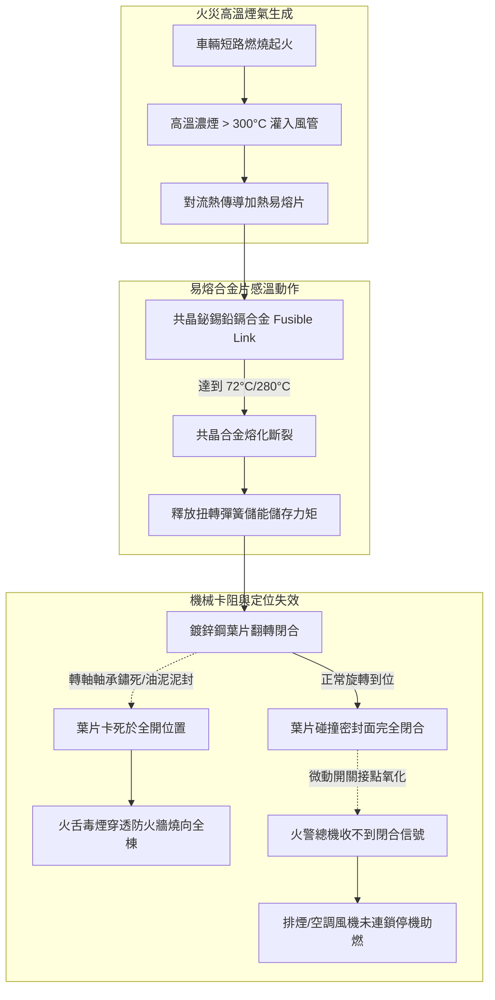
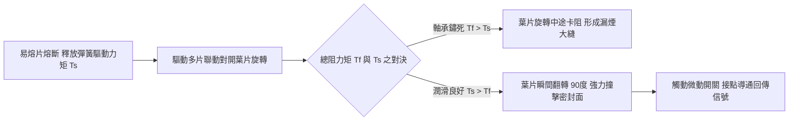
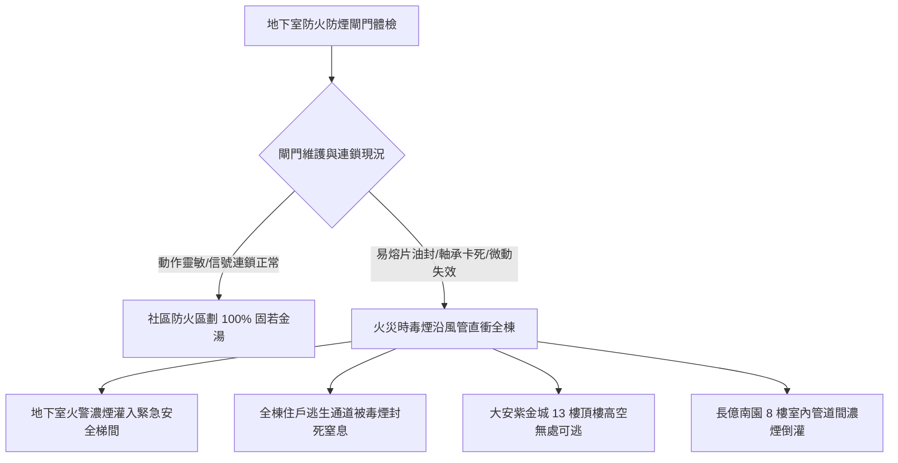

# 全案購屋實戰第五百六十四部_中古大樓社區地下室機械通風防排煙風管防火閘門熔斷手動復位卡死微動開關定位失效與風量衰減體檢工序全書

---

## 序章：高層建築防火防煙之咽喉要道——防火閘門之生死防線

在現代集合住宅大樓中，地下停車場（B1~B3/B4）、垂直安全梯間、緊急昇降機梯廳以及各樓層機電管線間，皆設有龐大之「**機械通風與防排煙風管系統（Mechanical Ventilation and Smoke Extraction System）**」。當火災不幸發生時，排煙風機負責高速抽出數百至數千度之劇毒高溫濃煙，而正壓送風機則向逃生安全梯間灌入新鮮空氣，形成正壓氣流屏障阻隔濃煙侵入。

在穿越大樓防火區劃（Fire Compartment）之混凝土防火牆、樓地板或管道間時，風管內部必須依法安裝「**常開型防火閘門（Fire Damper, FD）**」或「**排煙防火閘門（Fire/Smoke Damper, FSD）**」。

防火閘門屬於「平時長年開啟、火警高溫時必須在數秒內精準重力閉合」之關鍵安全連鎖部件。然而，在屋齡 20 至 30 年以上之中古大樓社區中，防火閘門常年深藏於地下室與各樓層天花板管線死角，隱藏四大致命機電與物理力學病理：
1. **易熔合金片（Fusible Link）受潮氧化脆化或水垢泥沙固化卡阻**：法定 72°C（一般通風）或 280°C（排煙風管）之熱敏易熔片，長年受地下室潮濕水氣與廢氣腐蝕，表面生成氧化物保護膜導致熔斷點大幅漂移；更常見的是，閘門滑軌與轉軸軸承被厚重的黑黃油泥、水泥粉塵與蛛網完全「泥封卡死」，即使易熔片在火災高溫下熔化斷開，重型鍍鋅鋼葉片依然被死死卡在常開位置，高溫火舌與致命毒煙沿著風道長驅直入相鄰防火區劃。
2. **手動復位機構（Manual Reset Mechanism）扭簧疲勞與鋼索斷裂**：定期消防安全檢查時，檢測人員若強制拉扯手動測試拉環，內部之重型不鏽鋼扭轉彈簧（Torsion Spring）產生塑性變形，或不鏽鋼拉索鏽斷，造成閘門「閉合後無法手動復位」或「卡在半開半閉狀態」，使平日地下室通風風量衰減超過 50%，一氧化碳濃度劇增。
3. **電氣微動輔助開關（Auxiliary Micro-switch）觸點氧化導致中控室連鎖失效**：防火閘門關閉時，必須藉由碰觸微動開關將「已關閉定位信號」回傳給中央火警受信總機（Fire Alarm Panel），並強制切斷對應之空調進風機以防助燃。但老舊微動開關接點氧化積碳，導致中控室誤判閘門依然處於常開狀態，進風機持續狂吹助長火勢。
4. **葉片密封耐溫膠條硬化脫落引發嚴重漏風漏煙**：葉片周邊之膨脹型石墨密封膠條（Intumescent Seal）經 20 年熱脹冷縮後老化碎裂，高溫時無法發泡膨脹封閉縫隙，閘門漏煙率超標數倍，失去阻煙防護功能。

本全書將深入剖析防火閘門熱傳導熔斷機制、葉片動態扭矩平衡方程式、防煙氣密流體力學，並建立現場實戰體檢工序，為購屋家庭鎖定社區防火安全之最高防線。

---

## 第一章：防火閘門熱力熔斷與動態力學失效機理

### 第一節：易熔合金片（Fusible Link）熱力熔化與失效分析

1. **共晶低熔點合金（Eutectic Alloys）物理特性**：
   - 防火閘門核心感溫元件為兩片薄黃銅板，中間以特定比例之鉍（Bi）、錫（Sn）、鉛（Pb）、鎘（Cd）等低熔點共晶合金銲接在一起。
   - 依據消防法規，普通防火閘門（FD）熔斷溫度為 **$72^\circ\text{C} \pm 2^\circ\text{C}$**；廚房排煙或防排煙風道之排煙防火閘門（FSD）熔斷溫度為 **$280^\circ\text{C} \pm 5^\circ\text{C}$**。
   - 當風管內煙氣溫度超過熔點時，共晶合金瞬間由固相轉為液相，兩片銅板在不鏽鋼彈簧拉力下分離斷開。

2. **表面污垢熱阻與合金老化延遲機制**：
   - 地下室排風管長年排放汽車廢氣，高黏度之碳黑、未燃烴類油泥與空氣中之纖維灰塵在易熔片表面沉積形成厚達 $1\sim 2\text{ mm}$ 之污垢保溫層。
   - 污垢層熱傳導率極低，形成可觀之熱阻（Thermal Resistance），火災發生時高溫煙氣無法及時傳導至金屬合金核心，造成熔斷動作時間由正常的 **$< 60\text{ 秒}$ 延遲至數分鐘以上**。
   - 在此致命延遲期間，數百立方公尺之劇毒一氧化碳與氰化氫濃煙已穿透風道灌滿相鄰樓層。

---

### 第二節：閘門葉片旋轉動態力學與摩擦阻力矩（Torque Balance）

1. **扭簧驅動力矩與摩擦阻力矩之平衡方程式**：
   - 閘門閉合動力來自預緊之重型不鏽鋼扭轉彈簧（Torsion Spring）。在任意翻轉角度 $\theta$ 下，葉片軸之動力學方程式為：
     $$J \cdot \frac{d^2\theta}{dt^2} = T_s(\theta) - T_f - T_{\text{wind}}$$
     其中 $J$ 為葉片轉動慣量，$T_s(\theta)$ 為彈簧驅動力矩，$T_f$ 為轉軸軸承與連桿鉸鏈之摩擦阻力矩，$T_{\text{wind}}$ 為風管內高速氣流對葉片產生之氣動阻力矩。

2. **軸承微動磨損（Fretting Corrosion）與咬死**：
   - 防火閘門 99.9% 的時間處於靜止狀態，但風管內氣流震動與大樓結構微震使轉軸在黃銅/不鏽鋼滑動軸套（Sleeve Bearing）內產生微幅微動摩擦。
   - 潤滑脂乾涸後，微動磨損產生金屬氧化鐵紅鏽（$\text{Fe}_2\text{O}_3$）硬質磨屑，將轉軸間隙（通常僅 $0.2\sim 0.3\text{ mm}$）完全脹死。
   - 摩擦阻力矩 $T_f$ 激增數倍，當 $T_f > T_s$ 時，彈簧根本無法拉動葉片，閘門維持原狀紋絲不動。

---

### 第三節：電氣輔助微動開關與中控受信總機連鎖

1. **常開/常閉接點之電氣防護等級**：
   - 防火閘門側邊配置防水防塵微動開關（Micro-switch），內部具備鍍銀合金觸點，防護等級需達 IP65。
   - 閘門閉合瞬間，旋轉凸輪碰桿壓下微動開關，常閉（NC）接點斷開、常開（NO）接點閉合，將乾接點信號（Dry Contact）經由信號模組傳輸至中央防災監控盤。

2. **接點氧化與虛接（False Connection）危機**：
   - 老舊地下室濕度高且伴隨腐蝕性氣體，微動開關外殼密封劣化，銀觸點表面生成高阻抗之硫化銀（$\text{Ag}_2\text{S}$）絕緣薄膜，接觸電阻由正常的 $< 0.1\Omega$ 激增至數千歐姆。
   - 即使閘門機械上已完全閉合，火警受信總機依然判定「閘門未就位」，無法自動切斷該區空調送風機，風機持續送入新鮮氧氣，產生「風箱效應」將局部初起火災助燃為全面燃燒。

---

## 第二章：現場看屋地下室防火閘門七大實戰體檢工序

在評估中古大樓社區時，買方應協調管委會機電人員或消防設備師陪同，攜帶高流明手電筒與安全帽，至地下室主排風管道間實地落實以下七步工序：

| 體檢步驟 | 檢驗標的與操作動作 | 合格標準 (Pass) | 潛在致命瑕疵 (Fail) | 修繕對策與預算評估 |
| :---: | :--- | :--- | :--- | :--- |
| **Step 1** | **檢視風管檢查門（Access Door）** 檢查防火閘門前後是否有活動檢查孔 | 閘門旁設有氣密可拆卸之金屬手孔門（$\ge 30\times 30\text{ cm}$），附密封膠條 | 無檢查門（全封閉盲管無法維護）、手孔門鏽死無法開啟 | 於風管側壁切割加裝標準帶鎖扣鍍鋅檢查門（約 2,500~4,500 元/處） |
| **Step 2** | **易熔合金片外觀與泥垢** 探頭進入檢查孔目視易熔片表面 | 金屬表面清潔光亮無厚重油垢，合金銲接線清晰完整 | 易熔片被黑黃黏稠油泥完全覆蓋、銅片鏽蝕發綠、合金開裂 | 以專用除油溶劑清洗，或更換原廠合格 72°C/280°C 易熔片組（約 800~1,600 元/片） |
| **Step 3** | **手動拉環釋放閉合測試** 手動拉動外部手動測試釋放拉環 | 葉片在 1 秒內迅速順暢旋轉 90 度完全閉合，撞擊聲清脆有力 | 葉片卡死不動、或僅翻轉一半即卡住（摩擦阻力過大） | 轉軸加注二硫化鉬耐高溫潤滑劑，更換重載高張力扭轉彈簧（約 3,500~7,000 元/組） |
| **Step 4** | **葉片周邊膨脹耐溫膠條** 手電筒照射葉片閉合後四周邊界 | 葉片與框體重合密封，膨脹石墨膠條厚度均勻無硬化脫落 | 膠條老化粉化碎裂露出縫隙、光線清晰透過縫隙直射出來 | 刮除舊膠條，重新黏貼耐火膨脹型石墨防煙密封條（約 800~1,500 元/米） |
| **Step 5** | **手動復位手柄操作流暢度** 手動搖動復位手柄將葉片重新拉回常開 | 搖動手柄手感均勻，棘輪定位扣件精準鎖定在全開位置 | 手柄軸打滑空轉、棘輪斷齒無法鎖死在全開位置 | 更換手動復位齒輪箱機構與棘輪定位夾爪（約 4,500~8,500 元/台） |
| **Step 6** | **微動開關定位信號電氣測試** 使用三用電表測量開關常開/常閉端子 | 閘門閉合瞬間，導通電阻 $< 0.5\Omega$；開啟時呈完全斷路 | 閉合後電阻高達數百歐姆（觸點氧化虛接）、或線路斷線 | 更換 IP67 防水防塵重載型金屬滾輪微動開關（約 1,200~2,200 元/只） |
| **Step 7** | **風量衰減與風道乾淨度檢查** 手持風速計測量地下室排風口風速 | 測得排風速度 $\ge 4.0\text{ m/s}$，風管無嚴重負壓吸癟異音 | 風速 $< 1.5\text{ m/s}$，風管發出尖銳嘯叫（閘門半卡阻造成風阻） | 全面校正閘門開度至 100% 水平，清理風道內部堵塞異物（約 5,000~12,000 元） |

---

## 第三章：防火閘門安全風險對四大核心物件之戰略決策

### 第一節：四大核心考慮物件之防煙安全深度評估
1. **大安紫金城 13 樓（PROP_10，第一首選）**：
   - 頂樓 13 樓若遭遇地下室火警，逃生時必須向下經由逃生安全梯步行下樓。
   - **生死關鍵**：若地下室或各樓層管道間防火閘門卡死無法閉合，劇毒濃煙將藉由「煙囪效應（Stack Effect）」在短短 3~5 分鐘內灌滿整座逃生梯間，高樓層住戶將面臨無路可逃之致命絕境。
   - **實地必查**：務必查閱管委會最近一次「**建築物公共安全檢查簽證及申報結果通知書**」中，關於「防火區劃、排煙設備及防火閘門」之抽驗合格紀錄。

2. **長億南園 8 樓（PROP_106，空間之王）**：
   - 室內面積大且緊鄰大樓公共管道間。
   - **談判籌碼**：若地下室排風管防火閘門長年失修卡死，或手孔門鏽蝕無人維護，買方應當場以「社區重大消防公共安全隱患，需動用專款全面檢修風道防火閘門」為由，向屋主爭取折讓價金 **10 至 20 萬元**。

### 第二節：成屋買賣合約防排煙與防火設備特約保障條款範本
> 「賣方保證本買賣標的所屬大樓之機械通風、防排煙系統及穿越防火區劃之防火閘門（含易熔片、手動復位機構及微動連鎖開關），均符合建築技術規則與消防法規之安全標準，且於最近一次法定公安與消防安檢中無任何列管重大缺失。若交屋前查明社區防火閘門存在普遍性鏽死卡阻、無法手動復位或信號斷線等重大安全瑕疵者，賣方應負責協調管委會於交屋前完成檢修更換；否則買方得主張自價金中扣留新台幣貳萬元整於履約保證專戶，作為買方承擔公共防火安全風險之補償。」
