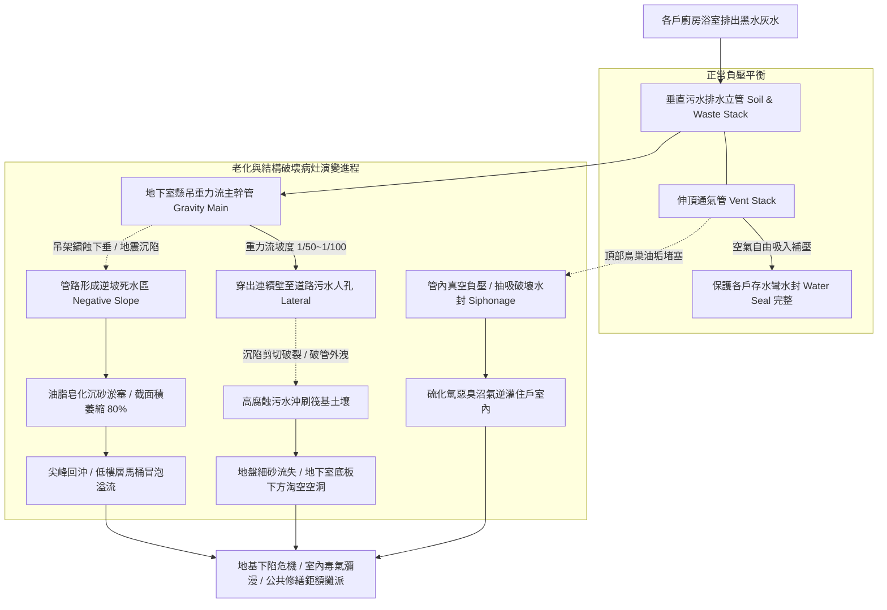

# 全案購屋實戰第五百四十一部_中古大樓社區地下室生活污水下水道用戶接管重力流破管滲漏地盤掏空沉砂淤塞逆坡回沖與惡臭毒氣逆灌室內體檢工序全書

## 壹、核心體檢宗旨與家庭居住安全意涵

在中古集合住宅大樓的衛生排水網絡中，民生污水排水系統承擔著全社區數百戶住戶每日廚房油脂廢水、衛浴洗滌水以及糞便污水（黑水與灰水）排放的關鍵任務。在台中市積極推動公設污水下水道接管工程的背景下，大部分屋齡 20 至 25 年的中古社區均已完成或正進行「污水下水道用戶接管工程（Sewage Lateral Connection）」，廢除傳統化糞池槽體，改由地下室重力流幹管直接銜接至道路公共污水下水道人孔。

對於小寶家庭重點考量的核心物件（**大安紫金城 13 樓**、**長億南園 8 樓**、**歌德堡 8 樓**與**靜園 A 區 11 樓**），雖然高樓層本身不會直接遭受一樓或二樓排水管倒灌冒泡的直接水害，但地下室生活污水公共幹管的健康妥善率，直接關乎整棟大樓的地下結構地基安全、全棟管道間沼氣毒氣防護以及公共維修基金的分攤風險。

然而，在屋齡達 20 至 25 年的中古地下室深層機房與基礎土層中，污水幹管在經歷數十萬噸強酸強鹼廢水沖刷、高濃度油脂皂化以及地震沉陷拉扯後，極易衍生出四大極具破壞性的深層公衛與結構病灶：

1. **地下室懸吊鑄鐵/PVC 污水幹管逆坡（Negative Slope）與重油污泥硬化沉砂淤塞**：重力流污水管標準坡度應維持在 **1/50 至 1/100**。老舊吊管吊架因螺栓鏽蝕下垂或地震結構位移，管路產生局部下陷形成「逆坡死水區」。廚房重油與毛髮沉泥在死水區內皂化凝固成堅硬如石的油垢塊，使原本 6 英吋（DN150）的管徑有效過流截面萎縮超過 **70%~80%**。每逢尖峰用水時段，污水排放不及，瞬間在垂直立管內形成高壓水柱逆向回沖！
2. **埋地幹管破裂滲漏與地下室筏基土壤「微觀淘空（Subsurface Soil Void）」**：早期穿出地下室連續壁銜接至道路人孔的埋地污水陶管或水泥管，因建築物本體與道路回填土層產生「不均勻沉陷差」，管口接頭被硬生生剪斷破裂。高腐蝕性污水長年順著破孔沖刷地盤，將筏基底部的細砂粉土持續淘洗掏空，在地下室底板下方形成巨大的「地下暗坑空洞」，直接危及整棟大樓的基礎抗震承載力！
3. **排水立管通氣管（Vent Pipe）鳥巢油垢堵塞與水封蒸發引發惡臭沼氣逆灌**：污水系統必須配置完整的伸頂通氣管（Stack Vent）。老舊通氣管頂端防蟲網破裂，遭鳥類築巢或油煙冷凝物堵塞。當垂直立管大量排水時，管內產生強烈負壓（吸吮作用），將各樓層衛浴存水彎的「水封（Water Seal）」瞬間吸乾破封。高濃度硫化氫（H2S）、氨氣及易燃甲烷沼氣，順著排水孔如毒氣室般狂湧逆灌進入住戶室內！
4. **幹管破裂產生的厭氧生物硫酸腐蝕（MIC）貫穿管壁噴湧發酵穢物**：在密閉管路內，厭氧菌將硫酸鹽轉化為硫化氫，頂部凝結水中的硫桿菌進一步將其氧化為極強之「硫酸（H2SO4）」，將鑄鐵管頂部管壁咬蝕至僅剩薄如紙片。在水流衝擊下，管壁瞬間大面積破裂穿孔，高壓發酵的糞便污水如瀑布般狂噴至地下室車道與機械車位，引發恐怖的環境衛生浩劫。

本手冊針對考慮標的建立標準化的地下室污水吊管坡度雷射量測、管底沉砂內視鏡勘驗、存水彎負壓防破封測試與買賣契約專屬特約防線。

---

## 貳、生活污水重力流接管體系與破管掏空失效力學

### 1. 污水管重力流坡度與流速法定標準規範
- **建築技術規則建築設備編第 29 條 / 排水管線設計規範**：
  - 管徑 100mm（4 英吋）之污水橫支管與幹管，重力流最小坡度不得小於 **1/50（2%）**；管徑 150mm（6 英吋）以上最小坡度不得小於 **1/100（1%）**。
  - **自清流速（Self-Cleansing Velocity）門檻**：管內污水流速必須維持在 **0.6 至 0.9 m/s** 之間。若因逆坡導致流速小於 0.6 m/s，固體糞便與油脂沉砂將立即滯留沉積硬化。
- **存水彎水封深度標準**：各衛生器具存水彎水封高度應維持在 **50 至 100 mm**。當管內負壓超過 **-25 mmAq（約 -2.5 mbar）** 時，水封即會被吸入管內破壞。

---

## 參、實地帶看地下室污水管線現場體檢工序（SOP）

小寶在實地帶看大安紫金城 13 樓、長億南園 8 樓、歌德堡 8 樓或靜園 A 區 11 樓時，應進行地下室污水吊管與室內存水彎雙向工序體檢：

| 檢驗步驟 | 檢驗場域與操作工序 | 正常指標 | 異常警訊與深層水力病灶 |
| :--- | :--- | :--- | :--- |
| **步驟一：地下室天花板懸吊污水幹管坡度勘驗** | 攜帶強光手電筒與雷射測距/水平儀，沿地下室天花板懸吊之橘紅色或灰色污水主管檢視。 | 管道平直均勻朝排水方向順暢向下傾斜，每隔 1.5~2 米配置完好之鍍鋅防震吊架。 | 1. 管道中段明顯呈「V 型或弧形下垂」（肉眼可見逆坡積水凹槽）。 2. 吊架螺栓鏽斷脫落，管身僅靠鐵絲勉強懸吊。 |
| **步驟二：污水管清潔口（Cleanout）與法蘭滲漏檢視** | 檢視污水幹管轉彎處配置的螺紋清潔孔蓋（CO）與法蘭接頭。 | 清潔孔蓋緊閉無漏，金屬法蘭乾燥無結晶，周圍無滴水與乾涸污漬。 | 1. 清潔口蓋板被白色生料帶厚厚包裹，下方持續滴落黏稠黑臭污水。 2. 法蘭螺栓鏽蝕脹大成球狀，管底積聚發黑固化油垢餅。 |
| **步驟三：穿出連續壁外牆套管處「沉陷剪切」體檢** | 走到地下室外牆角落，檢視污水幹管穿透連續壁銜接至外部道路之人孔套管處。 | 管道穿牆套管防水橡膠圈密封良好，無剪切偏位，牆面無水痕。 | 管道在穿牆處出現明顯「剪切微幅錯位（折角）」、管壁開裂，周邊水泥基座下陷掏空。 |
| **步驟四：目標戶衛浴存水彎負壓與防臭實測** | 於目標戶室內，將所有馬桶同時沖水，並在洗臉盆排水孔處細聽聲音。 | 沖水順暢迅速，排水孔安靜無任何氣泡反冒聲，室內空氣清新無異味。 | 1. 沖水時洗臉盆或地排發出「咕嚕咕嚕」劇烈喘氣冒泡聲（通氣管堵塞！）。 2. 地排飄出濃烈腐敗臭雞蛋味（硫化氫沼氣逆灌）。 |

---

## 肆、全案置產防禦與買賣契約特約保障

對於小寶家庭而言，無論購入哪一個樓層，地下室公共污水排水幹管若破裂或逆坡淤塞，全大樓不僅面臨地基土壤掏空下陷的結構危機，公共修繕清淤工程費用更需動輒十數萬元的基金攤派：

### 1. 污水排水幹管修繕與高壓水刀清淤成本基準
- **地下室重力流幹管專業高壓水刀旋轉噴頭清淤通管（含油脂皂化層粉碎清運）**：單次工程款約 **\$18,000 ~ \$32,000**。
- **重新校正懸吊污水幹管坡度、更換重載防震不銹鋼吊架組（以 30 米管段計算）**：約 **\$25,000 ~ \$42,000**。
- **連續壁穿牆套管沉陷破管開挖、更換撓性抗震伸縮接頭（Flexible Joint）與高壓發泡止漏**：工程款約 **\$45,000 ~ \$80,000**。
- **全棟頂樓污水伸頂通氣管疏通與更換不銹鋼防鳥防蟲通氣罩**：約 **\$8,000 ~ \$15,000**。

### 2. 購屋買賣合約公共污水下水道與幹管安全專屬特約條款範本
> **社區公共生活污水下水道重力排水幹管暢通保證特約條款**：  
> 「賣方擔保本買賣標的所屬大樓社區之地下室生活污水下水道用戶接管及懸吊重力流幹管運作正常，管路坡度合規無嚴重油泥沉砂淤塞逆坡，穿牆套管處無破裂滲水掏空地盤，且通氣系統暢通無硫化氫沼氣逆灌室內情事。自本契約簽訂日起至交屋日止，若經現場勘驗或專業下水道檢測機構判定該社區污水幹管嚴重逆坡堵塞需專案水刀清淤、或外牆破管需開挖修復者，其修繕支出或管委會因此產生之工程專案攤派款，概由賣方全額負責清償，賣方不得向買方主張任何補償。」
