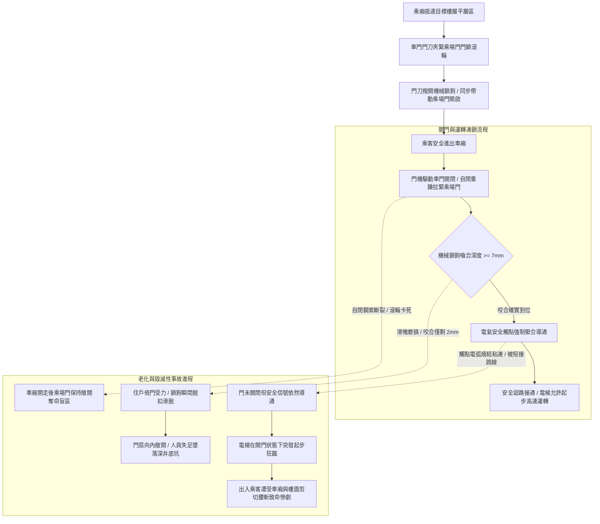

# 全案購屋實戰第五百四十七部_中古大樓社區各樓層電梯乘場門門鎖裝置機械咬合嚙合深度不足電氣安全觸點氧化積碳與剪切夾人事故體檢工序全書

## 壹、核心體檢宗旨與家庭居住安全意涵

在中古集合住宅大樓的垂直交通體系中，統計全台灣乃至全球歷年電梯重大傷亡事故，高達 **70% 至 80% 的傷亡悲劇均發生在「乘場門（Landing Door / Hall Door，各樓層電梯門）」的門鎖安全連鎖區域**。

乘場門是分隔各樓層候梯廳與深達數十公尺黑暗井道深淵的唯一物理隔屏。依據中華民國 CNS 10594 電梯安全標準與歐洲 EN 81-20 法規，每一層樓的乘場門必須配置一套極度嚴密的「機械與電氣雙重聯鎖裝置（Mechanical & Electrical Interlocking Device，簡稱門鎖總成 Door Lock Assembly）」：
1. **機械強制鎖定咬合（Mechanical Latching）**：當乘廂不在該樓層平層停靠區內時，乘場門的機械鉤鎖（Locking Hook）必須牢牢咬入鎖座，外力絕對無法自走廊手動推開或扒開門扇。
2. **電氣安全觸點閉合（Electrical Safety Contact）**：唯有當機械鉤鎖咬入深度達到法定安全標準（至少 7mm 以上）之後，門鎖內部的常開電氣安全開關觸點方能閉合導通，將「安全確認信號」送入電梯主電腦；只要有任何一層樓的門鎖被打開或未完全鎖死，電梯主安全迴路（Safety Circuit）立即強制斷電，主機煞車電磁抱死，絕對禁止電梯起步運轉。

然而，在屋齡達 20 至 25 年的中古社區各樓層走廊中（如小寶家庭重點關注的**大安紫金城 13 樓**、**長億南園 8 樓**、**歌德堡 8 樓**與**靜園 A 區 11 樓**），乘場門歷經住戶數十萬次推擠撞擊、推車刮碰以及微觀地坪沉陷，極易衍生出四大極具毀滅性的致命盲區：

1. **機械鉤鎖嚙合深度嚴重不足（不足 2~4 mm）引發「倚門墜落井道深淵」**：門扇下導軌滑塊（Door Guide Shoes）磨損鬆動，使門扇向井道內傾斜，鉤鎖咬合深度大幅縮減至僅剩數公釐（甚至僅靠尖端勉強勾住）。當長輩、幼童或飲酒住戶無意中輕輕倚靠在電梯門上時，門扇受外力微幅變形，鉤鎖瞬間「滑脫彈開」，門扇大開，人員直接踏空墜入深達十數公尺的井道底坑粉身碎骨！
2. **電氣安全觸點（Silver Contacts）氧化、積碳電弧燒結與「開門狀態下電梯開車剪切腰斬」**：門鎖開關每次分斷時均產生微弱電弧，20 年下來銀合金接點表面堆積發黑氧化層與積碳。部分不肖保養廠商為了避免接點接觸不良頻繁跳機報警，竟在接線端子排私自用銅線「將門鎖安全迴路短接跳線（Jumper）」，或是接點高溫融接粘連。此時若發生門扇敞開但電梯因信號誤判強行起步，正在跨入電梯的長輩幼童將當場遭受車廂與樓板邊緣「活生生剪切腰斬」的恐怖血腥慘劇！
3. **乘場門自動自閉重錘（Counterweight）鋼索斷裂脫落與敞門不閉**：安全法規要求當乘廂離開該樓層時，乘場門必須依賴自閉重錘或自閉彈簧以純機械力「自動關閉鎖死」。老舊自閉鋼索長年鏽蝕斷裂、滑輪軸銷生鏽卡死，導致車廂開走後，乘場門竟「保持敞開」，形成隨時吞噬行人的奪命黑洞！
4. **門刀（Car Door Vane / Cam）嚙合間隙偏移刮撞門鎖滾輪發出刺耳異音**：車廂頂部帶動各樓層門鎖開啟的金屬門刀，受導靴磨損晃動產生水平漂移，電梯高速穿堂而過時，門刀直接擦撞各樓層門鎖滾輪，發出規律刺耳的金屬撞擊聲，加速門鎖機構疲勞鬆脫。

本手冊針對高樓層置產標的建立標準化的各樓層乘場門機械咬合深度測量、外力推門防脫勾勘驗、自閉重錘回彈實測 SOP、修繕成本指標與買賣契約專屬特約防線。

---

## 貳、乘場門雙重聯鎖系統架構與剪切墜落失效力學

### 1. 乘場門機械鎖鉤嚙合深度法定標準規範
- **CNS 10594 昇降機安全標準 / EN 81-20 規範**：
  - 乘場門鎖緊元件之嚙合深度（Engagement Depth），在電氣安全觸點閉合瞬間，其有效機械咬合長度不得小於 **7 mm**。
  - **外力衝擊防護標準**：乘場門扇在承受垂直於門表面 **300 N（約 30 kgf）** 之靜態均勻推力時，門扇彈性變形量不得大於 15 mm，且鎖緊機構絕對嚴禁脫扣開啟。
  - **自閉機能規範**：當車廂在開鎖區以外時，開啟之乘場門被釋放後，必須能完全自動滑動閉合並確實鎖定。

### 2. 電氣安全觸點正向斷開標準
- 門鎖電氣開關必須採用「正向分斷（Direct Opening Action）」機構，利用機械連桿強制將動靜觸點推開，嚴禁僅依賴彈簧彈力斷開（防止接點高溫微熔焊接時無法斷開）。

---

## 參、實地帶看乘場門鎖裝置現場體檢工序（SOP）

小寶在實地帶看大安紫金城 13 樓、長億南園 8 樓、歌德堡 8 樓或靜園 A 區 11 樓時，搭乘電梯與各樓層走廊勘驗應進行以下四步深度工序體檢：

| 檢驗步驟 | 檢驗場域與操作工序 | 正常指標 | 異常警訊與深層機械病灶 |
| :--- | :--- | :--- | :--- |
| **步驟一：走廊乘場門扇手動扒門與推力勘驗** | 於目標樓層（如 13 樓）電梯不在該樓時，雙手以約 15~20 kgf 力量向內推壓並嘗試左右手動扒開門縫。 | 門扇紋絲不動、堅固牢靠，門中縫微幅位移在 **2 mm** 以內，無任何脫扣跡象。 | 1. 輕輕一推門扇即向內凹陷超過 20mm，上方傳出鎖鉤即將滑脫的「卡嗒」金屬鬆脫聲！ 2. 雙手用力一扒，門扇竟然被輕易拉開一條超過 5 公分的大縫！ |
| **步驟二：乘場門自閉重錘與回彈鎖定測試** | 當電梯停靠開門後，用手將乘場門手動推開約 1/3 幅度（約 30cm），隨後鬆開手部。 | 門扇在自閉重錘拉力下平順均勻回滑，發出清脆「啪」一聲確實鎖死在關閉位。 | 1. 鬆手後門扇卡在原處完全不回動（自閉鋼索早已斷裂或滑輪卡死！）。 2. 門扇緩慢回滑但到最後 2 公分無力卡阻，未完全上鎖。 |
| **步驟三：電梯平層穿堂時門刀刮撞異音監聽** | 在車廂內部由 1 樓直上頂樓，聆聽車廂高速經過各樓層乘場門時的聲音。 | 車廂運行平穩，僅有均勻風切聲，經過各樓層時無任何規律金屬敲擊聲。 | 每經過一層樓，車廂頂部便傳出「鏗、鏗、鏗」規律金屬碰撞聲（門刀與門鎖滾輪嚴重摩擦偏位！）。 |
| **步驟四：查閱每月保養單「門鎖裝置與自閉性」** | 查閱管理室存查之「電梯定期保養紀錄表」昇降門及門鎖項目。 | 技師按月檢測「各層乘場門鎖嚙合深度 >7mm」、「安全觸點正常」並簽章打勾。 | 該項目連續空白未填，或備註欄註記「X 樓門鎖接觸不良建議換新」，管委會未安排排修。 |

---

## 肆、高樓層住宅置產防禦與合約特約保障

對於鎖定高樓層（大安紫金城 13 樓、靜園 A 區 11 樓、長億南園 8 樓、歌德堡 8 樓）的小寶家庭而言，乘場門鎖是阻絕家人失足墜落深井底坑與防止開門剪切意外的生死守護線：

### 1. 乘場門鎖總成修繕更新成本基準
- **單一樓層乘場門鎖除鏽清潔、重新調校嚙合深度（>7mm）與更換自閉鋼索**：連工帶料約 **\$3,500 ~ \$6,000 / 樓層**。
- **更換合格原廠重載型乘場門鎖總成（含耐高溫正向分斷電氣安全觸點塊）**：約 **\$8,000 ~ \$14,000 / 樓層**。
- **全棟乘場門地坎（Door Sill）耐磨滑塊全面更換與門扇下防脫軌加固**：單門約 **\$2,500 ~ \$4,500**。
- **全棟乘場門安全連鎖系統全面大修翻新（以 12~15 層樓計算）**：整套工程款高達 **\$65,000 ~ \$110,000**。

### 2. 購屋買賣合約電梯乘場門安全連鎖專屬特約條款範本
> **電梯各樓層乘場門鎖裝置機械與電氣安全保證特約條款**：  
> 「賣方擔保本買賣標的所在棟別之電梯昇降設備運作正常，其各樓層乘場門（特別是本標的所在樓層及一樓大廳門）之機械鉤鎖咬合深度符合國家安全標準（大於七公釐），門扇結構堅固無推擠滑脫脫扣之隱患，且電氣安全觸點機能完整無跳線短接情事，自閉重錘裝置回彈確實。自簽約日起至交屋日止，若經電梯專業檢查機構判定該棟電梯乘場門鎖裝置老化損壞需更換或安全迴路遭短接者，其修繕支出或管委會因此產生之工程專案攤派款，全數由賣方負責清償，賣方不得向買方主張任何補償。」
