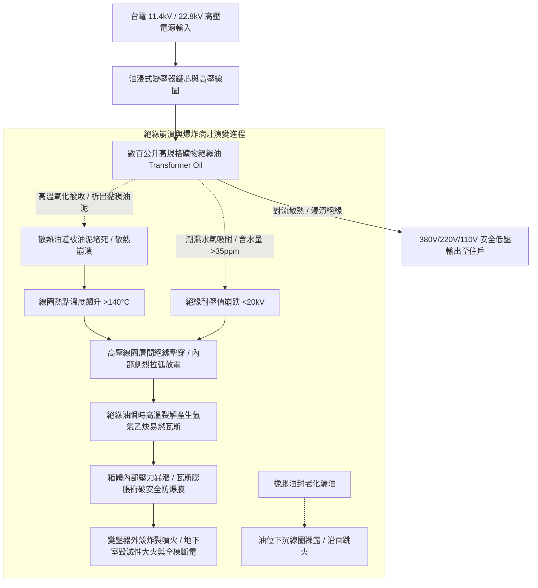

# 全案購屋實戰第五百四十三部_中古大樓社區地下室變電室油浸式變壓器絕緣油耐壓劣化油泥碳化PCB多氯聯苯殘留油封滲漏與高溫爆炸體檢工序全書

## 壹、核心體檢宗旨與家庭居住安全意涵

在中古集合住宅大樓中，全社區數百戶家庭的冷氣空調、廚房用電、照明插座、以及公共電梯與給水泵浦的龐大電力需求，其源頭完全依賴設置於大樓地下室「高低壓電氣設備室（配電室 / 變電室 Substation Room）」內的「油浸式電力變壓器（Oil-Immersed Power Transformers）」或乾式變壓器。

台電高壓電網以 **11.4 kV（11,400V）或 22.8 kV（22,800V）** 的超高壓饋線送入大樓地下室後，油浸式變壓器透過內部浸泡於數百公升「絕緣油（Transformer Mineral Insulating Oil）」中的高導磁矽鋼片鐵芯與銅線圈，將萬伏高壓降壓轉換為住戶日常使用的 **380V/220V/110V** 低壓電力。

絕緣油在變壓器內部扮演著「絕緣阻抗（Dielectric Insulation）」與「循環對流散熱（Cooling Heat Dissipation）」的生死雙重角色。對於小寶家庭重點考量的各棟社區（如**大安紫金城 13 樓**、**長億南園 8 樓**、**歌德堡 8 樓**與**靜園 A 區 11 樓**），雖然住家位於高樓層，但地下室變電室的變壓器若因長年維護不善發生絕緣擊穿與高溫爆炸，將引發全社區數日甚至數週無電可用的重大災難，其火災煙囪效應更會順著電纜管道間直衝頂樓，嚴重威脅全家人的生命安全。

然而，在屋齡達 20 至 25 年的中古社區變電室中，油浸式變壓器長年處於 24 小時連續高負載、高熱烘烤以及地下室濕氣環境中，極易衍生出四大極具毀滅性的電力安全與化學病灶：

1. **變壓器絕緣油吸收水氣耐壓絕緣強度（Breakdown Voltage）崩跌與內部相間短路爆炸**：礦物絕緣油長年吸附空氣中的微量水分（含水量超過 30~50 ppm），油分子在強電場作用下電離分解。絕緣耐壓強度由新油的 **> 40 kV** 急遽衰減至不足 **15~20 kV** 的危險邊緣。一旦遭遇夏季午後雷擊突波或住戶用電尖峰過載，高壓線圈層間絕緣瞬間「擊穿電弧放電（Arc Discharge）」，引發內部絕緣油瞬間氣化裂解，產生大量氫氣、乙炔與甲烷易燃氣體，巨大的內部膨脹壓力直接將厚重鑄鐵外殼炸飛炸碎，引發地下室毀滅性大爆炸與大火！
2. **絕緣油熱氧化劣質化、重度「油泥沉澱（Sludge Formation）」阻死散熱油道**：高溫加速油品氧化酸敗，酸價（Acid Number）飆升，油液變黑發黏並析出膠狀深褐色油泥。油泥沉積包裹在高壓線圈表面並堵死散熱散熱鰭片管路，散熱效率暴跌。線圈熱點溫度突破 **130°C~150°C**，牛皮紙絕緣材料（Kraft Paper）熱老化脆斷粉化，使變壓器剩餘壽命瞬間歸零。
3. **老舊變壓器橡膠油封墊圈（Gasket）硬化龜裂與慢性滲油**：高壓絕緣油順著低壓套管（Bushing）、放油閥（Drain Valve）與箱蓋接縫持續滲漏，在變壓器基座下方積聚大片黑色可燃油潭。油位持續下沉至「瓦斯繼電器（Buchholz Relay）」或線圈裸露水平線以下，導致裸露的高壓導電部分在空氣中直接發生相間跳火。
4. **早期殘留「多氯聯苯（PCB）」劇毒致癌化學品公害隱患**：台灣自民國 71 年起雖已禁用多氯聯苯，但在屋齡達 25~30 年以上的早期老舊變電室中，部分老舊電容器或未經合法更換變壓器油品的設備中，仍可能殘留微量 PCB 毒物。一旦高溫起火燃燒，將釋放出世紀之毒「戴奧辛（Dioxin）」，全大樓管道間與住戶室內將受到嚴重的持久性化學毒物污染！

本手冊針對考慮標的建立標準化的變電室油浸式變壓器油位油色勘驗、絕緣油耐壓試驗報告解讀、外觀滲油體檢 SOP、修繕成本指標與買賣契約專屬特約防線。

---

## 貳、變壓器油絕緣散熱體系與高溫爆炸失效力學

### 1. 變壓器絕緣油法定檢驗標準規範
- **CNS 1326 / ASTM D877 絕緣油耐壓標準**：
  - **新油標準**：擊穿電壓（Breakdown Voltage）應 **> 40 kV**。
  - **運轉中油品安全合格門檻**：擊穿電壓必須維持在 **> 30 kV（最低容許極限 25 kV）**。若實測耐壓值低於 **20 kV**，必須立即停機進行「真空高溫濾油（Oil Filtration）」或全數更換新油。
  - **酸價限制**：中和值酸價必須小於 **0.2 mg KOH/g**。超過 0.4 代表嚴重劣化酸化。

### 2. 多氯聯苯（PCB）法定環保安全界限
- 依行政院環境保護署《有害事業廢棄物認定標準》，變壓器絕緣油中之多氯聯苯含量必須 **< 50 ppm（現代標準嚴格要求 < 2 ppm）**。若檢出超標，該變壓器即屬法定有害化學毒物，必須專案委託甲級廢棄物處理機構高溫焚化銷毀。

---

## 參、實地帶看地下室變電室現場體檢工序（SOP）

小寶在實地帶看大安紫金城 13 樓、長億南園 8 樓、歌德堡 8 樓或靜園 A 區 11 樓時，應在管委會或專業機電技師陪同下，進行以下四步深度工序體檢：

| 檢驗步驟 | 檢驗場域與操作工序 | 正常指標 | 異常警訊與深層電力病灶 |
| :--- | :--- | :--- | :--- |
| **步驟一：變壓器油位計與絕緣油顏色勘驗** | 攜帶強光手電筒檢視變壓器頂部之玻璃管油位計（Oil Level Indicator）。 | 油位介於 20°C 常溫刻度線之間，油色清澈透亮，呈淡金黃色或透明琥珀色。 | 1. 油位計已乾涸看不見油面（嚴重漏油，內部線圈隨時裸露跳火！）。 2. 油色深黑發暗、渾濁如墨汁，管壁附著厚厚一層深褐色油泥。 |
| **步驟二：箱體外殼、高低壓套管接縫滲油查驗** | 檢視變壓器四周散熱油管、底部放油閥與高壓瓷瓶套管基座。 | 鑄鐵外殼乾爽微塵，無油漬滲漏，變壓器下方集油承槽乾燥無積油。 | 1. 底部放油閥周圍滿布黑色黏稠油垢，地面積聚大片油潭。 2. 高壓瓷瓶絕緣套管根部橡膠墊圈龜裂，油液向上漫溢冒泡。 |
| **步驟三：運轉電流嗡鳴聲與外殼紅外線測溫** | 於變電室安全圍欄外，細聽變壓器運轉聲音，並以紅外線測溫槍測量箱體溫度。 | 聲音為均勻低沈之 60Hz 交流嗡鳴聲，箱體外殼溫度穩定在 **45°C ~ 65°C**。 | 1. 傳出內部異常「啪茲、啪茲」微弱放電打火異音，或伴隨劇烈鐵芯鬆動雜音。 2. 散熱散熱鰭片局部溫度高達 **85°C ~ 100°C** 以上，伴隨強烈焦臭味。 |
| **步驟四：查閱大樓每年「高低壓電氣定期檢驗報告」** | 查閱管理室存查之經濟部認可檢驗機構申報的「大樓電力設備定期安全檢查記錄表」。 | 檢驗日期在一年內，技師簽章齊全，變壓器絕緣油耐壓值標註大於 **30 kV**。 | 報告已逾期數年未檢（重大公安黑戶！），或檢測單備註「絕緣油劣化建議抽換濾油」，管委會未處理。 |

---

## 肆、全案置產防禦與買賣契約特約保障

對於小寶家庭而言，無論購入哪一個樓層，地下室變電室的變壓器若老化爆炸，全社區將面臨數週斷電、公共電梯癱瘓、生活水塔無法揚水的重大生活災難，其重新更換大型變壓器的費用更高達數十萬至上百萬元：

### 1. 變壓器保養、濾油與重置成本基準
- **地下室變壓器現場帶電真空脫水高壓濾油工程（含耐壓測試報告）**：單台約 **\$18,000 ~ \$30,000**。
- **全數抽換全新符合 CNS 規範之無 PCB 礦物絕緣油（約 300~500 公升，含廢油清運）**：約 **\$35,000 ~ \$55,000**。
- **更換全套變壓器高低壓瓷瓶套管、耐油耐高溫氟橡膠墊圈組（Gasket）**：約 **\$25,000 ~ \$42,000**。
- **變壓器內部短路燒毀，全面吊裝更換全新高效能低噪音油浸式或乾式變壓器（以 300kVA~500kVA 計算）**：整套工程款高達 **\$350,000 ~ \$600,000**。

### 2. 購屋買賣合約公共變電室與電力設備安全專屬特約條款範本
> **社區公共變電室油浸式變壓器安全保證特約條款**：  
> 「賣方擔保本買賣標的所屬大樓社區之地下室公共高低壓變電設備運作正常，油浸式變壓器油位正常無嚴重滲漏，絕緣油耐壓強度符合國家電氣安全檢查標準，且無殘留超標多氯聯苯（PCB）有害化學物質情事。自本契約簽訂日起至交屋日止，若經經濟部認可專業檢驗機構判定該大樓變壓器絕緣油劣化嚴重需進行大型濾油或整組更新者，其修繕支出或管委會因此產生之工程專案攤派款，概由賣方全額負責清償，賣方不得向買方主張任何補償。」
