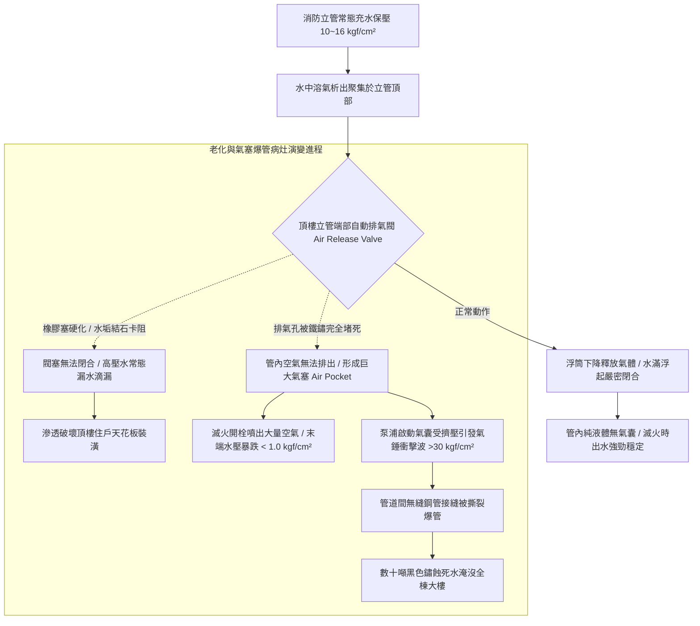

# 全案購屋實戰第五百四十九部_中古大樓社區各樓層消防送水幹管排氣閥橡膠塞老化洩漏立管水錘震盪末端放水試驗壓力不足與管壁穿孔體檢工序全書

## 壹、核心體檢宗旨與家庭居住安全意涵

在中古集合住宅大樓的消防滅火體系中，「室內消防栓系統（Indoor Fire Hydrant System）」與頂樓消防立管的「自動排氣閥組（Automatic Air Release Valve）」是火災發生瞬間能否第一時間提供高壓滅火水流的關鍵生命線。

整棟大樓由地下室專用消防泵浦（靜水壓通常高達 **10 ~ 16 kgf/cm²**）經由垂直無縫鋼管消防送水立管（Standpipe），常時充水保壓送達各樓層消防栓箱。為了防止消防水管內部因溶解空氣析出形成「氣穴（Air Pocket）」阻礙水流，並防止啟泵時空氣壓縮產生毀滅性「動態水錘（Water Hammer）」，在垂直消防立管的最頂端（通常位於頂樓水塔旁或最高層安全梯間頂部），法定必須安裝一只「高壓自動排氣閥」。

然而，在屋齡達 20 至 25 年的中古社區頂樓與管道間中（如小寶家庭重點關注的**大安紫金城 13 樓**、**長億南園 8 樓**、**歌德堡 8 樓**與**靜園 A 區 11 樓**），消防送水幹管常年處於靜止高壓死水環境中，極易衍生出四大極具破壞性的消防癱瘓與水浸病灶：

1. **自動排氣閥內部橡膠密封塞（Rubber Plaque / Seat）硬化水垢卡死與常態慢速漏水**：排氣閥浮筒橡膠密封塞歷經 20 年高溫烘烤與死水浸泡，橡膠硬化龜裂、表面結滿厚重石灰水垢。閥塞無法在水滿時完全氣密封閉，高壓消防水化為細小水流 24 小時不斷自排氣孔持續滴漏。頂樓樓板與管道間外牆常年積水長青苔，滲透破壞頂樓（如 13 樓）住戶的天花板與木作裝潢！
2. **排氣孔遭鐵鏽泥沙堵塞引發「管內氣塞阻水」與末端放水壓力崩跌**：立管內部鐵鏽剝落將排氣閥微小排氣孔（直徑通常僅 1.5~2.5 mm）完全堵死。當火災發生消防泵浦啟動時，管內殘留的大量高壓空氣無法排出，形成巨大的「氣墊阻力（Air Binding）」。高樓層（11~13 樓）消防栓箱在打開水帶射水時，噴出的全是空氣泡沫與微弱水流，射水壓力崩跌至不足 **1.0 kgf/cm²**（遠低於法定 1.7 kgf/cm²），完全喪失滅火能力，高樓層住戶只能在火場中坐以待斃！
3. **啟閉瞬間氣水混合劇烈震盪引發「超高壓氣錘管壁穿孔撕裂」**：空氣的可壓縮性是水的數萬倍。當管內有氣塞且排氣閥失效時，水流高速推擠氣囊，在管道彎頭與變徑處產生高達 **25 ~ 40 kgf/cm²** 的瞬時「氣水衝擊波（Air-Water Slam）」。全棟管道間傳出如迫擊砲轟擊般的震耳巨響，老舊焊接縫直接被撕裂爆開，每小時數十噸的黑色死水如洪水般淹沒安全梯與各樓層公共走廊！
4. **管道內部嚴重「微生物誘導腐蝕（MIC）」導致管壁薄化穿孔透光**：消防死水常年不流動，硫酸鹽還原菌在管底大量繁殖，在鋼管內壁形成密集的「潰瘍狀腐蝕坑（Pitting Corrosion）」。原本厚度達 4.5mm 的 SCH 40 鋼管，在未做防腐處理下有效管壁厚度衰減至不足 1.0mm，隨時會在保壓狀態下瞬間破管噴湧！

本手冊針對高樓層置產標的建立標準化的頂樓消防立管自動排氣閥外觀勘驗、高樓層消防栓末端放水試驗測壓 SOP、管壁超音波測厚成本指標與買賣契約專屬特約防線。

---

## 貳、消防送水幹管排氣與氣塞爆管失效力學

### 1. 消防栓末端放水試驗法定標準規範
- **各類場所消防安全設備設置標準第 34 條至第 37 條**：
  - 各樓層室內消防栓之放水壓力，在最遠或最高樓層（如 13 樓）實施放水測試時，瞄子端部實測放水壓力不得小於 **1.7 kgf/cm²（0.17 MPa）**，且放水量不得小於 **130 L/min**。
  - 放水壓力最大不得超過 **7.0 kgf/cm²**（超過需裝設減壓閥，防止消防水帶反作用力擊傷操作人員）。

### 2. 自動排氣閥耐壓與氣密標準
- 排氣閥公稱壓力必須達到 **16 kgf/cm² 或 20 kgf/cm²（PN 16/20 規格）**，閥體材質必須為球狀石墨鑄鐵（Ductile Iron）或不銹鋼，浮筒必須為 SUS 304/316 材質。在 0.2 kgf/cm² 低水壓至 16 kgf/cm² 高水壓全量程下，均不得有任何水珠滴漏。

---

## 參、實地帶看頂樓消防立管與排氣閥現場體檢工序（SOP）

小寶在實地帶看大安紫金城 13 樓、長億南園 8 樓、歌德堡 8 樓或靜園 A 區 11 樓時，應進行頂樓排氣閥與所在樓層消防栓箱深度工序體檢：

| 檢驗步驟 | 檢驗場域與操作工序 | 正常指標 | 異常警訊與深層消防水力病灶 |
| :--- | :--- | :--- | :--- |
| **步驟一：頂樓消防立管頂端排氣閥滲漏勘驗** | 爬上頂樓水塔旁或安全梯間頂端，檢視垂直紅色消防立管最上端安裝之小型金屬排氣閥。 | 閥體外觀乾燥無鏽，排氣銅嘴孔口無水滴、無水漬，下方地坪乾爽。 | 1. 排氣孔正下方持續「滴答、滴答」漏水，下方積聚黃褐色鐵鏽水痕。 2. 閥體被厚重白灰色石灰水垢完全裹覆，周邊混凝土長滿青苔。 |
| **步驟二：手動按壓排氣閥頂針「排氣排污實測」** | 佩戴工作手套，以一字起子微幅按壓排氣閥頂部的測試排氣頂針。 | 瞬間噴出微量壓縮氣體後立即有清水噴出，鬆手瞬間密封塞清脆閉死滴水不漏。 | 1. 按壓後完全無氣無水噴出（排氣孔早已被鐵鏽死死堵死！）。 2. 按壓後閥塞卡死無法彈回，高壓黑水持續狂噴噴湧無法關閉！ |
| **步驟三：目標樓層消防栓箱壓力表與末端放水檢驗** | 開啟目標樓層（如 13 樓）走廊消防栓箱，檢視箱內水壓表指針，並請警衛配合開栓測試。 | 靜態水壓保持在 **2.5 ~ 4.5 kgf/cm²**；微開放水閥時水流強勁，水柱噴射平穩。 | 1. 靜態壓力表指針幾近歸零（低於 1.0 kgf/cm²，管內嚴重欠壓氣塞！）。 2. 打開閥門時管內發出「啵、啵」劇烈氣泡爆破聲，噴出大量黑濁泡沫。 |
| **步驟四：調閱每年公共消防設備安全檢修申報單** | 查閱管理室存查之消防設備師簽證申報書中「室內消防栓末端放水壓力」項次。 | 報告載明頂樓消防栓實測放水壓力大於 **1.7 kgf/cm²**，各項檢查合格。 | 報告註記「高樓層放水壓力不足建議更換排氣閥」、「管壁鏽蝕滲漏」，管委會未撥款排修。 |

---

## 肆、高樓層住宅置產防禦與合約特約保障

對於鎖定高樓層（大安紫金城 13 樓、靜園 A 區 11 樓、長億南園 8 樓、歌德堡 8 樓）的小寶家庭而言，頂樓消防排氣閥若損壞，不僅面臨火災時高樓層「消防栓沒水滅火」的生命絕境，排氣閥慢速滴漏更會直接滲透腐蝕 13 樓天花板裝潢：

### 1. 消防立管排氣閥與系統修繕更新成本基準
- **更換頂樓高壓全不銹鋼自動排氣閥組（含前端不銹鋼高壓閘閥或球閥，SUS 316 規格）**：連工帶料約 **\$6,500 ~ \$12,000 / 處**。
- **全棟消防立管高壓水刀通管除鐵鏽與更換水錘吸收器（以 12~15 層樓計算）**：約 **\$28,000 ~ \$45,000**。
- **高樓層消防送水幹管嚴重腐蝕薄化，實施局部無縫鋼管（SCH 40）抽換焊接工程**：單段約 **\$18,000 ~ \$30,000**。
- **地下室主消防泵浦控制盤壓力開關更新與全棟消防立管加壓測漏工程**：整套約 **\$35,000 ~ \$55,000**。

### 2. 購屋買賣合約公共消防送水系統功能正常專屬特約條款範本
> **社區公共室內消防送水立管與排氣閥機能保證特約條款**：  
> 「賣方擔保本買賣標的所屬大樓社區之室內消防栓送水幹管系統運作正常，頂樓自動排氣閥密封良好無滴漏滲水，立管無異常水錘震盪，且本標的所在樓層消防栓之靜態及放水壓力符合法定消防標準（放水壓力大於 1.7 kgf/cm²）。自簽約日起至交屋日止，若經消防安全檢修申報判定該大樓高樓層消防送水壓力不足需改善、或頂樓排氣閥漏水損壞天花板裝潢者，其修繕支出或管委會因此產生之工程專案分攤款，全額由賣方清償負擔，賣方不得向買方主張任何補償。」
