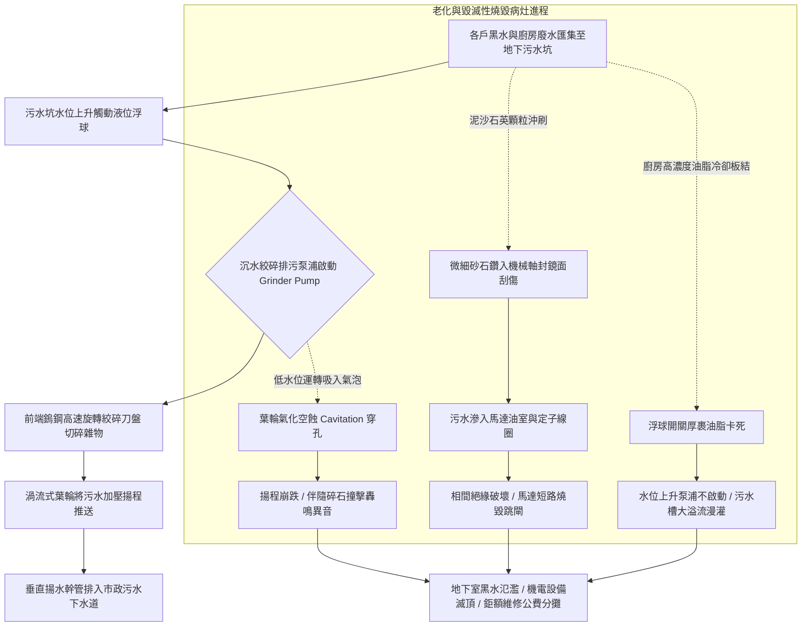

# 全案購屋實戰第五百四十二部_中古大樓社區地下室生活污水下水道用戶接管沉水式絞碎型排污泵浦氣化空蝕機械軸封砂石刮傷與化糞池槽體酸化滲漏體檢工序全書

## 壹、核心體檢宗旨與家庭居住安全意涵

在中古集合住宅大樓中，若社區地下室地勢較低（例如 B2、B3 層），或因市政污水下水道人孔管底標高高於大樓地下室污水收集坑，此時便無法依賴純自然重力流排放，必須設置「生活污水沉水式絞碎型排污泵浦系統（Submersible Grinder Sewage Pump System）」以及地下「污水儲留槽 / 原廢水集水池（Sewage Basin / Septic Sump）」。

排污泵浦肩負著將全社區黑水（糞便、衛生紙、雜物）與灰水（廚房油脂、衛浴洗滌水）由地下低點強力「提升揚程」推入市政污水下水道的重責大任。排污泵浦前端配備高硬度旋轉切碎刀刃（Grinder Mechanism），在泵送前將固體雜物粉碎至微小顆粒，防止幹管堵塞。

然而，在屋齡達 20 至 25 年的中古地下室機房與集水池中（如小寶家庭重點關注的**大安紫金城 13 樓**、**長億南園 8 樓**、**歌德堡 8 樓**與**靜園 A 區 11 樓**），沉水排污泵浦常年全時浸泡在強腐蝕性黑水與油脂砂石混合物中，極易衍生出四大極具破壞性的深層機電與結構病灶：

1. **旋轉絞碎刀盤磨鈍、砂石刮傷機械軸封（Mechanical Seal）與電機進水燒毀**：住戶日常排水夾帶的大量泥沙、毛髮與硬質異物，使鎢鋼切碎刀刃磨損鈍化，固體物無法有效絞碎而卡死葉輪；微細石英砂石顆粒鑽入機械軸封動靜環接觸面，將碳化矽鏡面刮出深深溝槽。高腐蝕性污水順著軸封破口湧入馬達內部油室與定子線圈，引發電機相間短路或絕緣擊穿，排污泵浦瞬間燒毀跳脫。
2. **葉輪流道在低水位時產生劇烈氣化空蝕（Cavitation）與金屬穿孔**：污水池液位控制浮球漂移或進水量不足時，泵浦在極低液位下強行運轉，吸入端產生大量空氣與污水漩渦。空化氣泡在高壓下破裂產生極端微射流，將鑄鐵葉輪背面打出蜂窩狀孔洞，水泵揚程崩跌，並伴隨如「金屬碎裂轟鳴」般之劇烈噪聲。
3. **老舊混凝土化糞池/污水槽體酸化腐蝕、鋼筋外露與地下水滲透**：老舊未接管或接管後轉為調節池之混凝土槽體，在硫化氫與硫酸鹽生物轉化下，池壁水泥砂漿產生嚴重的「生物硫酸酸化中性化」，水泥剝落、骨料裸露、內部鋼筋鏽蝕膨脹斷裂。高水壓之化糞污水順著池底裂縫無聲滲透至大樓基礎土壤，使地下室常年飄散難以驅散的陳年腐臭。
4. **液位浮球開關（Float Switch）厚裹重油油脂「懸空浮死」與排污池滿溢大漫灌**：廚房油脂冷卻後在浮球表面凝結成厚達數公分的油糕，浮球重量失衡或卡在壁面支架上，喪失隨水位自由浮動機能。當尖峰排水湧入時，泵浦完全無法自動啟動，發酵發臭的糞便黑水直接由人孔蓋四周如噴泉般漫溢淹沒整個地下室機房，造成百萬機電設備與機械停車坑嚴重泡水滅頂！

本手冊針對考慮標的建立標準化的地下室排污泵浦絞碎刀盤勘驗、機械軸封漏油檢測、浮球手動提拉測試與買賣契約專屬特約防線。

---

## 貳、沉水絞碎排污系統架構與電機進水燒毀力學

### 1. 沉水絞碎排污泵浦防護標準規範
- **CNS 10771 / IEC 60034 泵浦標準**：
  - 馬達防護等級必須達到 **IP68（全浸水型）**，絕緣等級需為 F 級或 H 級（耐溫 155°C~180°C）。
  - 機械軸封必須採用**雙組端面碳化矽/碳化矽（SiC-SiC）**或碳化鎢雙重密封，兩組軸封之間必須配置潤滑冷卻專用油室（Oil Chamber）。
- **馬達絕緣電阻安全門檻**：以 500V 高阻計（Megger）量測馬達線圈對地絕緣電阻，正常應 **> 20 MΩ**。若實測電阻低於 **1.0 MΩ**，代表內部軸封已嚴重進水漏電，必須立即吊起大修。

---

## 參、實地帶看地下室排污泵浦現場體檢工序（SOP）

小寶在實地帶看大安紫金城 13 樓、長億南園 8 樓、歌德堡 8 樓或靜園 A 區 11 樓時，應進行地下室排污機房與控制盤深度工序體檢：

| 檢驗步驟 | 檢驗場域與操作工序 | 正常指標 | 異常警訊與深層水電機電病灶 |
| :--- | :--- | :--- | :--- |
| **步驟一：污水坑人孔蓋四周密封與惡臭檢視** | 檢視地下室地面之排污坑鋼板人孔蓋周邊與通氣管道。 | 人孔蓋配置氣密橡膠條並用螺栓旋緊鎖定，周圍乾燥無水漬，無刺鼻腐臭味。 | 1. 人孔蓋四周發黑發潮、滲出黃褐色油水混合物，散發劇烈惡臭。 2. 人孔蓋隨便用木板或塑膠布覆蓋，完全無氣密防護。 |
| **步驟二：控制盤手動啟動抽水與「絕緣跳閘測試」** | 陪同總幹事至排污控制箱，將 1 號泵與 2 號泵分別切換至「手動（MANUAL）」運轉 5 秒。 | 泵浦啟動聲音平穩清脆，電流表指針在額定範圍內（如 5~8A），無跳電。 | 1. 手動切換瞬間，控制箱無熔絲開關（NFB）立即「啪」聲跳脫（馬達已進水短路燒毀！）。 2. 馬達發出「沉悶嗡嗡」卡死噪聲，指針衝破滿刻度過載跳脫。 |
| **步驟三：提拉浮球開關「自動連鎖啟抽實測」** | 佩戴防護手套，打開人孔觀察孔，以長桿手動將浮球向上提拉。 | 浮球向上提拉至浮起狀態瞬間，控制盤交流接觸器立即清脆吸合啟動泵浦。 | 1. 浮球提拉後毫無動靜（微動開關接點氧化或線路斷線）。 2. 浮球表面裹滿厚厚一層黑黃色油脂塊，黏重無法自行漂浮。 |
| **步驟四：調閱每年排污坑清淤與泵浦檢測單** | 查閱管理室存查之「沉水排污泵浦維護月報表與化糞池抽水肥紀錄」。 | 每半年至一年定期抽除池底沉砂油脂，泵浦每月測試交替運轉正常。 | 紀錄長年空白，或註記「1 號泵燒毀待料更換」，管委會拖延數月僅靠單泵帶病支撐。 |

---

## 肆、全案置產防禦與買賣契約特約保障

對於小寶家庭而言，無論購入哪一個樓層，地下室公共污水排水泵浦若燒毀或溢流，全大樓不僅面臨地下室黑水氾濫滅頂百萬機電與機械車位的衛生浩劫，更需面臨昂貴的吊車與密閉空間大修費用：

### 1. 沉水絞碎排污泵浦修繕與更新成本基準
- **地下室排污坑人工抽底清淤、高壓清洗與清運黏稠油脂沉砂**：單次約 **\$15,000 ~ \$25,000**。
- **拆卸吊起排污泵浦、更換原廠進口雙組碳化矽機械軸封與耐高溫絕緣潤滑油**：約 **\$12,000 ~ \$18,000 / 台**。
- **更換全套 AISI 304 不銹鋼絞碎刀盤與渦流式高硬度葉輪組**：約 **\$15,000 ~ \$22,000**。
- **全面更換全新重載型耐酸鹼防爆沉水絞碎排污泵浦機組（3HP~5HP 雙泵自動交替）**：整套工程款高達 **\$90,000 ~ \$150,000**。

### 2. 購屋買賣合約公共排污沉水泵浦運作保證專屬特約條款範本
> **社區公共地下室生活污水排污泵浦系統正常保證特約條款**：  
> 「賣方擔保本買賣標的所屬大樓社區之地下室生活污水集水坑、沉水式絞碎排污泵浦機組及自動交替控制系統運作正常，機械軸封良好無滲漏燒毀，浮球液位開關機能靈敏無卡死，且過去無因排污池漫溢致使地下室機房或停車設備泡水受損之情事。自本契約簽訂日起至交屋日止，若經現場勘驗或專業水電機電機構判定該大樓排污泵浦故障燒毀需全面更新者，其修繕支出或管委會因此產生之工程專案分攤款，全額由賣方清償負擔，賣方不得向買方主張任何補償。」
