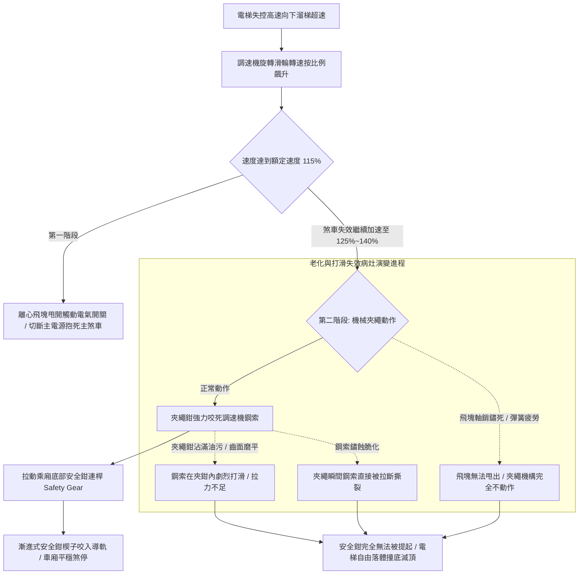

# 全案購屋實戰第五百四十八部_中古大樓社區各樓層電梯調速機夾繩鉗磨損飛塊離心彈簧疲勞失準與超速溜梯下墜體檢工序全書

## 壹、核心體檢宗旨與家庭居住安全意涵

在中古集合住宅大樓的電梯垂直運行安全體系中，「超速安全防護系統」由安裝於頂樓機房的「調速機（Over-speed Governor）」、貫穿整個井道的「調速機鋼索（Governor Rope）」、位於井道底部的「張力輪（Tension Sheave）」、以及安裝於乘廂底樑兩側的「安全鉗（Safety Gear）」共同組成，是電梯防止「超速溜梯與失控自由落體墜落」的最高等級主動安全防線。

當電梯因馬達失速、變頻器逆變器故障、主鋼索斷裂或煞車來令片碳化打滑而發生向下（或向上）失控加速狂飆時，調速機利用純機械離心力原理，在車速達到額定速度的 **115%（第一階段）** 時，電氣超速開關立即跳脫切斷主電源；若速度繼續失控飆升達到額定速度的 **125% ~ 140%（第二階段）** 時，調速機內部之機械「夾繩鉗（Rope Gripper / Wedge）」瞬間如鋼齒般強力咬死調速機鋼索，藉由鋼索拉力瞬間提起乘廂底部的楔形安全鉗，將重達數噸的車廂硬生生卡死扣緊在兩側 T 型導軌上，完成緊急救命煞停！

然而，在屋齡達 20 至 25 年的中古機房與井道中（如小寶家庭重點關注的**大安紫金城 13 樓**、**長億南園 8 樓**、**歌德堡 8 樓**與**靜園 A 區 11 樓**），調速機長年暴露於粉塵、油泥與極端溫差環境中，極易衍生出四大極具威脅的機械失靈與安全盲區病灶：

1. **夾繩鉗齒面金屬磨損、沾染黏稠油泥與「夾繩打滑失效」**：夾繩鉗碳鋼咬合齒面長年在鋼索高速摩擦下齒形磨鈍；更致命的是，維修工在保養鋼索時噴灑過量黃油，黏稠油脂甩入調速機輪槽與夾繩鉗內部。當超速發生時，夾繩鉗雖然動作下壓，但因油脂潤滑與齒面磨損，鋼索在夾鉗內高速「打滑空轉」，無法產生足夠拉力提起安全鉗，電梯依然以自由落體狂墜砸向底坑！
2. **飛塊離心旋轉鉸鏈（Flyweight Hinge）鏽死卡阻與離心彈簧疲勞失準**：調速機旋轉飛塊的軸銷受潮鏽蝕，內部配重離心彈簧長年承受疲勞拉伸，彈力係數（Spring Rate）嚴重漂移。原本應在 1.15 倍額定速度動作的機械機構，漂移至 1.5 倍甚至完全不動作；當真正發生超速下墜時，飛塊因卡阻無法甩出，安全保護完全「裝聾作啞」。
3. **調速機超速電氣安全開關（Over-speed Switch）接點氧化與「被惡意短接跳線（Jumper）」**：安裝於調速機側邊的微動超速開關，常因震動引發誤跳脫。部分不肖廠商為避免頻繁跳機，將開關後方線路直接常態短接，使電梯在第一階段完全失去斷電煞車預警保護。
4. **調速機鋼索硬化生鏽與索徑嚴重衰減（縮徑超過 10%）**：直徑通常僅為 6mm 或 8mm 的調速機專用小鋼索，歷經 20 年在空氣中氧化生鏽、內部麻芯潤滑脂乾涸。在夾繩鉗瞬間咬合衝擊的數百公斤剪切拉力下，鏽蝕的鋼索瞬間發生「瞬時拉斷」，使整個安全鉗連動機構徹底癱瘓！

本手冊針對高樓層置產標的建立標準化的頂樓機房調速機外觀勘驗、夾繩鉗齒面檢查、離心飛塊手動擺動測試 SOP、修繕成本指標與買賣契約專屬特約防線。

---

## 貳、調速機與安全鉗連動體系架構與失控墜落力學

### 1. 調速機與安全鉗法定動作速度標準規範
- **CNS 10594 昇降機安全標準 / EN 81-20 規範**：
  - **電氣超速開關動作速度**：應在調速機達到機械動作速度之前跳脫，且最大不得超過額定速度的 **1.15 倍**。
  - **機械夾繩動作速度**：
    - 額定速度 $V \le 1.0 \text{ m/s}$：動作速度最大不得超過 **1.40 倍**（且不小於 1.15 倍）。
    - 額定速度 $1.0 < V \le 1.6 \text{ m/s}$：動作速度最大不得超過 **1.35 倍**。
    - 額定速度 $V > 1.6 \text{ m/s}$：動作速度最大不得超過 **1.25 倍**。
  - **夾繩力要求**：夾繩鉗閉合時對調速機鋼索產生之拉拔力，至少應為提起安全鉗所需機械阻力的 **2 倍以上**，且不得小於 **300 N（約 30 kgf）**。

### 2. 漸進式安全鉗減速度標準
- 漸進式安全鉗在咬入導軌制動過程中，車廂全載重之平均減速度必須控制在 **0.2g 至 1.0g（約 2.0 ~ 9.8 m/s²）** 之間，確保人體內臟骨骼免受過大衝擊。

---

## 參、實地帶看頂樓機房調速機現場體檢工序（SOP）

小寶在實地帶看大安紫金城 13 樓、長億南園 8 樓、歌德堡 8 樓或靜園 A 區 11 樓時，搭乘電梯與查驗機房應進行以下四步深度工序體檢：

| 檢驗步驟 | 檢驗場域與操作工序 | 正常指標 | 異常警訊與深層機械病灶 |
| :--- | :--- | :--- | :--- |
| **步驟一：機房調速機外觀油污與夾繩槽勘驗** | 陪同總幹事或電梯維保技師至頂樓機房，檢視安裝於曳引機旁的調速機本體。 | 輪槽及夾繩鉗金屬表面乾燥微塵、無厚重油脂附著，夾繩鉗齒形銳利清晰。 | 1. 夾繩鉗口與鋼索槽內覆蓋厚達數公釐的黑色黏稠黃油（嚴重打滑隱患！）。 2. 夾繩鉗齒面已被磨平如鏡面，失去咬合力。 |
| **步驟二：手動撥動離心飛塊（Flyweight）靈活度測試** | 在電梯完全停穩切斷電源時，戴工作手套手動向外撥開調速機的旋轉離心飛塊。 | 飛塊向外張開手感均勻平滑、回位彈簧彈力緊實，鬆手瞬間立即迅捷回彈。 | 1. 飛塊軸銷卡死，需用極大力氣甚至工具敲擊才能勉強撥開。 2. 鬆手後飛塊卡在外面無法彈回，或回位彈簧鬆垮垮已斷裂！ |
| **步驟三：超速電氣微動開關外觀與防短接檢查** | 檢視安裝於調速機側邊之紅色超速安全開關與接線端子。 | 開關密封良好無積塵，擺桿靈活，接線端子無額外並聯之短接跳線。 | 1. 開關外殼碎裂，內部微動觸點氧化發黑。 2. 發現色彩異常的臨時銅線跨接在超速端子上（惡意廢除超速警報保護！）。 |
| **步驟四：調閱電梯年度安全檢查「超速試驗合格標籤」** | 檢視調速機外殼張貼的「安全檢查協會封印鉛封（Lead Seal）」與年度試驗單。 | 原廠防拆鉛封完好無損，標註動作速度數值（如 1.35 m/s），報告按年簽證合格。 | 1. 原廠校準鉛封已被剪斷破壞，調整螺栓有隨意旋動痕跡。 2. 檢查報告無填寫具體測試數據，僅草草打勾。 |

---

## 肆、高樓層住宅置產防禦與合約特約保障

對於鎖定高樓層（大安紫金城 13 樓、靜園 A 區 11 樓、長億南園 8 樓、歌德堡 8 樓）的小寶家庭而言，調速機是保障全家人免於電梯失控下墜粉身碎骨的最後救命核武器：

### 1. 調速機與安全鉗系統修繕更新成本基準
- **機房調速機現場清潔脫脂、軸銷注脂除鏽與重新校準跳脫動作速度（含專業儀器驗證）**：約 **\$6,000 ~ \$10,000 / 台**。
- **更換全套井道調速機專用高抗拉微型鋼索（以 12~15 層樓計算，約 80~100 米）**：約 **\$8,000 ~ \$15,000**。
- **更換合格原廠雙向動作型機房調速機總成（含超速電氣開關與合格鉛封）**：約 **\$22,000 ~ \$35,000**。
- **乘廂底部漸進式安全鉗總成拆卸清洗、更換楔子摩擦塊與校正導軌間隙**：約 **\$28,000 ~ \$45,000**。

### 2. 購屋買賣合約電梯調速機與防墜下墜安全專屬特約條款範本
> **電梯調速機與防墜落安全鉗系統功能正常保證特約條款**：  
> 「賣方擔保本買賣標的所在棟別之電梯昇降設備運作正常，其頂樓機房調速機組、調速鋼索及乘廂安全鉗防墜落機構運作確實，夾繩齒面無磨損打滑或油污附著，離心飛塊回彈靈活無卡死，超速電氣安全迴路無任何跳線短接情事，且領有主管機關指定檢查機構有效校準合格簽證。自簽約日起至交屋日止，若經電梯專業檢查機構判定該棟電梯調速機老化失準需更換總成或安全鉗需大修者，其修繕支出或管委會因此產生之工程專案分攤款，概由賣方全額負責清償，賣方不得向買方主張任何補償。」
