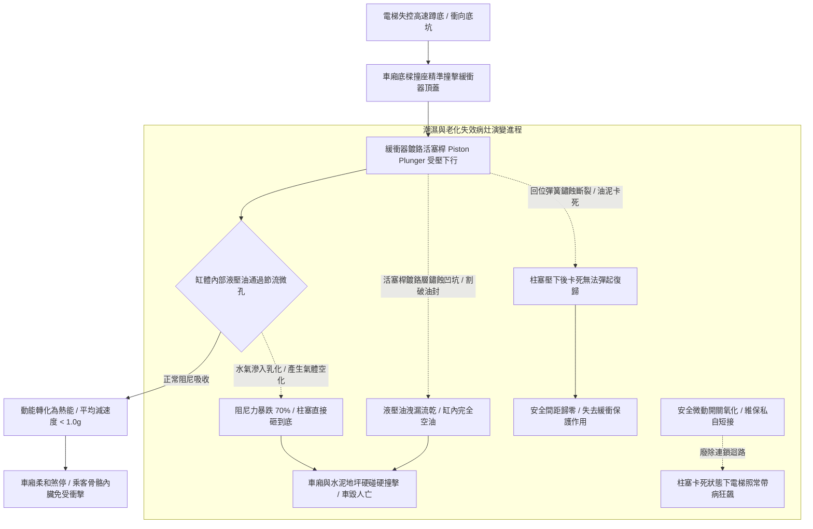

# 全案購屋實戰第五百四十六部_中古大樓社區各樓層電梯昇降路井道底坑油壓緩衝器液壓油乳化活塞桿鏽蝕微動極限開關接觸不良與安全防護體檢工序全書

## 壹、核心體檢宗旨與家庭居住安全意涵

在中古集合住宅大樓的垂直昇降電梯安全防護體系中，當電梯遭遇極端失控——控制電腦死機、調速機失靈、主鋼索在曳引輪槽嚴重打滑、或制動煞車來令片碳化打滑而發生「蹲底撞底（Crashing Bottom）」的毀滅性事故時，設置於昇降路井道最底層底坑（Pit）正下方的「油壓緩衝器（Oil Buffer / Hydraulic Buffer）」，是全車乘客最後一道由純物理流體力學構築的「生死阻尼防線」。

油壓緩衝器主要配置於額定速度大於 1.0 m/s（60 m/min）的中高速電梯。其工作原理係利用承重柱塞（Piston Plunger）在承受車廂或對重以巨大動能撞擊下壓時，強迫緩衝器缸體內部的專用液壓油通過微小節流孔（Orifice），藉由液體黏滯阻尼將動能瞬間轉化為熱能消散，使車廂在極短行程內（通常為數百公釐）維持重力加速度 **< 1.0g（小於 9.8 m/s²）** 的安全平均減速度停下，保護車內乘客頸椎不致折斷、內臟不致震裂。

然而，在屋齡達 20 至 25 年的中古社區地下室深層井道中（如小寶家庭重點關注的**大安紫金城 13 樓**、**長億南園 8 樓**、**歌德堡 8 樓**與**靜園 A 區 11 樓**），底坑常年陰暗、潮濕（RH > 85%）、甚至因連續壁微滲水導致底坑積水，油壓緩衝器極易衍生出四大極具威脅的阻尼癱瘓與安全盲區病灶：

1. **緩衝器液壓油乳化變質、酸化混水與有效黏滯阻尼力暴跌**：地下室水氣與底坑積水順著柱塞防塵密封圈滲入缸體內部。液壓油與水分高速乳化呈白濁牛奶狀，油液黏度指數暴跌且油中含氣。當車廂滿載撞擊時，乳化油因氣蝕空化（Cavitation）產生劇烈壓縮，阻尼力瞬間崩跌，柱塞直接「硬碰硬砸到底」，強大的衝擊反作用力直接將車廂底盤震碎、車內人員雙腿骨折！
2. **高精密鏡面活塞桿（Piston Rod）電化學鏽蝕凹坑與油封撕裂噴油**：碳鋼活塞桿外表面之鍍硬鉻層長年暴露於潮濕空氣中，產生細微點蝕鏽斑與縱向劃痕。當緩衝器偶爾受壓下行時，粗糙的鏽蝕金屬表面硬生生將橡膠唇形油封（Lip Seal）割裂撕破，數公升液壓油瞬間噴發洩漏至底坑地坪，缸體內部完全空油乾涸！
3. **柱塞回位彈簧（Return Spring）疲勞失效與緩衝器「壓下後卡死無法回彈」**：內部高剛性回位彈簧受長年水氣鏽蝕產生應力腐蝕裂紋。若電梯在檢修測試受壓後，柱塞卡在最底部無法自動彈回頂部正常延伸位置，使越程緩衝安全距離徹底「歸零」，若再次發生蹲底，車廂將毫無阻尼直接砸在水泥地坪上！
4. **緩衝器電氣安全極限微動開關（Buffer Safety Switch）接點受潮氧化與短接**：法規要求緩衝器柱塞未完全回位至頂部正常位置前，其安全微動開關必須強制切斷電梯主回路，嚴禁電梯運轉。老舊微動開關接點常年受潮氧化發黑，引發開路跳機；部分維保人員為了省事，在底坑接線盒內將該開關「私自短接跳線（Jumper）」，徹底廢除緩衝器復歸監視防線！

本手冊針對高樓層置產標的建立標準化的井道底坑油壓緩衝器柱塞鏡面勘驗、油質乳化判定、手動壓縮回彈實測 SOP、修繕成本指標與買賣契約專屬特約防線。

---

## 貳、井道油壓緩衝器阻尼吸收體系與失效力學

### 1. 油壓緩衝器法定安全行程與公差標準規範
- **CNS 10594 昇降機安全標準 / EN 81-20 規範**：
  - 油壓緩衝器之最小重力阻尼行程（Stroke, $S$）計算公式：
    $$S = 0.0674 \times V^2 \quad (\text{單位: 公尺})$$
    其中 $V$ 為調速機額定跳脫動作速度（m/s）。以 1.75 m/s（105 m/min）電梯為例，緩衝器最小行程不得小於 **0.28 公尺（280 mm）**。
  - **復歸時間標準**：由完全壓縮狀態釋放後，活塞柱塞完全彈回原位之時間不得大於 **90 秒**。
  - 減速度峰值大於 2.5g 之持續時間不得超過 **0.04 秒**，全行程平均減速度不得大於 **1.0g**。

### 2. 緩衝器液壓油專用規格標準
- 必須採用高黏度指數（VI > 150）、凝固點低於 -20°C 之抗磨液壓油（通常為 ISO VG 46 或 VG 68 號）。嚴禁任意添加機油或齒輪油代替。

---

## 參、實地帶看電梯底坑油壓緩衝器現場體檢工序（SOP）

小寶在帶看大安紫金城 13 樓、長億南園 8 樓、歌德堡 8 樓或靜園 A 區 11 樓時，搭乘電梯與查驗底坑應進行以下四步深度工序體檢：

| 檢驗步驟 | 檢驗場域與操作工序 | 正常指標 | 異常警訊與深層機械病灶 |
| :--- | :--- | :--- | :--- |
| **步驟一：底坑乾燥度與緩衝器基座勘驗** | 請總幹事或保養技師開啟地下室底坑檢修門，攜帶強光手電筒照射底部。 | 底坑水泥地坪乾燥清爽，無積水、無青苔結晶，緩衝器基座槽鋼油漆完好無鏽。 | 1. 底坑積水深達 10~20 公分，緩衝器缸體下半部浸泡在死水中！ 2. 緩衝器金屬基座鏽爛穿孔，地腳螺栓已完全斷裂。 |
| **步驟二：活塞桿表面鏡面鍍鉻與油位油色檢視** | 檢視頂部伸出之活塞桿全段表面，並觀察外殼透明油位觀察鏡（Sight Glass）。 | 活塞桿光滑如鏡無鏽斑痕跡，油位處於標準油線標記處，油質清澈淡黃。 | 1. 活塞桿外表布滿粗糙紅鏽麻點、甚至有縱向深道割痕。 2. 油位鏡內無油（已漏乾），或油液呈渾濁牛奶白濁狀（嚴重乳化變質！）。 |
| **步驟三：緩衝器安全微動開關外觀與電氣查驗** | 檢視安裝於緩衝器側邊之柱塞回位檢知微動開關與防塵軟管。 | 開關密封良好，碰桿頂在活塞專用凹槽內，接線端子金屬光亮無鏽。 | 1. 開關外殼破碎，內部接點裸露生鏽發黑。 2. 接線盒內發現彩色短接跳線（Jumper Wire），證實安全保護已被惡意廢除！ |
| **步驟四：調閱電梯年度安全檢查緩衝器試驗單** | 查閱管理室存查之「昇降設備年度安全檢查報告書」底坑檢查項目。 | 報告載明「油壓緩衝器回位試驗合格（<90s）」、「油位正常」，檢查員簽章完整。 | 該項目長年空白未填，或備註欄註記「緩衝器漏油待料更換」，管委會未安排維修。 |

---

## 肆、高樓層住宅置產防禦與合約特約保障

對於鎖定高樓層（大安紫金城 13 樓、靜園 A 區 11 樓、長億南園 8 樓、歌德堡 8 樓）的小寶家庭而言，底坑油壓緩衝器是家人乘坐電梯時免於失控墜落粉身碎骨的最後一道物理保命屏障：

### 1. 油壓緩衝器修繕更新成本基準
- **底坑排乾積水、清洗緩衝器外殼、更換全套原廠高壓耐磨防塵油封組**：連工帶料約 **\$8,000 ~ \$14,000 / 支**。
- **全數抽換專用抗磨耐溫液壓油（含缸體內部高壓除水除油泥沖洗）**：約 **\$6,000 ~ \$9,500 / 支**。
- **更換合格防水防爆柱塞回位安全微動開關組（含配線重整）**：約 **\$4,500 ~ \$7,500**。
- **活塞桿嚴重鏽蝕拉傷，全面更換全新重載型油壓緩衝器總成（以 105m/min 電梯計算，乘廂側與對重側共 2 支）**：工程款約 **\$45,000 ~ \$70,000**。

### 2. 購屋買賣合約電梯底坑安全緩衝裝置專屬特約條款範本
> **電梯昇降路底坑油壓緩衝器機能安全保證特約條款**：  
> 「賣方擔保本買賣標的所在棟別之電梯昇降設備運作安全正常，其昇降路底坑環境乾燥無積水浸泡，油壓緩衝器活塞柱塞光滑無鏽蝕拉傷、液壓油位充足無乳化漏油，且回位安全微動開關機能完整無跳線短接情事，符合建築物昇降設備安全檢查標準。自簽約日起至交屋日止，若經電梯專業檢查機構判定該棟電梯底坑油壓緩衝器損壞漏油需更換或回位失靈需大修者，其修繕支出或管委會因此產生之工程專案分攤款，概由賣方全額負責清償，賣方不得向買方主張任何補償。」
