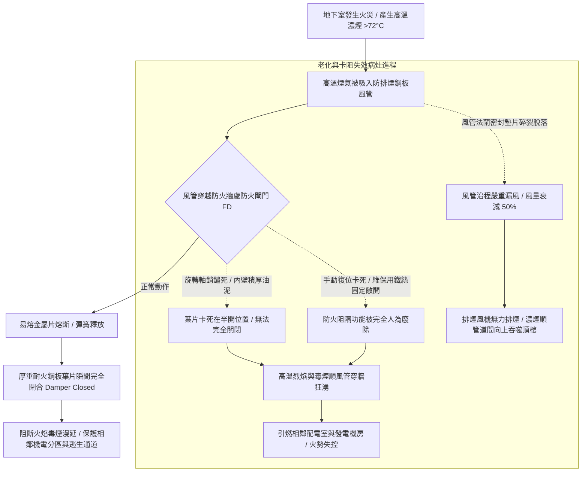

# 全案購屋實戰第五百四十四部_中古大樓社區地下室機械通風防排煙風管防火閘門熔斷手動復位卡死微動開關定位失效與風量衰減體檢工序全書

## 壹、核心體檢宗旨與家庭居住安全意涵

在中古集合住宅大樓中，地下室各層（包含停車場、機房與配電室）因處於密閉無自然對流之地下地層，依建築技術規則及各類場所消防安全設備設置標準，必須配置高規格的「地下室機械通風與防排煙系統（Basement Mechanical Ventilation & Smoke Exhaust System）」。該系統平時負責將汽車廢氣（一氧化碳 CO）強制抽出並導入新鮮空氣；火災時則切換至全風量高速排煙模式，將濃煙、高熱與有毒氣體強力排出，維持逃生通道的清晰度。

在穿透地下室各防火區劃（Fire Compartments）的鍍鋅鋼板防排煙風管穿越孔洞處，法定必須安裝「排煙防火閘門（Fire Damper / Combination Fire & Smoke Damper, FD/FSD）」。防火閘門平常維持常開狀態，內部設有「72°C 或 280°C 易熔金屬片（Fusible Link）」或溫度感測驅動器。當火災高溫氣流（> 72°C）流經風管時，易熔金屬片熔斷，彈簧強行釋放將厚重葉片閉合，阻斷火勢與濃煙在各防火分區之間穿透漫延。

然而，在屋齡達 20 至 25 年的中古社區地下室中（如小寶家庭重點關注的**大安紫金城 13 樓**、**長億南園 8 樓**、**歌德堡 8 樓**與**靜園 A 區 11 樓**），防排煙系統長年處於靜止備用、高濕鹽霧與油塵積聚環境中，極易衍生出四大極具威脅的消防癱瘓與毒煙竄流病灶：

1. **防火閘門旋轉軸銷生鏽咬死、易熔片熔斷後「卡在半開位置」引發火勢蔓延**：高濕環境使閘門葉片轉軸碳鋼銷軸嚴重鏽蝕，沉積在風管內壁的黏稠油塵將轉動機構硬生生卡死。當火災高溫熔斷易熔金屬片時，葉片因卡阻無法在彈簧拉力下迅速完全關閉（僅關閉 30%~50%），高達數百度的高溫烈焰與濃煙順著風管長驅直入，將相鄰防火區劃的機電室與車輛逐一引燃吞噬！
2. **手動復位機構（Manual Reset Mechanism）齒輪變形卡阻與「彈簧疲勞脆斷」**：消防安檢或測試時拉動閘門，復位手柄傳動棘輪與回位彈簧早已金屬疲勞脆斷。部分維修工因無法順利手動復位，私自拿鐵絲、木楔子將葉片「硬生生卡死在常開位置」，徹底廢除防火閘門的自動阻火功能！
3. **定位微動開關（End Switch）接點氧化與消防中控主機「假回報盲區」**：閘門邊緣配置確認關閉到位的電氣微動開關，因接點氧化或碰桿變形，閘門明明因故障敞開，消防中控台顯示的卻是綠色「正常備用」燈號，造成警衛與消防指揮官誤判現場安全防護狀態。
4. **風管法蘭接縫石棉墊片老化漏風引發「實際排煙風量衰減 50%」**：大口徑矩形風管段與段間由角鐵法蘭連接，歷經 20 年密封墊片乾硬碎裂脫落。當排煙風機啟動時，風管沿程嚴重「漏風洩壓」，末端吸風口實測排風量衰減超過 **50%~60%**，火災時地下室濃煙完全排不出去，直接順著樓梯間與電梯管道間向上狂湧，將高樓層住戶完全窒息包圍！

本手冊針對考慮標的建立標準化的防排煙風管防火閘門手動釋放測試、復位機構手感勘驗、消防中控連動查核 SOP、修繕成本指標與買賣契約專屬特約防線。

---

## 貳、防排煙防火閘門系統架構與毒煙蔓延失效力學

### 1. 防火閘門與排煙風量法定標準規範
- **建築技術規則建築設計施工編第 79-2 條 / 消防設置標準**：
  - 風管穿越防火區劃之牆壁或樓板時，貫穿孔道周邊應施作防火填塞，風管內部必須設置具備 **1 小時至 2 小時以上防火時效** 之排煙防火閘門。
  - 易熔金屬片之熔斷動作溫度通常設定為 **72°C ± 3°C**（一般通風空調風管）或 **280°C ± 5°C**（專用高溫排煙風管）。
  - **漏煙量極限標準**：在 250 Pa 測試壓差下，防火閘門閉合後之漏煙量不得大於 **0.15 m³/(s·m²)**。

### 2. 微動開關定位信號標準
- 閘門完全閉合時，微動開關必須確實發送常閉（NC）信號切斷排風機馬達供電（防止負壓助燃），並點亮消防中控台紅燈「防火區劃閉鎖完成」。

---

## 參、實地帶看地下室機械通風風管現場體檢工序（SOP）

小寶在實地帶看大安紫金城 13 樓、長億南園 8 樓、歌德堡 8 樓或靜園 A 區 11 樓時，應沿地下室車道與機房天花板風管，進行以下四步深度工序體檢：

| 檢驗步驟 | 檢驗場域與操作工序 | 正常指標 | 異常警訊與深層消防病灶 |
| :--- | :--- | :--- | :--- |
| **步驟一：風管天花板懸吊與法蘭接縫氣密勘驗** | 攜帶強光手電筒檢視天花板懸吊之鍍鋅鐵皮風管各角鐵法蘭接縫與吊架。 | 風管平直堅固，吊架無生鏽晃動，法蘭接頭四周密封膠平整無脫落。 | 1. 風管局部凹陷變形，法蘭接縫處黑油泥外滲，可見內部石棉墊片碎裂掛在外面。 2. 通風風機運轉時，法蘭縫隙發出明顯「呼呼」漏風哨音。 |
| **步驟二：防火閘門外部手動釋放與閉合動作測試** | 佩戴防護手套，找到風管外側之防火閘門手動檢修把手，按下釋放扣板。 | 扣板按下瞬間，內部彈簧以極大力量驅動葉片「啪」一聲瞬間完全緊閉。 | 1. 扣板按下去後葉片紋絲不動（軸銷早已鏽死卡死！）。 2. 葉片僅緩慢下滑一半便卡在半空中，用手推動有嚴重金屬卡阻感。 |
| **步驟三：手動復位手柄手感與彈簧完整度檢查** | 轉動復位手柄將葉片拉回常開定位，觀察棘輪鎖定狀態。 | 手柄旋轉順暢，齒輪一齒一扣清脆咬合，復位至定位點後自動鎖定不回滑。 | 1. 手動手柄齒輪打滑空轉，無法將葉片拉回。 2. 外觀可見回位彈簧鏽蝕成渣或斷裂，甚至發現外側被鐵絲死死纏繞固定！ |
| **步驟四：調閱每年公共安全與消防檢修申報單** | 查閱管理室存查之消防設備師簽證之「防排煙設備性能檢查報告書」。 | 排煙風量實測達標，防火閘門抽測動作全數合格，微動開關連動正常。 | 申報單連續數年註記「防火閘門生鏽卡阻待修復」、「排煙風量不足」，管委會未撥款排修。 |

---

## 肆、全案置產防禦與買賣契約特約保障

對於小寶家庭而言，無論購入哪一個樓層，地下室防排煙系統若在火災時失靈，高溫濃煙將順著全棟垂直電梯管道間與安全梯產生致命的「煙囪效應」直撲高樓層，使頂樓高樓層住戶陷入無處可逃的窒息絕境：

### 1. 防火閘門與風管系統修繕更新成本基準
- **現場拆卸檢修孔、軸銷除鏽高溫注脂與更換專用 72°C/280°C 易熔金屬片**：單處約 **\$3,500 ~ \$6,500**。
- **更換全套重載型電動復位防火排煙閘門（含 24V 驅動馬達與雙微動開關，符合 UL 555 標準）**：約 **\$18,000 ~ \$28,000 / 座**。
- **地下室主風管全段法蘭重新施打耐高溫防火矽利康密封膠與更換保溫岩棉**：單一防火分區工程款約 **\$25,000 ~ \$45,000**。

### 2. 購屋買賣合約公共防排煙與防火區劃安全專屬特約條款範本
> **社區公共地下室機械防排煙與防火閘門機能保證特約條款**：  
> 「賣方擔保本買賣標的所屬大樓社區之地下室機械通風防排煙系統運作正常，風管穿越防火牆處之防火閘門機能靈敏無卡死，易熔片及微動開關連動確實，且風管密封良好無嚴重漏風風量衰減情事，符合建築技術規則與消防法規標準。自本契約簽訂日起至交屋日止，若經消防安全檢修申報判定該大樓防排煙系統重大故障需進行風管氣密改善或更換防火閘門工程者，其修繕支出或管委會因此產生之工程專案攤派款，概由賣方全額負責清償，賣方不得向買方主張任何補償。」
