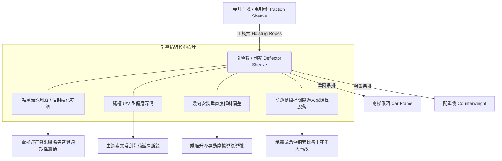

# 全案購屋實戰第五百零七部_中古大樓社區各樓層電梯昇降路鋼索引導輪偏磨軸承異音垂直度偏差與防跳槽擋桿體檢工序全書

## 壹、核心體檢宗旨與家庭居住安全意涵

中古電梯大樓日常運轉中，電梯主機、調速機、主鋼索及引導輪（Deflector Sheave / Secondary Sheave）構成垂直運輸的核心傳動鏈。隨著社區屋齡超過 20 至 25 年，引導輪在數百萬次往復升降與長年受力下，常出現深層疲勞耗損：

1. **輪槽偏磨與不均勻磨耗**：主鋼索多槽張力不均或導軌垂直度偏移，導致引導輪繩槽單側嚴重磨損，加劇主鋼索咬合磨損與斷絲風險。
2. **中心軸承滾珠剝落與潤滑脂乾涸**：軸承長年重載運轉，潤滑油封硬化漏油，軸承滾動體出現點蝕（Pitting）與剝落，引發劇烈低頻嗡鳴與週期性異音。
3. **垂直度與同軸度幾何偏差**：安裝基座減震橡膠墊老化變形，造成引導輪與曳引輪中心線失準，造成鋼索運轉擺動甚至引發乘廂垂直抖動。
4. **防跳槽擋桿（Rope Retainer / Anti-derailment Device）鬆脫失效**：安全法規要求引導輪外圍必須裝設間隙小於 2~3mm 之防跳槽安全擋桿。若螺栓震動鬆動或間隙過大，遇強震（如台中 921 震後結構應力）或緊急煞車時，主鋼索恐脫出輪槽，導致電梯暴衝卡死或鋼索絞斷重大公安事故。

本手冊為小寶家庭量身打造，針對考慮名單中的中古社區（如大安紫金城 13 樓、長億南園 8 樓等），提供標準化之機房引導輪查驗工序、量測指標與談判議價籌碼轉化法。

---

## 貳、電梯引導輪系統關鍵結構與潛在病灶剖析

### 1. 繩槽磨損與深度落差極限
- **標準繩槽形狀**：通常為半圓型帶下切槽（Undercut U-groove）或 V 型槽。
- **病灶徵兆**：若各槽深度磨損落差超過 **0.8 mm**，或鋼索深陷輪槽超過鋼索直徑三分之二，將導致各條主鋼索受力極度不均，加速單條鋼索提早疲勞斷裂。
- **外觀特徵**：引導輪正下方地面或機座周邊堆積大量細微金屬鐵屑（赤褐色或銀灰色粉末）。

### 2. 引導輪軸承（Bearing）損壞進程
- **初期**：輕微刺耳高頻金屬刮磨聲。
- **中期**：電梯以額定速度運轉時，機房內伴隨「隆隆」低頻共振，手觸軸承座外殼有明顯高溫（超過 60°C）與麻手震動。
- **末期**：軸承保持架碎裂，引導輪偏擺卡死，造成主鋼索劇烈摩擦打滑、冒煙並觸發熱過載跳脫。

---

## 參、實地帶看現場與機房維保體檢工序（SOP）

中古社區實地勘查時，購屋者應透過搭乘感受結合管委會電梯保養紀錄表進行精準判讀：

| 檢驗步驟 | 檢驗標的與工序 | 正常指標 | 異常警訊與潛在成本 |
| :--- | :--- | :--- | :--- |
| **步驟一：搭乘乘廂震動感知** | 於 1 樓搭乘至頂樓，手機放置車廂地坪開啟加速度儀（如 Vibration App）。 | 加速度振幅穩定，無垂直週期性頓挫。 | 若出現週期性「喀嗒」頓挫或高頻嗡鳴，多為引導輪軸承損壞或繩槽偏磨跳動。 |
| **步驟二：機房外觀與聲音直擊** | 陪同房仲或總幹事至電梯機房（大安紫金城/長億南園頂樓機房），聆聽運行聲音。 | 運轉音平順低沈，無金屬尖銳摩擦或軸承滾珠撞擊聲。 | 聽聞金屬碰擊聲；引導輪基座下有積聚紅色鐵鏽粉塵（鋼索乾磨與輪槽刮削）。 |
| **步驟三：防跳槽安全裝置查驗** | 檢查引導輪上方與兩側之防跳槽固定鋼桿（Rope Guard）。 | 擋桿牢固固定於基座，鋼索與擋桿間隙保持在 **2 ~ 3 mm**。 | 擋桿螺栓鬆動傾斜、間隙大於 8 mm，或甚至無防跳槽裝置（重大公安違規）。 |
| **步驟四：調閱電梯年度安全檢查表** | 查閱「中華民國昇降設備安全檢查協會」或保養廠商（永大、崇友、三菱、大同奧斯等）每月保養紀錄。 | 引導輪、鋼索磨損項次打勾合格，且軸承定期注脂。 | 近期維護單註記「建議更換副輪/引導輪軸承」、「鋼索偏磨建請改善」，代表即將面臨重大維修公費支出。 |

---

## 肆、談判折價籌碼與合約特約保障條款

當查驗發現電梯引導輪系統存在重度偏磨或軸承異音時，買方應將潛在之修繕風險轉化為強而有力的砍價與合約自保依據：

### 1. 維修重置行情與折價依據
- **引導輪軸承更換工程**：吊掛牽引鋼索、拆卸輪組、油壓迫緊拔取軸承並重置，單台電梯費用約 **\$35,000 ~ \$55,000**。
- **引導輪整組換新與鋼索全數更換**：若引導輪繩槽偏磨導致主鋼索同步受損，更換引導輪＋主鋼索（通常 3~5 口直徑 10~12mm 鋼索），整套修繕費用高達 **\$120,000 ~ \$180,000**。
- **談判切入點**：以此為依據，要求屋主在總價讓利 **15 ~ 25 萬元**，作為分擔社區公共基金提撥與修繕儲備金之折讓。

### 2. 不動產買賣買方特約防護條款
> **買賣特約條款範本**：  
> 「賣方保證本買賣標的所屬大樓社區之電梯昇降設備運作正常，領有主管機關有效使用許可證。於本約簽訂日至交屋日前，所屬棟別電梯引導輪、主鋼索或曳引機若經專業檢驗機構判定需進行重大修繕或更新（預估單次工程款超過新台幣五萬元），其衍生之公共基金特別徵收費用或專案攤派款項，均由賣方全額負擔，賣方不得推諉或要求買方補貼。」
