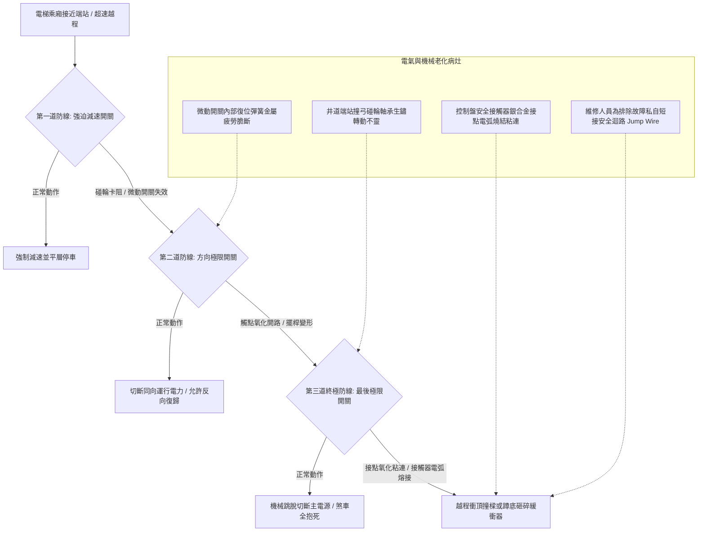

# 全案購屋實戰第五百零九部_中古大樓社區各樓層電梯極限極限開關接觸器接點氧化粘連與越程衝頂撞底雙重安全防線體檢工序全書

## 壹、核心體檢宗旨與家庭居住安全意涵

在中古集合住宅電梯安全防護體系中，為了防止電梯因控制電腦當機、變頻器失速、煞車制動器打滑或鋼索曳引力失常而發生極端「越程衝頂（Overtravel Upward / Crashing Ceiling）」或「蹲底撞底（Crashing Bottom）」的重大毀滅性公安事故，昇降路頂端與底端均設置了梯次分明的電氣安全保護開關防線：

1. **第一道防線：強迫減速開關（Terminal Slowdown Switch）**：當車廂接近頂層或底層端站時，若速度未減至設定值，碰輪（Roller Lever）觸碰撞弓（Cam），強迫控制系統切斷高速運轉並強制作減速煞車。
2. **第二道防線：端站極限開關（Directional Limit Switch）**：若減速失敗車廂繼續越程越過平層位置約 50 ~ 100 mm 時，立即切斷該方向的運轉控制迴路，阻止電梯繼續朝危險方向運轉，但仍允許朝相反方向安全復歸。
3. **第三道終極防線：最後極限開關（Final Terminal Limit Switch）**：若前兩道開關均失效，車廂越程超過 150 ~ 250 mm（在撞擊緩衝器或對重衝頂前），機械式連桿強制切斷電梯主電源與安全接觸器（Safety Contactor）線圈電源，主煞車立即緊急抱死，此狀態必須由電梯專業技師至機房手動復歸。

然而，在屋齡達 20 至 25 年以上的中古大樓（如大安紫金城 13 樓、長億南園 8 樓），端站開關常因井道潮濕粉塵積聚、碰輪軸承咬死、微動開關彈簧疲勞，或是控制盤內的「主安全接觸器（Safety Circuit Contactors）」銀接點氧化、積碳電弧高溫燒結「粘連（Contact Welding）」，導致即使極限開關動作跳脫，接觸器卻因接點粘死而無法斷電，形成形同虛設的「致命盲區」。

本手冊為小寶家庭量身訂製，針對高樓層置產標的建立端站電氣防護之現場查驗 SOP、控制盤維護紀錄解讀與買賣特約避坑防禦機制。

---

## 貳、端站極限防護系統與接點粘連病灶力學

### 1. 接觸器「接點粘連（Welding）」毀滅性危害
- **電弧高溫燒結**：每次電梯急停或大電流啟閉時，交流接觸器（Magnetic Contactor）接點間均會產生瞬間高達數千度的電弧（Arcing）。老舊社區接觸器使用超過 10~15 年未更換，銀鎢合金接點燒蝕殆盡，露出底層紫銅，極易在跳脫瞬間發生金屬熔融焊接。
- **連鎖失效**：一旦接觸器接點粘連，即便最後極限開關切斷控制信號，主回路電源依然源源不絕送入曳引馬達與煞車線圈，電梯將全速衝撞井道頂部樓板或底坑，造成車廂人員重傷致死。

### 2. 井道撞弓與滾輪連桿的機械磨耗
- **撞弓（Cam Plate）鬆動偏移**：安裝於車廂側或對重側的斜角金屬撞弓，受長年震動造成螺栓鬆脫偏斜，無法精準壓下端站開關之滾輪。
- **滾輪橡膠老化碎裂**：極限開關滾輪多包覆防震耐磨橡膠，長年硬化碎裂後，金屬碰輪與金屬撞弓直接撞擊，造成擺臂彎曲變形甚至斷裂。

---

## 參、實地帶看搭乘感受與管委會電氣維保體檢工序（SOP）

| 檢驗步驟 | 檢驗標的與實務工序 | 正常狀態指標 | 異常警訊與潛在重大風險 |
| :--- | :--- | :--- | :--- |
| **步驟一：頂層端站平層精準度勘驗** | 於最頂層（如大安紫金城 13 樓、靜園 A 區 11 樓）搭乘至定位，觀察車廂地坪與樓面高低差。 | 兩側地坪水平誤差在 **±5 mm** 以內，無明顯衝過頭再倒退修正。 | 1. 停靠時高出或低於地坪超過 **20 mm**。 2. 出現明顯頓挫衝頂煞車感，代表強迫減速失效，已逼近極限防線。 |
| **步驟二：機房控制盤電氣跳脫聲音** | 陪同總幹事或房仲至電梯機房，觀察電梯進站停靠時控制盤接觸器動作。 | 接觸器吸合與釋放聲音清脆俐落，無延遲拖泥帶水，無火花外濺。 | 1. 接觸器釋放時發出「滋滋」拉弧聲，外殼可見明顯跳火與焦黑熏痕。 2. 接觸器塑膠外殼受熱黃化脆裂，有塑膠燒焦異味。 |
| **步驟三：查驗安全迴路是否有短接線** | 檢視控制盤端子排（Terminal Block）之安全迴路端子（標示 SAFETY / LIMIT）。 | 接線端子排列整齊，無任何額外跨接的臨時跳線（Jumper Wire）。 | 發現色彩異常的臨時鱷魚夾線或跨接短路銅線，此為不肖廠商掩蓋開關故障的「致命短接」，絕對不可進場！ |
| **步驟四：調閱年度端站越程試驗紀錄** | 查核管委會保存之「昇降設備年度安全檢查紀錄表」中「極限開關及越程防止裝置」測試項。 | 技師簽核完成端站低速切斷測試與最後極限跳脫試驗，判定合格。 | 連續數期無測試記錄，或備註欄註明「端站開關接觸不良建議換新」，管委會卻遲未撥款修復。 |

---

## 肆、高樓層住宅置產防禦與談判特約維權

大安紫金城 13 樓、靜園 A 區 11 樓、長億南園 8 樓等高樓層置產標的，日常進出全仰賴頂端平層與減速開關的安全守護。端站開關與控制盤接觸器的妥善率，是保障家人免於衝頂意外的生命防線：

### 1. 關鍵電氣設備更新預算基準
- **井道強迫減速＋方向＋最後極限開關組換新（上下端共 6 組）**：工程料件連同線路重拉約 **\$25,000 ~ \$40,000**。
- **機房主控制盤主安全接觸器組（3~4 組）全數更換**：採用台安、士林電機或原廠進口重載交流接觸器，連工帶料約 **\$30,000 ~ \$45,000**。
- **全套主控制盤電腦主機板與安全迴路總體翻新**：若控制盤已停產無法取得匹配接點，需升級現代化微電腦/變頻控制盤，單棟造價約 **\$180,000 ~ \$280,000**。

### 2. 購屋買賣合約安全特約條款範本
> **安全與維修責任特約條款**：  
> 「賣方保證本買賣標的所在棟別之電梯安全防護裝置（包括但不限於強迫減速開關、方向極限開關、最後極限開關及控制盤主安全迴路）均符合中華民國建築物昇降設備安全檢查標準，無任何短接或功能失效情事。自簽約日起至交屋日止，若經電梯合格專業檢查機構判定該棟電梯有安全迴路接觸不良或需更換主接觸器之情事，其修繕支出或管委會因此產生之工程分攤款，一律由賣方全額繳清負擔，不得向買方主張任何補償。」
