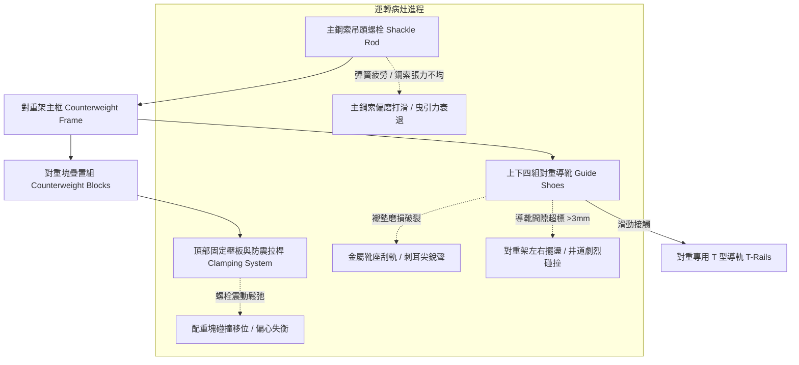

# 全案購屋實戰第五百零八部_中古大樓社區各樓層電梯配重側導靴襯墊磨損對重塊鬆動間隙異音與對重架結構疲勞體檢工序全書

## 壹、核心體檢宗旨與家庭居住安全意涵

在中古集合住宅大樓中，電梯昇降系統透過「對重側（Counterweight System，配重側）」平衡乘廂載重（通常平衡率設為乘廂全載重之 40% ~ 50%）。對重系統長年在井道內與乘廂呈相反方向作高速上下往復穿梭，在屋齡達 20 至 25 年以上的社區中，對重架與導靴襯墊（Counterweight Guide Shoes & Liners）常因長年震動與磨耗，衍生出極易被一般看屋者忽視但危及乘載安全的深層病灶：

1. **對重導靴耐磨襯墊（Guide Shoe Liner）過度磨損穿孔**：工程塑膠襯墊（UHMW-PE、尼龍或聚氨酯）乾磨破裂，導致金屬靴座直接刮削導軌（T 型鋼軌），發出刺耳的金屬尖叫聲與造成導軌不可逆之拉傷起毛。
2. **對重導靴間隙過大引發對重架搖晃撞擊**：導靴單邊磨耗游隙超過 **3 ~ 5 mm**，當電梯高速穿堂風或遇到微震時，對重架在井道內產生劇烈左右擺盪，產生「匡啷、匡啷」沉重金屬撞擊聲，甚至有卡軌或與乘廂交會時發生擦撞的重大公安風險。
3. **對重塊（Counterweight Filler Blocks）壓板鬆動震脫**：對重架內部層疊堆置數百公斤乃至上噸的鑄鐵塊或混凝土配重塊。若頂部固定壓板（Clamping Plate）螺栓疲勞鬆弛，高速急停或地震時對重塊互相撞擊粉碎或甚至脫落，恐直接砸穿底坑緩衝器。
4. **對重架主結構應力腐蝕與疲勞裂紋**：井道潮濕或底坑積水水氣蒸發，導致對重架底部懸掛鋼索扣件、吊頭螺栓（Shackle Rod）與焊接接角產生應力腐蝕裂紋。

本手冊針對小寶家庭的核心考量物件（大安紫金城 13 樓、長億南園 8 樓、歌德堡 8 樓、靜園 A 區 11 樓），建立嚴密之對重系統搭乘檢驗、井道異音判讀工序與談判特約保護防線。

---

## 貳、對重側系統核心結構與損壞力學演變

### 1. 導靴間隙與磨損極限標準
- **新品標準間隙**：滑動導靴（Sliding Guide Shoe）襯墊與導軌兩側及頂面之工作游隙應維持在 **0.5 ~ 1.5 mm**。
- **警訊與報廢極限**：
  - 單邊磨損間隙超過 **3.0 mm** 即需更換襯墊。
  - 襯墊磨損厚度消耗達原厚度之 **50%**，或金屬靴底已露出磨擦軌面者，必須立即停機更換。

### 2. 配重平衡率失調對主機的毀滅性連帶衝擊
- 若管委會或非原廠保養商維修時任意增減對重塊，導致平衡率偏離標準值（40% ~ 50%）：
  - **對重過輕**：電梯滿載上行時，曳引馬達重載過電流跳脫；主鋼索在曳引輪槽劇烈打滑磨損。
  - **對重過重**：電梯空車下行時馬達負擔過重，且煞車制動器（Brake）需承受超額制動力矩，煞車來令片提早燒結碳化。

---

## 參、實地帶看搭乘感受與管委會維保體檢工序（SOP）

| 檢驗步驟 | 檢驗場域與操作工序 | 正常狀態指標 | 異常警訊與深層病灶判讀 |
| :--- | :--- | :--- | :--- |
| **步驟一：空車全行程升降異音監聽** | 在非尖峰時段，從最底層單獨搭乘電梯直達頂樓（如大安紫金城 13 樓）。 | 全程僅有平穩的風切聲與導軌滑動輕微沙沙聲。 | 1. 運行至中樓層兩車交會處發出「匡啷」碰撞聲（對重導靴間隙過大擺動）。 2. 全程伴隨刺耳金屬尖嘯聲（襯墊磨耗穿孔刮軌）。 |
| **步驟二：各樓層乘場門外靜音勘查** | 站在走廊電梯門旁，聆聽車廂經過時的井道內部迴音。 | 車廂經過時聲音均勻平順。 | 傳出「規律性撞擊聲」或「金屬震顫共鳴」，通常為對重塊壓板鬆弛導致塊體間微幅跳動撞擊。 |
| **步驟三：檢查對重軌道潤滑狀態** | 透過透明觀景窗、乘場門頂部安全玻璃或請總幹事開啟機房井道觀察孔。 | 導軌表面油膜均勻透明，無乾涸起毛或金屬碎屑刮痕。 | 導軌頂面乾涸發黑、溝槽深陷，且導軌支架積聚大量工程塑膠碎屑或金屬鐵粉。 |
| **步驟四：調閱電梯每月安全維護紀錄** | 查閱管理室保存之「電梯定期保養紀錄表」昇降路檢查項目。 | 註記「對重導靴襯墊厚度正常」、「各鋼索吊頭張力均勻調整」。 | 紀錄表連續數月註記「對重異音待查」、「建請編列預算更換對重導靴組」，代表管委會拖延維修。 |

---

## 肆、高樓層住宅置產防禦與談判議價籌碼

對於鎖定高樓層（如大安紫金城 13 樓、靜園 A 區 11 樓、長億南園 8 樓、歌德堡 8 樓）的買方而言，電梯對重系統損壞將直接導致高樓層居住者每日進出的不便與安全威脅：

### 1. 工程維修工料預算評估
- **更換對重導靴耐磨襯墊（4 組）**：連工帶料約 **\$18,000 ~ \$30,000**。
- **對重架導軌校正與拉傷拋光修復**：若金屬刮軌已造成導軌表面拉傷起槽，需重新校正垂直度並以軌道拋光機研磨，單棟費用約 **\$45,000 ~ \$70,000**。
- **全套滾輪式對重導靴（Roller Guide Shoes）升級工程**：若中古社區將老舊滑動導靴升級為三輪彈簧避震滾輪導靴，工程款達 **\$80,000 ~ \$120,000**。

### 2. 購屋談判與合約特約防護條款
> **買賣特約防護範本**：  
> 「買賣雙方同意，賣方應擔保本買賣標的所在棟別之電梯設備，於交屋日前均處於正常合法運轉狀態，無導靴磨損引發之嚴重晃動、撞擊異音或結構安全隱患。交屋前若經電梯原廠維保技師勘驗認定對重系統、導軌或乘廂導靴有立即更換或校正之必要，其所需工程費用或管委會因該項工程辦理之臨時專案攤派款，全數由賣方負擔清償，不得以此阻礙點交或轉嫁予買方。」
