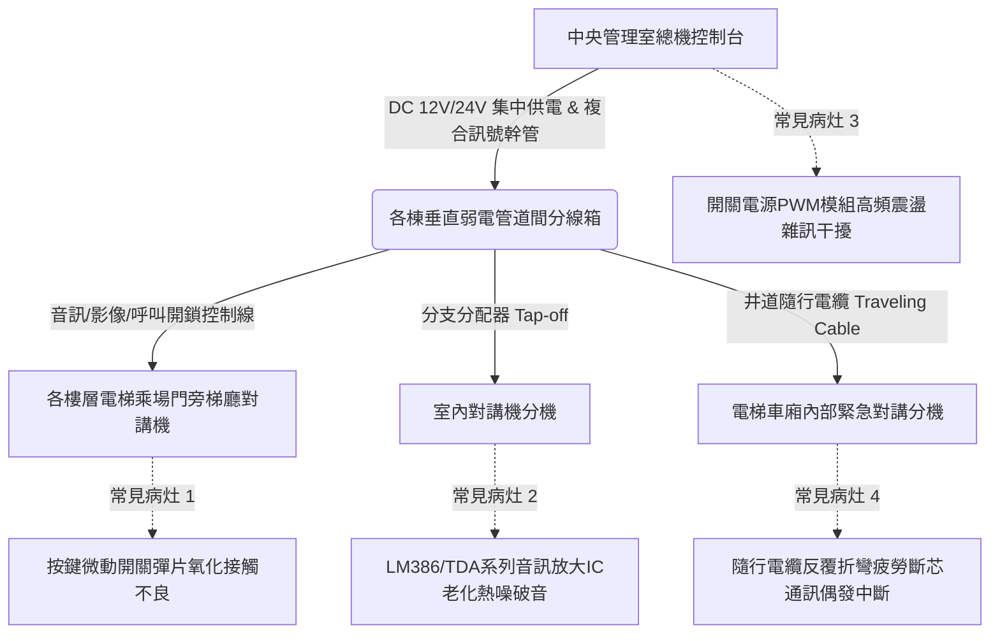

# 全案購屋實戰第五百零六部：中古大樓社區各樓層電梯對講機室內分機音訊放大IC老化破音直流供電壓降雜訊干擾與主機面板通訊中斷體檢工序全書

## 壹、核心查驗宗旨與前言

大樓弱電對講系統為全棟住戶對外防禦、訪客辨識、警衛管理室緊急呼叫及電梯受困通報之關鍵生命線。於二十年至三十年屋齡之中古電梯大樓中，各樓層室內對講機分機、梯廳對講面板與管理室主機常因直流電源供應器（DC Power Supply）濾波電容乾涸、線路老化阻抗增加導致壓降過鉅、音訊放大晶片（Audio Amplifier IC）熱劣化破音雜訊、以及雙絞線屏蔽層氧化接地失效，造成戶戶通話不清、梯廳無法呼叫甚至緊急求救訊號阻斷。

本工序全書旨在提供一套系統化、標準化之物理與電氣體檢標準，協助置產家庭精準鑑別室內分機、公共管道間訊號幹管及中控主機之硬體健康狀態，杜絕交屋後承擔全棟數十萬至百萬元對講弱電系統全面汰換之鉅額公攤修繕費用。

---

## 貳、電梯與各樓層對講機系統核心架構與常見物理病灶

### 一、音訊放大 IC 老化與交連電解電容容量乾涸
1. **電氣特性劣化機制**：早期室內機音訊放大電路多採用雙極型或低功率運算放大器（如 LM386、TDA2822 等），長期處於通電待機狀態下，散熱不良引致晶片矽基板熱疲勞，內部差動放大電路平衡失調，產生嚴重「嘶嘶」底噪或交越失真（Crossover Distortion）。
2. **電解電容漏液與容量衰退**：周邊隔直交連電容及電源濾波電容（通常為 100μF~470μF / 16V~25V）在環境溫濕度交替影響下，電解液揮發乾涸，等效串聯電阻（ESR）激增數十倍，導致音訊動態範圍壓縮、破音及自激震盪鳴叫（Howling）。

### 二、直流集中供電壓降與地迴路（Ground Loop）雜訊
1. **長距離供電壓降效應**：大樓垂直管道線徑若僅配置 0.5mm~0.65mm 銅線，自地下室或一樓管理室延伸至十幾層頂樓，迴路電阻可達數十歐姆。當多戶同時響鈴通話時，尖峰電流驟升，終端分機工作電壓大幅跌破容許門檻（例如標稱 DC 12V 跌至 8.5V 以下），導致語音調變失敗、音量微弱甚至系統重啟當機。
2. **共模雜訊干擾**：弱電線路若與大樓動力電纜（如揚水馬達、電梯動力配線）同槽共架平行鋪設且間距未達 30 公分，高壓交流電磁場感應至對講音訊線，產生強烈 60Hz 交流「嗡嗡」聲（Hum Noise）。

### 三、隨行電纜與按鍵接點機械損耗
1. **電梯車廂通訊核心痛點**：車廂對講機係透過懸掛於井道之多芯隨行電纜與機房連線。經年累月運轉彎折，內部細銅絞線產生金屬疲勞而形成隱蔽性「若斷若續」（Intermittent Open Circuit），在電梯升降特定高度時通話突然中斷。
2. **按鈕導電橡膠老化**：室內機開門鈕與警衛呼叫鈕多採用碳膜接觸或輕觸開關，油脂積累與金屬彈片硫化導致接觸電阻超過 500Ω，按壓數次均無法成功觸發大門電鎖釋放。

---

## 參、實地現場逐項體檢工序與量測指引

### 步驟一：室內分機外觀與物理按鍵觸發檢測
1. **外殼與面板狀態檢查**：檢視室內機外殼是否有塑料黃化脆裂、掛機微動開關（Hook Switch）彈簧彈力疲乏或卡滯現象。
2. **送受話器（Handset）聽筒檢測**：提起聽筒貼耳聆聽，於未呼叫待機狀態下，確認是否有高頻尖銳聲、低頻交流嗡嗡聲或熱噪嘶嘶聲。
3. **通話品質實測**：請陪同仲介或管理員於社區一樓大門主機或管理室發起呼叫通話：
   - 測試雙向語音清晰度，確認雙方音量是否飽滿平衡、有無齒音破音、迴授嘯叫或金屬破裂音。
   - 測試語音通話時背景安靜度，確認無電梯昇降時的變頻器高頻載波干擾聲。
4. **開鎖功能響應測試**：通話過程中按下「開鎖鍵」，觀察門禁電鎖（陽極鎖或磁力鎖）是否在 0.5 秒內俐落動作並釋放，室內機回饋指示燈是否即時熄滅。

### 步驟二：電氣參數萬用電表精確量測（屋主與仲介同意下之進階量測）
1. **端子排開路直流電壓量測**：
   - 使用數位萬用電表 DC 檔位，量測室內機背面電源輸入端（通常標記為 `+` / `-` 或 `V+` / `GND`）。
   - 正常待機電壓標準：DC 12V 系統不得低於 11.2V；DC 24V 系統不得低於 22.5V。若待機低於標準值 10% 以上，即判定為幹管壓降過鉅或集中供電變壓器老化。
2. **動態負載壓降量測**：
   - 保持電表表筆接觸端子，按下呼叫管理室通話鍵，記錄通話瞬間之電壓降幅（$\Delta V$）。
   - 容許動態壓降限度：$\Delta V \le 0.8\text{V}$。若通話瞬間電壓暴跌超過 1.5V，代表幹管導線氧化接觸不良或供電模組負載調整率（Load Regulation）嚴重劣化。
3. **音訊線交流雜訊電壓量測**：
   - 將萬用電表切換至 AC 毫伏檔（AC mV），量測音訊信號端（`AUDIO` 與 `GND` 間）。
   - 正常靜態通話間隙交流雜訊應小於 $30\text{mV}_\text{rms}$；若量測值大於 $100\text{mV}_\text{rms}$，代表存在嚴重交流電磁感應或接地開路。

### 步驟三：公共管道間分線箱與管理室主機交叉核實
1. **各樓層管道間弱電箱查驗**：
   - 檢視該樓層弱電箱內對講分接端子台是否有氧化銅綠（Verdigris）、裸線未套管受潮短路、或膠布老化脫落現象。
   - 檢視線材規格：標準大樓對講系統應使用具備鋁箔或編織網屏蔽之雙絞線（STP）或專用複合隔離電纜，若僅使用一般無遮蔽電話平排線（Flat Wire），日後必生干擾。
2. **管理室主機與電梯連通性核實**：
   - 借閱管委會歷次設備維護月報，調閱近半年「對講系統修繕通報紀錄」，確認是否頻繁出現「特定棟別無法通話」、「電梯受困呼叫無回應」等系統性結構故障。

---

## 肆、評估判定基準與瑕疵等級劃分

| 瑕疵等級 | 現象特徵與量測數據 | 潛在隱患與風險評估 | 預估修繕工法與費用規模 |
| :--- | :--- | :--- | :--- |
| **輕度瑕疵 (A級)** | 僅室內機聽筒接線氧化、微動開關接觸不良，通話輕微雜音，但開鎖與通話功能基本正常；電壓在容許範圍內。 | 局部零件老化，影響使用舒適度，尚無立即安全性或斷訊風險。 | 更換室內機耳麥螺旋線或局部噴塗接點清潔劑，更換單戶分機約需 **1,500 ~ 3,500 元**。 |
| **中度瑕疵 (B級)** | 單戶分機完全無聲或無法開鎖，管線端子台受潮腐蝕；通話時破音嚴重（音訊 IC 損壞）；或特定樓層電梯對講機偶發性斷訊。 | 室內設備完全癱瘓，訪客無法通知；緊急時無法向管理室或消防求救。 | 更換全新相容室內分機、重新壓接樓層端子及局部管線抽換，費用約 **3,500 ~ 8,000 元/戶**。 |
| **重度瑕疵 (C級)** | 全棟多戶通話雜音震天、整棟梯廳面板呼叫失靈、或管理室主機當機斷電；各樓層動態壓降超過 2.0V；電梯井道隨行電纜斷芯無訊號。 | 弱電系統全面崩潰，涉及全棟管道幹管重抽、集中供電系統換新、電梯隨行電纜更換，管委會若無基金將陷入修繕停擺。 | 全棟對講弱電主幹與主機全面更新工程，平均每戶公攤費用達 **15,000 ~ 35,000 元以上**。 |

---

## 伍、買賣合約保障特約條款與談判折價策略

### 一、談判折價依據與議價話術
若看屋現場實測對講機存在雜訊破音、開鎖不良或無法呼叫管理室之情事，買方應當場錄影並由仲介載入看屋瑕疵確認單，作為實質降價或扣抵修繕款之籌碼：
> 「本物件之室內對講機語音系統已呈現嚴重破音與電壓不穩失靈狀態，經初步電氣量測已涉及分機主機板劣化或公共管道間分配器腐蝕。由於本社區弱電線路已逾二十年，若後續查明屬全棟幹管問題，買方交屋後將面臨大額修繕公攤。屋主應於成交總價中直接折讓設備修繕款新台幣 2 萬元整，或由賣方於交屋前負責修復至可正常通話開鎖之完好狀態。」

### 二、成屋買賣契約專用法律特約條款（範本）

> **【不動產買賣契約書——弱電對講與門禁系統點交保證特約條款】**
>
> 1. **功能完整性保證**：賣方保證本買賣標的物所屬之室內對講機分機、梯廳對講面板、大樓門禁開鎖觸發線路及通往中央管理室（含社區大門及電梯緊急求救系統）之語音與控制信號，於交屋日前均處於通話清晰、無破音、無異常交流電磁雜訊且能正常開鎖之堪用狀態。
> 2. **修復義務與驗收**：雙方同意於交屋驗收時，由買賣雙方及地政士（或指定物業管理人員）現場實測通話與開鎖功能。若發現分機無聲、破音、開鎖失靈或訊號中斷者，賣方應於交屋日前自費修復完畢並出具專業弱電廠商之驗收單據。
> 3. **修繕款抵扣約定**：若賣方未於約定期限內修復完畢，買方得逕行委請合格弱電工程廠商進行檢修或更換全新相容機種，相關工程修繕費用（以新台幣貳萬元為上限）逕自買賣尾款中全額扣抵，賣方絕無異議。
> 4. **全棟性系統瑕疵之公攤追索權**：若交屋後一年內，管委會因交屋前已存在之對講系統全棟性幹管癱瘓而決議啟動全棟更新且向住戶徵收特別公攤維修費用時，賣方應依產權持有期間比例負擔該筆公攤費用。
