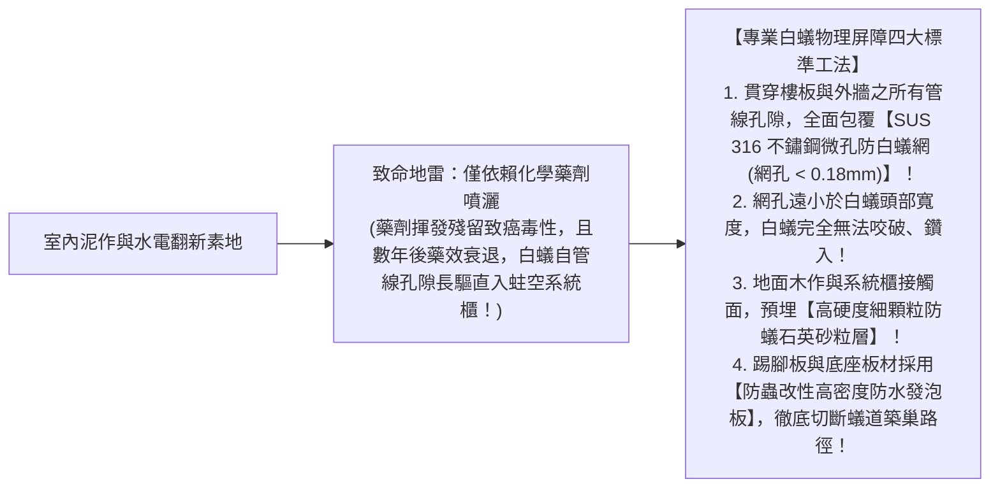
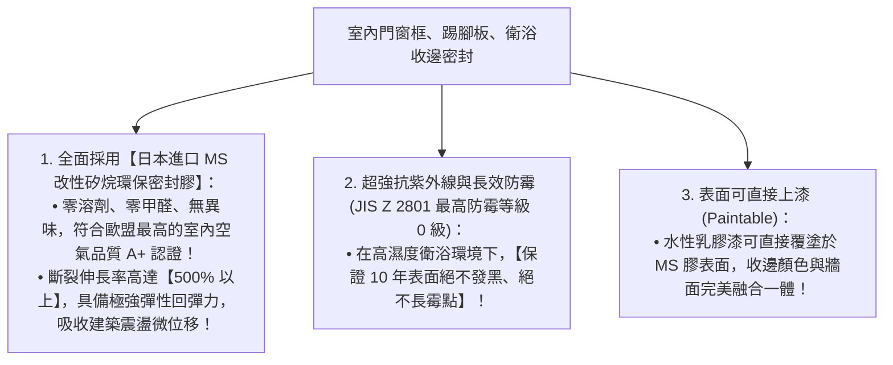

# 全案購屋實戰第八十一部：全室防蟲白蟻物理屏障工序與高分子彈性填縫耐候全書

## 核心主旨
本篇為購屋實戰指引第八十一部，聚焦於台中南區 28~29 年中古大樓在室內木作、系統櫃與泥作交接處之「防蟲白蟻物理屏障工法 (Physical Termite Barrier)」，以及「高分子改性矽烷 (MS Polymer) 耐候彈性填縫密封標準」，徹底杜絕老屋潮濕環境引發白蟻蛀蝕昂貴木作，並確保室內外接縫 15 年不開裂、不發霉、不滲水。

---

### 一、中古大樓老屋翻新「白蟻物理防禦與不鏽鋼微孔防蟲網」高標工序

28~29 年中古大樓在拆除舊木作後，水氣容易聚積於陰暗角落，形成白蟻入侵的溫床。傳統化學噴藥 2~3 年即會失效，物理防禦是唯一能維持 20 年以上的無毒長效方案：

---

### 二、全室門窗與踢腳板「MS 改性矽烷密封膠 (MS Polymer)」耐候標準

傳統酸性或中性矽利康在台灣高溫潮濕氣候下，1~2 年內即會發霉變黑、硬化收縮脫膠：

---

### 三、買方隨身談判金句：老屋蟲害防護與耐候細部翻修之價格抗辯

當房仲試圖強調房子現況乾乾淨淨不用花大錢整理時，買方攻防切入：

> 「周小姐，大安紫金城原本是分租給多名學生的套房，過去將近 30 年的木板隔間與潮濕環境，牆體內部有沒有白蟻卵跟蟲害隱患，大家都心知肚明。我們買來給長輩自住，全室拆除後必須徹底做物理防白蟻屏障、更換全套日本 MS 環保防霉填縫膠，這些看不見的細部無毒環保工程款，每一項都是實打實的現金支出。我們出價 730 萬（目標 768 萬）就是為了把這筆自住必備的健康無毒工程款保留下來。請周小姐向屋主轉達我們實實在在的自住買方誠意，價格有共識隨時可簽約！」
