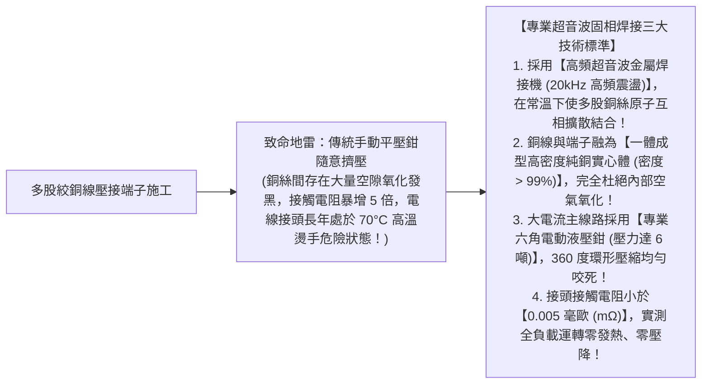
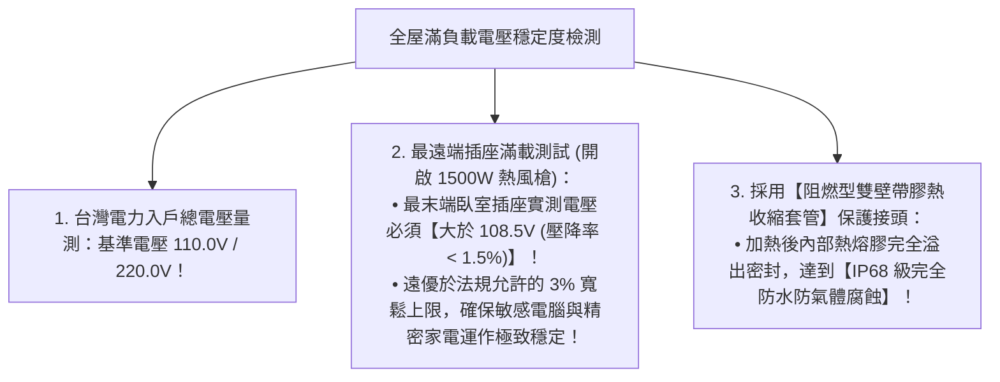

# 全案購屋實戰第八十七部：全室強電迴路電線銅端子超音波焊接工序與配電箱零壓降全書

## 核心主旨
本篇為購屋實戰指引第八十七部，聚焦於台中南區 28~29 年中古大樓在總配電箱水電翻新之「銅端子超音波金屬焊接 (Ultrasonic Wire Welding)」與「六角液壓環壓 (Hexagonal Hydraulic Crimp)」工序，徹底消除老屋電線接頭因接觸電阻過大產生之電壓降（Voltage Drop）與長期發熱氧化，確保全屋 30 年大功率用電零阻抗、零鬆脫。

---

### 一、中古大樓配電箱「電線端子機械壓接 vs 超音波焊接」高標工序

傳統水電師傅在配電箱壓接電線時，常使用普通手動鉗子隨便夾一下，銅線內部充滿空氣空隙，通電幾年後銅線氧化發黑、電阻大增：

---

### 二、全室大功率用電「線路電壓降 (Voltage Drop) < 1.5%」檢驗標準

現代家庭同時開啟冷氣、IH爐與烤箱時，若電線壓降過大，會導致冷氣壓縮機啟動不良、燈光瞬間閃爍暗淡：

---

### 三、買方隨身談判金句：電氣工藝老舊與高階重電工資之價格抗辯

當房仲試圖強調「電線以前拉過了不用全部重換」時，買方攻防切入：

> 「周小姐，表面有電線跟真正安全的高階用電工藝是完全兩碼事。29 年的老屋電箱裡面都是以前粗糙手剪纏繞的電線，很多接頭都已經氧化發熱有隱藏火災風險。我們買下來是自己全家要長住的，必須請專業水電團隊將全室配電盤以超音波金屬焊接與六角液壓重新壓接、做到全屋滿載壓降小於 1.5% 的最高電氣標準，這筆極耗工時的高階水電工資少說又是幾萬元的硬支出。我們堅持出價 730 萬（目標 768 萬）就是為了把這筆自住必備的電氣頂級安全預算先保留下來。請周小姐向屋主轉達我們講求極致安全的自住買方心態，價格有共識隨時可簽約！」
