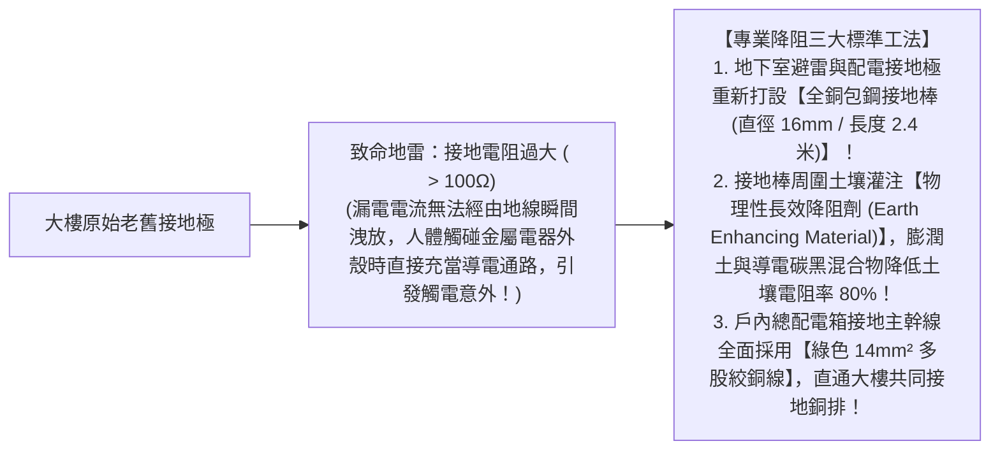
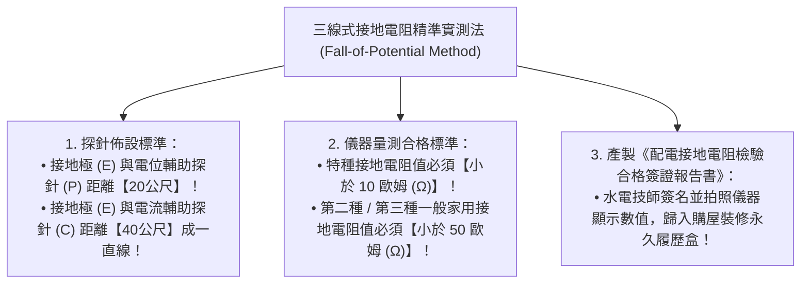

# 全案購屋實戰第八十三部：全室強電迴路雷擊接地電阻降阻工序與電氣地線終極實測全書

## 核心主旨
本篇為購屋實戰指引第八十三部，聚焦於台中南區 28~29 年中古大樓在室內配電接地系統之「接地電阻實質降阻工法 (Earth Resistance Reduction)」，以及「數位三線式接地電阻計 (Digital Ground Tester) 實測驗證標準」，徹底解決老屋接地極電阻過大、漏電無法及時洩放至地表導致家電微漏電麻手與雷擊防護失效問題。

---

### 一、中古大樓老舊接地系統「接地電阻過大」成因與降阻高標工序

28~29 年中古大樓當初施工時埋設的接地銅棒，歷經數十年地底水氣侵蝕與土壤酸化，接地電阻常飆升至 100Ω~300Ω 以上，使得配電箱接地線形同虛設：

---

### 二、配電系統「數位三線式接地電阻計」法規實測標準

老屋水電抽換線路完工驗收時，不能只用驗電筆測「有沒有接地」，必須依經濟部用戶用電設備裝置規則進行嚴格量測：

---

### 三、買方隨身談判金句：老屋接地系統缺失與用電安全之價格抗辯

當房仲試圖強調房子電線插座都是三孔很安全時，買方攻防切入：

> 「周小姐，表面插座有三個孔不代表真正安全。29 年的老大樓地底下的接地極早就氧化失效了，很多三孔插座裡面接地線根本沒接，或是接地電阻大到連漏電都放不掉。我們買下來給長輩住，全室必須請甲級電匠帶專業接地電阻計實測、重新在地下室配電箱引出合規的真接地幹線，確保接地電阻小於 50Ω，這筆專業的大樓接地工程款隨便算都要好幾萬元。我們出價 730 萬（目標 768 萬）就是為了把這筆自住必備的電氣生命安全預算先扣下來。請周小姐向屋主轉達我們實在、重視家庭的買方誠意，價格有共識隨時可簽約！」
