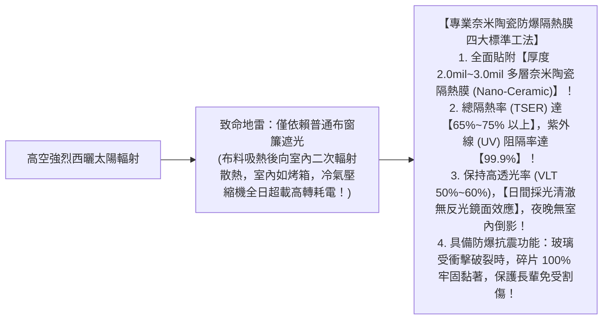
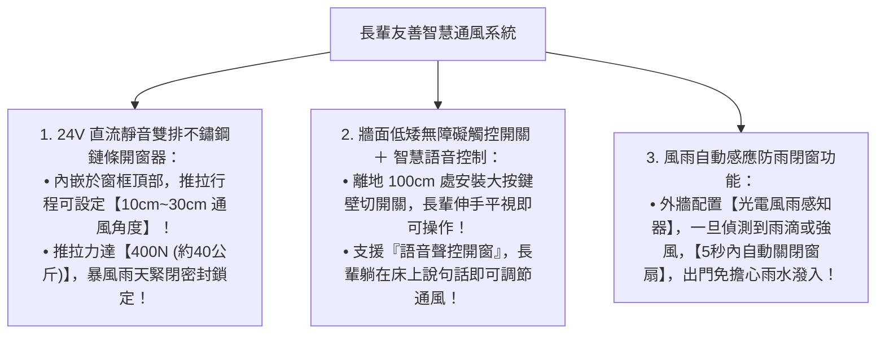

# 全案購屋實戰第八十二部：全室氣密防音窗隔熱膜工序與長輩友善全自動開窗系統全書

## 核心主旨
本篇為購屋實戰指引第八十二部，聚焦於台中南區 28~29 年中古大樓在窗戶工程之「奈米陶瓷多層金屬隔熱防爆膜工序 (Nano-Ceramic Window Film)」，以及室內高窗加裝「長輩友善直流靜音電動鏈條開窗器 (Electric Window Actuator) 智慧聯動標準」，大幅阻隔高樓層西曬紫外線熱輻射，徹底免除長輩踮腳爬高開窗的跌倒意外風險。

---

### 一、高樓層「奈米陶瓷隔熱防爆膜」隔熱降溫高標工序

大安紫金城 13 樓屬於高樓層戶，午後常面臨西曬高溫曝曬。傳統窗簾只能遮擋光線，熱輻射依然穿透玻璃滯留室內：

---

### 二、長輩起居防跌「直流無刷電動鏈條開窗系統」標準

老屋氣密窗把手或高處氣窗常需踮腳或搬板凳才能開啟，這是長輩居家跌倒的高危險動作：

---

### 三、買方隨身談判金句：高樓層西曬散熱與長輩安全開窗之價格抗辯

當房仲強調 13 樓採光充足、通風非常棒時，買方攻防切入：

> 「周小姐，13 樓採光好是優點，但強烈的西曬熱輻射讓室內夏天高溫難耐，而且高樓層的大型窗戶推拉阻力大、位置高，對同住的長輩來說，每天開關窗都有踮腳摔倒的危險。我們買下來給全家人自住，全室大面窗戶必須全面貼附醫療級奈米陶瓷隔熱膜、並為長輩加裝全套風雨感應電動開窗系統，這筆攸關長輩防跌與夏季節能的智慧窗戶工程款又是十幾萬現金。我們出 730 萬（目標 768 萬）就是為了把這筆自住必備的全齡安全預算先扣下來。請周小姐向屋主轉達我們實在、重視家庭的買方誠意，價格有共識隨時可簽約！」
