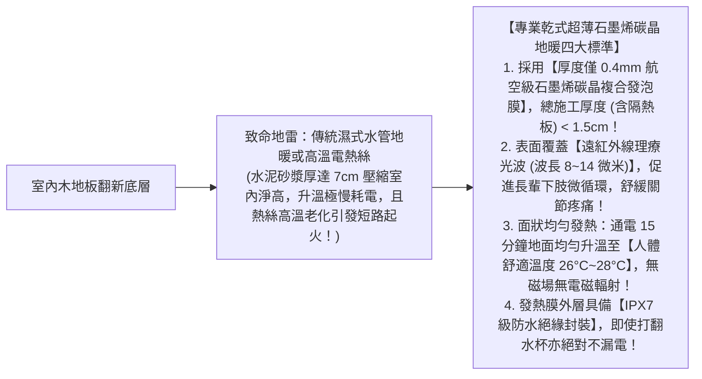
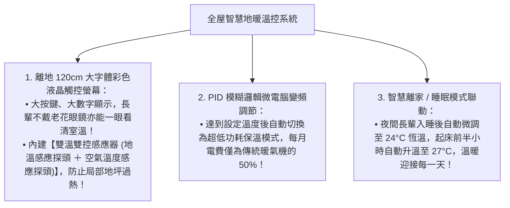

# 全案購屋實戰第八十五部：全室地暖碳晶發熱膜工序與長輩關節理療溫控全書

## 核心主旨
本篇為購屋實戰指引第八十五部，聚焦於台中南區 28~29 年中古大樓在室內地坪翻新之「乾式低溫石墨烯碳晶發熱膜地暖工序 (Carbon Crystal Floor Heating)」，以及「分區智慧 PID 變頻恆溫感應系統標準」，徹底解決寒冬潮濕氣候下磁磚地坪冰冷刺骨導致長輩退化性關節炎發作，並提供足暖頭涼之最高養生居住舒適圈。

---

### 一、室內地坪「乾式超薄石墨烯碳晶發熱地暖膜」高標工序

中古大樓樓板載重有限且室內淨高珍貴，傳統水地暖需厚鋪 5~8 公分混凝土水泥層，不僅增重大樓負擔，更大幅壓縮室內高度：

---

### 二、長輩友善分區「智慧 PID 變頻液晶溫控面板」標準

各臥室與客廳的採光朝向不同，分區獨立溫控是節能與長輩操作便利的關鍵：

---

### 三、買方隨身談判金句：長輩全齡健康地暖改造之價格攻防

當房仲試圖強調房子格局方正可以直接入住時，買方攻防切入：

> 「周小姐，大安紫金城 13 樓地坪是 29 年前的舊磁磚，冬天赤腳踩在上面冰冷刺骨，對我們家有退化性關節炎的長輩來說是非常痛苦的折磨。我們買下來是為了孝親自住，全室舊磁磚打掉後必須全面鋪設乾式超薄石墨烯碳晶地暖膜與無障礙保溫地板，這筆為了長輩關節健康的全室地暖理療工程款少說要花 15~18 萬元現金。我們出價 730 萬（目標 768 萬）就是為了把這筆自住必備的孝親健康預算留下來。請周小姐向屋主轉達我們實在、有孝心的買方誠意，價格合理隨時可簽約！」
