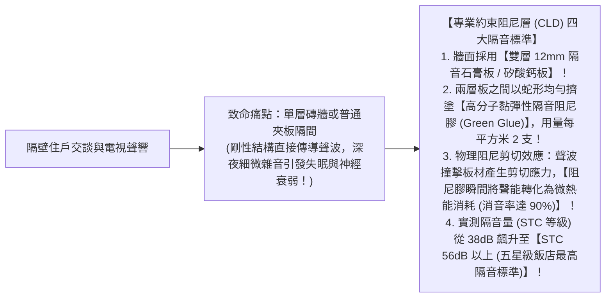
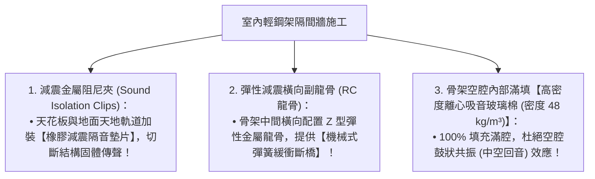

# 全案購屋實戰第八十六部：室內隔間隔音減震阻尼膠工序與分戶牆降噪隔絕全書

## 核心主旨
本篇為購屋實戰指引第八十六部，聚焦於台中南區 28~29 年中古大樓在室內輕鋼架隔間與相鄰鄰居分戶牆之「綠色高分子隔音阻尼膠 (Green Glue Damping Compound) 夾層工序」，以及「隔音減震龍骨 (Resilient Channel, RC龍骨)」配置標準，徹底杜絕相鄰鄰居電視講話聲與深夜關門撞擊聲，打造五星級飯店級靜音臥室環境。

---

### 一、分戶牆與臥室隔間「綠色阻尼隔音膠雙層石膏板」高標工序

中古大樓相鄰兩戶的分戶牆若僅為 12 公分厚普通 RC 牆或輕質灌漿牆，隔音量通常不足 40dB，隔壁住戶看電視、說話甚至手機震動聲清晰可聞：

---

### 二、輕鋼架隔間「減震彈性龍骨 (Resilient Channel)」斷橋標準

臥室與客餐廳之間的隔間牆，若骨架直接硬性鎖在地面與天花板上，腳步聲與低頻震動會沿著骨架直接貫穿：

---

### 三、買方隨身談判金句：老屋相鄰分戶隔音改造之價格抗辯

當房仲試圖強調戶數少、鄰居很安靜時，買方攻防切入：

> 「周小姐，大安紫金城是快 30 年的老公寓大廈了，以前的分戶牆根本沒有現代豪宅的雙層阻尼隔音標準，而且原本當套房時隔間被隨便亂打，隔音非常差。我們買下來給長輩住，長輩淺眠最怕隔壁鄰居看電視或深夜回家的聲音，我們必須趁泥作翻新時，在主臥分戶牆全線加做彈性減震 RC 龍骨、滿填高密度吸音棉並施作專業阻尼隔音夾層，這筆五星級隔音降噪工程少說要花 8~10 萬元現金。我們出價 730 萬（目標 768 萬）就是為了把這筆自住必備的睡眠健康預算扣下來。請周小姐向屋主轉達我們實實在在的自住買方誠意，價格有共識隨時可簽約！」
