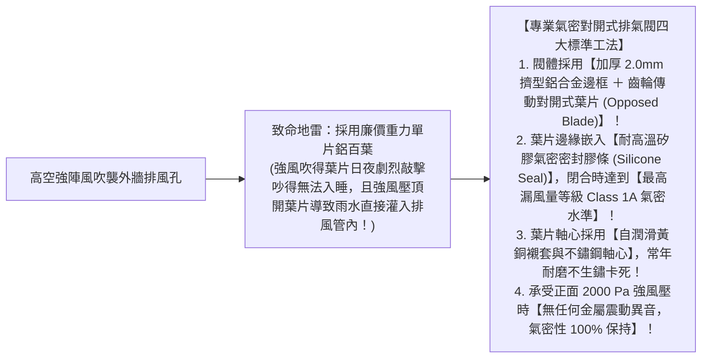
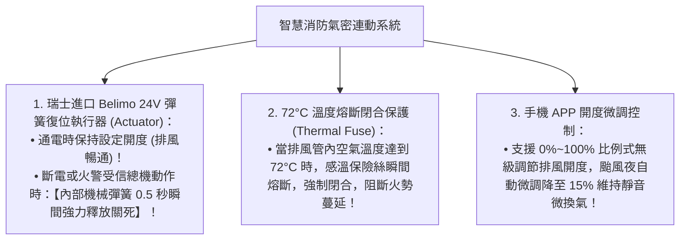

# 全案購屋實戰第八十四部：全室鋁合金百葉排氣閥防回風密封工序與氣動調節全書

## 核心主旨
本篇為購屋實戰指引第八十四部，聚焦於台中南區 28~29 年中古大樓在室內外通風換氣開口之「高壓氣密型鋁合金對開式百葉排氣閥 (Motorized Control Damper)」工序，以及「負壓連動氣動調節閉合標準」，徹底杜絕高樓層外牆強風倒灌拍打金屬葉片產生惱人撞擊噪音，並在火災發生時 0.5 秒瞬間連動氣密閉合阻斷濃煙外溢。

---

### 一、高樓層外牆排氣開口「抗強風氣動對開百葉」高標工序

大安紫金城 13 樓屬於高樓層戶，外牆排煙口若使用一般輕質單向擺動百葉，在強烈東北季風吹襲下，葉片會劇烈上下拍打發出「喀噠喀噠」的金屬噪音，且暴風雨時風雨會被吹回管道內：

---

### 二、智慧消防連動「24V 電動彈簧復位風閥執行器」標準

廚房油煙排氣與全熱交換排風管穿過外牆或防火區劃時，安全連動必須達到最高消防標準：

---

### 三、買方隨身談判金句：高空排風防噪與消防安全升級之價格抗辯

當房仲試圖強調房子高樓層通風好不需要再改裝排風時，買方攻防切入：

> 「周小姐，13 樓高樓層風壓非常大，現在外牆舊排氣孔都是老式的薄鋁片，稍微有一點陣風就拍打得像在打鼓一樣，而且颱風天下大雨還會雨水倒灌進排風管。我們自住買下來，為了睡眠品質與高空消防安全，全室外牆排風開口必須全面換裝專業級齒輪傳動對開氣密百葉、並配置彈簧復位執行器，這筆高空外牆風閥工程款又是實打實的現金支出。我們出價 730 萬（目標 768 萬）就是要把這筆自住必備的高空安全預算先保留下來。請周小姐向屋主轉達我們實實在在的自住買方誠意，價格有共識隨時可簽約！」
