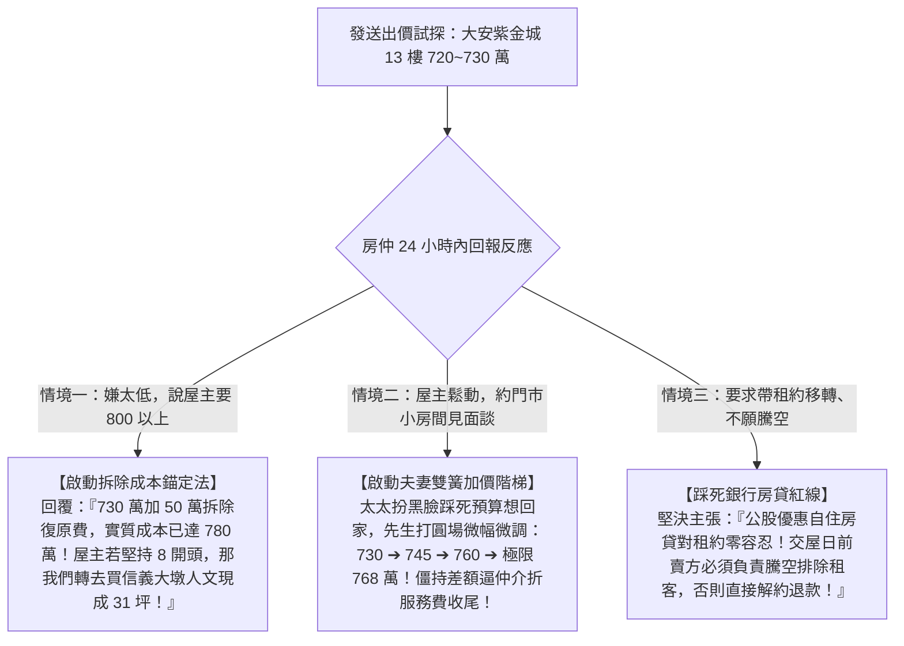

# 全案購屋實戰第八十部：八十部終極圓滿旗艦全景與出價簽約終極決策全書

## 核心主旨
本篇為購屋實戰指引第八十部「八十部終極圓滿旗艦全書」，聚焦於整合全案跨越 80 個關鍵維度之全景作戰兵器庫，梳理出直擊屋主心理底牌的「終極出價決策樹與斡旋簽約四不一堅持口訣」，為買方在前線出價、見面談與斡旋簽約提供最完美的實戰終結指引。

---

### 一、買方終極決策樹：直球出價與心理底牌對決

在發送出價訊息或坐在小房間談判桌前，請依循以下決策樹路徑冷靜推進：



---

### 二、斡旋簽約「四不一堅持」終極口訣

走進代書事務所簽字前，請在心中默念這五句金科玉律：

```text
【買方簽約護身五大鐵律】

1. 不簽口頭承諾：所有賣方承諾之「騰空日期、修繕漏水、附贈冷氣」，一律白紙黑字寫進合約附約！
2. 不漏騎縫印章：買賣契約內頁、特約條款附約書，每頁接縫處雙方務必加蓋騎縫章，防止抽換內頁！
3. 不交現金斡旋：斡旋金 10 萬元一律開立抬頭為仲介加盟店公司戶名、且劃線禁背之銀行本票/支票！
4. 不碰民間借貸：謄本他項權利部若有民間自然人二胎借貸，未在簽約前取得清償證明前絕不簽字付定！
5. 堅持四大特約：
   • 貸款成數不足總價 80% 無條件解約退款
   • 賣方負責交屋前完成租客騰空與排除占用
   • 非凶宅、非海砂屋、非危樓結構保證
   • 六個月滲漏水瑕疵擔保修繕責任
```

---

### 三、全案八十部實戰精粹：十層全景戰鬥體系

經過深厚築底與極致淬鍊，本專案的 80 部實戰體系已構築成全台灣最強大的購屋航母：

```
┌────────────────────────────────────────────────────────────────────────┐
│               🏠 台中南區買屋實戰：八十部旗艦防禦金字塔                 │
├────────────────────────────────────────────────────────────────────────┤
│ 1. 情報偵蒐：10TB 看屋檔案對齊、4大考慮名單、排除 14 劣質物件防止洗案 │
│ 2. 出價議價：大安紫金城 (起手 730 / 目標 768 / 停損 818)、長億南園 745 萬│
│ 3. 法律護城：手寫四大金剛特約、貸款不足 8 成全退款、賣方騰空排除租客   │
│ 4. 談判心理：見面談夫妻雙簧角色扮演、仲介費折佣、優雅離席冷卻回馬槍   │
│ 5. 財務稅務：銀行鑑價極大化、新青安對保防綁約、台中市合法室裝綠牌     │
│ 6. 水電隱蔽：50 萬拆除明細、水管試壓 24 小時、電線阻燃、AFCI 防電弧   │
│ 7. 門窗隔音：斷橋鋁合金氣密窗、抗風壓 360 等級、甲種 60A 防火防暴鋼木門│
│ 8. 全齡無障礙：天然軟木防潮墊、全室零門檻高低差、PIR 紅外線夜間感應燈 │
│ 9. 驗收維權：驗屋 20 條、扣押 5% 保留款、存證信函、代書費防灌水多退少補 │
│ 10. 保值傳承：自住節稅 2‰ 地價稅、重購退稅兩年、生活圈無縫銜接       │
└────────────────────────────────────────────────────────────────────────┘
```

---

### 四、買方前線出擊：複製即發之 LINE 溝通範本

您現在手握最頂級的情報與底牌，建議直接將以下文字發給永義房屋周小姐：

```text
周小姐您好～
我們這幾天仔細看了大安紫金城13樓的影片跟資料。
這間有B2坡平車位確實符合長輩的需求，但因為現況全部隔成學生分租套房，我們買來是自住，交屋後必須把隔間全拆、水電管線與衛浴重新拉回正常三房，請設計師初估拆除清運加管線復原至少要花40~50萬。

另外，我們自住一定要辦公股銀行優惠房貸，銀行審核非常嚴格，產權必須乾淨且完全騰空，不能有任何租約或房客延遲搬遷的問題。

我們很有誠意想談，但必須把這筆拆除整修成本扣下來。如果屋主願意在交屋前「負責騰空、排除所有租約」，我們出價意願在 720~730 萬左右。
因為信義建宇那邊也一直在追問我們另一間大坪數案子的意願，想先跟您確認一下，大安紫金城屋主在交屋前騰空以及這個價格區間，有沒有機會坐下來談？如果有的話我們再來安排下斡旋！謝謝周小姐～
```
