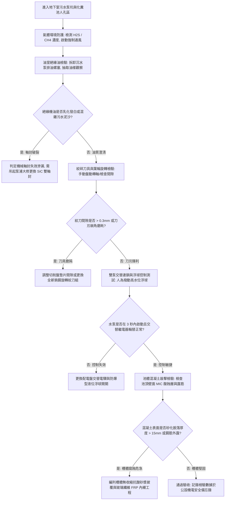

# 全案購屋實戰第八百一十二部：中古大樓社區地下室生活污水下水道用戶接管沉水式絞碎型排污泵浦氣化空蝕機械軸封砂石刮傷與化糞池槽體酸化滲漏體檢工序全書

## 壹、 導言與實務體檢核心概述

在集合住宅中古電梯大樓之污廢水排放架構中，位於地下室（B1 至 B3/B4）之公共浴廁、洗車排放水、地坪清潔水以及化糞池/廢水池之底層污水，因受限於建築物垂直標高低於外部市政道路公共污水下水道管頂標高，無法依靠自然重力流自流排放，必須配置**沉水式絞碎型排污泵浦系統（Submersible Grinder Sewage Pump System）**進行強制加壓提昇排放。

依據中華民國建築技術規則建築設備編及 CNS 沉水式污物泵規範，排污系統普遍配置具備**高鉻合金鎢鋼旋轉絞刀（Tungsten Carbide Grinder Cutter）**之雙泵備援系統（1 用 1 備，Duty/Standby）。當毛巾、濕紙巾、塑膠袋或各類衛生纖維雜物隨廢水進入泵浦吸入口時，絞刀以高達 1750 至 3500 RPM 之高速旋轉，將固體雜物撕裂粉碎成直徑小於 $6\ \text{mm}$ 之微細懸浮漿液，再經由多翼式渦流葉輪（Vortex Impeller）揚送至市政下水道。

然而，在屋齡 20 至 35 年之中古大樓中，污水池沉積了大量自住戶廚房與衛浴沖洗流入之細砂粒、毛髮及油脂。硬質石英砂微粒對**碳化矽機械軸封（SiC Mechanical Seal）**造成嚴重研磨拉溝；加之化糞池長期處於高濃度酸性硫化物環境下，混凝土槽體產生**生物硫酸腐蝕（Microbiologically Influenced Corrosion, MIC）**，槽壁鈣質大量溶出砂化、鋼筋裸露鏽斷；而當排污泵啟動抽水時，若池底沉砂過深或水位過低，泵浦吸入口將產生**吸入空氣渦流（Air Entrainment）**與**嚴重氣蝕（Cavitation）**，導致排污馬達過載燒毀、廢水池暴滿漫流，整座地下室淹沒於惡臭糞水浩劫之中。

本手冊為買方提供沉水絞碎排污泵浦與污水槽體結構之專項體檢工序。

---

## 貳、 絞碎排污泵與污水池槽體失效機理剖析

### 一、 鎢鋼絞刀鈍化、纖維纏繞與機械軸封刮傷
1. **絞刀間隙擴大與長纖維抱死（Cutter Binding）：** 旋轉絞刀與固定切削盤（Cutter Ring）之剪切間隙標準為 $0.1\ \text{mm} \sim 0.2\ \text{mm}$。在長年吸入硬質金屬碎屑或砂石衝擊下，刀刃崩裂鈍化，間隙擴大至 $1.0\ \text{mm}$ 以上。濕紙巾與不織布衛生棉無法被剪斷，反而緊密纏繞於絞刀軸心，造成馬達堵轉（Rotor Stall），過載電驛頻繁跳脫。
2. **碳化矽機械軸封（SiC vs. SiC）砂石刮痕與水浸油室：** 沉水泵內部設有油室（Oil Chamber），內注冷卻絕緣機油。當廢水中的石英細砂穿透外軸封防塵環，研磨顆粒進入摩擦面，碳化矽鏡面密封面被割出放射狀深溝。高腐蝕性污水大量湧入油室，導致潤滑油乳化發白，進而擊穿內軸封，污水灌入三相馬達定子線圈，引發相間接地短路燒毀。

### 二、 化糞池槽體生物酸化腐蝕與基礎底板滲漏
1. **生物硫酸腐蝕（MIC 腐蝕效應）：** 封閉化糞池與廢水池內部濕度飽和，厭氧分解產生之硫化氫（$\text{H}_2\text{S}$）逸散至頂部空氣層，附著於池頂潮濕混凝土壁面。好氧硫桿菌（Thiobacillus）將其氧化代謝為硫酸（$\text{H}_2\text{SO}_4$），pH 值可暴跌至 $1.0 \sim 2.0$（強酸環境）。強酸與混凝土中的水化矽酸鈣反應生成膨脹性二水石膏（Gypsum），導致頂板與側壁混凝土大面積層狀剝落、鋼筋腐蝕斷裂。
2. **槽底穿孔與地下水回滲掏空：** 地下室污水池底板若因地震剪力破裂，未經處理之污水順著裂縫排入地下土層，掏空地盤；而當大雨地下水位暴漲時，外圍地下水又倒灌入廢水池，造成排污泵頻繁無效啟動（盲抽地下水），導致公共電費暴增且水泵加速折損。

---

## 參、 現場實勘與機能檢測驗收標準工序（SOP）



### 一、 沉水絞碎泵現場診斷四步法
1. **絕緣機油乳化取樣檢測（Oil Chamber Emulsion Test）：**
   - 吊起或於檢修架上旋開沉水泵浦油室檢驗螺栓（Oil Plug）。
   - 以透明滴管抽取油樣觀察。
   - 合格標準：油品應呈現澄清黃色或透亮機油色。若油品呈現如「牛奶般乳白混濁（Milky Emulsion）」或直接噴出黑臭污水，證實下端機械軸封已被砂石割破，若不立即吊修，馬達將在數日內完全燒毀。
2. **鎢鋼絞刀間隙厚薄規量測（Cutter Clearance Check）：**
   - 切斷泵浦動力主電源並掛牌上鎖（LOTO）。
   - 使用厚薄規（Feeler Gauge）插入旋轉絞刀與固定切削環之刀口。
   - 合格標準：剪切間隙必須在 **$0.10\ \text{mm} \sim 0.20\ \text{mm}$** 之間。若間隙大於 $0.35\ \text{mm}$，絞刀失去撕裂纖維能力，必須拆卸重整調整墊片。
3. **滿水位警報與自動交替輪替測試：**
   - 在控制盤切至「自動」狀態下，手動提起污水池內之「高水位啟動浮球」。
   - 檢核 1 號泵浦啟動排水，觀察其出水管壓力錶與運轉三相電流（電流不得超過額定滿載 FLA）；
   - 放下浮球停機後再次提起，控制盤必須自動切換為 2 號泵浦啟動。若無法交替，判定交替電驛觸點燒結。
4. **化糞池頂壁 MIC 生物酸蝕深度量測：**
   - 配戴防毒面具開啟污水池通風人孔，強光照射池壁頂部氣相區。
   - 使用金屬檢驗刮刀刮除混凝土表面腐蝕層。
   - 合格標準：混凝土應質地堅硬、敲擊聲音清脆。若表面呈白色石膏狀膏體、用刮刀輕易刮下深度達 $10\ \text{mm} \sim 30\ \text{mm}$ 且見鏽蝕箍筋，代表槽體結構已受強酸嚴重侵蝕，隨時有坍塌破洞危機。

---

## 肆、 購屋合約防坑特約條款與修繕責任劃分

在成屋買賣契約中，針對中古社區地下室污水提升與化糞池公共衛生安全，應載明以下保障條款：

```markdown
### 買賣契約防坑特別約定事項：公設沉水排污泵浦與污水槽結構衛生安全保證

1. 【排污設備運轉保證】：賣方保證本社區地下室生活污水下水道用戶接管沉水排污泵浦系統（包含絞碎刀具、機械軸封、雙泵交替控制盤及液位傳感器）處於正常完好運轉狀態，無馬達燒毀、無油室乳化洩漏，且排污管路通暢無回流。
2. 【化糞池槽體結構瑕疵排除】：買方有權委託合格機電技師檢驗公設污水池。若發現沉水泵浦軸封破裂滲水、絞碎功能喪失、污水池槽壁遭受生物硫酸嚴重侵蝕露筋，或池底滲漏導致地下室惡臭瀰漫者，賣方應負責協調管委會於交屋前完成修繕更新；若交屋日前因公設排污系統故障導致污水漫溢損及本買賣標的物專有部分，賣方承擔全額修復及消毒賠償責任。
```

---

## 伍、 本專項工序體檢總結

沉水式絞碎排污泵浦與污水池是中古大樓隱蔽於地底深處的「排毒動脈」。機械軸封的微量砂石磨損與池體酸蝕，往往是引發地下室大淹糞水、損害數百萬公設機電的引信。買方深入檢核排污泵油室乳化狀態、鎢鋼絞刀間隙與槽體腐蝕工序，方能確保居住環境遠離惡臭與淹水災難，享有真正乾淨舒心的生活品質。
