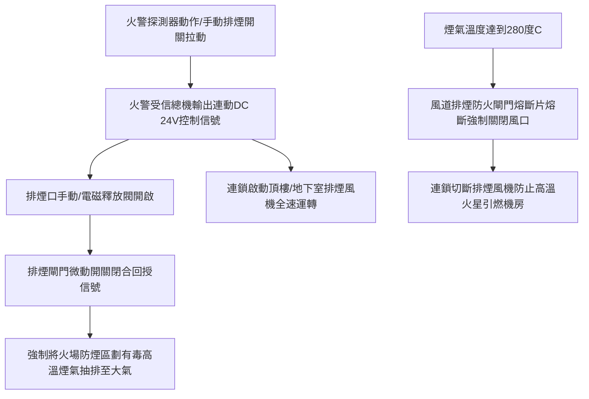

# 全案購屋實戰第八百七十一部：中古大樓社區消防排煙設備梯間與地下室機械排煙風機風道熔斷防火閘門聯鎖連動失效與濃煙阻絕體檢工序全書

## 壹、編撰宗旨與火場濃煙窒息致命因子

在火災動力學（Fire Dynamics）與建築消防安全工程中，火場奪命之最主要元兇往往非高溫明火，而是燃燒不完全所產生的高濃度有毒濃煙與窒息性氣體（包括一氧化碳 $\text{CO}$、氰化氫 $\text{HCN}$、光氣及二氧化碳）。在集合住宅大樓中，高溫濃煙因溫差熱浮力驅動，會在垂直樓梯間與電梯昇降管道內產生極強烈的「煙囪效應（Stack Effect）」，垂直擴散速度可高達每秒 $3 \sim 5\text{ 公尺}$，數分鐘內即可封鎖整棟建築的避難逃生動線。

依據我國《各類場所消防安全設備設置標準》，高層建築、地下各層停車場、無窗戶居室及各樓層「特別安全梯（Special Smoke-proof Staircase）排煙室」，均強制設置「機械防排煙設備」（Mechanical Smoke Control System）。

然而，在屋齡 20 年至 35 年以上之中古大樓社區（如台中南區的大安紫金城、長億南園、歌德堡、工學天下等），機械排煙系統長年處於靜止狀態，面臨極其嚴重的隱形劣化：
1. **排煙風機（Smoke Exhaust Fan）馬達絕緣老化、三角皮帶龜裂打滑或軸承卡死**，火災時無法達到額定排煙風量；
2. **鍍鋅排煙風道接縫填縫膠脆化漏風**，負壓抽風時大量吸入冷空氣，使火場實際排煙效率折損 $50\%$ 以上；
3. **風道防火閘門（Fire Damper, FD）與防煙閘門（Smoke Damper, SD）熔斷機構卡死、手動復位卡筍變形、驅動微動開關接點氧化**，無法在火警信號或高溫（$72^\circ\text{C}$ 或 $280^\circ\text{C}$）時準確閉合或連鎖開關，導致濃煙在各防煙區劃之間串流灌入避難梯間，造成逃生人員集體嗆傷窒息。

本手冊針對中古社區機械排煙風機、風道氣密性、防火排煙閘門及控制連鎖系統，詳解流體氣動力學原理、高溫阻燃標準、現場量測儀器與全流程標準體檢工序，為購屋家庭與管委會建立最堅固的無煙逃生走廊。

---

## 貳、防排煙系統流體力學架構與連鎖控制物理機制

### 一、排煙風量法規標準與風道氣流力學
依據《各類場所消防安全設備設置標準》：
1. **防煙區劃與排煙量要求**：
   - 每一個防煙區劃面積不得超過 $500\text{ m}^2$（地下室或特定場所為 $400\text{ m}^2$），且區劃內任一點至排煙口之水平距離不得超過 $30\text{ 公尺}$。
   - 特別安全梯排煙室之機械加壓防煙風量：加壓空氣必須在安全梯與排煙室、排煙室與走廊之間維持至少 **$25 \sim 50\text{ Pa}$ 之微正壓（Positive Pressure）**，以壓制濃煙侵入。
   - 機械排煙風量標準：單一防煙區劃排煙風量不得小於 **$1 \text{ m}^3/\text{min}\cdot\text{m}^2$**（即每平方公尺每分鐘 1 立方公尺），且地下室總排煙量通常要求不得小於 **$400 \sim 600\text{ m}^3/\text{min}$**。
2. **風道全壓與流阻損失**：
   排煙風機所需之全壓（Total Pressure $P_t$）為動壓（Velocity Pressure $P_v$）與靜壓（Static Pressure $P_s$）之總和：
   $$P_t = P_s + P_v = P_s + \frac{1}{2} \rho v^2$$
   高溫煙氣密度 $\rho$ 隨溫度上升而降低（$300^\circ\text{C}$ 時約為常溫的一半）。排煙風機必須配備高溫耐熱電動機（通常要求能在 $250^\circ\text{C} \sim 300^\circ\text{C}$ 高溫煙氣中連續運轉 60 分鐘以上而不燒毀）。

---

## 參、中古大樓防排煙系統三大核心病徵與致命風險

### 一、排煙風道防火閘門熔斷機構鏽蝕與卡死
1. **低熔點合金熔斷片氧化脆化**：常態安裝於風道穿牆處之防火閘門，其控制核心為易熔合金片（Fusible Link，排煙風道熔斷溫度通常標定為 $280^\circ\text{C}$，一般空調風道為 $72^\circ\text{C}$）。長年在潮濕空氣中，易熔片表面生成厚氧化物，阻礙導熱或機械卡死。
2. **葉片轉軸積垢與扭簧疲勞**：防火閘門多葉聯動百葉軸承缺乏耐高溫潤滑，金屬葉片受粉塵與濕氣附著。當火災觸發釋放時，扭力彈簧無法克服摩擦阻力將百葉完全關閉，留存 $2 \sim 5\text{ cm}$ 縫隙，使致命火舌與毒煙直接沿風道貫穿延燒至其他樓層。

### 二、排煙風機傳動皮帶斷裂與軸承咬死
1. **橡膠皮帶老化打滑**：中古大樓頂樓排煙機房長年西曬高溫，風機馬達與風輪之間的 V 型傳動皮帶（V-Belt）硬化龜裂、張力鬆弛。當火災全載啟動時，皮帶在皮帶輪上劇烈打滑空轉，轉速無法傳遞至風輪，實際排風量劇降 $80\%$。
2. **滾珠軸承潤滑脂碳化**：排煙風機鮮少運轉測試，軸承內之高溫鋰基潤滑脂乾涸固化。突發啟動時瞬間產生金屬研磨高溫，引發軸承抱死並燒毀馬達定子線圈。

### 三、排煙口手動開啟裝置鋼索脫落與控制箱無反應
設置於各樓層牆面之「手動排煙拉桿開關（Manual Smoke Control Box）」，其連接至天花板排煙風口之軟鋼索（Bowden Cable）若轉彎半徑過小或遭裝修木作擠壓折死，住戶遭遇火警用力拉動時鋼索脫落，天花板排煙口紋風不動；若電磁閥線圈燒毀，受信總機連動輸出即告失效。

---

## 肆、全流程標準檢測與實戰體檢工序

### 一、排煙口與手動開關連鎖功能體檢
1. **手動釋放機構操作**：
   - 逐層拉動手動排煙開關手柄，確認機構手感順暢，天花板排煙口之遮煙百葉應在 **$3\text{ 秒}$ 內完全彈開**至全開角度（$\ge 70^\circ$）。
   - 檢查排煙口微動開關回授接點，確認火警受信總機對應分區之「排煙口動作」指示燈立即亮起。
2. **手動復位功能測試**：
   - 使用專用復位拉繩或復位扳手將排煙百葉手動關閉，確認鎖定卡扣定位清脆確實，微動開關回授信號解除。

### 二、機械排煙風機性能與氣動力學量測
1. **絕緣電阻與電氣查核**：
   - 使用 500V 高阻計量測排煙馬達絕緣電阻，標準值必須 $\ge 5\text{ M}\Omega$。
   - 檢查控制盤緊急備用電源（發電機迴路）之自動切換開關（ATS）連鎖功能。
2. **風量與風速測定（皮托管法／熱線式風速儀）**：
   - 啟動排煙風機，在排煙口表面依九宮格點劃分，使用校正合格之葉輪式或熱線風速計量測平均風速 $v$（$\text{m/s}$）。
   - 計算實測排煙風量：
     $$Q = 60 \times A_{\text{effective}} \times v_{\text{avg}} \quad (\text{m}^3/\text{min})$$
   - **判定標準**：實測總風量不得低於設計額定風量之 $90\%$。
3. **皮帶張力與振動頻譜**：
   - 使用皮帶張力計壓測傳動皮帶中點，撓度應符合原廠規範（通常為跨距之 $1.5\%$）。
   - 運轉時使用震動筆量測軸承垂直與水平震動速度（RMS），標準值應小於 $4.5\text{ mm/s}$。

### 三、風道防火閘門（$280^\circ\text{C}$ FD）防護體檢
1. **模擬動作測試**：
   - 打開風管側邊專用維修檢查門（Inspection Door），卸下易熔片固定插銷，手動觸動釋放槓桿。
   - 觀察閘門葉片在自重或扭簧作用下是否迅速平順全閉，葉片周邊防火膨脹石綿條是否緊密貼合風管內壁。
2. **電氣連鎖切斷測試**：
   - 檢查閘門連動微動開關，當防火閘門閉合瞬間，應立即連鎖切斷該分區排煙風機運轉回路，防止風道在閘門關閉下形成極限真空負壓壓扁風管。

---

## 伍、購屋避坑指南與管委會整改預算表

### 一、買方看屋排煙設施現場查驗關鍵
1. **檢查梯間特別安全梯排煙口是否被裝修封閉**：
   - 進入各樓層特別安全梯排煙室，抬頭確認天花板上方之鋁合金排煙口（約 $40\text{cm}\times 60\text{cm}$）未被裝修木作、吊頂或油漆封死，周遭維持淨空。
2. **檢查牆面手動排煙拉桿開關面板**：
   - 確認走廊牆面排煙手動開關高度介於地面 $0.8 \sim 1.5\text{ 公尺}$ 之間，保護壓克力罩完整，標示「火災時拉下此開關」字樣清晰。
3. **查閱社區年度消防檢修申報書之「排煙設備」項目**：
   - 確認是否有「排煙風機馬達故障」、「排煙風門開啟不良」或「風量不足」之限期改善通知；若管委會長期編列 $0$ 元維護預算，代表公設維運嚴重失職。

### 二、機械防排煙系統專項維修更新預算參考清單

| 維修／改善工程項目 | 技術規範與標準工法 | 預算區間（每台／每組） | 安全重要度等級 |
| :--- | :--- | :--- | :--- |
| **排煙風機高溫馬達軸承更新與全機動平衡** | SKF 高溫深溝球軸承 + 耐高溫潤滑脂 | 8,500 ~ 16,000 元／台 | 極高 |
| **排煙風機耐熱 V 型傳動皮帶全組換新** | 齒形高扭力防靜電耐油耐熱皮帶（一套3~4條） | 2,500 ~ 4,500 元／組 | 中度（每2~3年必換） |
| **手動排煙口拉線機構與電磁釋放閥更換** | DC 24V 電磁釋放器含軟鋼索套件 | 3,500 ~ 6,500 元／處 | 緊急極高 |
| **風道排煙防火閘門（$280^\circ\text{C}$）大修與換片** | 不銹鋼葉片、UL認證熔斷片與耐熱微動開關 | 6,500 ~ 12,000 元／組 | 極高 |
| **大樓頂樓排煙機房控制盤電磁開關更新** | 富士/士林重載交流接觸器含熱動過載電驛 | 5,500 ~ 9,500 元／面 | 高度 |
| **特別安全梯加壓排煙差壓感知控制系統校準** | 微差壓感應傳送器（0~100 Pa）與洩壓閥 | 15,000 ~ 28,000 元／處 | 專業等級（高樓必備） |

---

## 陸、本案結語

在烈火肆虐的極限危局中，一套運作精準的機械防排煙系統，就是住戶在滾滾濃煙中看見生機的「生命抽風機」。它阻絕了毒煙的無情蔓延，為消防隊員創造攻堅救援通道，更為全棟百戶住戶爭取寶貴的黃金逃生時間。

購屋家庭在審視社區公共安全時，將體檢視角拓展至頂樓風機與管道間排煙閘門，正是以專業建築工程智慧保障家人一生免於火災濃煙威脅的最高典範！
