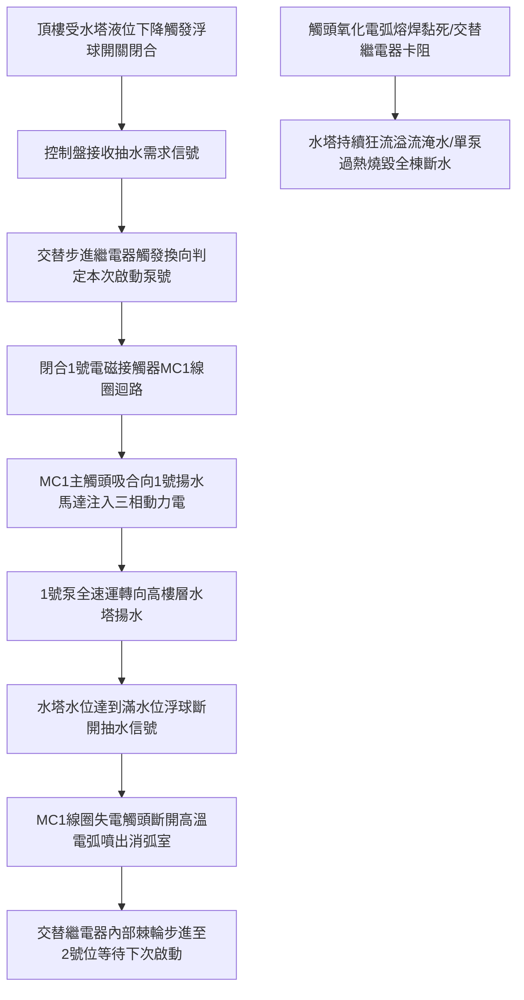

# 全案購屋實戰第八百七十七部：中古大樓社區地下室生活自來水雙泵自動交替控制盤電磁接觸器主觸點電弧燒蝕交替步進繼電器機械疲勞與揚水停擺體檢工序全書

## 壹、編撰宗旨與大樓高空生命水理動脈

在現代都會區集合住宅大樓（特別是屋齡 20 年至 35 年以上之高層中古大樓，如台中南區的大安紫金城、長億南園、歌德堡、靜園等）的垂直給水系統中，整棟大樓數百戶家庭日常盥洗、烹飪飲食、沖廁以及消防補水，全賴位於地下室最底層的「生活自來水揚水系統（Domestic Water Booster / Transfer Pumping System）」。

地下室受水箱接收市政自來水後，透過一組「雙泵備援揚水泵浦（1號揚水泵與2號揚水泵）」，日夜不停地將自來水克服數十公尺甚至上百公尺的建築高度重力水頭，加壓泵送至大樓頂樓受水塔（屋頂水箱）。

而指揮這兩台揚水心臟的「中樞神經大腦」，正是設置於泵浦旁的「雙泵自動交替控制盤（Dual Pump Alternating Control Panel）」。

然而，在中古大樓長達數十年的不間斷頻繁切換運轉中，控制盤內之強電機電元器件面臨極其嚴苛的電氣磨耗與物理老化：
1. **交流電磁接觸器（Magnetic Contactor, MC）主觸頭在高感性馬達負載啟動與斷開時遭受強烈電弧（Electric Arc）高溫燒蝕**，導致金屬觸點凹凸不平、氧化積碳、電阻激增，甚至在高溫下發生致命的「觸頭熔焊黏死（Contact Welding）」，引發泵浦無法停機狂抽、水塔溢流淹沒電梯機房；
2. **自動交替步進繼電器（Alternating Relay / Stepping Relay）內部機械棘輪棘爪磨損或電子觸發雙穩態觸點疲勞失準**，造成「雙泵交替邏輯崩潰」，系統鎖死於單台運轉，導致單泵過熱燒毀，而另一台備用泵卻處於「假待機」冷態；
3. **欠相／逆相保護電驛（Phase Failure Relay）電子元件老化漂移**，無法在台電電網突發缺相或電壓不平衡時即時跳脫保護，導致高達數萬元的揚水馬達在數十秒內因三相不平衡過熱燒毀定子線圈，全社區瞬間面臨斷水危機。

本手冊針對中古社區生活自來水雙泵交替控制盤，深入解剖交流接觸器滅弧室構造、馬達啟動衝擊電流動態、交替步進邏輯機制，並制定一套高標準之全流程現場體檢與電氣量測工序，為購屋家庭與管委會建立水脈長流的給水安全保障。

---

## 貳、揚水控制盤電氣動力學架構與交替切換物理機制

### 一、感應馬達感性負載啟動衝擊與電弧物理
揚水泵浦通常由三相鼠籠式感應馬達（$3\phi \ 220\text{V} / 380\text{V}$，功率通常為 $5.5\text{kW} \sim 15\text{kW}$，即 $7.5\text{HP} \sim 20\text{HP}$）驅動：
1. **直接啟動（DOL）或 Y-Δ 降壓啟動衝擊電流**：
   - 感應馬達在接通電源瞬間，轉子尚處於靜止狀態，旋轉磁場切割轉子導條之相對速度最大，感應電動勢極高，產生高達額定滿載電流（FLA）**$5 \sim 7\text{ 倍}$ 之湧浪啟動電流（Inrush Starting Current）**：
     $$I_{\text{start}} = (5 \sim 7) \times I_{\text{nominal}}$$
   - 即使採用 Y-Δ（星三角）降壓啟動，其切換瞬間仍會產生額定電流 $2 \sim 3$ 倍的過渡衝擊電流。
2. **電感反電動勢與電弧電離能量**：
   馬達定子繞組具有極高電感量 $L$。當接觸器主觸頭在通電狀態下切斷電路時，依照電磁感應定律，繞組兩端會感應產生極高的反向電動勢：
   $$\mathcal{E} = -L \frac{di}{dt}$$
   此瞬態反電壓可高達數千伏特，直接擊穿兩觸點間的空氣介質，形成溫度高達 **$3,000^\circ\text{C} \sim 6,000^\circ\text{C}$ 的高溫等離子體電弧（Plasma Arc）**。高溫電弧使觸點表面的銀鎳（AgNi）或銀氧化鎘（AgCdO）合金劇烈氣化、蒸發並飛濺，造成觸頭材料質量永久性損失。

### 二、交替步進繼電器（Alternating Relay）之邏輯機制
1. **機械式棘輪步進構造**：
   由微型電磁鐵、棘輪（Ratchet Wheel）、棘爪（Pawl）及雙投微動開關組成。每次電磁鐵受水位信號通電吸合時，棘爪推動棘輪旋轉一個齒距，使凸輪帶動微動開關翻轉狀態（由 NO 轉 NC，或由 NC 轉 NO），實現「1號泵 $\to$ 2號泵 $\to$ 1號泵」的精準交替。
2. **電子式雙穩態正反器（Bistable Flip-Flop）構造**：
   新型控制盤多採用微處理器或雙穩態固態繼電器，利用脈衝觸發信號翻轉內部邏輯狀態，驅動兩只超小型繼電器分別導通 MC1 與 MC2。

---

## 參、中古社區揚水控制盤三大核心病徵與失靈成因

### 一、電磁接觸器主觸頭氧化積碳與熔焊黏死（Pump Runaway）
1. **接觸面有效導電率崩解**：高頻次電弧轟擊使觸點合金表面的銀成分大量揮發，表面形成高電阻率的金屬氧化物與游離碳黑積層。接觸電阻自正常的數毫歐姆（$\text{m}\Omega$）飆升數十倍，通電時接觸面劇烈發熱，表面溫度常達 $80^\circ\text{C} \sim 120^\circ\text{C}$。
2. **熔焊黏死引發停機失效**：當馬達啟動瞬間若遇電壓短暫偏低或吸合鐵芯殘磁彈簧疲勞，主觸頭在閉合瞬間產生微小「彈跳（Contact Bounce）」。彈跳產生的局部微電弧瞬間熔化兩側銀合金，使動觸點與靜觸點在液態金屬冷卻後完全「熔焊凝固在一起」。當水塔滿水信號發出、接觸器線圈斷電時，機械彈簧根本無法拉開熔焊的觸頭，揚水泵被迫持續狂抽不停，導致頂樓水塔自溢流管瘋狂排水，甚至水流溢入梯廳電梯井，造成電梯電子基板全數泡水燒毀！

### 二、自動交替繼電器卡死導致「單泵過勞死、雙泵皆休克」
1. **機械式棘輪卡阻或簧片疲勞**：控制盤長年暴露於地下室潮濕環境中，機械式步進繼電器的轉軸生鏽或齒輪被粉塵油泥黏滯，棘爪無法順暢推動齒輪前進，交替指令鎖定在單一線路上。
2. **偏載運轉熱崩潰**：大樓 1 號泵連續數月承擔 $100\%$ 的全棟給水抽水任務，軸承磨損、機械軸封乾磨漏水、定子線圈長期受熱絕緣裂化而最終燒毀；而 2 號泵長年靜止未運轉，泵殼內部葉輪與水垢鐵鏽黏結「抱死」。當管委會發現 1 號泵燒毀緊急手動切換至 2 號泵時，2 號泵因葉輪卡死無法轉動，通電瞬間直接發生堵轉（Locker Rotor），數秒內再度燒毀，全社區陷入全棟斷水癱瘓！

### 三、熱動過載電驛（Thermal Overload Relay, TH-RY）雙金屬片疲勞失準
1. **雙金屬片（Bimetallic Strip）熱疲勞**：過載保護電驛長年處於微發熱狀態，兩層熱膨脹係數不同之合金片發生金屬蠕變（Creep），脫扣機構彈簧彈力衰減。
2. **拒動或誤動**：當馬達發生輕度過載或單相缺相時，熱動電驛無法在臨界時間內彎曲推動脫扣槓桿，喪失保護功能；或在正常負載電流下頻繁「跳脫誤動作」，造成大樓頻繁無故停水。

---

## 肆、生活自來水控制盤標準體檢與電氣量測工序

### 一、斷電安全隔離與接觸器主觸點微觀體檢
1. **安全斷電與驗電作業**：
   - 切斷揚水控制盤上游無熔絲斷路器（NFB/MCCB），並進行 LOTO 安全掛鎖。
   - 使用合格三相驗電筆確認 R-S-T 三相動力電源零電壓。
2. **消弧罩拆卸與觸點外觀查驗**：
   - 拆下電磁接觸器上方的耐弧塑料消弧罩（Arc Chute），露處動觸點與靜觸點。
   - 使用強光手電筒與高倍放大鏡檢查觸點表面：
     - **優良狀態**：金屬表面平整，呈均勻銀灰色，金屬燒蝕厚度小於 $10\%$。
     - **警戒狀態**：表面出現顆粒狀凹坑與黑褐色氧化層，厚度磨損達 $30\% \sim 50\%$。
     - **危險報廢**：觸頭表面合金層已完全燒蝕露出底層紫銅基底、或兩端出現金屬融化熔焊拉扯毛刺，必須立即整組換新接觸器！
3. **動態接觸電阻量測（Micro-ohmmeter Test）**：
   - 手動按壓接觸器銜鐵使其完全閉合，使用微歐姆表量測主觸頭接觸電阻。
   - **標準判定**：三相主觸頭之接觸電阻均應小於 **$50\text{ m}\Omega$**，且三相阻值偏差不得大於 $10\%$。

### 二、交替運轉邏輯與水位聯鎖動態驗收
1. **手動模擬水位信號抽水測試**：
   - 將控制盤面板上的切換開關置於「自動（AUTO）」位置。
   - 在控制盤內部端子台短接「屋頂水塔低水位啟動信號」（模擬需要抽水）：
     - 觀測 1 號接觸器 MC1 是否迅猛吸合，啟動綠燈亮起；
     - 移除短接線（模擬水滿停機），MC1 應立即斷開。
   - 再次短接低水位信號：
     - **交替功能核心驗證**：本次必須精準由 2 號接觸器 MC2 吸合，2 號泵運轉指示燈亮起；
     - 重複測試至少 **5 次**，驗證交替邏輯必須維持嚴格的「1-2-1-2-1」循序輪替，絕不得出現跳步或連鎖失靈。
2. **雙泵並聯強抽模式測試（特定大樓配備）**：
   - 短接「水塔極低水位警報信號」，確認系統是否具備超低水位時兩台泵浦同時啟動（並聯運轉）之冗餘強抽機能。

### 三、三相負載電流與三相不平衡率實測
1. **負載運轉電流測量**：
   - 啟動泵浦運轉，使用校正合格之真有效值（True-RMS）交流鉤表量測三相運轉電流 $I_R, I_S, I_T$。
   - 核對實測電流不得超過馬達銘牌標稱之額定滿載電流（FLA）。
2. **三相電流不平衡率計算（NEMA 標準）**：
   $$I_{\text{avg}} = \frac{I_R + I_S + I_T}{3}$$
   $$\text{不平衡率 } (\%) = \frac{\max(|I_R - I_{\text{avg}}|, |I_S - I_{\text{avg}}|, |I_T - I_{\text{avg}}|)}{I_{\text{avg}}} \times 100\%$$
   - **標準判定**：三相電流不平衡率**絕對不得大於 $5\%$**（若超過 $5\%$，馬達內部溫升將以平方倍數劇增，定子絕緣壽命縮短 $50\%$ 以上）。

---

## 伍、購屋決策避坑指南與管委會整改預算表

### 一、買方看屋機電給水安全查核 4 訣
1. **進入地下室查看揚水泵控制盤面板燈號**：
   - 找到生活揚水控制盤，確認面板上的「電源指示燈（R-S-T）」是否全亮；手動/自動選擇開關（MANUAL/AUTO）是否切在「AUTO（自動）」。若切在手動或有「故障紅燈亮起」，高度暗示自動交替系統早已失靈。
2. **檢視控制箱內部有無焦黑痕跡與焦味**：
   - 透過控制盤散熱百葉或請管委會陪同開啟盤門。盤內若散發強烈電木塑膠燒焦味、接觸器消弧罩上方有黑色碳粉噴濺痕跡，代表接觸器已處於隨時熔焊爆發邊緣。
3. **查閱機房水塔揚水馬達輪流保養紀錄單**：
   - 確認 1 號泵與 2 號泵是否有各自獨立之累積運轉計時器（Hour Meter）。健康運轉的社區，兩台泵浦的運轉時數應相當接近（差距小於 $10\%$）；若 1 號泵累計 5000 小時而 2 號泵僅 100 小時，代表交替繼電器長年卡死故障。
4. **檢查頂樓水塔溢流管口是否有常態流水痕跡**：
   - 走訪屋頂水塔，觀察溢流管（Overflow Pipe）出水管口周圍是否長滿綠色青苔或有長年滴水沉積物。若有，代表底層揚水接觸器曾發生熔焊黏死、或浮球閥止水不良引發過漫水災情。

### 二、自來水揚水雙泵控制系統專項整改預算參考清單

| 維修／改善工程項目 | 技術規範與標準工法 | 預算區間（每台／每面） | 安全重要度等級 |
| :--- | :--- | :--- | :--- |
| **重載型交流電磁接觸器換新（含消弧室）** | 富士/士林電機 30A~50A 級接觸器新品 | 2,500 ~ 4,500 元／只 | 極高（每3~5年必做） |
| **微電腦數位型雙泵自動交替控制器更換** | 固態雙穩態電子交替繼電器（含插座組） | 1,800 ~ 3,500 元／組 | 極高（根治單泵過勞） |
| **精密型三相欠相/逆相/電壓不平衡保護電驛** | 具備延時脫扣與數位電壓顯示監控電驛 | 2,800 ~ 5,000 元／只 | 高度（保護馬達防燒） |
| **電子式可調精密過載保護電驛（E-O/L）更新** | 取代傳統雙金屬片，具備相敏保護與快速脫扣 | 2,000 ~ 3,800 元／只 | 高度 |
| **雙泵揚水控制盤整體現代化重組配線工程** | 盤體除鏽噴漆、阻燃銅排、端子排與指示燈更換 | 25,000 ~ 45,000 元／面 | 中度（20年以上老盤翻新） |
| **泵浦加裝變頻器（VFD）恆壓軟啟動控制盤** | 台達/東元 7.5HP~15HP 雙變頻輪替水泵專用盤 | 68,000 ~ 110,000 元／座 | 專業推薦（消除啟動電弧與水錘） |

---

## 陸、本案結語

在大樓立體生活結構中，水流向上攀升的每一公尺，都是對地下機電控制系統可靠度的嚴苛考驗。雙泵交替控制盤看似只是幾顆繼電器與接觸器的組合，卻是守護全棟百戶住戶每日用水無虞、防止水塔溢流滅頂的無名英雄。

購屋家庭在評估優質中古社區時，唯有將體檢眼光精準投射於地下室這座藍色的揚水控制心臟，徹底檢視接觸器觸點健康度與交替邏輯，方能確保新居水脈暢通如意，讓家庭生活的每一滴甘泉皆飽含踏實與安心！
