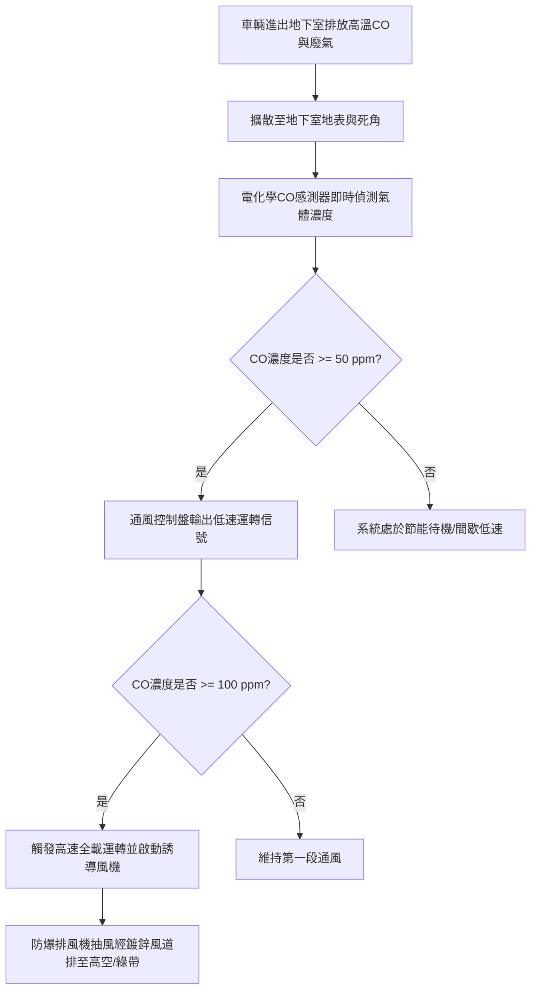

# 全案購屋實戰第八百七十三部：中古大樓社區地下室筏基通風換氣系統防爆排風機葉輪動平衡失衡風管法蘭墊圈老化粉塵沉積與一氧化碳中毒防護體檢工序全書

## 壹、編撰宗旨與地下封閉環境空氣品質致命隱憂

在台灣都會區集合住宅（尤其是屋齡 20 年至 35 年以上之大型中古社區，如台中南區的大安紫金城、長億南園、歌德堡、工學天下等），地下室停車場通常深入地表下二至四層（B1~B4）。此類地下受限空間（Confined Space）由於缺乏充足之天然對流開口，常年處於汽車內燃機燃燒不完全所排放的高濃度一氧化碳（$\text{CO}$）、氮氧化物（$\text{NO}_x$）、碳氫化合物（$\text{HC}$）及懸浮微粒（$\text{PM}_{2.5}/\text{PM}_{10}$）的濃聚環境中。

一氧化碳是一種無色、無味、無臭但極具致命親和力的劇毒氣體。其與人體血液中血紅素（Hemoglobin）的結合力比氧氣高出 **200 至 250 倍**。當人體吸入濃度達 $200\text{ ppm}$ 的一氧化碳時，2 至 3 小時內即可產生頭暈、噁心、四肢無力；當濃度升高至 $800\text{ ppm}$ 時，45 分鐘內即會陷入昏迷甚至死亡。

依據我國《建築技術規則》建築設備編第 102 條及環保法規，地下停車場必須強制配置獨立且完善之「機械通風換氣系統」（包含送風機、排風機、一氧化碳自動偵測感應連鎖系統及分布風管網）。

然而，在中古大樓長年運轉中，地下室通風換氣系統普遍淪為「設備存在但功能半殘」之沉睡設施：
1. **防爆排風機（Exhaust Fan）葉輪長年黏附油污粉塵导致「動平衡失衡（Dynamic Unbalance）」**，引發軸承劇烈抖動、偏心磨損與金屬疲勞，產生低頻噪音與機組燒毀；
2. **鍍鋅鐵皮風管法蘭（Flange）石綿／橡膠密封墊圈硬化龜裂、法蘭夾脫落**，管網漏風率高達 $30\% \sim 50\%$，排風負壓在前端即告洩漏，深層筏基死角廢氣根本無法抽出；
3. **一氧化碳電化學感測器長年未校正導致「感度鈍化漂移」**，控制箱無法在濃度超標時自動啟動風機，使返家停車或在地下室取車的住戶與幼童暴露於慢性中毒的極大風險中。

本手冊針對中古社區地下室機械通風換氣系統，詳解空氣力學流場、一氧化碳擴散動力學、風機動平衡校正、風道密封檢驗及感測連鎖體檢標準工序，為購屋家庭與管委會建立呼吸無虞的健康地下生活空間。

---

## 貳、地下通風系統空氣動力學架構與 CO 感測連動原理

### 一、換氣次數法規標準與通風量計算
依據《建築技術規則》及消防相關規範：
1. **法規換氣量要求**：
   - 地下停車場平時通風換氣量，每小時換氣次數（Air Changes per Hour, $\text{ACH}$）不得少於 **5 次**（部分規範對尖峰進出時段要求達 **8~10 次/hr**）。
   - 換氣體積流量公式：
     $$Q_{\text{vent}} = V_{\text{parking}} \times \text{ACH} \quad (\text{m}^3/\text{hr})$$
     例如地下室總樓地板面積為 $2,000\text{ m}^2$、淨高 $3.2\text{ m}$，則總空間容積 $V = 6,400\text{ m}^3$。在 $\text{ACH} = 6$ 次/hr 標準下，通風系統所需最小總排風量為：
     $$Q_{\text{vent}} = 6,400 \times 6 = 38,400\text{ m}^3/\text{hr} = 640\text{ m}^3/\text{min}$$
2. **送風與排風之平衡壓比（風量比）**：
   為防止地下室廢氣經由樓梯間、電梯管道間逆向滲漏灌入 1 樓大廳或各住宅單元，地下室通風系統必須維持微弱的「**負壓狀態（Negative Pressure）**」。因此，排風機之額定風量必須大於送風機風量：
   $$Q_{\text{exhaust}} \approx (1.1 \sim 1.2) \times Q_{\text{supply}}$$

### 二、一氧化碳電化學感測器工作原理
1. **定電位電解式電化學反應**：
   感測器內部包含工作電極（Working Electrode, WE）、對電極（Counter Electrode, CE）與參比電極（Reference Electrode, RE），浸潤於酸性電解質溶液中。當空氣中的 $\text{CO}$ 分子透過微孔透氣膜擴散至工作電極表面時，在催化劑作用下發生氧化反應：
   $$\text{CO} + \text{H}_2\text{O} \to \text{CO}_2 + 2\text{H}^{+} + 2e^{-}$$
   對電極則發生氧氣還原反應：
   $$\frac{1}{2}\text{O}_2 + 2\text{H}^{+} + 2e^{-} \to \text{H}_2\text{O}$$
2. **輸出電流與線性度**：
   氧化還原產生的微小電子流（微安培 $\mu\text{A}$ 級）與環境中 $\text{CO}$ 氣體濃度成嚴格之正比線性關係。經運算放大電路轉換為標準 $4 \sim 20\text{ mA}$ 類比訊號或 RS-485 數位訊號傳輸至通風控制箱。

---

## 參、中古社區地下室通風系統三大核心病徵與失靈成因

### 一、排風機葉輪動平衡失衡（Dynamic Unbalance）與軸承損壞
1. **粉塵油泥不均勻附著**：地下室空氣中懸浮大量未完全燃燒之碳煙微粒與地表粉塵，經風機抽吸後，高溫潮濕油泥在離心風輪（Sirocco Fan）或軸流葉片（Axial Fan）背面產生厚薄不均的黏附。
2. **偏心離心力引發劇烈震動**：
   離心力 $F_{\text{unbalance}} = m \cdot r \cdot \omega^2$ 與轉速之平方成正比。哪怕僅數十公克的泥垢偏心沉積，在 $1750\text{ RPM}$ 高速旋轉下即產生高達數百牛頓的動態衝擊載荷。此偏心力迅速破壞軸承滾道，導致軸承過熱高溫抱死，並將震動傳導至懸吊彈簧避震器，產生全棟低樓層可感知的低頻嗡嗡噪音。

### 二、風管法蘭接縫氣密性失效與沿程漏風
1. **密封墊料老化粉化**：鍍鋅鐵皮風管連接法蘭通常夾有發泡橡膠（EVA/EPDM）或石綿墊圈。在 20 年乾濕冷熱交替下，墊料嚴重硬化、收縮粉碎脫落，法蘭螺栓受震動鬆脫。
2. **風量短路與無效空抽**：排風口因前端漏風而吸入靠近機房的清淨空氣，形成「氣流短路」；而在距離機房最遠的停車泊位與行車動線死角，風管末端吸力趨近於零，一氧化碳長期滯留濃度居高不下。

### 三、CO 感測器電解液乾涸與「假安全」現象
市售電化學型 $\text{CO}$ 感測器之有效使用壽命通常僅為 **3 至 5 年**。在 20 年以上的中古社區中，管委會鮮少編列預算更換感測頭。感測器內部電解液早已完全揮發乾涸，表面催化金屬中毒鈍化，控制面板長年顯示數值為「$0\text{ ppm}$」或鎖定在安全低數值，給住戶帶來虛假的「空氣極佳」錯覺，實質上通風機組從不自動啟動。

---

## 肆、地下通風系統標準體檢與維護工序

### 一、排風機動平衡量測與機電震動體檢
1. **震動速度均方根值（RMS）檢測**：
   - 啟動排風機，使用三軸壓電式震動分析儀（Vibration Analyzer），在馬達驅動端（DE）、非驅動端（NDE）及風機主軸承座上測量垂直、水平與軸向之震動速度。
   - **ISO 10816-3 振動評價標準（Class II 中型旋轉機械）**：
     - $V_{\text{RMS}} \le 2.8\text{ mm/s}$：狀態優良（Good）。
     - $2.8 < V_{\text{RMS}} \le 4.5\text{ mm/s}$：可接受範圍（Acceptable）。
     - $V_{\text{RMS}} > 4.5\text{ mm/s}$：震動超標，必須進行現場動平衡校正或更換軸承。
2. **現場動平衡校正工序（Field Dynamic Balancing）**：
   - 使用高壓水槍或專用除油溶劑徹底清除葉片背面結垢。
   - 貼附反光貼紙，利用激光轉速計測定旋轉相位角與初始不平衡向量 $\vec{U}_0$。
   - 於葉輪邊緣試加配重塊 $M_{\text{trial}}$ 再次運轉，計算影響係數矩陣，並於精密計算位置焊接耐熱平衡配重片，直至剩餘不平衡量滿足 ISO 1940 規範之 G2.5 級平衡精度。

### 二、風管氣密性（漏風率）與風量平衡實測
1. **風管煙霧擴散檢漏**：
   - 在風管入口處釋放消防級無毒白煙，利用風機全載加壓送風。
   - 沿風管吊掛動線巡查各法蘭連接點、咬口接縫與風門軟接頭，檢視有無煙霧白霧噴出。
2. **各風口風速與風量平衡測量**：
   - 使用風量罩（Flow Hood）或校正合格之葉輪風速計，測量各排風百葉出風口之平均截面風速。
   - 調整各分歧管的手動風量調節閥（Volume Damper, VD），使距機房最遠端風口之實測風量達到設計額定值之 **$85\%$ 以上**，杜絕通風死角。

### 三、一氧化碳感測器標定與連動控制驗收
1. **標準氣體現場標定校正（Span Calibration）**：
   - 準備經國家標準檢驗局認證之標定氣瓶（零點氣體：純氮氣 $\text{N}_2$；跨度標準氣體：$50\text{ ppm}$ 及 $100\text{ ppm} \ \text{CO}$ 氣體）。
   - 將專用標定罩扣緊感測器採樣孔，通入 $50\text{ ppm}$ 標準氣體持續 90 秒，觀察儀表讀數，若誤差超過 $\pm 5\%$，應透過面板電位器或數位指令進行 Span 增益補償校準。
2. **雙段連鎖啟動時間測定**：
   - 模擬濃度達到 $50\text{ ppm}$：通風機應於 **$30\text{ 秒}$ 內連鎖啟動低速段**或第一組風機。
   - 模擬濃度達到 $100\text{ ppm}$：系統應立即**觸發全速全載強排**，並於中控室發出聲光警報。

---

## 伍、購屋決策避坑指南與管委會整改預算表

### 一、買方地下室看屋防毒自保關鍵 4 訣
1. **進入地下室聞嗅與呼吸體感**：
   - 步行進入地下室三層或四層停車場最深處，深呼吸感受。若有明顯刺鼻廢氣味、燃油燃燒焦味或胸悶壓迫感，代表該區域為長年無風死角。
2. **抬頭觀察排風管法蘭接縫**：
   - 檢視風管法蘭連接處四周是否有黑色吹出狀吹痕（粉塵噴出積垢痕跡），那是法蘭墊圈漏風之明確物理證據。
3. **檢視牆面 CO 感測器指示燈號**：
   - 尋找立柱或牆面上安裝之一氧化碳感知器（離地高度應介於 $1.2 \sim 1.5\text{ 公尺}$），確認面板液晶顯示是否正常亮起、電源指示綠燈是否常亮、有無顯示「Sensor Fail」或長年不變的死機數值。
4. **查閱地下室機電委外保養合約與耗材更換清冊**：
   - 確認管委會最近一次更換通風排風機軸承、傳動皮帶及 CO 感測器探頭之具體年份。若超過 5 年未換探頭，系統實質處於「失能裸奔」狀態。

### 二、地下室通風換氣系統專項整改預算參考清單

| 維修／改善工程項目 | 技術規範與標準工法 | 預算區間（每台／每處） | 安全重要度等級 |
| :--- | :--- | :--- | :--- |
| **電化學一氧化碳感測器探頭全組更新** | 消防專用雙接點 4-20mA 防爆型感測器新品 | 4,500 ~ 7,500 元／只 | 緊急極高（防止中毒） |
| **排風機葉輪現場精密動平衡校正與除泥** | ISO 1940 G2.5 級現場雙面動平衡校正 | 12,000 ~ 20,000 元／台 | 極高（消除低頻噪音） |
| **排風機防爆馬達耐高溫軸承更換** | SKF / NSK 專用雙密封防塵深溝滾珠軸承 | 6,500 ~ 12,000 元／台 | 高度 |
| **鍍鋅風管法蘭密封墊圈重做與漏風補漏** | 耐候阻燃 EPDM 密封條 + 矽酮防火密封膠 | 800 ~ 1,500 元／米 | 中度（恢復排風負壓） |
| **地下室輔助導流噴流誘導風機（Jet Fan）安裝** | 220V/380V 低噪音高推力導流風機 | 18,000 ~ 32,000 元／台 | 治本根除通風死角 |
| **通風控制箱變頻器（VFD）恆壓/CO節能改造** | 台達/東元 15HP~30HP 風機專用變頻器控制盤 | 65,000 ~ 120,000 元／座 | 高度（節能兼顧安全） |

---

## 陸、本案結語

地下室停車場是現代家庭每天開車返家、迎著微風步入家園的第一個空間介面。若地下室常年充斥致命的一氧化碳與廢氣，家人進出無異於日積月累吸入毒素。

購屋家庭在評估中古大型社區時，切不可只將眼光停留在中庭造景與華麗門廳，更應親身踏入地下室最深層，用工程數據查驗風機震動、風道氣密與一氧化碳感測系統的真實效能。唯有清朗流通的地下空氣環境，才能為長遠的家庭置產提供最堅實的健康福祉！
