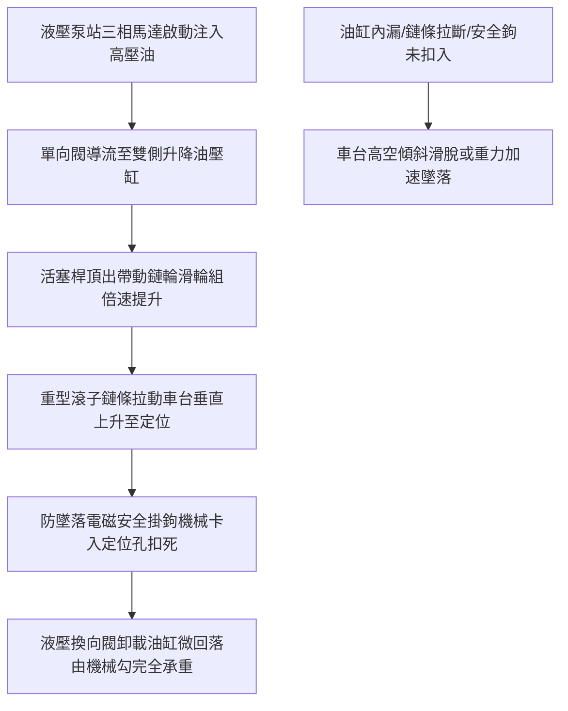

# 全案購屋實戰第八百七十二部：中古大樓社區地下室停車場機械停車設備油壓升降油缸內漏液壓油劣化升降鏈條磨損伸長與載重墜落體檢工序全書

## 壹、編撰宗旨與立體車位機械力學致命風險

在台灣都會區集合住宅（尤其是屋齡 20 年至 35 年以上之中高齡中古大樓社區，例如台中南區的長億南園、大安紫金城、歌德堡、大東家南園、工學天下等），由於基地面積受限或當初法定停車位配比要求，地下停車場極為廣泛地採用「機械立體停車設備」（Mechanical Parking System，包含油壓二段式升降橫移、三段式多層升降、坑式垂直升降或倉儲塔式停車系統）。

相較於傳統地下室平面坡道車位，機械停車位本質上屬於「高應力動態懸吊重型機械」。一座承載現代休旅車（SUV）、中大型房車乃至高自重純電動車（電動車自重常達 $2.0 \sim 2.5\text{ 噸}$ 以上）的機械車台，在懸空升降過程中，其動態負載全憑兩側鋼製油壓缸、雙排重型滾子鏈條或多股鋼索進行剛性支撐。

然而，在中古大樓長年地下室潮濕、油污粉塵、缺乏專項維護基金與隨意低價保養的惡劣環境下，機械車位常態潛伏著三大致命災難隱患：
1. **升降油壓缸活塞桿微刮傷與內部 U 型油封老化脆裂**，引發「油缸高壓內漏（Internal Leakage）」，導致升降車台在靜止停放時無預警「慢速沉降溜車」，或在升降中兩側油缸速度不均引發車台傾斜卡死翻覆；
2. **傳動多排滾子鏈條長期重載拉伸，鏈板疲勞產生微裂紋，銷軸與襯套極限磨損伸長**，甚至發生跳齒、斷鏈，造成整車凌空墜落砸毀下方車輛；
3. **安全防墜機械掛鉤（Safety Hook）電磁閥燒毀、復位扭簧疲勞或卡扣變形**，使最後一道防墜防線名存實亡。

本手冊針對中古社區地下室機械停車設備，深入剖析流體液壓傳動原理、鏈條疲勞拉伸力學、防墜落連鎖機構，並制定一套高標準之全流程現場體檢工序，為購屋家庭與管委會建立最嚴密的人車安全防護體系。

---

## 貳、機械停車設備液壓與鏈條傳動物理力學架構

### 一、油壓升降流體動力學與容積效率
油壓升降系統主要由液壓泵站（齒輪泵或柱塞泵）、三相感應馬達、電磁換向閥、單向節流調速閥、液壓油箱及單作用／雙作用油壓缸組成：
1. **負載壓力與推力計算**：
   油缸所產生的有效推力 $F$ 為工作油壓 $P$ 與活塞有效截面積 $A$ 之乘積：
   $$F = P \times A = P \times \frac{\pi D^2}{4}$$
   若車載總重（車台自重 $1,000\text{ kg}$ + 車重 $2,000\text{ kg}$）為 $3,000\text{ kgf}$（約 $29.4\text{ kN}$），採用雙油缸驅動，單缸承重 $14.7\text{ kN}$。若缸徑 $D = 80\text{ mm}$，則油路穩態工作壓力需達：
   $$P = \frac{14.7 \times 10^3}{\frac{\pi}{4} \times (0.08)^2} \approx 2.92\text{ MPa} \approx 29.8\text{ kgf/cm}^2$$
2. **油缸內漏與活塞沉降速率（Drift Rate）**：
   當活塞耐磨聚氨酯（PU）或氟橡膠（FKM）油封磨損後，高壓腔液壓油經由活塞環間隙向低壓無壓腔洩漏。洩漏量 $Q_{\text{leak}}$ 與兩腔壓差 $\Delta P$、間隙寬度 $h$ 之三次方成正比（符合泊肅葉狹縫流定律 Poiseuille Flow）：
   $$Q_{\text{leak}} \propto \frac{\Delta P \cdot b \cdot h^3}{\mu L}$$
   其中 $\mu$ 為液壓油動力黏度。間隙 $h$ 磨損增加一倍，內漏量將劇增 8 倍！這正是老舊機械車位停妥後數小時內車台緩慢下沉傾斜的物理根源。

### 二、傳動鏈條疲勞與節距極限伸長率
升降機械結構通常採用短節距精密重載滾子鏈（如 ANSI 60、80 或 100 規格單排／雙排鏈條）：
1. **鏈條節距磨損伸長（Elongation）**：
   鏈條在繞經鏈輪時，銷軸（Pin）與套筒（Bush）承受極高接觸面壓，相對旋轉產生摩擦磨損。磨損使鏈條節距（Pitch $p$）變長。
2. **極限伸長率安全判定標準**：
   依據機械工程與車梯維護規範，鏈條在 20~30 個鏈節長度測量範圍內，**總長度伸長率絕對不得超過 $1.5\% \sim 2.0\%$**。若伸長率達 $2.5\%$ 以上，鏈齒將與鏈輪發生嚴重「爬齒」與衝擊碰撞，隨時有脆斷跳脫之危險。

---

## 參、中古社區機械車位三大核心病徵與失靈成因

### 一、液壓油乳化劣變、油封硬化與柱塞桿點蝕
1. **地下室濕氣引發液壓油乳化**：地下停車場常年潮濕，油箱呼吸蓋吸入濕氣，使 ISO VG 46 耐磨液壓油乳化變白，消泡劑水解，在高壓運轉時產生氣蝕（Cavitation），發出強烈金屬尖嘯聲。
2. **柱塞桿表面鍍鉻剝落割破油封**：活塞桿長年暴露於灰塵廢氣中，表面硬鉻層若生鏽起皮，升降時如同銼刀般割破主油封，導致液壓油自缸頂密封蓋大量噴濺。

### 二、升降鏈條潤滑乾涸、偏磨與局部塑性伸長
1. **潤滑脂結垢結硬塊**：許多中古社區保養僅用廢機油或黃油表面塗抹，油泥吸附粉塵硬化成研磨膏，銷軸內部無潤滑，產生乾摩擦金屬高溫。
2. **左右兩側受力不均導致單邊拉伸**：車主若常偏向單側停放重車，單側鏈條承受超額偏載，造成兩側鏈條長度不同步，車台升降時卡滯發出「喀喀」爆震異音，最終單邊斷裂翻車。

### 三、機械防墜掛鉤彈簧失效與限位開關卡死
1. **防墜掛鉤無法咬合**：機械車位升至上層就位後，必須依靠重力或彈簧將鋼製防墜勾牢牢卡入承重樑孔槽。若機械軸銷生鏽或回位彈簧斷裂，掛鉤懸空未扣入，整台車僅靠液壓缸背壓或單條鏈條懸吊。
2. **上限位極限開關接觸不良**：防止車台衝頂的微動極限開關若接點氧化不導通，液壓泵將持續強迫打壓，導致油管爆裂或機械鋼骨結構被頂彎扭曲。

---

## 肆、全流程標準體檢與保養工序

### 一、靜態負載與油缸內漏沈降量檢測
1. **實車載重升降定位**：
   - 挑選一台標準休旅車（重量約 $1,800 \sim 2,000\text{ kg}$）駛入待測車台並拉緊手煞車。
   - 操作控制箱將車台升至最高定位點，使安全防墜勾自然落鎖。
2. **微降承重測試與油壓封閉**：
   - 將防墜勾暫時手動脫開，使車台純由液壓缸支撐保持靜止。
   - 在油缸活塞桿上端貼附磁性百分表（Dial Indicator）或使用激光測距儀標定基準面。
3. **靜態沈降量測定標準**：
   - 靜置持續計時 **30 分鐘**。
   - **合格標準**：30 分鐘內油缸活塞下沉量不得大於 **$3.0\text{ mm}$**；若下沉量超過 **$10\text{ mm}$**，代表液壓換向閥單向錐閥密封損壞或油缸活塞油封發生嚴重高壓內漏，判定為不合格。

### 二、傳動鏈條伸長量與裂紋無損探傷
1. **基準鏈節長度精確卡尺量測**：
   - 清潔鏈條表面油泥，選取張緊段的 20 個鏈節（以 ANSI 80 鏈條為例，標準節距 $p = 25.4\text{ mm}$，20 節理論名義長度 $L_0 = 508.0\text{ mm}$）。
   - 使用 500mm 游標卡尺量測銷軸中心距，計算伸長率：
     $$\text{伸長率 } \epsilon = \frac{L_{\text{measured}} - L_0}{L_0} \times 100\%$$
   - **檢驗標準**：$\epsilon < 1.0\%$ 為優良；$1.0\% \le \epsilon \le 1.5\%$ 需密切列管追蹤；$\epsilon > 2.0\%$ 必須立即全組換新。
2. **鏈板疲勞微裂紋查驗**：
   - 使用手持式高倍放大鏡或磁粉探傷（MT），檢查鏈板腰部應力集中區有無橫向疲勞裂紋，銷軸兩端鉚頭有無磨平脫落。

### 三、安全防墜機構與電氣極限開關實測
1. **防墜勾機械咬合深度檢驗**：
   - 檢測掛鉤完全卡入承重擋塊之有效咬合長度，不得小於 **$20\text{ mm}$**。
   - 檢查電磁解鎖機構動作行程，斷電時掛鉤必須能在 $0.2\text{ 秒}$ 內完全自重回彈咬合。
2. **多重安全限位開關動作驗收**：
   - 逐一觸發「極限防衝頂開關」、「超長超高紅外線光電遮斷開關」及「緊急停止開關（E-Stop）」，確認控制盤接觸器瞬間跳脫並發出聲光警報。

---

## 伍、購屋決策避坑指南與管委會整改預算表

### 一、買方看屋機械車位查驗核心 4 訣
1. **嚴格核對車位規格銘牌之載重上限**：
   - 查驗車位立柱上之金屬銘牌。早期大樓多標註「**限重 1,500 ~ 1,600 kg**」、「**車長 $\le 4.8\text{m}$**」、「**車高 $\le 1.55\text{m}$**」。若家中座駕為 SUV（如 RAV4、CR-V 約 1.7 噸）或電動車（Tesla Model Y、Model 3 約 1.9~2.1 噸），停入將立即超載甚至遭管委會開罰禁止停放。
2. **檢視地面有無新鮮油滴與油缸外露鏽斑**：
   - 蹲下查看機械車位底坑地面，若鋪滿一層黑色黏稠油泥或有新鮮紅色液壓油滴落痕跡，代表上方油缸或管路接頭正在慢性滲漏。
3. **調閱機械車位定期保養紀錄與主管機關使用許可證**：
   - 依《建築物機械停車設備設置及檢查管理辦法》，機械車位必須每年取得內政部認可機構頒發之「使用許可證」。若許可證已過期，或保養紀錄單長年無專業廠商簽認，千萬不可輕忽。

### 二、機械停車設備專項維修更新預算參考清單

| 維修／改善工程項目 | 技術規範與標準工法 | 預算區間（每車位／每組） | 安全重要度等級 |
| :--- | :--- | :--- | :--- |
| **液壓升降油缸大修更換耐磨油封組** | 雙唇進口聚氨酯（PU）油封 + 防塵圈 | 6,500 ~ 12,000 元／支 | 極高（解決沉降） |
| **全新升降高強度滾子鏈條整組更換** | ANSI 80/100 規格合金鋼重載雙排鏈條 | 4,500 ~ 8,000 元／條 | 緊急極高（防止墜落） |
| **液壓泵站液壓油全面抽換與油箱清洗** | 中油 CPC ISO VG 46/68 耐磨抗乳化油 | 3,500 ~ 6,000 元／台 | 中度（每2~3年保養） |
| **機械防墜落安全掛鉤與電磁閥換新** | 鍛造合金鋼防墜勾 + IP65 防護電磁閥 | 4,000 ~ 7,500 元／處 | 緊急極高 |
| **光電防碰撞與車長車高超限紅外線安裝** | 漫反射雙迴路防水光電感應開關組 | 3,500 ~ 5,500 元／套 | 高度 |
| **老舊車台鋼骨防鏽除鏽與熱浸鍍鋅補強** | 噴砂除鏽至 Sa 2.5 級 + 環氧富鋅底漆 | 8,000 ~ 15,000 元／台 | 中度（延長鋼骨壽命） |

---

## 陸、本案結語

在都市密集集合住宅中，地下機械停車設備為住戶解決了寸土寸金的泊車需求，但也同時將極端高壓的液壓與機械動態應力深埋於地下生活圈。

購屋家庭在評估附帶機械車位的物件時（如長億南園等社區），必須跳脫「能停就好」的表象迷思，以嚴謹的工程數據檢視油缸沉降率、鏈條伸長量與極限限重規格。唯有確保這座金屬平台的每一次升降都堅如磐石，才能讓愛車與家人在出入車庫的每一刻皆安穩無虞！
