# 全案購屋實戰第八百七十五部：八百七十五部圓滿登峰全景極致全維度全生命週期家庭置產避坑抗震防漏水電機電消防永恆至尊金典總綱全書

## 壹、編撰宗旨與跨紀元家庭置產安全工程學

從首部啟航至第八百七十五部登峰造極，本系列歷經數十載建築工程實踐與數百場中古大樓實戰帶看體檢，鑄就出全台灣唯一融合「建築結構工程學」、「流體給排水水動力學」、「強弱電電力工程學」、「被動消防逃生安全學」與「家庭資產防禦經濟學」的跨領域永恆典範。

當家庭在台中南區、南屯區乃至全台各都會精華區評估屋齡 20 年至 35 年之中古集合住宅時（例如大安紫金城、長億南園、歌德堡、靜園等指標社區），絕不能被粉飾一新的表面裝潢所迷惑。一座承載全家人數十年幸福生活與一生積蓄的建築物，本質上是一個日夜不息進行能量與物質交換的「龐大複合生命體」。

本第八百七十五部至尊總綱全書，站在八百七十五部深厚工序基石之上，進行全景式系統貫通，確立四大核心候選物件之攻防定錨，為購屋者建立全維度零死角的置產防禦聖經。

---

## 貳、全維度機電結構六大核心防禦系統總覽

```mermaid
flowchart TD
    subgraph S1[一、地下地基抗浮與導排水防線]
        A1[連續壁複壁導水溝高壓除鈣] --- A2[筏基抗浮孔隙水壓釋放]
        A2 --- A3[集水深井雙泵備援與防錘逆止閥]
    end
    subgraph S2[二、垂直升降與地下機械泊車防線]
        B1[電梯底坑油壓緩衝器阻尼防護] --- B2[調速機安全鉗連鎖剎車]
        B2 --- B3[機械車位雙缸內漏沈降量與鏈條防墜]
    end
    subgraph S3[三、高樓消防水網與極限排煙防線]
        C1[末端查驗閥動態水壓與超音波測厚] --- C2[濕式警報逆止閥延遲防誤報]
        C2 --- C3[機械防排煙風機高溫馬達與280度防火閘門]
    end
    subgraph S4[四、地下環境健康與通風安全防線]
        D1[防爆排風機葉輪現場雷射動平衡] --- D2[風管法蘭EPDM阻燃密封防漏]
        D2 --- D3[電化學一氧化碳感測器雙段連鎖]
    end
    subgraph S5[五、生活給排水與衛生水理防線]
        E1[二次加壓變頻泵PID定壓防氣蝕] --- E2[垂直幹管減壓閥水錘吸收器]
        E2 --- E3[筏基沉水絞碎污水泵四浮球防溢流]
    end
    subgraph S6[六、強電安全與緊急電力備援防線]
        F1[油浸變壓器絕緣耐壓與PCB檢測] --- F2[低壓配電ACB/MCCB脫扣校驗]
        F2 --- F3[緊急柴油發電機冷卻水箱與ATS切換]
    end
```

---

## 參、中古社區跨系統隱形崩潰鏈深度剖析

中古大樓各機電子系統並非獨立存在，若管委會長期忽略定期深度檢驗，微小局部劣化將觸發多米諾骨牌般的致命連鎖崩潰：

### 一、地下水位抬升 $\to$ 底坑導水溝石化阻塞 $\to$ 電梯與車位雙重癱瘓
當連續壁導水溝因碳酸鈣結晶（$\text{CaCO}_3$）嚴重石化淤塞時，地下水無法排入集水井，造成複壁夾層內部地下水位與孔隙水壓急遽抬升。高壓地下水自施工縫漫入電梯底坑與機械車位深坑：
1. **電梯緩衝器液壓油全面乳化**：水氣導致緩衝器柱塞桿點蝕生鏽、復位開關氧化短路，迫使電梯控制系統緊急停梯停擺；
2. **機械車位液壓缸浸水鏽蝕**：水氣由油箱呼吸孔侵入升降液壓油，引發油封脆化破裂與高壓內漏，造成機械車台發生慢速溜車與傾斜崩塌。

### 二、通風排風機動平衡失衡 $\to$ 風道負壓失效 $\to$ 一氧化碳毒氣向住宅倒灌
地下室防爆排風機葉輪因粉塵黏附導致動平衡失衡，軸承高溫燒毀抱死；同時鍍鋅風管法蘭密封墊圈乾裂脫落導致沿程大量漏風。當下班尖峰時段數十輛車輛密集進出地下室時：
1. **電化學感測器因電解液乾涸而失能未報警**；
2. **地下室微負壓（Negative Pressure）平衡瓦解**，轉化為正壓狀態；高濃度一氧化碳（$\text{CO}$）與尾氣顆粒經由樓梯間排煙風道逆止閥漏縫與電梯管道間，直接倒灌灌入 1 至 3 樓低樓層住宅室內，造成住戶不明原因之慢性頭痛與中毒窒息危機。

### 三、自動撒水管網電化學點蝕 $\to$ 爆管高壓水流 $\to$ 低壓配電盤全毀大停電
高樓層生活走廊天花板之消防自動撒水鋼管，因管內死水產生微生物腐蝕（MIC）穿孔。高達 $6 \sim 8\text{ kgf/cm}^2$ 的高壓銹水柱噴湧而出，順著公共強電管道間向下狂瀉。水流澆灌至地下室主要低壓配電盤內部，引發空氣斷路器（ACB）主觸頭電弧短路爆破，整棟大樓瞬間陷入全面斷電、揚水泵浦停止、電梯停擺之極限癱瘓狀態。

---

## 肆、四大主力候選物件決戰實戰評定與出價戰略

結合永義房屋周小姐 20 部實勘帶看影片全紀錄、現場工程體檢標準及區域行情大數據，對四大核心考慮物件進行戰略定錨：

### 一、大安紫金城 13 樓（PROP_10）——「平面車位溢價王、租約拆除反制策略」
- **極致優勢**：
  - 附帶 B2 獨立大型平面車位（南區老市區具備極高稀缺溢價，獨立估值達 180 萬，保值抗跌首選）。
  - 13 樓高樓層無遮擋視野、雙面採光通風極佳。
- **痛點與改造成本**：
  - 現況隔間為分租學生套房，需預留約 35 萬之室內隔間拆除、全室電線更新與恢復三房格局款項。
  - 需嚴格查驗天花板消防撒水頭與末端查驗閥動態放水壓力。
- **談判與出價策論**：
  - 開價 898 萬。起手斡旋 720~730 萬，目標成交區間 768~788 萬，最高封頂 800 萬。
  - **必簽特約**：「現況租約期滿騰空點交」、「銀行房屋貸款核貸不足成交價 8 成無條件解除契約全額退款」。

### 二、長億南園 8 樓（PROP_106）——「32 坪大室內空間、車位限重與無障礙破底籌碼」
- **極致優勢**：
  - 主建物加陽台實質室內使用坪效高達 32 坪，室內無壓迫感，大客廳與三大房家庭生活機能最充裕。
- **痛點與公設限制**：
  - 機械車位限重 1.6 噸（無法停放大型休旅車 SUV 或特斯拉電車），需定期檢測升降鏈條磨損伸長率與液壓缸內漏。
  - 梯廳入口有 4 階高差無障礙缺失，需評估推車與長輩進出動線。
- **談判與出價策論**：
  - 開價 998 萬。以「機械車位換車限制」與「梯廳無障礙台階改善費」作為重擊賣方心理底價之利刃。起手出價 698~720 萬，目標錨定 745~760 萬。

### 三、歌德堡 8 樓——「百萬現代北歐精裝、最佳心理牽制籌碼」
- **極致優勢**：
  - 全室已完成百萬現代北歐精緻裝潢，水電已翻新，可省去交屋後 80~120 萬裝修工程款與長達半年的監工時間。
- **戰略部署意涵**：
  - 作為牽制大安紫金城與長億南園賣方讓價的最佳武器。若前兩案價格僵持不下，歌德堡可作為即買即住的最佳生活品質選擇。

### 四、靜園 A 區 11 樓——「三面採光、雙衛自然開窗終極安全底牌」
- **極致優勢**：
  - 高樓層邊間三面採光，通風極致；主客雙衛浴皆直接開窗，完全杜絕暗房與潮濕發霉困擾。
- **戰略部署意涵**：
  - 作為談判全盤破局時的第一安全備援底牌。

---

## 伍、購屋家庭終極現場「避坑十檢」操作綱領

| 檢驗維度 | 核心查核工序與標準 | 隱形地雷判定標準 |
| :--- | :--- | :--- |
| **一、頂（天花板消防）** | 抬頭查驗撒水頭四周淨空 $\ge 30\text{ cm}$，螺紋接頭無結晶 | 撒水頭被木作包覆或有碳酸鈣白色鹽結晶（微漏） |
| **二、底（地下筏基）** | 查驗連續壁導水溝無白色鈣化泥沙，集水井水質清澈 | 牆角踢腳嚴重白華起泡、集水井溢水泥漿痕跡 |
| **三、電（變配電系統）** | 檢視低壓配電盤母線排無過熱變色、柴油發電機水箱無漏水 | 配電盤有焦味嗡嗡聲、散熱鰭片嚴重鋁蝕堵塞 |
| **四、梯（電梯被動防線）** | 搭梯停層平順無剛性頓挫，底坑緩衝器活塞光潔無鏽 | 緩衝器柱塞桿生鏽點蝕、液壓油乳化、復位開關氧化 |
| **五、車（機械停車位）** | 查核車位金屬銘牌限重（$\ge 1.8\text{ 噸}$），底坑無漏油 | 限重僅 1.5 噸（無法停休旅車）、油缸慢速沈降溜車 |
| **六、風（地下通風防毒）** | 查核 CO 感測器顯示正常，排風機運轉振動平穩無刺耳異音 | 地下室有刺鼻酸腐廢氣、排風機劇烈抖動（動平衡失衡） |
| **七、水（生活給排水）** | 全開水龍頭量測動態水壓（$\ge 1.5\text{ kgf/cm}^2$），關閉無水錘 | 減壓閥尖叫、關水時管道間傳出金屬撞擊爆震聲 |
| **八、火（防排煙防火閘門）** | 檢查特別安全梯排煙口無被木作封閉，手動開關靈活 | 排煙拉桿鋼索脫落、風道 $280^\circ\text{C}$ 防火閘門卡死 |
| **九、結（抗震結構力學）** | 巡查地下室與室內大樑、剪力牆無 45 度貫穿性斜裂紋 | 柱頭柱腳出現混凝土壓碎剝落、鋼筋外露鏽蝕 |
| **十、法（產權與特約守則）** | 謄本核對車位產權獨立性、無違建查報、增列解約特約 | 租約未終止、無產權登記之私設車位、貸款未保證 |

---

## 陸、全書總綱圓滿結語

《全案購屋實戰》系列手冊第八百七十五部的集大成，不僅代表著一套無懈可擊的現代大樓機電建築工程防禦體系，更是獻給每一位為家庭未來深謀遠慮的置產決策者最珍貴的傳承。

買房是一場將一生財富轉化為家庭安寧堡壘的重大遠征。在喧囂浮躁的房市浪潮中，唯有手握工程科學真理，以最嚴格的工序審視地基、結構、水力、機電與消防，方能穿透歲月考驗，為所摯愛的家人鑄造一座歷久彌堅、安枕無憂的永恆家園！
