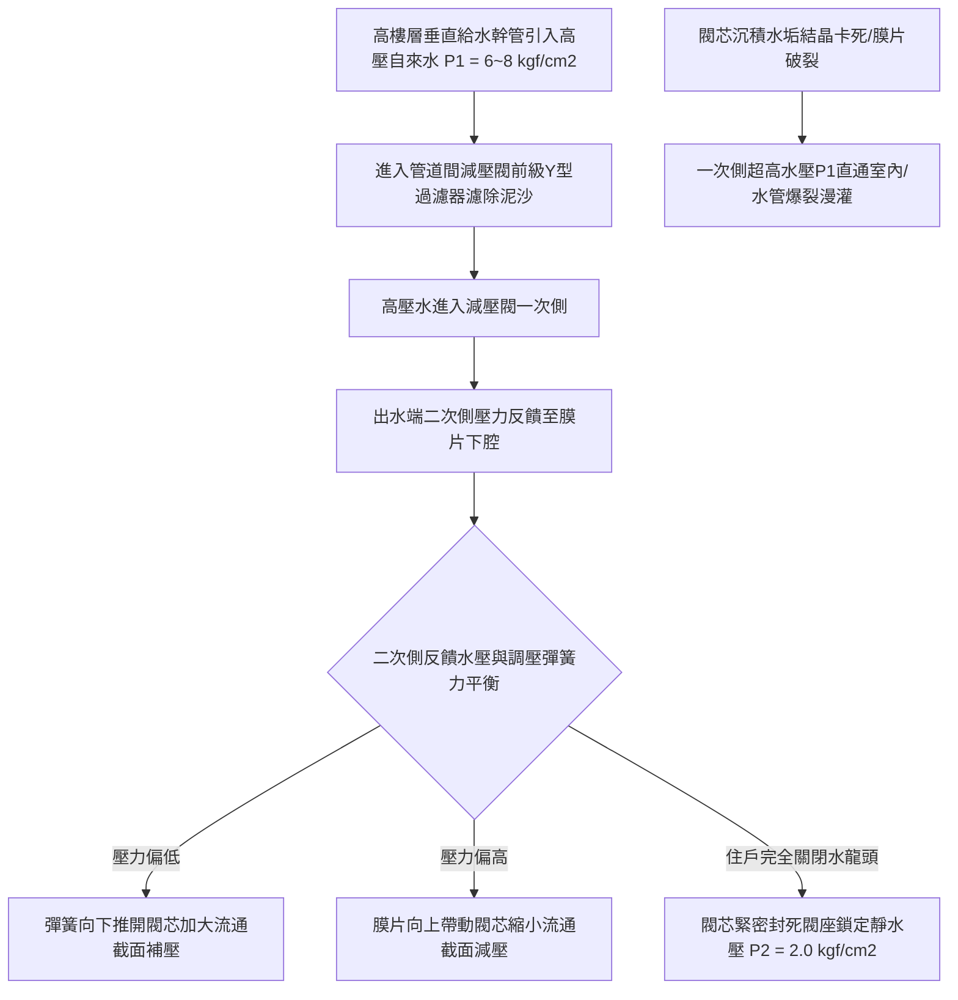

# 全案購屋實戰第八百七十八部：中古大樓社區各樓層生活自來水減壓閥組閥芯水垢結晶卡死動態減壓失效管壁承受高壓水錘破裂與室內爆水漫灌體檢工序全書

## 壹、編撰宗旨與高層水力靜壓破壞力學意涵

在台灣都市集合住宅建築工程中，凡樓層高度超過 10 至 12 層以上之中高層中古大樓社區（例如台中南區的大安紫金城、長億南園、歌德堡、工學天下、靜園等），自屋頂受水塔（高位水箱）向下輸送之自來水重力流給水系統，其垂直靜態水壓（Static Water Pressure）完全由建築標高落差所決定。

依據流體靜力學公式：
$$P_{\text{static}} = \rho \cdot g \cdot H$$
垂直高度每下降 $10\text{ 公尺}$，管內靜水壓即增加約 $1.0\text{ kgf/cm}^2$（約 $0.1\text{ MPa}$ 或 $1.0\text{ bar}$）。以一座 20 至 25 層樓高（樓高落差約 $60 \sim 80\text{ 公尺}$）之集合住宅大樓為例，在未經水壓分區減壓之情況下，底層（1 至 5 樓）垂直自來水幹管之靜水壓力將高達 **$6.0 \sim 8.0\text{ kgf/cm}^2$ 以上**！

若此等超高水壓直接灌入一般家庭室內，將使洗臉盆三角凡而角閥、熱水器冷水進水管、洗碗機軟管、淨水器濾殼及馬桶進水低水箱浮球閥常年處於「超額承壓破壞邊緣」。

依據《建築技術規則》建築設備編第 29 條規範，住宅室內給水栓之動態出水壓力標準應維持在 **$1.0 \sim 2.5\text{ kgf/cm}^2$** 之間；當垂直水壓超過 $3.5\text{ kgf/cm}^2$ 時，各樓層給水管道間內必須強制安裝「直動式或先導式生活自來水減壓閥組（Pressure Reducing Valve, PRV）」。

然而，在屋齡 20 年至 35 年以上之中古大樓中，減壓閥組常年處於地下管道間或梯廳公共管箱深處，面臨極其嚴重的隱形劣化：
1. **水中游離鈣、鎂離子在高壓剪切摩擦下析出堅硬的水垢結晶（Scale Incrustation）**，卡死於減壓閥不鏽鋼閥芯與青銅閥座密封環之間，導致閥門無法嚴密閉合，引發「減壓完全失靈」，使管內水壓瞬間飆升至全開靜水壓；
2. **減壓閥內部氯丁橡膠（Neoprene）或三元乙丙橡膠（EPDM）增強膜片受水質氯化侵蝕老化龜裂穿孔**，導壓腔失去反饋平衡力，造成出水壓力劇烈失控震盪；
3. **住戶關閉水龍頭瞬間產生之「反射水錘波（Water Hammer Wave）」缺乏有效吸收消解**，水錘衝擊波在管內產生高達 $15 \sim 20\text{ kgf/cm}^2$ 之瞬態峰值壓力，直接震裂住戶裝潢天花板內之自來水彎頭接牙或壓接處，數十分鐘內數十噸自來水自管道間狂瀉灌入室內，百萬木地板、家具與電梯電氣設備毀於一旦！

本手冊針對中古社區各樓層管道間生活自來水減壓閥組、旁通閥管路、水錘吸收器及室內管網耐壓體系，深入解剖力學平衡原理、膜片破損流力特性與無損水壓量測技術，並制定一套高標準之全流程現場體檢工序，為購屋家庭與管委會建立固若金湯的高樓供水平衡防線。

---

## 貳、直動式與先導式減壓閥水力平衡物理力學架構

### 一、直動式薄膜減壓閥力學靜力平衡方程
住宅各戶分歧管最常採用之直動式薄膜減壓閥（Direct-acting Diaphragm PRV），其內部由調壓彈簧、彈簧座、柔性感應膜片、平衡推桿、錐形閥芯（Poppet）與橡膠密封閥墊構成：
1. **受力動態平衡機制**：
   減壓閥處於流體穩定流動狀態時，膜片與閥桿組件受三個主要垂直方向力之平衡：
   $$\sum F = F_{\text{spring}} - F_{\text{diaphragm}} - F_{\text{valve}} = 0$$
   其中：
   - $F_{\text{spring}} = k \cdot (x_0 - x)$：上方重載調壓彈簧向下推動閥門開啟之彈性力（$k$ 為彈簧剛度，$x$ 為壓縮位移）。
   - $F_{\text{diaphragm}} = P_2 \times A_{\text{effective}}$：出水端（二次側減壓後壓力 $P_2$）回饋水壓向上推動膜片之閉合力（$A_{\text{effective}}$ 為柔性膜片有效受壓面積）。
   - $F_{\text{valve}}$：一次側高壓水 $P_1$ 作用於閥芯端面之軸向不平衡力（現代優質平衡式閥芯透過平衡活塞孔消除此項影響，使閥門開度不受一次側水壓波動干擾）。
2. **自動恆壓反饋調控動態**：
   - 當住戶開啟水龍頭出水時，$P_2$ 略微下降，向上推力 $F_{\text{diaphragm}}$ 減小，彈簧力推動閥芯向下加大開度，自來水流量增加以維持二次側出口壓力穩定；
   - 當住戶關閉水龍頭時，$P_2$ 瞬間上升，向上推力大於彈簧力，推動閥芯向上緊壓閥座，完全切斷一次側與二次側水流，將靜止狀態下之室內靜水壓精準鎖定在調定值（例如 $2.0\text{ kgf/cm}^2$）。

### 二、快速關閉水龍頭水錘波傳播力學（儒可夫斯基 Joukowsky 方程）
當住戶瞬間關閉陶瓷閥芯單槍水龍頭（關閉時間 $t < \frac{2L}{a}$）時，管內流動水體之動量瞬間受阻轉化為壓力能：
$$\Delta P = \rho \cdot a \cdot \Delta v$$
其中：
- $\rho$ 為水之密度（$1000\text{ kg/m}^3$）。
- $a$ 為壓力波在彈性管道中之傳播速度（鋼管內約為 $1000 \sim 1200\text{ m/s}$，不鏽鋼壓接管約為 $800 \sim 1000\text{ m/s}$）。
- $\Delta v$ 為水流初速減變量（一般室內水流流速約 $1.5 \sim 2.0\text{ m/s}$）。
由公式計算，水流初速由 $2.0\text{ m/s}$ 瞬間歸零時，產生的瞬態水錘衝擊壓升高達：
$$\Delta P = 1000 \times 1000 \times 2.0 = 2.0 \times 10^6\text{ Pa} \approx 20\text{ kgf/cm}^2 \quad (\approx 2.0\text{ MPa})$$
若減壓閥反應遲緩且未配置活塞式水錘吸收器，高達 $20\text{ kgf/cm}^2$ 的衝擊水錘波將以音速在室內暗管中來回震盪反射，數週內即可將管件牙口震脫引發大漏水。

---

## 參、中古社區減壓閥系統三大核心病徵與失靈成因

### 一、閥芯與閥座硬水結晶卡死（靜壓失控直通）
1. **碳酸鈣水垢物理卡阻**：中部地區自來水水質硬度偏高（總硬度常達 $150 \sim 200\text{ mg/L}$）。自來水流經減壓閥微小節流縫隙時產生劇烈壓力降與流速激增，局部空化作用促使碳酸鈣與氫氧化鎂微細晶粒沉積附著於不鏽鋼閥芯周圍。
2. **靜壓攀升（Creep Effect）**：當住戶半夜不用水時，因閥芯被微量水垢微粒卡阻無法百分之百完全緊密閉合，一次側高達 $7 \sim 8\text{ kgf/cm}^2$ 的高壓自來水透過微米級漏縫緩慢向二次側滲透滲漏。數小時內，室內管網靜水壓逐漸自正常的 $2.0\text{ kgf/cm}^2$ 慢速爬升至與幹管完全相同的 $8.0\text{ kgf/cm}^2$。清晨住戶第一次開啟水龍頭時，強烈高壓水柱瞬間噴射炸開，這正是減壓閥閥芯水垢卡死的標準前兆。

### 二、橡膠感應膜片疲勞老化、硬化與撕裂穿孔
1. **自來水餘氯氧化侵蝕**：市政自來水中殘留之次氯酸（$\text{HClO}$）與次氯酸根離子具有強烈氧化性，長年浸潤使減壓閥內部氯丁橡膠膜片硫化鍵斷裂，橡膠變硬脆化、彈性系數喪失。
2. **膜片撕裂導致減壓功能全面瓦解**：在長年數十萬次開關水的動態微幅變形下，膜片在邊緣金屬壓板夾持處產生疲勞環狀微裂紋，最終爆裂穿孔。一旦穿孔，二次側水壓直接自膜片上方通氣洩壓孔（Vent Hole）向外狂噴，或高壓水直接灌入彈簧腔，閥芯徹底失去向下閉合之平衡力，減壓閥淪為直通管。

### 三、前置 Y 型過濾器（Strainer）鐵鏽淤塞與水流尖叫噪聲
1. **管壁剝落鏽塊堵死濾網**：中古大樓鍍鋅鋼管或鑄鐵幹管內壁剝落的鐵鏽碎片，長年沉積於減壓閥前置 Y 型過濾器的 60 目不鏽鋼濾網內。
2. **節流空化尖叫與出水細弱**：當濾網堵塞面積超過 $80\%$ 時，自來水通過濾網時產生極大局部水頭損失，在減壓閥內部產生劇烈空化氣蝕（Cavitation）。當住戶開啟蓮蓬頭淋浴時，管道間傳出尖銳刺耳如吹哨般的「高頻金屬尖叫聲」，且室內出水量驟降，熱水器因動態水壓過低而頻繁熄火點不著。

---

## 肆、各樓層自來水減壓閥組標準體檢工序

### 一、管道間減壓閥靜態與動態雙壓表檢測工序
1. **雙壓力表配置查驗**：
   - 打開樓層公共走廊或梯廳之給水管道間檢修門，尋找目標戶之減壓閥組。
   - 減壓閥組標準配置必須包含：**前置隔離閘閥/球閥 $\to$ Y型過濾器 $\to$ 前級一次側高壓表（$P_1$） $\to$ 減壓閥本體 $\to$ 後級二次側低壓表（$P_2$） $\to$ 水錘吸收器 $\to$ 後置隔離閥 $\to$ 旁通管迴路（Bypass Loop）**。
2. **靜態壓力（零流量）保壓測試**：
   - 確保室內所有水龍頭、馬桶進水閥及用水設備完全關閉。
   - 讀取二次側壓力表 $P_2$ 之靜態數值，標準設定值應介於 **$1.8 \sim 2.5\text{ kgf/cm}^2$**。
   - **保壓觀察 15 分鐘**：指針必須穩固鎖定，**絕對不得有任何向上攀升慢移現象**。若 15 分鐘內 $P_2$ 指針由 $2.0$ 慢慢爬升至 $4.0$ 或與 $P_1$ 同步，判定為閥芯水垢卡阻或密封墊硬化洩漏，列為不合格！
3. **動態壓力（全流量）出水測試**：
   - 全開室內浴室臉盆水龍頭與淋浴蓮蓬頭（大流量出水工況）。
   - 觀察此時二次側壓力表 $P_2$ 之動態壓降數值。
   - **合格標準**：動態出水壓力降幅應在 **$0.3 \sim 0.5\text{ kgf/cm}^2$ 之內**（即實測動態水壓應維持在 $\ge 1.5\text{ kgf/cm}^2$）；若開水時指針瞬間暴跌至 $0.8\text{ kgf/cm}^2$ 以下且出水綿軟無力，代表前置 Y 型過濾器已嚴重淤塞或減壓閥口徑規格配置偏小。

### 二、減壓閥彈簧調壓靈敏度校正工序
1. **調節螺栓保護蓋拆卸**：
   - 旋下減壓閥頂部黃銅或塑料調壓保護帽，露處內六角或方形調壓螺栓與鎖緊防鬆螺帽。
2. **微調校正驗收**：
   - 鬆開鎖緊螺帽，順時針方向旋轉調壓螺栓（壓縮內部彈簧，增加出水壓力 $P_2$）；逆時針旋轉則為放鬆彈簧降低壓力。
   - 旋轉一圈觀察 $P_2$ 壓力表變動幅度（通常每旋轉一圈壓力變動約 $0.3 \sim 0.5\text{ kgf/cm}^2$）。
   - **機構靈敏度判定**：旋轉時指針反應靈敏即時、無卡頓跳動；調整完畢後將鎖緊螺帽牢固緊固。若旋轉螺栓時壓力指針毫無反應，代表內部閥桿已完全卡死在閥體導向套內，必須全組拆解更換。

### 三、前置 Y 型過濾器排泥排渣清洗工序
1. **閥組截斷隔離**：關閉減壓閥前後兩端隔離球閥，並打開二次側洩水閥排空管內存水與壓力。
2. **濾網拆解清污**：
   - 使用活動扳手卸下 Y 型過濾器底部斜向六角螺塞，小心抽出內部圓筒狀不鏽鋼濾網。
   - 檢視濾網內部堆積之鐵鏽屑、焊渣、黃泥與碳酸鈣結晶塊；使用黃銅鋼絲刷配合稀醋酸溶劑徹底刷洗清除網孔泥垢，檢查不鏽鋼網面有無破洞撕裂。
3. **密封墊片更新與復位**：更換全新耐油三元乙丙（EPDM）密封 O 形環，鎖緊螺塞並恢復通水。

---

## 伍、購屋避坑指南與管委會整改預算表

### 一、買方看屋給水減壓管網查驗關鍵 4 訣
1. **自行攜帶指針式水壓表實測室內出水靜壓**：
   - 隨身準備一只市售標準洗衣機或水龍頭專用快速接頭指針水壓表（量程 0~10 kgf/cm²，售價僅數百元）。
   - 接上後陽台洗衣機水龍頭，開啟水龍頭讀取靜水壓。若指針高達 **$4.0 \sim 6.0\text{ kgf/cm}^2$**，代表該棟大樓管道間減壓閥早已失靈直通，室內隨時面臨爆管淹水巨災！
2. **瞬間急關水龍頭傾聽牆體水錘聲**：
   - 將廚房單槍水龍頭開至最大，然後以最快速度「啪」地一聲瞬間下壓關閉水流。
   - 側耳傾聽廚房牆壁或天花板管道內有無沉悶金屬撞擊聲（「咚！咚！」震盪聲）。若有強烈水錘震盪，代表減壓閥組後端並未安裝水錘吸收器，或內部氣囊已破裂漏氣。
3. **查驗管道間檢修門開口尺寸與位置**：
   - 進入公共梯廳，確認各樓層管道間門未被鄰居鞋櫃或雜物阻擋封死；檢修門開啟後，減壓閥組位置應在胸前高度便於維修扳手操作，嚴禁被排水管死死包夾無法更換。
4. **檢查熱水器進水軟管與三角凡而閥體**：
   - 俯身觀察熱水器下方冷水進水波紋管及浴室臉盆三角凡而，若閥體接縫長滿青綠色銅綠結晶，或有水珠滲出，高度暗示管內長期承受超高靜態水壓。

### 二、各樓層自來水減壓閥組專項維修更新預算參考清單

| 維修／改善工程項目 | 技術規範與標準工法 | 預算區間（每戶／每組） | 安全重要度等級 |
| :--- | :--- | :--- | :--- |
| **全銅/不銹鋼直動式平衡閥芯減壓閥換新** | 1"~1-1/4" 進口意大利或一線品牌（含雙壓表） | 4,500 ~ 7,500 元／組 | 極高（靜壓失控必做） |
| **活塞式不銹鋼水錘吸收器安裝更換** | SUS 304 充氮活塞式水錘消除器 1/2"~3/4" | 1,800 ~ 3,200 元／只 | 極高（消除管壁震盪） |
| **Y型過濾器拆解清洗與更換不銹鋼濾網** | 304 不銹鋼 60 目濾芯 + EPDM 高溫密封圈 | 1,000 ~ 1,800 元／處 | 中度（每2~3年常態保養） |
| **耐震充油不銹鋼壓力表更新（0~10 kgf/cm²）** | 甘油充填抗震型軸向/徑向 2.5" 壓力表 | 600 ~ 1,000 元／只 | 高度（精準監控水壓） |
| **管道間減壓閥旁通管迴路（Bypass）增設** | 包含 3 只 304 不銹鋼全流量球閥與配管修改 | 6,500 ~ 11,000 元／組 | 專業推薦（確保維修不斷水） |
| **室內冷熱水給水管高壓保壓測漏試驗** | 10 kgf/cm² 靜態水壓保壓 60 分鐘壓力降測試 | 2,500 ~ 4,500 元／戶 | 裝修交屋必備驗收 |

---

## 陸、本案結語

在高樓林立的現代都會集合住宅中，重力流帶來了源源不絕的自來水便利，但伴隨而來的垂直超高水壓，卻是潛伏在住戶天花板與牆體暗管中看不見的「高壓定時炸彈」。各樓層減壓閥組正是馴服狂暴水壓、將凶險的超高重力水頭轉化為柔順家庭用水的精密調節器。

購屋家庭在審視 20 年以上之優質中古大樓時，切不可被精美的室內龍頭與衛浴磁磚所蒙蔽，務必親自攜帶水壓表實測室內靜動態水壓，並深入管道間查驗減壓閥閥芯與過濾器之健康狀態。唯有牢牢將管內水壓鎖定在安全舒適的物理平衡區間，才能徹底免除室內爆管漫灌之滅頂之災，確保全家人安枕無憂、世代傳承！
