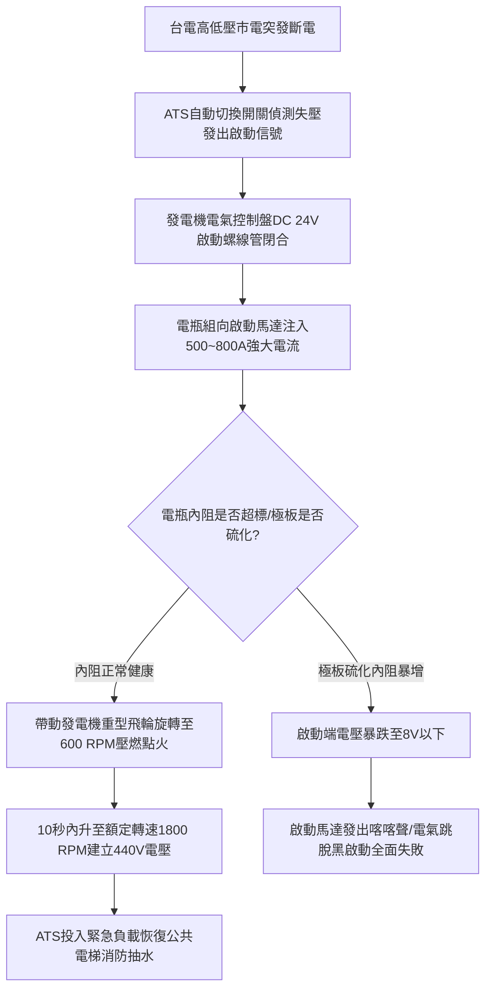

# 全案購屋實戰第八百七十六部：中古大樓社區地下室緊急柴油發電機組啟動電瓶硫酸鹽化電極板硫化容量衰減自動浮充充電器失準與停電黑啟動失敗體檢工序全書

## 壹、編撰宗旨與極限斷電黑啟動之生命防線

在台灣都市集合住宅（特別是屋齡 20 年至 35 年以上之高層中古大樓，如台中南區的大安紫金城、長億南園、歌德堡、工學天下等）的機電防護架構中，「緊急柴油發電機組（Emergency Diesel Generator Set, EDG）」是整座社區在遭遇台電電網跳電、區域大停電、強烈地震或火災突發時，唯一具備「黑啟動（Black Start）」能力的孤島生命線電源。

當台電高壓或低壓市電斷電的瞬間，整棟大樓必須依賴自動切換開關（ATS, Automatic Transfer Switch）在 **10 至 12 秒之內**，將緊急消防撒水泵浦、室內消防栓栓管加壓泵浦、排煙風機、緊急昇降機（消防員電梯）、梯間緊急照明與受水箱揚水設備之供電迴路，全面切換由緊急柴油發電機全壓驅動。

然而，在長達數十年的社區維運實務中，發電機引擎機械本體往往保養尚可，但**高達 $80\%$ 以上的停電啟動失敗災難，均導因於「發電機啟動鉛酸蓄電池（Starting Lead-Acid Batteries）的極板不可逆硫酸鹽化（Sulfation）」與「自動浮充電器（Float Charger）電壓失準過充或欠充」**！

長年處於高溫潮濕地下室的啟動蓄電池，若內部化學活性衰退，平時看似有電壓，但在啟動馬達需要瞬間抽取數百安培（$400 \sim 800\text{ A}$）超大冷啟動電流（CCA）的關鍵 $0.5$ 秒內，蓄電池端電壓瞬間暴跌至臨界值以下，導致啟動馬達齒輪發出無力的「喀喀」空跳聲而無法帶動曲軸轉動，整座大樓瞬間淪為漆黑無水、消防癱瘓、電梯夾人的死亡陷阱。

本手冊針對中古社區緊急柴油發電機啟動電瓶組、智能浮充電器、啟動馬達電氣迴路及現場放電負載檢測，詳解電化學雙硫酸鹽反應機理、電導內阻分析技術與全流程體檢工序，為購屋家庭與管委會建立萬無一失的緊急供電堡壘。

---

## 貳、鉛酸蓄電池電化學反應機制與瞬間啟動物理特性

### 一、鉛酸蓄電池雙硫酸鹽化學平衡反應
緊急柴油發電機通常採用 $24\text{V DC}$ 啟動系統（由兩只 $12\text{V}$ 重負載免加水鉛鈣合金閥調式 VRLA 或加水型鉛銻合金電瓶串聯組成）：
1. **電化學熱力學反應方程式**：
   $$\text{PbO}_2 (\text{正極二氧化鉛}) + \text{Pb} (\text{負極海綿鉛}) + 2\text{H}_2\text{SO}_4 (\text{電解液硫酸}) \underset{\text{充電}}{\overset{\text{放電}}{\rightleftharpoons}} 2\text{PbSO}_4 (\text{硫酸鉛}) + 2\text{H}_2\text{O} (\text{水})$$
2. **正常可逆反應過程**：
   在放電時，正負極活性物質皆轉化為微細晶粒狀的硫酸鉛（$\text{PbSO}_4$），電解液硫酸濃度下降，密度由 $1.280\text{ g/cm}^3$ 降至約 $1.150\text{ g/cm}^3$；充電時，電解液中的水分子分解，硫酸鉛重新還原為正極二氧化鉛與負極金屬海綿鉛，密度回升。

### 二、柴油引擎冷啟動瞬間電流（CCA）與端電壓驟降力學
柴油引擎壓縮比高達 $16:1 \sim 22:1$，且無火星塞輔助點火，純靠氣缸壓縮空氣產生的高溫（$500^\circ\text{C} \sim 700^\circ\text{C}$）壓燃霧化柴油：
1. **瞬間超大湧浪電流**：
   在曲軸靜止靜摩擦阻力最大的第一衝程瞬間，啟動馬達所需的冷啟動電流（Cold Cranking Amps, CCA）高達：
   $$I_{\text{start}} = 500 \sim 1000\text{ A} \quad (\text{持續時間約 } 0.2 \sim 0.5\text{ 秒})$$
2. **歐姆定律內阻壓降效應**：
   蓄電池端電壓 $V_{\text{terminal}}$ 遵循封閉電路歐姆定律：
   $$V_{\text{terminal}} = E_0 - I_{\text{start}} \times R_{\text{internal}}$$
   其中 $E_0$ 為蓄電池開路電動勢（標準 $24\text{V}$ 系統約為 $25.2 \sim 26.0\text{V}$），$R_{\text{internal}}$ 為電池內部等效串聯內阻。
   - **健康電瓶**：$R_{\text{internal}} \approx 10\text{ m}\Omega$。在 $I = 600\text{ A}$ 啟動瞬間，內阻壓降僅為 $\Delta V = 600 \times 0.010 = 6.0\text{V}$，端電壓維持在 $19.2\text{V} > 16.0\text{V}$（啟動馬達運轉臨界電壓），曲軸迅猛旋轉點火啟動！
   - **劣化老化電瓶**：$R_{\text{internal}}$ 因極板硫化暴增至 $30\text{ m}\Omega$ 以上。在 $600\text{ A}$ 負載瞬間，內阻壓降高達 $\Delta V = 600 \times 0.030 = 18.0\text{V}$，端電壓瞬間崩跌至 $7.2\text{V} \ll 16.0\text{V}$，控制繼電器直接跳脫，啟動完全失敗！

---

## 參、中古社區發電機電瓶組三大核心病徵與失靈成因

### 一、極板不可逆硫酸鹽化（Irreversible Sulfation）
1. **大結晶體生成**：若電瓶常年處於欠充（Undercharging）狀態，微細的硫酸鉛晶粒在熱力學驅動下逐漸溶解再結晶，聚合成粗大、緻密且導電率極差的粗晶硫酸鉛（$\text{PbSO}_4$）。
2. **活性表面積喪失**：粗晶硫酸鉛在常規充電時無法被化學分解還原，如同一層堅硬的絕緣釉質覆蓋在正負極板表面，使有效電化學反應面積劇降 $70\%$ 以上，電池有效蓄電容量（Ah）與瞬間放電能力（CCA）徹底喪失。

### 二、自動浮充電器（Float Charger）失準引發過充與電解液乾涸
1. **熱失控（Thermal Runaway）與極板變形**：地下室發電機房常年通風不良，夏季室溫常達 $35^\circ\text{C} \sim 40^\circ\text{C}$。若浮充電器缺乏溫度補償機制（標準應為 $-3\text{ mV/}^\circ\text{C}/\text{cell}$），浮充電壓漂移過高（$>2.35\text{V/cell}$），將導致電瓶內部電解水產生大量氫氣與氧氣，蓄電池產生「熱失控」膨脹鼓包。
2. **電解液乾涸與隔板碳化**：加水型電瓶極板外露接觸空氣氧化，免加水 VRLA 電瓶內部安全閥頻繁排氣洩壓導致膠體電解液乾涸，玻璃纖維隔板（AGM）碳化穿孔造成內部微短路。

### 三、電瓶樁頭（Terminals）酸蝕氧化與大電流接觸電阻過高
鉛質電瓶極柱與銅質接線端子之間，因硫酸酸霧微漏產生電化學腐蝕，表面生成一層厚實的白色或藍綠色硫酸銅、硫酸鉛氧化絕緣層。當數百安培啟動電流通過時，接觸電阻處產生極大壓降並瞬間產生高溫燒毀樁頭。

---

## 肆、發電機電瓶與啟動系統標準體檢工序

### 一、電瓶靜態外觀與電解液密度檢驗
1. **外觀結構檢查**：
   - 檢查電瓶外殼有無變形、膨脹鼓包、電解液滲漏或裂紋。
   - 檢視極柱接線端子有無白綠色結晶腐蝕，接線螺栓緊固扭矩是否達到 **$8 \sim 10\text{ N}\cdot\text{m}$**。
2. **開路電壓量測（Open Circuit Voltage, OCV）**：
   - 拔除浮充電器電源，靜置 30 分鐘後，使用高精度數位三用電表量測單體與串聯總電壓。
   - **標準合格值**：$12\text{V}$ 電瓶開路電壓應 $\ge 12.60\text{V}$（充飽狀態）；串聯 $24\text{V}$ 系統應 $\ge 25.20\text{V}$；若單體電壓低於 $12.20\text{V}$，代表電量低於 $50\%$ 或內部有壞格。
3. **電解液比重量測（加水型電瓶）**：
   - 使用光學折射比重計吸取各單格電解液，標準比重應介於 **$1.260 \sim 1.280\text{ g/cm}^3$**（$25^\circ\text{C}$），各格比重差不得大於 $0.025\text{ g/cm}^3$。

### 二、電導內阻分析儀（Conductance / Internal Resistance Test）精密體檢
1. **非破壞性交流電導檢測**：
   - 採用專業蓄電池電導內阻測試儀（如 Midtronics 或 Hioki 蓄電池檢測儀），夾附於電池正負極柱。
   - 透過注入微弱交流交流信號量測內部等效電導值（Siemens）與動態內阻值（$\text{m}\Omega$）。
2. **冷啟動電流容量判定標準**：
   - 輸入電瓶名牌標稱 CCA 值（例如 $800\text{ CCA}$）。
   - **健康等級（Good）**：實測實存容量 $\ge 80\%$ 標稱值，內阻維持基準值之內。
   - **警戒等級（Warning）**：實存容量介於 $60\% \sim 79\%$，需列入排程更換。
   - **汰換等級（Replace）**：實存容量 $< 60\%$，或內阻超過原廠新品值之 **$1.5 \sim 2.0\text{ 倍}$**，代表電極板已深度硫化，必須立即整組汰換，嚴禁繼續使用！

### 三、真機啟動壓降與滿載運轉實測
1. **啟動瞬間動態電壓跌落測試（Cranking Voltage Drop Test）**：
   - 將數位示波器或具備峰值保持（Peak Hold）功能之電表接至電瓶輸出端。
   - 手動按下發電機測試啟動按鈕，記錄啟動馬達旋轉衝擊瞬間之最低電壓 $V_{\text{min}}$。
   - **合格標準**：$24\text{V}$ 啟動系統之最低瞬間電壓**絕對不得低於 $16.0\text{V}$**（單只 $12\text{V}$ 電池不得低於 $8.0\text{V}$）；且自啟動信號發出至點火成功轉速升至 $1800\text{ RPM}$ 之時間必須在 **$3 \sim 5\text{ 秒}$ 內完成**。
2. **自動充電器充電電流與均充/浮充切換查核**：
   - 檢查發電機運轉與靜止狀態下，充電機輸出直流電壓是否穩定維持在浮充電壓範圍（$27.0 \sim 27.6\text{V}$，對應單格 $2.25 \sim 2.30\text{V}$）。
   - 運轉充電發電機（交流充電機 Alternator）皮帶張力與輸出發電電壓是否達到 $28.0\text{V}$。

---

## 伍、購屋決策避坑指南與管委會整改預算表

### 一、買方看屋機電安全查核 4 訣
1. **查閱發電機啟動電瓶銘牌與出廠製造日期**：
   - 走入地下室發電機房，檢視電瓶上方標籤或外殼烙印之出廠年月（如：2021/05）。鉛酸啟動電瓶之物理安全壽命**嚴格為 2 至 3 年**。若使用超過 3 年未更換，黑啟動失敗率高達 $70\%$ 以上。
2. **觀察電瓶外殼與充電機面板狀態**：
   - 檢查外殼是否兩側鼓脹隆起（熱失控象徵）；檢查充電機面板「浮充電壓錶」讀數是否介於 $27.0 \sim 27.6\text{V}$，指針有無劇烈跳動。
3. **核對管委會每月「發電機無載/有載試運轉紀錄簿」**：
   - 依消防法規，社區發電機每月必須至少進行一次無載試車運轉 10~15 分鐘，每半年進行一次有載轉換運轉。若紀錄簿長達半年空白或每次僅打勾無實際數值，代表機電維護嚴重脫軌。
4. **確認電瓶室通風與防火防酸安全設施**：
   - 發電機電瓶下方應配置耐酸鹼防漏托盤，防止電解液腐蝕地坪；機房內應配置專用防爆通風百葉，防止充電產生的氫氣蓄積引發氣爆。

### 二、發電機啟動蓄電池與充電系統專項整改預算參考清單

| 維修／改善工程項目 | 技術規範與標準工法 | 預算區間（每組／每台） | 安全重要度等級 |
| :--- | :--- | :--- | :--- |
| **重負載免保養發電機專用啟動電瓶換新** | 12V 100Ah~120Ah 800CCA（兩只一組） | 8,500 ~ 15,000 元／組 | 極高（每2~3年必換） |
| **微電腦智能多段式定電壓浮充電器更換** | DC 24V 10A 具溫度補償與故障警報接點 | 7,500 ~ 13,000 元／台 | 極高（根治過充電解乾涸） |
| **啟動馬達大修更換電磁開關與碳刷** | 24V 5.5kW~7.5kW 啟動馬達分解保養 | 6,500 ~ 12,000 元／台 | 高度 |
| **電瓶接線端子與鍍錫厚銅線更換** | 50mm²~70mm² 耐高溫純銅電纜含端子包膠 | 2,500 ~ 4,000 元／組 | 中度 |
| **蓄電池專用耐酸鹼防爆安全托盤安裝** | 高密度聚乙烯（HDPE）耐酸防漏盤 | 1,500 ~ 2,500 元／只 | 中度 |
| **發電機年度全載假負載（Load Bank）測試** | 100kW~300kW 移動式假負載箱滿載測試 | 25,000 ~ 45,000 元／次 | 專業推薦（消除引擎積碳） |

---

## 陸、本案結語

緊急柴油發電機組是整棟大樓在狂風暴雨與烈火濃煙中的「電力方舟」，而啟動蓄電池組則是喚醒這艘方舟心臟的「黃金之匙」。鑰匙一旦生鏽失靈，再龐大先進的發電機組也只是一堆毫無生命價值的冷鐵。

購屋家庭在評估中古大樓時，務必將體檢眼光精確聚焦於這組隱匿於發電機底座旁的啟動電瓶與浮充電器上。唯有確保蓄電池隨時具備噴薄而出的冷啟動能量，才能在全城陷入黑暗的極限危局中，為摯愛的家人點亮永不熄滅的生命明燈！
