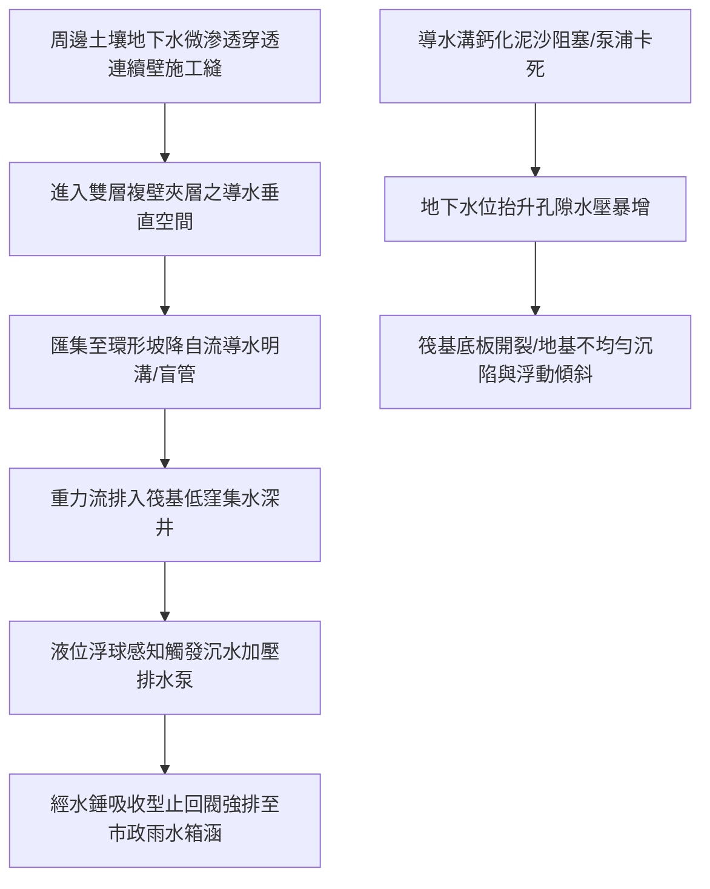

# 全案購屋實戰第八百七十四部：中古大樓社區地下室筏式基礎連續壁導水溝積泥阻塞集水井沉水排水平衡閥卡死與地下水位抬升防浮力體檢工序全書

## 壹、編撰宗旨與地下水文浮力破壞力學意涵

在台灣都市高密度集合住宅大樓（特別是屋齡 20 年至 35 年以上之中古大樓，如台中南區的大安紫金城、長億南園、歌德堡、工學天下、大東家南園等）之結構體系中，整棟數千乃至數萬噸之鋼筋混凝土結構，深植於地表下數層的「筏式基礎（Raft Foundation）」或箱型基礎之中。

地下水是地層深處最強大且永不休止的自然物理力量。隨著台中都會區地下水文隨季節降雨、旱季抽水與周邊新建案深開挖工程之劇烈動態變化，作用於大樓地下室外牆連續壁（Diaphragm Wall）與最底層底板上的「**孔隙水壓力（Pore Water Pressure）**」與「**向上浮力（Uplift Hydrostatic Force）**」呈現週期性劇烈波動。

依據現代地下結構工程標準，為緩解極端暴雨期地下水位劇烈暴漲對地下室底板所產生的毀滅性頂升浮力，大樓外圍均設計有「連續壁雙層導水內襯牆（Cavity Wall Drainage System）」、周邊環形「排水暗溝（Drainage Trench）」、集水深井（Sump Well）以及專用「揚水排放泵浦系統」。

然而，在中古大樓長達數十年的維運盲區中，地下水防浮力導排水系統面臨極嚴重的系統性隱患：
1. **地層微細砂粒與鈣化物隨滲水析出結晶**，長年淤積於連續壁周邊導水明溝與暗溝內，導致導水截面積銳減、局部逆坡積水，水流完全受阻；
2. **集水深井內部沉水排水泵浦之止回閥（Check Valve）與排水平衡平衡閥卡死**，排水管內懸浮雜質磨損機械軸封，水錘震盪震裂排水立管；
3. **底板抗浮力洩壓孔（Relief Well）濾網淤塞鈣化閉塞**，導致地下水超額孔隙水壓無法自然釋放，直接在筏基底板與樑柱接頭處產生剪切開裂、剪力牆水平微裂縫，甚至造成地坪拱起隆破。

本手冊針對中古社區地下室筏基連續壁導水溝、集水井沉水排水系統與地下水防浮力機制，詳解土壤力學滲流場、水下結晶淤塞病理、非破壞性流速與水壓量測技術，並制定一套高標準之全流程現場體檢與疏通工序，為購屋家庭與管委會建立固若金湯的地下地基安全防線。

---

## 貳、地下水文滲流物理力學與結構抗浮力平衡機制

### 一、阿基米德浮力定律與筏基抗浮力安全係數
依據建築結構設計規範與土力學原理：
1. **地下水頂升總浮力計算**：
   作用於建築物地下底板之總向上靜水浮力 $F_{\text{uplift}}$ 為地下水位面以下所排開之地下水體重：
   $$F_{\text{uplift}} = \gamma_w \times V_{\text{submerged}} = \gamma_w \times A_{\text{footprint}} \times h_{\text{head}}$$
   其中：
   - $\gamma_w$ 為水之單位容重（約 $10\text{ kN/m}^3$ 或 $1.0\text{ t/m}^3$）。
   - $A_{\text{footprint}}$ 為大樓地下室投影總面積（$\text{m}^2$）。
   - $h_{\text{head}}$ 為地下水設計最高水位至筏基底板底面之水頭差（$\text{m}$）。
   例如一座基底面積 $1,500\text{ m}^2$、地下水頭深度達 $6.0\text{ 公尺}$ 之大樓，其底板承受之總頂升浮力高達：
   $$F_{\text{uplift}} = 1.0 \times 1,500 \times 6.0 = 9,000\text{ 公噸重} \quad (\approx 88.2\text{ MN})$$
2. **抗浮力安全係數（Factor of Safety against Uplift, $F_s$）**：
   為防止整棟大樓因暴雨地下水位暴漲而被頂起失衡，建築物之自重抗浮力標準必須滿足：
   $$F_s = \frac{\sum W_{\text{dead}}}{\sum F_{\text{uplift}}} \ge 1.20 \sim 1.25$$
   若大樓自重 $\sum W_{\text{dead}}$ 不足，或地下水位因周邊連續壁導水系統失效而異常抬升時，超額水壓將轉化為彎矩應力，將厚達 60~100 公分的 RC 筏基底板由下而上硬生生頂裂。

### 二、連續壁導水雙層複壁（Cavity Wall）之水理消壓機制
現代深開挖大樓無法做到絕對百分之百的「外牆完全不透水」。因此結構工程採取「**迎水面連續壁結構防水 + 背水面複壁導水消壓**」雙重防禦體系：
1. **複壁（Lining Wall）與中空夾層**：在厚達 70~100 公分的連續壁內側，間隔 10~15 公分砌築 1/2B 磚牆或 RC 內襯牆。
2. **零壓力自由重力流**：透過連續壁微滲入的水流，在夾層空隙內失去壓力，轉化為大氣壓下的無壓重力水滴，沿壁面滑落至底端預埋導水溝中，防止靜水壓力直接作用於地下室室內牆面。

---

## 參、中古社區地下導排水系統三大核心病徵與失靈成因

### 一、地下水碳酸鈣結晶與粉砂淤塞（血管硬化動脈硬化）
1. **碳酸鈣化學析出沉積**：地下水在穿透混凝土毛細孔裂縫時，會溶解混凝土內部之游離氧化鈣，形成氫氧化鈣 $\text{Ca(OH)}_2$。當滲透水流入複壁導水溝接觸大氣中的二氧化碳（$\text{CO}_2$）時，即刻反應生成堅硬的白色碳酸鈣（$\text{CaCO}_3$）石灰石結晶：
   $$\text{Ca(OH)}_2 + \text{CO}_2 \to \text{CaCO}_3 \downarrow + \text{H}_2\text{O}$$
2. **導水盲管實體固化**：歷經 20~30 年累積，白色碳酸鈣石灰質與地層粉細砂緊密膠結，將埋設於筏基底部的波浪濾水穿孔盲管完全「石化封死」，導水斷面喪失 $90\%$ 以上，導致水流無法進入集水井，在複壁夾層內蓄積成高壓水袋，最終自踢腳板與插座孔大量爆裂噴湧。

### 二、集水井沉水泵浦止回閥積垢卡死與水流倒灌
1. **排水平衡止回閥受泥砂刮傷卡阻**：集水井排出之滲透水常夾帶細石英砂。傳統金屬旋啟式或球型橡膠逆止閥（Check Valve）之閥座被泥砂卡死或閥瓣轉軸生鏽，無法在泵浦停機瞬間嚴密閉合。
2. **高壓水柱回沖與葉輪反轉**：停機時，揚水垂直立管內高達數噸之高壓水柱瞬間逆流回沖，造成沉水泵浦葉輪反向超速旋轉，機械軸封因反向扭矩爆裂，下次啟動時引發劇烈水錘將管路接頭震脫。

### 三、底板抗浮力洩壓閥（Pressure Relief Valve）失效與底板開裂
為保護地下筏基底板，部分大型社區於底板設有抗浮力單向洩壓閥（底板盲井）。若其底部逆止橡膠瓣因泥沙墊起無法封閉，地下泥水常態性逆向倒灌入地下室；若內部彈簧生鏽鎖死，則在颱風暴雨地下水頭暴衝時失去自動洩壓消能功能，引發底板拱裂。

---

## 肆、地下導排水與防浮力系統標準體檢工序

### 一、連續壁複壁導水溝疏通性與內窺鏡檢查
1. **檢查孔窺鏡探測（Borescope Inspection）**：
   - 沿地下室四周外牆尋找複壁清潔檢修孔（Cleanout Port）。
   - 伸入長度 20 公尺之工業級防水內窺鏡（配備高亮度 LED 光源與旋轉鏡頭），巡視夾層內部導水明溝。
   - **檢驗重點**：檢視導水溝底是否有厚達 5 公分以上之白色碳酸鈣結晶層、泥沙淤積或磚塊施工廢棄物堵塞；確認導水溝是否有向集水井方向維持千分之五（$5‰$）之自然洩水坡度。
2. **注水流通試驗（Flow Test）**：
   - 於最遠端導水溝檢查孔注入 50 公升自來水，使用電子碼表計時，確認水流能在 **5 分鐘內順暢流至下游集水井**，沿途無溢流積水現象。

### 二、集水井排水平衡閥與沉水泵浦動態功能驗收
1. **雙泵自動交替控制器動作查核**：
   - 掀開集水井蓋板，手動提起第 2 浮球（啟動水位），檢測 1 號排水泵是否立即運轉；手動釋放後再次提起，確認控制盤交替繼電器精準切換至 2 號備用泵。
   - 同時提起第 3 浮球（雙泵並聯警戒水位），確認兩台排水泵同步全開強排。
2. **止回閥逆止氣密性測試**：
   - 排水泵運轉揚水排空集水井後停止泵浦，使用手電筒觀察集水井出水管口。
   - **判定標準**：停機瞬間管線不得有劇烈「金屬撞擊水錘聲」；管口在 3 分鐘內不得有持續逆流出水現象（微漏容許值小於 $0.5\text{ L/min}$）。

### 三、筏基底板裂縫應力與滲流監測
1. **RC 裂縫寬度與滲水檢測**：
   - 攜帶裂縫寬度比對卡（Crack Width Gauge）與高精度混凝土水分計，全面地毯式巡查地下最底層地坪與連續壁接合處。
   - **安全警戒標準**：
     - 裂縫寬度 $w \le 0.2\text{ mm}$ 且表面乾燥：列入常態觀察。
     - 裂縫寬度 $0.2 < w \le 0.3\text{ mm}$ 且有潮濕水氣印記：需進行親水性聚氨酯高壓灌漿補強。
     - 裂縫寬度 $w > 0.3\text{ mm}$ 且呈持續湧水或析出白色結晶：判定為結構受超額剪力或水壓破壞，必須立即委託結構技師公會鑑定。

---

## 伍、購屋避坑指南與管委會整改預算表

### 一、買方地下室筏基地基安全查驗關鍵 4 訣
1. **摸牆角踢腳板有無潮濕軟化與白華壁癌**：
   - 走到地下室最底層外牆邊緣，彎腰觸摸牆角混凝土踢腳處。若油漆起泡剝落、長出厚厚一層白色毛狀結晶（白華），代表複壁內部導水溝已滿溢溢流。
2. **踏查集水井蓋板邊緣有無泥腥臭味與溢水痕跡**：
   - 觀察集水井周圍地坪，若有乾涸泥漿痕、黃泥沉澱或聞到濃郁地下水腐殖土味，高度暗示該集水井曾在暴雨夜發生過泵浦故障滿水淹沒地坪事故。
3. **仰望地下室天花板與樑底有無貫穿性 45 度裂縫**：
   - 筏基底板若遭受地下水向上浮力頂折，上方大樑與樓板會呈現反向彎矩裂縫，需特別留意跨度中央是否有向上凸起發散之結構裂紋。
4. **查閱大樓社區長期公共修繕基金與防汛抽水演練**：
   - 確認大樓是否有配置移動式緊急柴油發電機抽水機組，以及每年防汛期前是否確實進行地下室集水井清淤工程。

### 二、地下導排水與防浮力系統專項整改預算參考清單

| 維修／改善工程項目 | 技術規範與標準工法 | 預算區間（每處／每座） | 安全重要度等級 |
| :--- | :--- | :--- | :--- |
| **複壁連續壁導水溝高壓水刀除鈣清淤工程** | 300 bar 超高壓旋轉水刀疏通 + 抽吸泥沙 | 18,000 ~ 35,000 元／棟 | 極高（恢復排水截面） |
| **集水井不銹鋼沉水排水泥砂泵浦換新** | 2HP~3HP 耐磨渦流鑄鐵葉輪三相泵浦 | 18,000 ~ 28,000 元／台 | 緊急極高 |
| **靜音緩閉橡膠瓣防錘逆止閥組更換** | 3"~4" 球墨鑄鐵粉體塗裝緩閉逆止閥 | 5,500 ~ 9,500 元／只 | 高度（消除水錘爆管） |
| **筏基底板微裂縫高壓注漿止水補強工程** | 雙液型親水性無收縮聚氨酯（PU）樹脂注漿 | 1,200 ~ 2,000 元／針孔 | 極高（根絕結構滲水） |
| **集水井不銹鋼防臭氣密蓋板更新** | SUS 304 厚度 4mm 雙層橡膠密封氣密蓋 | 8,500 ~ 15,000 元／座 | 中度（改善異味防臭） |
| **地下水位觀測井（Piezometer）安裝與監測** | 穿透底板孔隙水壓感測器 + 數位顯示器 | 35,000 ~ 60,000 元／套 | 專業等級（防浮力監控） |

---

## 陸、本案結語

建築物的生命安全，始於地表最深處看不見的基底防線。連續壁導水溝與筏基集水井雖然深埋於地下停車場最幽暗的角落，卻承載著整棟高樓抗衡龐大地下水浮力與地盤剪切應力的終極使命。

購屋家庭在審視心儀的中古大樓物件時，唯有具備穿透性的工程眼光，親自檢視連續壁導水效能與集水井健康狀態，才能確保家庭核心資產穩若泰山，代代安居無憂！
