# 全案購屋實戰第八百七十部：八百七十部圓滿登峰全景極致全維度全生命週期家庭置產避坑抗震防漏水電機電消防永恆至尊金典總綱全書

## 壹、總綱立論與跨紀元置產安全哲學

從全案置產實戰首部開篇至今，歷經八百七十部宏大篇章的深入淬鍊，本系列構築出全台灣集合住宅與中古大樓置產領域中最具權威性、科學性與工法深度的工程檢驗體系。

當現代家庭面對台中南區、南屯區乃至全台都會區的中古屋市場時（涵蓋屋齡 20 年至 35 年之鋼筋混凝土集合住宅），買房絕不僅僅是室內坪數、採光方位與現況裝潢的視覺選擇，本質上是家庭核心資本對整座大型建築物「**結構生命週期（Structure Life Cycle）**」、「**深層水理循環（Hydraulic Dynamics）**」、「**微環境耐候防護（Weatherability Shielding）**」與「**公設機電安全備援（Electromechanical & Fire Safety Redundancy）**」的世紀總體託付。

本第八百七十部總綱全書，貫通全系列核心精華，將「結構力學抗震」、「全維度防漏防水」、「給排水水力健康」、「電氣安全與能源穩定」、「垂直梯運被動防護」及「極限消防避難救援」熔鑄為一體，為購屋家庭建立一套永恆不墜的「家庭安全資產護城河」。

---

## 貳、六大系統維度核心體檢防線總圖譜

```mermaid
flowchart TD
    subgraph S1[一、結構抗震與地基安全]
        A1[耐震剪力牆45度微裂紋] --- A2[梁柱接頭箍筋錨固135度]
        A2 --- A3[筏基底板抗浮力盲溝排水]
    end
    subgraph S2[二、全天候全方位防水體系]
        B1[連續壁二次施工縫灌漿] --- B2[屋頂女兒牆PU聚脲複合層]
        B2 --- B3[浴室降板負壓防水層搭接]
    end
    subgraph S3[三、給排水水理循環工程]
        C1[二次加壓PID變頻穩壓恆壓] --- C2[垂直幹管水錘吸收減壓閥]
        C2 --- C3[筏基沉水絞碎污水雙泵備援]
    end
    subgraph S4[四、強弱電機電與電力防護]
        D1[油浸變壓器耐壓與PCB檢驗] --- D2[低壓配電ACB/MCCB脫扣校正]
        D2 --- D3[柴油發電機冷卻水箱打滑防護]
    end
    subgraph S5[五、垂直升降電梯被動防線]
        E1[調速機夾繩鉗離心安全機制] --- E2[底坑油壓緩衝器行程與乳化]
        E2 --- E3[乘場門機械鎖與電氣接點連鎖]
    end
    subgraph S6[六、火災極限消防逃生滅火]
        F1[末端查驗閥壓力動態放水] --- F2[濕式警報逆止閥延遲防誤報]
        F2 --- F3[緩降機400kgf錨固與離心調速]
    end
```

---

## 參、跨系統三大致命交乘病理與崩潰鏈剖析

在 20 年以上之中古大型社區中，各子系統從非孤立運作，而是互為因果。當一個微小的隱形病徵未獲及時根治，極易透過連鎖反應引發系統性崩潰：

### 一、給水水錘震盪 $\to$ 管壁微裂點蝕 $\to$ 機電短路燒毀鏈
高樓層生活自來水幹管減壓閥內部水垢卡死或水錘吸收器氣囊破損，導致啟停泵浦時管網產生高達 $15\text{ kgf/cm}^2$ 之破壞性水錘波。震盪波沿管道間傳遞，造成給水管螺紋接頭鬆脫，高壓水流噴濺滲入公共弱電與低壓配電管道間。配電箱內母線排與空氣斷路器（ACB）絕緣擊穿相間短路，瞬間引發全棟停電與電氣火災。

### 二、連續壁微裂滲漏 $\to$ 底坑積水潮濕 $\to$ 電梯安全失靈鏈
地下室外牆連續壁施工縫防水失效，地下高水壓水氣常態浸潤電梯底坑（濕度達 $95\%$ 以上）。高濕環境造成電梯油壓緩衝器柱塞桿點蝕生鏽、內部液壓油乳化失去阻尼，且復位微動開關銅綠氧化斷路。遇電梯下墜極限工況時，緩衝器無法提供額定剪力緩衝，直接導致乘廂剛性衝撞底坑。

### 三、廚房油脂皂化 $\to$ 污水浮球卡阻 $\to$ 地下配電室淹水滅頂鏈
餐飲油脂未經油水分離直接排入筏基污水坑，冷卻後形成堅硬浮油塊。浮油包覆懸吊浮球開關使其失去重力翻轉功能，污水控制盤無法接收高水位啟動信號。暴雨之夜污水倒灌漫出人孔蓋，直接淹入相鄰之地下變電室，導致油浸式變壓器與緊急發電機冷卻風扇抱死，使全社區生命線陷入徹底癱瘓。

---

## 肆、全生命週期購屋決戰：四大核心候選物件實戰評定

結合永義房屋周小姐帶看實勘記錄與大樓全維度工程體檢標準，對四大主力考慮物件進行戰略級總結：

### 一、大安紫金城 13 樓（PROP_10）——「車位為王、租約拆除策略」
- **核心價值指標**：
  - 配置 B2 獨立大型平面車位（南區老市區稀缺性頂級，單獨估值達 180 萬以上，抗跌保值第一名）。
  - 高樓層 13 樓採光景觀視野開闊，通風極佳。
- **機電工程與屋況痛點**：
  - 現況為隔間分租學生房間，需預留約 35 萬之木作隔間拆除、電線重拉回歸家庭格局工程款。
  - 需查驗 11 樓以上天花板自動撒水頭是否有被學生裝潢木作遮蔽，以及各樓層末端查驗閥放水連鎖機制。
- **出價與談判特約守則**：
  - 委託出價起手 720~730 萬，談判天花板嚴格封頂 800 萬以內。合約必須註明「現況租約到期終止並騰空點交」、「銀行貸款成數不足 8 成無條件解約全額退還定金」。

### 二、長億南園 8 樓（PROP_106）——「超大室內坪效、公設機械限制防線」
- **核心價值指標**：
  - 主建物加陽台實質室內使用坪數高達 32 坪，方正大三房，空間感與家庭生活機能最為寬敞舒適。
- **機電工程與公設痛點**：
  - 車位為機械塔式／倉儲車位，重量嚴格限制 1.6 噸（休旅車 SUV、大型電車無法停放），且需定期查核機械車位限位極限開關與鏈條鏈輪磨損。
  - 梯廳存在 4 階高差無障礙缺失，家庭長輩進出需額外評估斜坡板改善可能性。
- **出價談判攻防**：
  - 藉由「機械車位換車限制」、「無障礙門檻缺憾」作為重擊賣方底價籌碼，起手 698~720 萬，目標錨定 745~760 萬。

### 三、歌德堡 8 樓——「百萬免整理裝潢、最佳牽制籌碼」
- **核心價值指標**：
  - 現況為北歐百萬現代精美裝潢，省去交屋後 80~120 萬翻修現金流與長達半年的監工時間成本。
- **戰略部署意涵**：
  - 作為與大安紫金城及長億南園斡旋談判時的最佳心理牽制籌碼。若大安與長億價格僵持不下，歌德堡能提供即買即住之最高家庭生活品質。

### 四、靜園 A 區 11 樓——「三面採光、雙衛自然開窗終極底牌」
- **核心價值指標**：
  - 高樓層邊間三面通風採光，客浴與主臥雙衛浴皆直接開窗，完全無暗房無潮濕發霉顧慮，為結構平面配置最健康之格局。
- **戰略部署意涵**：
  - 作為整體談判破局時的第一安全備援底牌。

---

## 伍、購屋家庭終極現場體檢「避坑十字金箴」

1. **頂**：仰頭看天花板撒水頭螺紋接頭無白鹽結晶、無鐵氟龍脫膠滲漏。
2. **底**：低頭看地下室筏基污水坑無惡臭外溢、底坑集水溝無泛黃水痕。
3. **電**：檢視社區發電機冷卻水箱鰭片無鋁蝕白粉、配電盤無異音無焦味。
4. **梯**：乘梯停層無剛性頓挫下墜、底坑緩衝器活塞光潔無鏽斑乳化油。
5. **水**：全開各室內水龍頭確認給水減壓閥動態平穩、關閉時無撞擊水錘。
6. **火**：樓層管道間消防閘閥常態全開上鎖、逃生口緩降機支架錨固不鬆動。
7. **縫**：樑柱接頭無45度剪力斜裂紋、外牆窗框四周無發散狀龜裂水痕。
8. **位**：確認配屬車位之產權獨立性、長寬高淨空與休旅車載重容許限額。
9. **契**：買賣契約務必載明「特約解約退定條款」與「現況瑕疵擔保責任」。
10. **和**：調閱管委會歷次會議記錄與修繕準備金專戶，確保財務穩健無虧空。

---

## 陸、全書圓滿結語

八百七十部全案購屋實戰手冊的集大成，不僅是一部現代建築機電工程學的縮影，更是凝聚無數專業智慧、用以守護家庭一生奮鬥心血的工程寶典。

在紛亂繁複的房地產市場中，願每一位秉持理性、科學與嚴謹態度的購屋者，皆能手握這座堅不可摧的知識燈塔，穿透表面裝潢迷霧，洞察建築深層真相，為摯愛的家人挑選出一座真正抗震、防漏、水順、電安、梯穩、避險的傳世好宅！
