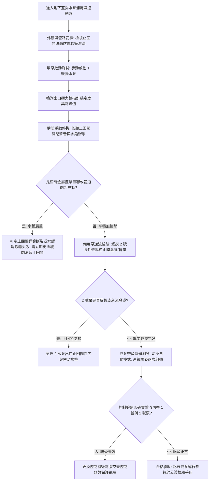

# 全案購屋實戰第八百三十二部：中古大樓社區地下室生活自來水雙泵揚水系統止回閥逆向洩漏低頻水錘震盪雙泵自動交替控制器故障與高樓層水塔溢流體檢工序全書

## 壹、 導言與實務體檢核心概述

在集合住宅中古電梯大樓之生活給水架構中，地下室受水箱至頂樓蓄水池之供水依靠**揚水泵浦系統（Lifting / Transfer Pump System）**。為確保供水不中斷，法規與水電工程規範均強制配置**雙泵備援系統（1用1備或雙泵並聯運行，Duty/Standby Dual Pumps）**，並由配電盤內之**自動交替運轉控制器（Alternating Relay / PLC 控制器）**實現每次啟動輪流交替運行，避免單一泵浦長期閒置受潮卡死。

在揚水管路高壓端（泵浦出口），必須安裝**消音緩閉式止回閥（Silent Check Valve / Non-Slam Check Valve）**與**水錘消除器**。依據流體動力學與水錘波傳遞理論（Joukowsky Equation）：

$$\Delta P = \rho \cdot a \cdot \Delta v$$

當揚水高度達 40 至 60 公尺（靜壓約 $4.0 \sim 6.0\ \text{kgf/cm}^2$），揚水泵浦停機瞬間，上升水柱因重力反轉下墜形成極大負壓與倒流回沖。若止回閥關閉遲緩（Slamming），下墜水體猛烈撞擊閥瓣，瞬時水錘衝擊波速 $a$ 可達 $1,000\ \text{m/s}$ 以上，產生高達 $15\ \text{kgf/cm}^2$ 之破壞性峰值壓力，沿垂直幹管引發整棟大樓「咚！咚！」的低頻結構共振。

在屋齡 20 至 35 年之中古社區中，止回閥彈簧疲勞斷裂、橡膠閥口磨耗產生「逆向洩漏（Back-leakage）」，導致剛抽上頂樓的高壓水大量倒流回地下室水箱，形成泵浦頻繁短週期啟動（Short Cycling）；若再加上雙泵交替電驛觸點氧化黏死，頂樓浮球開關訊號異常，揚水泵浦將徹夜不停盲抽，造成頂樓水塔水流狂溢、電梯機房淹水與泵浦馬達空轉燒毀之嚴重災難。

本手冊為買方提供揚水系統之標準化公設體檢工序。

---

## 貳、 雙泵揚水系統與止回閥失效機理剖析

### 一、 揚水止回閥逆流與毀滅性水錘機理
1. **內置彈簧疲勞與閥瓣卡滯：** 消音止回閥依靠不鏽鋼復位彈簧在水流流速降為零的「瞬間先期關閉」。歷經數萬次開閉，彈簧因金屬疲勞彈力衰退或水垢泥沙淤積於導向軸（Guide Stem），造成閥瓣關閉延遲，回沖水流推動閥瓣猛烈撞擊閥座，產生劇烈水錘震盪，撕裂管路支吊架（Pipe Hangers）與膨脹螺栓。
2. **密封面磨蝕與逆流倒灌：** 自來水中之砂礫高速沖刷閥座橡膠密封環（EPDM/NBR），使閥門喪失單向截流功能。當備用泵處於待命狀態時，運轉泵將高壓水經由備用泵之洩漏止回閥直接打回水箱，造成水泵做虛功、電費暴增且揚程不足。

### 二、 雙泵自動交替控制器與浮球電驛失效
1. **交替電驛（Alternating Relay）金屬接點電弧氧化熔死：** 機械式步進棘輪或微電腦交替繼電器常因配電盤潮濕引起接點氧化阻抗過高，卡死於單一迴路，導致「一泵操到燒毀、另一泵鏽死無法啟動」。
2. **頂樓電極棒／浮球開關（Float Switch）高水位信號失靈：** 水塔內電極棒水垢結晶短路，無法感測停水水位，揚水泵持續注水，高樓層水塔發生「瀑布式溢流」，順著樓梯間與排氣管道間漫延至各樓層住戶室內。

---

## 參、 現場實勘與機能檢測驗收標準工序（SOP）



### 一、 揚水雙泵機能實測四步法
1. **停機瞬態水錘衝擊聆聽法（Slamming Noise Audit）：**
   - 啟動 1 號揚水泵運轉至額定壓力（如 $5.0\ \text{kgf/cm}^2$）。
   - 按下「停止」按鈕，站在泵浦旁仔細聆聽止回閥閉合瞬間。
   - 合格標準：僅有輕微之「嗒」聲，管路無肉眼可見晃動。若伴隨「轟！咚！」之金屬撞擊巨響，且整支直管劇烈甩動，證明止回閥緩閉機制已失靈，隨時有爆管之虞。
2. **備用泵反轉逆流摸溫檢測（Back-spin & Temperature Check）：**
   - 在 1 號泵全速揚水時，檢視靜止之 2 號備用泵冷卻風扇。
   - 嚴禁出現逆向自轉現象（被逆流水流驅動反轉），且摸測 2 號泵止回閥後端管段，不應有高壓水倒灌之震顫水流感。
3. **自動輪替交替運行驗證（Alternating Logic Verification）：**
   - 將配電盤旋鈕切至「自動（AUTO）」檔位。
   - 人為短接「液位啟動接點」模擬水塔缺水，記錄 1 號泵啟動；斷開接點模擬水滿停機。
   - 再次短接接點，系統必須自動切換為 2 號泵啟動。若連續兩次均為同一泵浦運轉，確認交替電驛故障。
4. **馬達絕緣阻抗與三相平衡電流測量：**
   - 使用高阻計（Megger）量測馬達線圈對地絕緣阻抗，標準值必須大於 **$5\ \text{M}\Omega$**（老舊系統不得低於 $1\ \text{M}\Omega$）。
   - 使用鉗錶量測三相運轉電流，相間不平衡率應在 **$\pm 5\%$** 以內。

---

## 肆、 購屋合約防坑特約條款與修繕責任劃分

在中古成屋合約中，針對高樓層水塔溢流風險與地下室揚水供水系統，應明載保障條款：

```markdown
### 買賣契約防坑特別約定事項：公設揚水供水泵浦與水錘防護機能保證

1. 【給水揚水設備現況正常】：賣方保證本社區地下室生活自來水揚水泵浦系統（包含主備雙泵、消音止回閥、水錘消除器及控制配電盤）運轉正常，且雙泵自動交替輪值功能完好，管路無劇烈水錘撞擊震盪。
2. 【頂樓防溢流與漏水擔保】：若點交日前查驗發現揚水系統止回閥逆漏、交替控制器失靈或頂樓水塔溢流管洩漏者，賣方應負責協調社區管委會於交屋前完成修繕；因公共揚水系統溢流造成本戶室內裝潢天花板滲水損壞時，修復與損害賠償責任概由賣方承擔。
```

---

## 伍、 本專項工序體檢總結

自來水雙泵揚水系統是大樓每日生活水源的動脈推手，而消音止回閥則是阻擋數十噸下墜重力水柱衝擊波的最後盾牌。一旦止回閥失效引發低頻水錘，將持續震盪大樓結構梁柱並震裂管線。買方深入機房驗收雙泵輪替與停機水錘工序，是確保居家寧靜與長久免受漏水之苦的最高防線。
