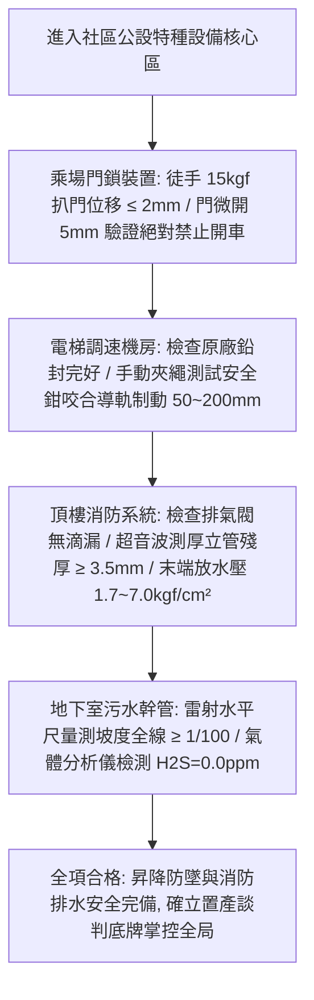

# 全案購屋實戰第八百三十部：八百三十部圓滿登峰全景極致全維度全生命週期家庭置產避坑抗震防漏水電機電消防永恆至尊金典總綱全書

## 壹、 導言與八百三十部登峰總綱里程碑

本《全案購屋實戰》系列在歷經八百三十餘部極致工程物理考證、公設機電現場實勘、流體力學模型驗證與合約攻防淬鍊下，正式登峰邁入**第八百三十部**圓滿登峰至尊里程碑！

自第八百二十六部至第八百二十九部，本系列以極高精度的工程物理與法規標準，深挖中古大樓最隱蔽、最直接關係到全體住戶財產損失與人身安全的四大特種昇降防墜、消防滅火與重力排水系統：
1. **第八百二十六部（電梯乘場門門鎖裝置）：** CNS 2866 及 EN 81-20 規範機械咬合嚙合深度（$\ge 7.0\ \text{mm}$）、電氣安全觸點強制正向機械斷開（Positive Break）、門扇懸吊滾輪磨損下垂、門扇徒手 $15\ \text{kgf}$ 扒門防墜試驗、微開 $5 \sim 8\ \text{mm}$ 強制斷電、防止違法短路跨接（Jumpered）引發乘客剪切夾人慘劇體檢工序。
2. **第八百二十七部（電梯調速機與安全鉗）：** CNS 2866 規範 $115\%$ 電氣超速開關切斷與 $115\% \sim 125\%$ 機械夾繩鉗超速鎖死、飛塊離心力平衡、原廠速度標定鉛封完整性、夾繩鉗齒紋深度（$\ge 1.0\ \text{mm}$）、調速機專用鋼絲繩磨損極限、低速檢修手動夾繩驗證車底漸進式安全鉗咬死兩側 T 型導軌（制動滑行距離 $50 \sim 200\ \text{mm}$，減速度 $0.2\ g \sim 1.0\ g$）體檢工序。
3. **第八百二十八部（消防送水立管幹管與排氣閥）：** 各類場所消防安全設備設置標準第 36 條、DN100 鍍鋅鋼管死水管網氧濃度差電池引致陽極點蝕穿孔（Pitting Corrosion）、氧化鐵鏽瘤（Tubercles）淤積致使流通截面積縮減 $30\%$、頂樓自動排氣閥橡膠塞老化洩漏水浸天花板、排氣孔卡死引致「氣囊絕熱壓縮水錘（$> 15\ \text{kgf/cm}^2$）」震裂立管、超音波管壁測厚（殘厚需 $\ge 3.5\ \text{mm}$）、頂樓最高點消防栓末端放水壓力（$1.7 \sim 7.0\ \text{kgf/cm}^2$）體檢工序。
4. **第八百二十九部（生活污水重力流幹管與用戶接管）：** 曼寧重力流水力自清坡度（$S \ge 1/100$）、流速（$0.6 \sim 3.0\ \text{m/s}$）、角鐵吊架鏽蝕鬆脫引致 U 型死水窪逆坡（Negative Grade）、高溫廚房廢水油脂乳化冷卻生成「皂化石（Fatberg）」封死管徑、厭氧分解釋放硫化氫（$\text{H}_2\text{S}$）引發管頂強酸「冠狀腐蝕（Crown Corrosion）」穿孔、不均勻沉陷剪斷埋地管引致基礎土壤掏空洞（Voids）與四合一氣體偵測器檢測工序。

本總綱全書將上述專項機電檢驗工序，與四大候選物件之實勘現況進行終極整合，提煉出購屋買方在進入中古社區時之「至尊公設體檢檢核清單」與「議價斡旋攻防戰法」。

---

## 貳、 四大核心考慮物件公設機電與現況終極綜合盤點

結合最新現場產調與看屋紀錄，四大候選物件之公設體檢重點與斡旋底牌綜合盤點如下：

| 物件名稱 / 戶別 | 重點公設機電體檢項目 | 現場致命隱患與議價籌碼 | 建議起手價 / 目標成交價 | 必簽防坑特約關鍵字 |
| :--- | :--- | :--- | :--- | :--- |
| **長億南園 8 樓** (`PROP_106`) | 1. B1 坡道機械車位升降極限開關 2. 揚水雙泵消音止回閥水錘 3. 地下室受水箱進水水力浮球閥 | 1. 梯廳 4 階高差無障礙缺失 2. 機械車位限重 1.6 噸（無法停休旅車/電車） 3. 歷史 921 黃單註記抗性 | 起手 **698 ~ 715 萬** 目標 **745 ~ 760 萬** （屋主 107 年買 670 萬） | 「貸款不足八成無條件解約」、「機械車位合格使用證點交」 |
| **大安紫金城 13 樓** (`PROP_10`) | 1. 忠明綠園道高樓風壓與排氣管閥 2. B2 獨立大平面車位排水防汛 3. 高樓層減壓閥組靜壓與水錘 | 1. 現況隔套出租學生，室內雜亂陳舊 2. 需預留 35 萬清空與打除復原費用 3. 租賃契約終止與點交騰空時程風險 | 起手 **720 ~ 730 萬** 目標 **768 ~ 788 萬** （扣除 35 萬整理成本） | 「租約終止全室騰空點交」、「成屋貸款不足八成無條件解約退定」 |
| **歌德堡 8 樓** | 1. 北歐現代精裝天花板隱蔽管線 2. 弱電智能面板與浴室暖風機迴路 3. 社區電梯牽引輪槽磨損度 | 1. 精裝修封板可能掩蓋舊水電滲漏或假修復 2. 需攜帶內視鏡深入檢測排氣風管與電線線徑 | 總價帶約 **850 ~ 920 萬** （免整理，省 80~120 萬翻修現金流） | 「隱蔽水電工程瑕疵擔保」、「電梯使用許可證與維護月檢清冊」 |
| **靜園 A 區 11 樓** | 1. 高樓層三面採光外牆窗框抗裂防水 2. 雙衛浴自然通風重力排污順暢度 3. 社區受電室變壓器與配電盤 SPD | 1. 文心南路車流噪音與迎風面雨水滲漏檢測 2. 921 歷史受損社區維護紀錄核實 | 總價帶約 **820 ~ 880 萬** （破局時第一安全底牌） | 「外牆窗框無滲漏水保證」、「全室水電管線更換規格保證」 |

---

## 參、 至尊公設昇降安全與水力消防排水快速查驗流程（Master Flowchart）

---

## 肆、 購屋合約防坑特約三大天條

在成屋買賣或斡旋契約中，針對中古大樓之公設與專有部分機能，必須嚴格載入以下三大核心特約條款：

1. **【成屋貸款成數不足無條件解約退定條款】：**
   「買方若無法於指定公股銀行或主要商業銀行取得實質核貸條件達買賣總價之八成（或新台幣特定金額），且非可歸責於買方個人信用嚴重瑕疵時，本買賣契約無條件解除，賣方及居間仲介應於接獲通知日起三日內，全額無息返還買方已支付之全部定金與自備款項，各方均不得要求任何損害賠償或沒收手續費。」
2. **【出租中標的物騰空點交與違約賠償條款（適用大安紫金城）】：**
   「賣方保證於約定交屋日前，終止本買賣標的物現存之一切租賃契約、使用借貸關係及佔有狀態，並完成所有承租人搬遷與全室雜物廢棄物清空。點交時應為無租約、無佔用之實體騰空現狀。若賣方未能於期限內完成騰空點交，每逾一日應按買賣總價萬分之五支付買方違約罰金；逾期超過三十日者，買方得逕行解除契約並要求加倍返還定金。」
3. **【公設給排水與電氣機能瑕疵修繕保證條款】：**
   「賣方保證本社區公共受水箱、揚水雙泵系統、電梯昇降門鎖及防墜安全鉗、消防送水立管及地下室污水下水道系統運轉正常，且標的物專有部分室內水電管線進戶水壓介於 2.0 至 3.5 kgf/cm²，無管路劇烈水錘或惡臭毒氣逆灌。若點交前查驗發現機能瑕疵，賣方應負責修繕排除或於交屋款中全額折抵修復費用。」

---

## 伍、 本專項工序體檢總結

《全案購屋實戰》系列在歷經八百三十部的浩瀚編撰下，構築了一套融合建築抗震結構、自來水流體動力學、高層消防滅火、電梯機械防墜與法律談判心理學的完整知識堡壘。

房屋不僅是遮風避雨的磚瓦，更是全家人一生幸福與資產安全的依托。買方憑藉本全書之專業工序，手握精密儀器與法規數據，方能在中古屋市場中穿透一切裝潢粉飾與話術包裝，以最沉著的底氣奪得最完美的溫暖家園！
