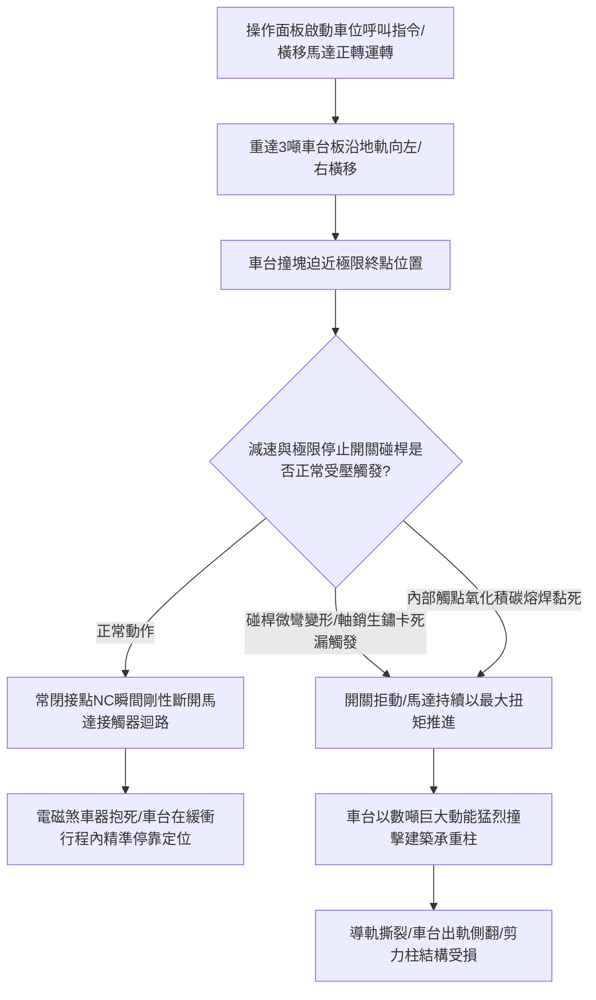

# 全案購屋實戰第八百九十七部：中古大樓社區地下室機械停車設備車位限位極限開關碰桿變形接點氧化短路與橫移車台衝撞邊柱體檢工序全書

## 壹、編撰宗旨與立體機械泊車動態幾何防撞防線

在現代集合住宅大樓（特別是屋齡 20 年至 35 年以上之中大型中古社區，例如台中南區的長億南園、大安紫金城、歌德堡、工學天下、靜園等）的地下停車場中，為在有限的地下室地坪上追求法定停車位數量的最大化，極為普遍地安裝了「升降橫移式機械立體停車設備（Puzzle Parking System）」或「多層多列循環式機械車位」。

此類機械泊車設備依靠電動機、減速機、鏈條鏈輪以及鋼製軌道，日夜不停地將停載著大型休旅車（SUV）與各型轎車（車載總重常達 $2.0 \sim 3.0\text{ 噸}$）的金屬車台板（Pallet），在狹窄的地下室柱網空間內進行高精度的「垂直升降」與「水平橫移」。

而在這個龐大金屬重型機械的精準定位體系中，擔任「位置感知大腦與行程煞車終點站」的核心電氣元器件，正是安裝於鋼骨導軌與橫移樑兩端的「行程限位極限開關（Position Limit Switches / Over-travel Limit Switches）」。

極限開關是機械車位的「防撞紅外線與機械停靠錨」。

然而，在中古大樓長達 20 至 35 年的潮濕地下室環境中，機械車位極限開關長態承受著車輛輾壓的強烈衝擊震動、地下室水氣與油污粉塵的侵蝕，極其普遍地面臨三大致命災難隱患：
1. **極限開關金屬滾輪碰桿（Roller Lever Arm）因車台長期偏載撞擊產生塑性微彎曲變形，或轉軸軸銷生鏽卡滯**，導致車台在橫移至極限終點時，碰桿無法被車台撞塊（Cam Striker）順暢壓下，極限開關完全「漏觸發拒動」；
2. **微動開關內部銀合金觸點受空氣氧化、電弧積碳或外殼密封膠圈脆化進水，產生接點氧化接觸不良，甚至內部微動彈片疲勞「熔焊短路黏死」**，控制系統誤判開關處於非動作狀態；
3. **一旦橫移行程極限開關失靈，三相減速馬達將持續以全額扭矩強行推進，重達數噸的金屬車台將直接以時速數公里之動能「暴走衝出軌道、猛烈衝撞地下室鋼筋混凝土承重柱與側邊壁體」**！強烈撞擊瞬間將車台鋼骨擠壓扭曲變形、車輛自車台上滑脫翻覆砸毀下方車輛，甚至震裂大樓地下結構承重剪力柱，釀成無法挽回的重大人身與資產滅頂浩劫！

本手冊針對中古社區地下室機械停車設備橫移與升降極限開關、減速碰塊、電氣連鎖控制迴路及防衝撞機械阻擋器，深入解剖動量撞擊力學、開關行程幾何餘量分析、接觸電阻電氣特性及全流程現場實務體檢工序，為購屋家庭與管委會建立固若金湯的立體泊車安全防線。

---

## 貳、機械車台橫移動力學與極限開關動作幾何架構

### 一、橫移車台動能與衝擊碰撞力學方程式
機械車台在地下室水平橫移時，通常由小型臥式三相齒輪減速馬達（功率約 $0.4\text{ kW} \sim 0.75\text{ kW}$）驅動鋼輪沿地表金屬槽鋼軌道滾動，額定橫移速度通常為 $V_{\text{traverse}} \approx 0.1 \sim 0.15\text{ m/s}$（約 6~9 m/min）：
1. **車台全載運動動量與動能**：
   車台板自重 $M_{\text{pallet}} \approx 800\text{ kg}$，搭載一台大型休旅車或純電車 $M_{\text{car}} \approx 2200\text{ kg}$，總運動質量高達：
   $$M_{\text{total}} = 800 + 2200 = 3000\text{ kg} \quad (\approx 3.0\text{ 噸})$$
   其全速運動時之動能為：
   $$E_k = \frac{1}{2} M_{\text{total}} V^2 = \frac{1}{2} \times 3000 \times (0.15)^2 \approx 33.75\text{ J}$$
2. **剛性衝撞極限衝擊力計算（動量定理 Impulse-Momentum Theorem）**：
   當極限開關失靈、馬達未斷電時，車台以額定速度直接撞擊剛性混凝土邊柱。若減震橡膠墊已老化粉碎，金屬與混凝土之碰撞緩衝時間極短（$\Delta t \approx 0.01\text{ 秒}$），加之馬達堵轉極限扭矩（$T_{\text{stall}} \approx 2.5 \ T_{\text{nominal}}$）的持續強烈推擠，產生的瞬間衝擊力 $F_{\text{impact}}$ 高達：
   $$F_{\text{impact}} = \frac{M_{\text{total}} \cdot V}{\Delta t} + F_{\text{motor\_push}} = \frac{3000 \times 0.15}{0.01} + 15000 \approx 60,000\text{ N} \quad (\approx 6.0\text{ 公噸重} / 60\text{ kN})$$
   高達 6 噸的剛性動態衝擊載荷，足以瞬間撞裂 4000 psi 混凝土保護層、剪斷導軌固定地腳螺栓，將車台鋼骨扭曲成平行四邊形廢鐵！

### 二、雙重行程限制幾何配置與安全餘量（Over-travel Margin）
依據 CNS 13350（機械式停車設備安全規範），水平橫移與垂直升降機構必須具備「雙階梯式限位保護」：
1. **第一級：常規工作停止極限開關（Normal Stop Limit Switch）**：
   當車台抵達指定停靠泊位時觸發，切斷馬達運行電源，電磁制動器抱死；
2. **第二級：極限超越安全開關（Over-travel Safety Limit Switch）**：
   設置於常規停止位置後方 **$20 \sim 30\text{ mm}$ 處**。若第一級開關因接點黏焊或機械卡阻失靈，車台繼續滑移時，第二級極限開關必須被剛性壓下，直接切斷整座控制盤之「總安全電源接觸器（Main Safety Contactor）」，並鎖定系統發出緊急聲光警報；
3. **第三級：機械剛性防撞阻擋器（Mechanical End-stop Buffer）**：
   在軌道終端牢固焊接厚度不小於 $16\text{ mm}$ 之鋼製擋塊，並襯墊厚度 $\ge 50\text{ mm}$ 之高彈性聚氨酯（PU）防撞橡膠塊。

---

## 參、中古社區機械車位極限開關三大核心病徵與失靈成因

### 一、滾輪碰桿金屬塑性彎折變形與「漏觸發空擦」
1. **車台偏載震盪衝擊**：住戶休旅車停入車台時若偏向一側，橫移時車台在軌道上產生微幅偏航蛇行（Yawing）。安裝於車台側面的撞塊（Cam Striker）以非正常角度斜向劇烈撞擊極限開關的滾輪碰桿。
2. **碰桿角度偏位導致擦肩而過**：厚度僅 2~3mm 的不銹鋼或鑄鋁碰桿在反覆斜向衝擊下載荷超標，產生永久塑性彎折變形（彎角達 $10^\circ \sim 20^\circ$）。當車台橫移至終點時，撞塊只是輕輕擦過變形的滾輪邊緣，無法將碰桿下壓至觸發深度（預行程 Pre-travel 不足），開關完全不動作，車台長驅直入撞擊邊柱！

### 二、微動開關接點氧化、積碳與內部彈片「熔焊短路」
1. **微電弧電蝕與高阻抗膜**：極限開關通常直接串聯在接觸器線圈迴路中（AC 110V/220V）。開關分斷瞬間，線圈電感釋放反向電動勢產生微小電弧，使銀合金接點產生電蝕凹坑與黑褐色氧化層。
2. **接點熔焊黏結引發開路失效**：在經歷數萬次通斷後，接點金屬在高溫電弧下發生局部熔化，常閉接點（NC）在微觀下被「熔焊冷凝在一起」。當碰桿被外力機械壓下時，內部彈片根本無法跳開，電路持續導通，控制系統被盲目欺騙，馬達持續通電狂推。

### 三、外殼 IP 防護密封膠圈硬化進水與內部機構生鏽抱死
1. **地下室潮氣凝露侵入**：地下停車場常年濕度高達 $85\% \sim 95\%$，洗車水與地面拖地水常濺至導軌兩側。極限開關橡膠電纜防水接頭（Cable Gland）與外殼密封墊老化硬化失去彈性，水氣在開關內部凝結成積水。
2. **回位扭簧與轉軸紅鏽卡死**：開關內部不銹鋼或高碳鋼回位扭簧生鏽斷裂，滾輪轉軸被紅鏽咬死。一旦碰桿被壓下一次後，便永遠卡在動作位置「無法自主回彈復位」，下次車台反向運轉時系統立即報警死機，或機構脫扣引發連環碰撞。

---

## 肆、機械車位極限開關與防撞系統標準體檢工序

### 一、機械碰桿幾何角度、嚙合深度與外觀檢測
1. **碰桿外觀與旋轉軸銷查驗**：
   - 走入機械車位底坑與軌道兩側，尋找所有橫移與升降極限開關。
   - 使用乾淨棉布擦拭開關表面油泥，檢視金屬滾輪碰桿有無彎曲、偏斜、裂紋；檢查滾輪表面有無磨平刮傷，用手撥動滾輪確認其在軸上能**自由靈活旋轉無卡滯**。
2. **撞塊與滾輪幾何嚙合量測（Overlap Measurement）**：
   - 操作車台以點動方式緩慢逼近極限位置。
   - 使用游標卡尺測量車台金屬撞塊與極限開關滾輪的幾何接觸重疊寬度：
     - **合格標準**：撞塊工作面與滾輪接觸寬度必須 **$\ge 12.0\text{ mm}$**，且撞塊壓下滾輪的垂直深度必須達到開關規定的「額定動作行程（通常為 $15^\circ \sim 30^\circ$ 擺角，行程深度 $\ge 8.0\text{ mm}$）」；
     - 壓到底後，開關必須保留至少 **$3.0\text{ mm}$ 的超行程安全餘量（Over-travel Margin）**，嚴禁撞塊將碰桿硬生生「壓死到底折斷」！

### 二、極限開關電氣接點通斷與接觸電阻實測
1. **常閉接點（NC）強制斷開電阻檢測**：
   - 切斷車位控制主電源，拔除待測極限開關端子排連線。
   - 三用電表接至常閉接點（NC 1-2 端子）：
     - **自由未觸發狀態**：接觸電阻必須 **$< 0.3\,\Omega$**；
     - **用手推動碰桿動作瞬間**：電路必須**立即堅決斷開（電阻瞬間升至無窮大 $\infty$）**，且用手緩慢釋放碰桿時，機構必須在 $0.1\text{ 秒}$ 內清脆彈回導通，絕不得有任何黏滯阻滯現象。
2. **絕緣電阻（Megger Test）檢驗**：
   - 使用 500V 高阻計量測開關接線端子與金屬外殼（PE 接地端）之間的絕緣電阻。
   - **標準判定**：絕緣電阻必須 **$\ge 20\text{ M}\Omega$**；若低於 $2\text{ M}\Omega$，代表內部已嚴重受潮凝露進水，必須整只換新。

### 三、低速點動動態防撞與第二級極限連鎖驗收
1. **第一級工作停止開關動態測試**：
   - 空載操作車台以正常速度向邊柱方向橫移。
   - 當車台觸碰第一級極限開關瞬間：
     - **合格判定**：橫移馬達必須立即斷電，電磁煞車器抱死，車台平穩停靠；
     - 測量車台邊緣與建築承重柱之間的殘餘安全淨空距離，**絕對不得小於 $100\text{ mm}$**！
2. **第二級超越極限（Over-travel）連鎖跳脫模擬驗收**：
   - 人為將第一級開關短接（模擬第一級失靈故障），操作車台繼續向極限方向慢速點動推進。
   - 當車台撞塊觸碰第二級極限開關瞬間：
     - **安全鐵律**：控制盤總電源接觸器必須瞬間跳脫斷電，中控室聲光警報大作，整座車位系統進入「故障鎖死狀態」；
     - 檢查車台與終端機械防撞橡膠塊之接觸：車台必須在撞上橡膠塊之前停止、或僅輕微貼靠，鋼結構絕對不得有任何塑性變形。

---

## 伍、購屋避坑指南與管委會整改預算表

### 一、買方看屋機械車位防撞安全查核 4 訣
1. **蹲下檢視軌道終端承重柱表面有無撞擊刮痕**：
   - 走到機械車位橫移最邊側，仔細觀察旁邊的大樓混凝土承重柱與牆壁表面。若柱體油漆大面積剝落、甚至混凝土保護層被撞出凹坑缺角、鋼筋裸露，代表該車位曾發生過「極限開關失靈衝撞邊柱」之重大事故！
2. **親自操作車位橫移觀察停靠時有無劇烈衝擊**：
   - 請屋主或房仲現場操作機械車位按鈕，將所屬車位橫移就位。
   - 仔細觀察車台滑行至終點停靠時的姿態：車台應平順減速軟著陸停下；若車台是「砰」地一聲猛烈撞擊機械擋塊才被動停下、伴隨整座金屬鋼架劇烈顫抖，代表限位開關早已位移失效。
3. **俯身檢視極限開關外殼橡膠防塵套有無破損**：
   - 檢視安裝於地表導軌兩端的極限開關。若外殼塑料破裂、金屬外殼鏽成紅褐色、電線裸露用絕緣膠帶隨意纏繞，代表設備長期缺乏專業保養。
4. **查閱機械車位定期保養紀錄簿之「極限開關測試」**：
   - 依據法規，機械停車設備每個月必須進行一次定期安全保養。確認保養紀錄單上是否有針對「升降/橫極限開關」、「超程防撞開關」確實逐一勾選檢驗。

### 二、機械停車設備極限開關系統專項維修更新預算參考清單

| 維修／改善工程項目 | 技術規範與標準工法 | 預算區間（每台／每處） | 安全重要度等級 |
| :--- | :--- | :--- | :--- |
| **重載型雙迴路防水極限開關全組換新（IP67）** | 歐姆龍（Omron）/天得鑄鋁防爆型滾輪碰桿開關 | 1,800 ~ 3,200 元／只 | 極高（碰桿變形必換） |
| **增設第二級超越極限（Over-travel）安全開關系統** | 獨立安全迴路微動開關 + 斷電連鎖接觸器套件 | 3,500 ~ 6,500 元／泊位 | 緊急極高（防止衝撞邊柱） |
| **軌道終端高彈性聚氨酯（PU）防撞緩衝阻擋塊增設** | 厚度 50~80mm 模鑄高阻尼 PU 緩衝橡膠塊 + 鋼座 | 2,500 ~ 4,500 元／處 | 極高（最後一道防線） |
| **車台撞塊（Cam Striker）位置校正與加固焊接** | 8mm 厚熱鍍鋅鋼板撞塊校平 + 加長受碰行程面 | 1,500 ~ 2,500 元／處 | 高度 |
| **極限開關訊號傳輸屏蔽耐油電纜全線重鋪** | RVVP 3×0.75mm² 耐油耐寒高柔性屏蔽控制電纜 | 2,000 ~ 3,500 元／台 | 中度（根治訊號干擾） |
| **全座機械車位雷射水平導軌校正與防出軌檔板加裝** | 導軌水平度與平行度校正（$<2mm$） + 防跳軌勾板 | 12,000 ~ 22,000 元／組 | 專業推薦（徹底消除卡軌） |

---

## 陸、本案結語

在寸土寸金的現代都會地下室，立體機械停車設備承載著家庭數百萬元的名貴座駕與出入平安。在那動輒數噸重的金屬車台高速穿梭的背後，一枚看似不起眼的極限開關，就是守護愛車免遭粉身碎骨、阻絕車台撞擊大樓地基大樑的「最後煞車金錨」。

購屋家庭在評估附帶機械車位的物件時（如長億南園等社區），務必將體檢視角延伸至這些隱匿於軌道邊緣的電氣碰桿與終端緩衝器。唯有確保極限開關感知靈敏如鷹隼、機械防撞屏障固若金湯，才能讓全家人在每一次泊車入庫的起居之中，享有真正萬無一失的踏實與從容！
