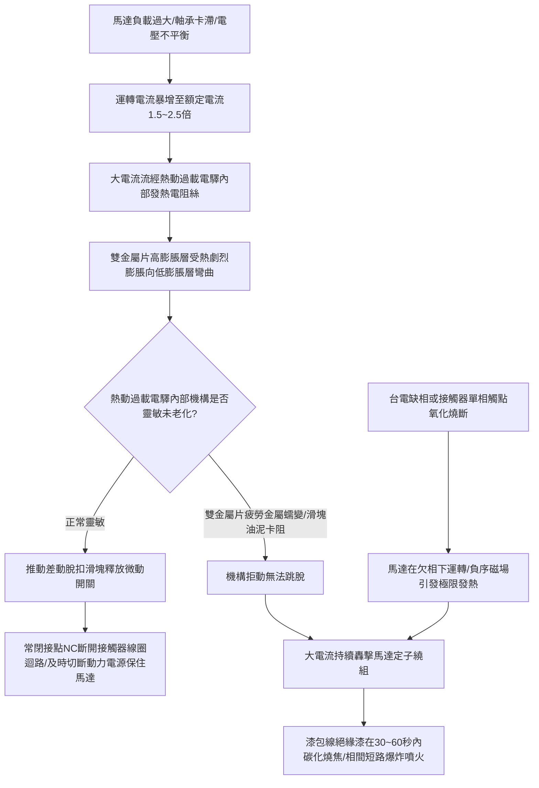

# 全案購屋實戰第八百九十三部：中古大樓社區低壓配電盤電磁接觸器主觸頭氧化電弧熔焊熱動過載繼電器失準與動力設備缺相燒毀體檢工序全書

## 壹、編撰宗旨與強電動力控制心臟之極限安全防禦

在現代集合住宅大樓（特別是屋齡 20 年至 35 年以上之中高齡中古大樓社區，例如台中南區的大安紫金城、長億南園、歌德堡、工學天下、靜園等）的強電動力控制體系中，整座社區的公設生命線——包含地下室自來水揚水泵浦、污水排污泵浦、消防加壓泵浦、地下室排風機以及電梯動力主機，其三相交流動力電源（$3\phi \ 220\text{V} / 380\text{V}$）之頻繁啟動、停止與正反轉切換，全數仰賴安裝於各動力控制盤內部的「交流電磁接觸器（Magnetic Contactor, MC）」。

而為防止馬達在高負載下過熱燒毀，接觸器下方通常緊密串接一只「熱動過載繼電器（Thermal Overload Relay, TH-RY / TOR）」，共同組合成一套經典的「電動機啟動保護器（Magnetic Motor Starter, MS）」。

電磁接觸器與熱動過載電驛，本質上是整棟大樓動力心臟的「電氣開關與過熱保險絲」。

然而，在中古大樓長達數十年的頻繁運轉中（如揚水泵浦每日啟停數十次，排污泵浦與排風機頻繁交替），這套強電控制元器件面臨極其殘酷的電熱電弧衝擊與機械磨損，常態潛伏著三大毀滅性災難隱患：
1. **電磁接觸器主觸頭（Main Contacts）銀合金層在承受高感性馬達啟動湧浪電流與切斷反電動勢時，遭受強烈電弧（Electric Arc）反覆燒蝕，產生嚴重氧化積碳與接觸面凹凸不平，最終在高溫下發生致命的「主觸頭熔焊黏死（Contact Welding）」**。此時接觸器線圈即使斷電，機械機構仍無法彈開，導致受水箱泵浦持續狂抽、水塔溢流滅頂，或排風機失控狂轉過熱自燃；
2. **熱動過載繼電器內部雙金屬片（Bimetallic Strip）在經歷數十年微熱烘烤後產生嚴重的金屬蠕變（Creep）與彈簧疲勞失準**，其保護特性曲線發生劇烈漂移。當馬達遭遇過載時，過載電驛「拒絕跳脫（Failure to Trip）」，喪失熱保護功能；
3. **更具毀滅性的是「三相電源缺相（Phase Loss / Single Phasing）」**。當台電外線保險絲熔斷一相、或接觸器單相主觸頭因氧化燒斷時，三相馬達被迫在「缺一相（單相）」狀態下勉強運轉。由於旋轉磁場畸變，馬達定子線圈電流瞬間暴增至額定電流的 **$1.5 \sim 2.5\text{ 倍}$**。若熱動過載電驛缺乏差動欠相保護（Differential Phase Failure Mechanism）或已老化卡死，高達數萬元的三相馬達定子繞組將在 **$30 \sim 60\text{ 秒}$ 內完全燒焦碳化**，引發控制箱爆裂噴火，導致全社區公設供水與通風徹底癱瘓！

本手冊針對中古社區各類動力控制盤電磁接觸器、滅弧室、熱動過載電驛及欠相保護電路，深入剖析電弧等離子體物理學、雙金屬片熱應力彎曲方程、三相不平衡對稱分量法（Symmetrical Components），並制定一套高標準之全流程現場體檢與電氣量測工序，為購屋家庭與管委會建立固若金湯的動力設備強電安全屏障。

---

## 貳、交流電磁接觸器滅弧流力學與熱過載雙金屬片物理機制

### 一、交流電磁系統吸合與高感性負載電弧物理
交流接觸器主要由鐵芯（靜鐵芯與動銜鐵）、短路環（Shading Coil）、電磁線圈、反力彈簧、動靜主觸頭及耐弧滅弧罩構成：
1. **電磁吸力與交變磁通力學**：
   線圈通入交流電後，鐵芯內部磁通 $\Phi = \Phi_{\max} \sin(\omega t)$。電磁吸力 $F_{\text{mag}}$ 隨時間平方波動：
   $$F_{\text{mag}} = \frac{\Phi^2}{2 \mu_0 A} = \frac{\Phi_{\max}^2}{4 \mu_0 A} [1 - \cos(2\omega t)]$$
   為防止吸力每秒 120 次過零時銜鐵震動發出強烈「嗡嗡噪聲」與觸點彈跳，靜鐵芯端面嵌有銅質「短路環」，利用感應電流產生相位差約 $90^\circ$ 的次級磁通，使合成電磁吸力始終大於反力彈簧阻力，維持平穩吸合。
2. **感性負載斷開電弧等離子體能量**：
   馬達定子繞組為強電感性迴路（$\text{PF} \approx 0.8$）。觸頭分開瞬間，儲存在磁場中的能量 $E = \frac{1}{2} L I^2$ 釋放，在兩觸點間微米級間隙感應出極高的反電動勢（$\mathcal{E} = -L \frac{di}{dt}$），擊穿空氣介質形成溫度高達 **$4,000^\circ\text{C} \sim 6,000^\circ\text{C}$ 的高溫等離子電弧**。
   - 優質接觸器配備金屬消弧柵片，利用電弧自感磁場將電弧拉長切入柵片冷卻，在交流電流首次過零點（Current Zero）徹底滅弧；
   - 若短路環斷裂或觸頭彈性疲勞，閉合瞬間產生微秒級「觸頭彈跳（Contact Bouncing）」，在動態微間隙中產生劇烈電弧熔融銀合金表面，冷卻時動靜觸頭直接「熔焊成一體」。

### 二、熱動過載電驛雙金屬片熱力學彎曲方程
熱動過載電驛的核心感應元件是由兩層具有不同熱膨脹係數的金屬片（高膨脹層通常為鐵鎳鉻合金，低膨脹層為因瓦合金 Invar）在高溫高壓下軋製而成的「雙金屬片」：
1. **自由端熱彎曲位移公式（Timoshenko 雙金屬片理論）**：
   當溫度升高 $\Delta T$ 時，雙金屬片自由端產生的側向熱彎曲位移 $Y$ 為：
   $$Y = \frac{3 \cdot (\alpha_2 - \alpha_1) \cdot L^2 \cdot \Delta T}{4 \cdot t}$$
   其中：
   - $\alpha_2, \alpha_1$ 分別為高膨脹層與低膨脹層之線膨脹係數；
   - $L$ 為雙金屬片之受熱有效長度；
   - $t$ 為雙金屬片之總厚度；
   - $\Delta T$ 為工作電流通過電阻加熱絲所產生的溫升（$\Delta T \propto I^2 R$）。
2. **反時限保護特性曲線（Inverse Time Characteristic）**：
   電流越大，發熱功率 $I^2 R$ 越高，雙金屬片達到脫扣位移所需的時間越短（例如 $1.2 \ I_{\text{setting}}$ 需時約 20 分鐘跳脫，而 $6 \ I_{\text{setting}}$ 啟動堵轉電流僅需 $5 \sim 10\text{ 秒}$ 即可迅速跳脫），精準模擬馬達自身的發熱耐受極限。

---

## 參、中古社區電磁接觸器與過載系統三大核心病徵與失靈成因

### 一、電磁接觸器主觸頭氧化、電弧熔焊黏死（Runaway Disaster）
1. **銀鎢/銀鎳合金氧化與有效導電截面崩潰**：在 20 多年的數十萬次啟閉電弧轟擊下，主觸頭表面的銀成分大量揮發，表面轉化為高電阻率的金屬氧化層與焦黑積碳。接觸電阻劇增引發觸頭自身劇烈發熱，表面溫度常達 $90^\circ\text{C} \sim 130^\circ\text{C}$。
2. **熔焊黏死引發災難性失控**：當揚水泵浦將頂樓水塔打滿水、液位控制器發出停機指令時，接觸器線圈斷電，但熔焊黏結的動靜觸頭使三相動力電源依然持續接通！揚水馬達無法停機瘋狂打水，數百噸自來水自水塔通氣孔與人孔蓋噴湧而出，水流自梯間瀑布般向下狂瀉灌入電梯井道，造成電梯控制主機全部報廢！

### 二、短路環斷裂、動鐵芯磨損與震天動地的「交流嗡嗡噪聲」
1. **短路環（Shading Ring）疲勞振斷**：嵌入靜鐵芯端面的紫銅短路環，承受長達 20 年的交變磁場機械震動，焊點或轉角處產生金屬疲勞脆斷。短路環一旦斷裂，次級移相磁通消失，交流電磁吸力在每個半波過零點降為零。
2. **極限高頻振動與線圈燒毀**：動鐵芯以每秒 120 次的頻率猛烈撞擊靜鐵芯，控制箱內傳出極端刺耳如電鑽般的「高頻金屬嗡嗡噪聲」。強烈機械震動直接將接觸器內部塑膠骨架震裂、主觸頭彈跳加劇，並使吸合線圈因過熱而在數小時內冒煙燒斷。

### 三、熱動過載電驛金屬蠕變失準與「單相缺相燒馬達」
1. **雙金屬片常年熱蠕變疲勞**：控制盤內部常年悶熱，過載電驛內部雙金屬片長期處於受熱微彎狀態，產生不可逆的金屬應力鬆弛，預緊彈簧彈力衰退，整定電流刻度與實際動作點產生高達 $30\% \sim 50\%$ 的嚴重偏差。
2. **欠相運轉（Single-phasing）在數十秒內燒毀定子線圈**：當大樓供電線路因外線施工跳脫一相、或接觸器三相觸頭中某一相因電弧燒蝕斷開時，馬達陷入缺相運轉。此時馬達輸出扭矩銳減，轉差率激增，定子繞組內部產生強大的「負序磁場（Negative Sequence Field）」，引發定子電流飆升至額定值的 2 倍以上。若熱動電驛缺乏三相差動平衡槓桿或已卡死，馬達定子絕緣漆在 $180^\circ\text{C}$ 高溫下瞬間炭化冒煙，數萬元的馬達徹底燒毀報廢！

---

## 肆、電磁接觸器與熱過載電驛標準體檢工序

### 一、安全斷電隔離、消弧罩拆卸與觸頭微觀查驗
1. **動力電安全斷電作業（LOTO）**：
   - 切斷待測控制盤上游無熔絲斷路器（NFB/MCCB），掛上「檢修中嚴禁送電」標誌牌。
   - 使用數位驗電表嚴格驗證接觸器進線端 R-S-T 三相電壓絕對為零。
2. **消弧罩取下與動靜觸點無損查驗**：
   - 卸下接觸器頂部耐高溫消弧罩，使用強光手電筒與高倍放大鏡檢視動觸頭與靜觸頭表面：
     - **優良等級**：觸點表面平整，呈均勻金屬銀灰色，燒蝕斑點面積小於 $20\%$。
     - **警戒等級**：表面呈現明顯凹凸不平黑褐色氧化層，觸點金屬厚度磨損達 $30\% \sim 50\%$。
     - **報廢標準**：觸頭銀合金層完全燒失露出底層紅銅基體、兩端出現明顯熔焊拉扯金屬毛刺，或手動按壓銜鐵時動靜觸頭「超程（Over-travel）」小於 **$1.0\text{ mm}$**，必須立即更換觸頭組件或整組更換接觸器！
3. **微歐姆表量測主觸頭接觸電阻**：
   - 手動完全壓合接觸器銜鐵，使用數位微歐姆表（Micro-ohmmeter）分別量測 R-S-T 三相主觸點接觸電阻。
   - **標準合格值**：三相接觸電阻均應 **$< 30\text{ m}\Omega$**，且三相阻值不平衡率必須小於 **$10\%$**。若單相電阻超過 $50\text{ m}\Omega$，代表接觸面已嚴重氧化發熱。

### 二、熱動過載繼電器手動測試與整定電流核驗
1. **整定電流值（Current Setting）精確核對**：
   - 檢視熱動過載電驛正面的圓形整定旋鈕。
   - 查閱所保護馬達之金屬銘牌標稱之「額定滿載電流（FLA, Full Load Amps）」。
   - **標準整定準則**：過載電驛整定電流 $I_{\text{setting}}$ 必須嚴格設定在馬達額定滿載電流的 **$1.0 \sim 1.05\text{ 倍}$**（嚴禁部分不肖水電工將旋鈕隨意旋至最大值以防止跳脫，那是導致馬達燒毀的自殺行為！）。
2. **機械手動脫扣功能（Test Trip Button）驗收**：
   - 用小型螺絲起子撥動過載電驛標有「TEST」或「TRIP」之紅色/綠色手動測試按鈕。
   - **合格判定**：脫扣機構必須立即發出清脆的「喀嗒」彈跳聲，彈出黃色或紅色故障指示旗標；同時使用三用電表測量常閉接點（NC 95-96）必須**瞬間斷開（電阻無窮大）**，常開警報接點（NO 97-98）必須**可靠導通**。
3. **手動復位與自動復位切換驗收**：
   - 按下藍色復位鈕（RESET），機構必須在 $0.1\text{ 秒}$ 內完全復位定位。

### 三、三相負載運轉電流、溫度與欠相模擬實測
1. **運轉三相電流平衡度檢測**：
   - 啟動動力設備運轉，使用校準之 True-RMS 數位交流鉤表測量三相運轉電流 $I_R, I_S, I_T$。
   - 計算 NEMA 三相電流不平衡率，**實測不平衡率絕對不得大於 $5\%$**。
2. **紅外線熱影像接觸器溫升掃描**：
   - 設備全載運轉 30 分鐘後，使用紅外線熱像儀掃描接觸器主觸頭接線端子與線圈本體。
   - **合格標準**：端子接點溫度不得超過 **$70^\circ\text{C}$**，各相溫差不得大於 **$5^\circ\text{C}$**；若單相端子溫度超過 $85^\circ\text{C}$，代表接觸不良正處於高溫燒蝕中。

---

## 伍、購屋避坑指南與管委會整改預算表

### 一、買方看屋機電控制盤查核關鍵 4 訣
1. **打開地下室揚水/排污控制盤傾聽有無「刺耳金屬嗡嗡聲」**：
   - 請房仲或管委會陪同打開地下室給水或排污控制盤。若內部電磁接觸器發出如電鑽般劇烈的「震顫嗡嗡聲」，代表短路環已斷裂或銜鐵嚴重積垢，隨時有接觸器卡死燒毀危險。
2. **檢視接觸器消弧罩上方有無黑褐色碳粉噴濺痕跡**：
   - 透過手電筒照射接觸器塑料外殼，若消弧罩排氣口周圍有濃密的黑色碳粉噴濺痕跡、或盤內聞到濃烈刺鼻的電木燒焦味，高度暗示接觸器主觸頭正在遭受嚴重電弧燒蝕。
3. **核對過載電驛旋鈕刻度是否與馬達銘牌吻合**：
   - 檢視過載電驛上的旋鈕指針，對照旁邊水泵馬達銘牌上的額定電流（如 15A）。若旋鈕被蓄意調到極限最大值（如 30A），代表該台設備曾頻繁過載跳脫，管委會為求省事惡意將安全保險絲廢除，馬達隨時面臨燒毀。
4. **查閱大樓公共機電委外保養合約中「接觸器更換年限」**：
   - 電磁接觸器的機械壽命雖長，但電氣壽命在頻繁重載下**嚴格只有 3 至 5 年**。確認社區是否有按期編列預算整批更換老舊接觸器與過載電驛。

### 二、電磁接觸器與動力保護系統專項整改預算參考清單

| 維修／改善工程項目 | 技術規範與標準工法 | 預算區間（每台／每面） | 安全重要度等級 |
| :--- | :--- | :--- | :--- |
| **重載型交流電磁接觸器換新（含金屬消弧室）** | 富士/士林/施耐德 35A~65A 級動力接觸器新品 | 2,800 ~ 4,800 元／只 | 極高（每3~5年必做） |
| **具備三相差動欠相保護精密熱動過載電驛換新** | 具備欠相保護、環境溫度補償與手動/自動復位 | 1,800 ~ 3,200 元／只 | 極高（防止缺相燒毀） |
| **微電腦數位型電子式馬達保護器（E-MMP）升級** | 具備過載、欠相、逆相、堵轉及漏電全功能保護 | 5,500 ~ 9,500 元／套 | 專業推薦（徹底保護貴重馬達） |
| **控制盤內部老舊端子排、阻燃銅線與線標整線重配** | 阻燃耐高溫控制線 + 絕緣壓接端子 + 端子排換新 | 8,500 ~ 15,000 元／面 | 中度（改善接觸電阻） |
| **全盤帶電紅外線熱影像精準溫度體檢報告** | 專業紅外線熱像儀檢測所有動力接觸器端子溫升 | 8,000 ~ 15,000 元／次 | 法定極高（年度必備） |
| **欠相/逆相電壓保護電驛（Phase Failure Relay）增設** | 監控三相進線電壓，欠相時 0.1 秒內強制切斷 | 3,200 ~ 5,500 元／套 | 極高（源頭防護） |

---

## 陸、本案結語

在集合住宅龐大運轉的機電神經系統中，電磁接觸器與熱動過載繼電器就是日夜守護每一座水泵、每一台風機與每一部電梯的「強電開關手與熱盾衛士」。它們在無人注視的地下室控制箱內，日復一日地承受著數千度電弧的高溫炙烤與數萬牛頓的電磁衝擊。

購屋家庭在評估中古大樓的公設品質時，務必將檢驗眼光深探至這些看似不起眼的塑料強電方盒之中。唯有確保接觸器主觸頭光潔無熔焊、過載電驛具備敏銳的欠相保護本能，才能確保整棟大樓的動力心臟永不熄火、水脈長流，為家庭的長遠資產安全築起最不可撼動的電氣生命堡壘！
