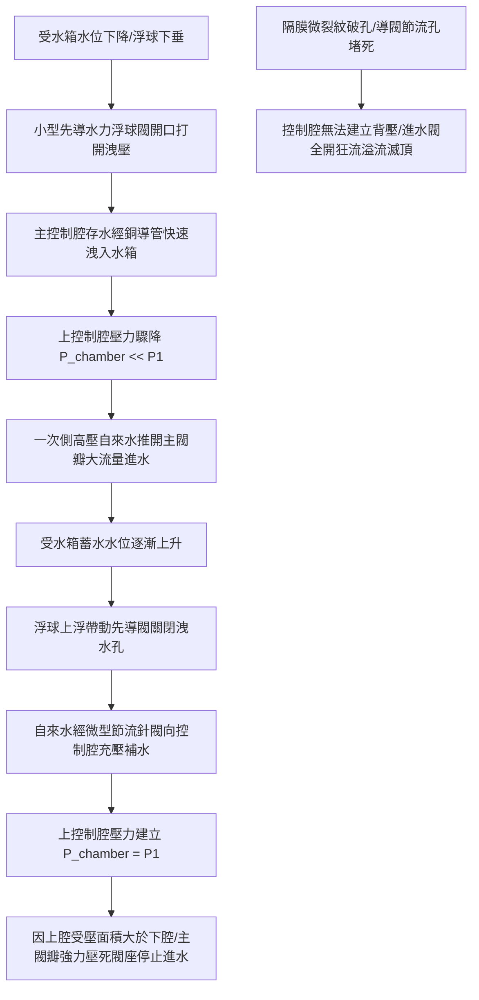

# 全案購屋實戰第八百九十二部：中古大樓社區地下室生活自來水受水箱進水水力浮球閥主閥隔膜微裂紋導閥濾網水垢淤塞洩壓孔堵塞與自來水狂流溢流淹水體檢工序全書

## 壹、編撰宗旨與地下公設防洪滅頂致命隱患

在現代都會區集合住宅大樓（特別是屋齡 20 年至 35 年以上之中高齡中古大樓社區，例如台中南區的大安紫金城、長億南園、歌德堡、工學天下、靜園等）的給水架構中，地下室最底層（B2 或 B3）設置之「自來水生活受水箱（蓄水池，Domestic Underground Water Tank）」是整座大樓自來水調蓄的核心水庫。

市政自來水幹管通常以 $1.5 \sim 3.0\text{ kgf/cm}^2$ 之水壓，經由口徑達 $2\text{ 英吋至 } 4\text{ 英吋}$（DN50~DN100）之大口徑自來水進水幹管直接注入地下受水箱。而負責精準阻斷與開啟這股龐大水流的關鍵閥門，正是安裝於水箱頂部進水管端的「先導水力隔膜式浮球進水閥（Diaphragm Hydraulic Pilot Float Control Valve）」。

然而，在中古大樓長達數十年的沉睡運轉中，這座大口徑先導水力進水閥面臨極其嚴重的隱形劣化與機構失靈：
1. **內部尼龍強化橡膠隔膜片（Diaphragm）受自來水餘氯長年氧化侵蝕與數十萬次彎折疲勞，產生微觀疲勞微裂紋（Micro-cracks）**，導致閥體主控制腔（Upper Control Chamber）無法建立密封背壓，進水閥完全失去關斷能力，呈現致命的「全開常通卡死狀態」；
2. **微型銅質先導閥（Pilot Valve）濾網與不鏽鋼節流洩壓針閥孔（Orifice Needle Valve）被自來水中的碳酸鈣水垢結晶與管壁鐵鏽微粒完全淤塞堵死**，使控制腔壓力無法洩放或補壓，造成水力主閥拒動或無法閉合；
3. **一旦進水閥深夜突發失效狂流，每小時數十公噸的市政自來水將以瀑布般的流量瘋狂注水**。若受水箱溢流管（Overflow Pipe）口徑配置不足或排水明溝遭雜物堵塞，冰冷的高壓自來水將在數小時內漫過受水箱人孔蓋，直接淹沒相鄰的地下室高低壓變電室、緊急柴油發電機組與電梯底坑，造成數百萬至上千萬元的毀滅性機電災難！

本手冊針對中古社區地下室生活自來水受水箱先導式水力浮球進水閥、導閥控制迴路、機械浮球連桿及受水箱溢流排水系統，深入剖析差壓水力自力驅動原理、膜片破損微觀機制與現場實務體檢工序，為購屋家庭與管委會建立固若金湯的受水安全防線。

---

## 貳、先導式水力隔膜進水閥物理力學架構與自力反饋平衡原理

### 一、水力主閥構造與上下腔面積差動平衡方程式
先導式水力隔膜進水閥是一種「**無需任何外加電力、純靠管網內部自來水本身水力能量驅動**」之高精度自力式控制閥門：
1. **內部關鍵流體構造**：
   - 閥體分為下腔（進水高壓通道與出水通道）與上控制腔（Upper Diaphragm Chamber）。
   - 上控制腔由大面積柔性耐磨橡膠隔膜與主閥瓣緊密壓合。
   - 上控制腔頂部受壓有效面積 $A_{\text{upper}}$ **嚴格大於** 底端閥座進水流道受壓面積 $A_{\text{lower}}$（通常面積比為 $A_{\text{upper}} / A_{\text{lower}} \approx 1.25 \sim 1.40$）。
2. **主閥關閉水力平衡力學方程式**：
   當上控制腔充滿來自一次側的自來水高壓水（壓力 $P_{\text{chamber}} = P_1$）時，隔膜組件受垂直方向力之平衡為：
   $$F_{\text{net}} = F_{\text{down}} - F_{\text{up}} = (P_{\text{chamber}} \times A_{\text{upper}} + F_{\text{spring}}) - (P_1 \times A_{\text{lower}})$$
   由於 $P_{\text{chamber}} = P_1$，且 $A_{\text{upper}} > A_{\text{lower}}$，向下作用力 $F_{\text{down}}$ 恆大於向上推力 $F_{\text{up}}$：
   $$F_{\text{net}} = P_1 \times (A_{\text{upper}} - A_{\text{lower}}) + F_{\text{spring}} > 0$$
   這股巨大的向下合力推動主閥瓣牢固壓死於不鏽鋼閥座上，即便管網水壓高達 $10\text{ kgf/cm}^2$，閥門亦能實現「零滴漏」之絕對水力截斷！

### 二、先導微型浮球閥（Pilot Valve）與旁通銅導管迴路
主閥之動作完全由一組精密的外部旁通導管迴路所指揮：
1. **供壓節流迴路**：自一次側進水管引出一支 $3/8\text{ 英吋}$ 銅管，經由 Y 型先導過濾器與可調式微型節流針閥（Needle Valve），將水流注入主閥上控制腔。
2. **洩壓先導迴路**：自上控制腔引出另一支導管，連接至安裝於受水箱液面處之小型黃銅浮球閥（口徑僅 $1/2\text{ 英吋}$）。
   - **水位低**：浮球下垂，先導閥全開，上腔洩壓速度遠大於節流針閥進水速度，主閥瞬間全開補水；
   - **水滿**：浮球上浮至水平定位，先導閥閉合，上腔無法洩壓，水流在數秒內注滿上腔，主閥平順緩閉。

---

## 參、中古社區受水箱進水閥三大核心病徵與失靈成因

### 一、柔性強化橡膠隔膜微裂紋與爆裂穿孔（背壓瓦解）
1. **水質氯化與熱冷蠕變脆化**：自來水中餘氯與微量重金屬長年滲透橡膠分子鏈，使三元乙丙橡膠（EPDM）內部交聯結構斷裂。在水壓波動頻繁伸縮彎折下，隔膜與金屬托盤夾持邊緣產生微觀環狀疲勞微裂紋。
2. **控制腔壓力短路直通**：一旦微裂紋發展為貫穿性針孔，一次側高壓水將直接透過隔膜裂孔漏入出水低壓端，上控制腔內部無法蓄積起等同於一次側之工作壓力（$P_{\text{chamber}} \ll P_1$）。向下壓合力 $F_{\text{net}}$ 徹底歸零，主閥瓣在進水水流衝擊下完全被頂開，無法關閉，引發永無止境的狂暴進水。

### 二、先導管路節流針閥與微型濾網泥垢水垢堵塞
1. **微米級孔隙淤塞**：為實現主閥平穩緩閉以防止水錘，先導管路進水針閥之節流孔徑通常僅有 **$1.0 \sim 1.5\text{ mm}$**。大樓自來水幹管若有鐵鏽塊剝落、或水質硬度析出碳酸鈣顆粒，極易將此微小孔口完全堵死。
2. **無法補水閉閥**：當水箱已達滿水位、先導浮球閥已完全閉合時，由於節流孔堵塞，自來水無法進入主閥上控制腔補壓。上控制腔維持真空或低壓狀態，主閥持續大開進水，形成「水滿不停」的失控狀態。

### 三、先導浮球連桿機構卡阻、浮球破裂進水沉底
1. **黃銅旋轉軸銷氧化卡死**：懸掛於受水箱潮濕氣體中的微型浮球閥，其黃銅轉軸受地下室高濕環境腐蝕，生成厚綠色銅鏽，連桿旋轉阻力劇增。浮球浮力無法克服卡滯摩擦力，無法升起關閥。
2. **不鏽鋼或銅浮球微孔漏水**：空心金屬浮球在接縫焊接處若受酸性水氣電化學腐蝕產生砂眼，水箱內部水霧滲入球體內部。浮球自重增加沉入水中（失去浮力），系統誤判定為「永遠缺水」，進水閥全載長開狂灌。

---

## 肆、受水箱先導式水力進水閥標準體檢工序

### 一、手動旁通球閥切換與先導迴路靜態保壓檢測
1. **手動強迫關斷測試（Manual Shut-off Test）**：
   - 走入地下室受水箱人孔上方進水管路平台，尋找水力主閥上方之先導洩壓銅導管。
   - 導管中間通常設有一只 $3/8\text{ 英吋}$ 手動黃銅小球閥（針閥）。
   - **動作操作**：手動將該小球閥完全「關閉」（模擬先導浮球閥完全閉合水滿狀態）。
   - **判定標準**：主水力閥瓣必須在 **$10 \sim 30\text{ 秒}$ 內完全平穩閉合**，大口徑進水管流動聲徹底消失，出水端完全斷流（零滴漏）；若手動關死小球閥後超過 1 分鐘主閥仍持續轟鳴進水，代表**主隔膜片已穿孔破裂**或**節流針閥孔完全堵死**，判定為重大不合格！
2. **手動強迫全開測試（Manual Full-open Test）**：
   - 將該手動小球閥完全打開，主閥必須在 **$5 \sim 15\text{ 秒}$ 內迅猛全開出水**，確認內部回位彈簧與閥桿滑動順暢無卡死。

### 二、先導管路 Y 型微型過濾器拆解清污工序
1. **安全隔離**：關閉水力閥一次側大口徑主進水閘閥／蝶閥，釋放管網殘壓。
2. **先導過濾器濾網查驗**：
   - 旋開先導銅管前端之微型 Y 型過濾器螺塞，取出內部黃銅／不鏽鋼微型濾網（孔徑約 80 目）。
   - 檢視濾網表面有無紅色鐵鏽泥沙、碳酸鈣白鹽沉積物；使用專用清潔劑與毛刷清洗乾淨。
3. **節流針閥開度校驗**：
   - 檢查針閥開度螺栓，一般標準開度為全關後逆時針退回 **$1.5 \sim 2.5\text{ 圈}$**。開度過小關閥遲緩易溢流，開度過大關閥過快將引發強烈破壞性水錘。

### 三、主閥橡膠隔膜拆解微觀檢查與厚度量測
1. **閥蓋螺栓對角均勻卸除**：
   - 鬆開主閥頂部 6 至 8 顆高強度不鏽鋼螺栓，平穩取下上控制腔閥蓋與重載不鏽鋼回位彈簧。
2. **柔性隔膜無損探傷**：
   - 取出主隔膜組件，以乾淨無塵布擦拭。
   - 雙手輕輕拉伸隔膜邊緣，在強光手電筒下透光檢查隔膜表面有無微小裂紋、砂眼或橡膠脫層現象。
   - 使用超音波橡膠厚度規量測膜片厚度，磨損減薄量不得超過原始厚度之 **$15\%$**。若橡膠表面已失去彈性呈塑性硬化狀，必須立即更換原廠全新耐氯膜片組件。

---

## 伍、購屋避坑指南與管委會整改預算表

### 一、買方看屋地下受水箱安全查核 4 訣
1. **查看受水箱頂部通氣孔與人孔蓋密封度**：
   - 爬上地下室受水箱頂部檢查人孔，人孔蓋必須具備鎖扣且墊有防蟲防塵橡膠密封條，高度需凸出水箱頂板至少 **$15\text{ cm}$ 以上**。
2. **嚴格檢查受水箱「溢流管（Overflow Pipe）」口徑與防蟲網**：
   - 依給排水法規，受水箱溢流管口徑必須**大於進水管徑至少一級（例如進水管 3"，溢流管必須達 4" 以上）**，且溢流管出口必須為「間接排水（Air Gap）」，嚴禁直接插入排污下水道防止毒氣倒灌，出口需配置細目不鏽鋼防蟲防鼠防鳥網。
3. **檢查水箱周圍地坪排水明溝有無青苔與淤積**：
   - 巡視受水箱周遭地面集水溝，若溝底乾燥清潔無積水代表維護良好；若溝內積滿深厚黃褐色水垢、甚至有乾涸水痕自人孔蓋向下流淌，高度暗示該社區曾發生過進水閥故障溢流漫淹事故。
4. **查閱大樓社區自來水水費異常暴增紀錄**：
   - 向管委會或警衛室側面了解社區公共水費帳單。若某幾個月公共自來水水費突然無故暴增數萬元，往往正是進水閥膜片微漏長年自溢流管流失之確鑿鐵證！

### 二、受水箱水力進水控制系統專項整改預算參考清單

| 維修／改善工程項目 | 技術規範與標準工法 | 預算區間（每台／每處） | 安全重要度等級 |
| :--- | :--- | :--- | :--- |
| **先導式水力隔膜進水閥大修更換原廠膜片組** | EPDM 尼龍夾層耐氯強化膜片 + 不銹鋼彈簧 | 4,500 ~ 8,500 元／台 | 極高（每3~5年必做） |
| **全組汰換進口／一線球墨鑄鐵先導水力進水閥** | 2"~3" DN50~DN80 雙腔緩閉型先導閥總成 | 18,000 ~ 32,000 元／台 | 極高（閥體鏽蝕必換） |
| **不銹鋼連桿微型先導浮球閥更換（SUS 316）** | SUS 316 耐腐蝕先導閥體含抗壓無縫浮球 | 2,800 ~ 5,000 元／組 | 高度 |
| **增設超高水位緊急電磁截斷切斷閥（雙重安全）** | DC 24V / AC 110V 常開型緊急防溢流電磁閥 | 12,000 ~ 20,000 元／處 | 專業推薦（防止水淹機房） |
| **受水箱大口徑溢流管修改與防蟲間接排水改善** | 4"~5" 鍍鋅鋼管或厚管配防蟲不銹鋼濾網 | 8,500 ~ 15,000 元／處 | 緊急極高（防止倒灌） |
| **水箱高水位警報浮球開關與中控室警報連線** | 雙觸點重錘式耐水浮球感知器 + 蜂鳴警報器 | 3,500 ~ 6,500 元／套 | 極高（早苗預警） |

---

## 陸、本案結語

地下室受水箱是整座高樓社區生命水理循環的「源頭蓄水庫」。一座口徑數英吋的先導水力進水閥，平日默默在水箱幽閉的頂部承受著全天候的市政高壓衝擊。它若失靈，帶來的絕非僅僅是水費的損失，而是動輒數百萬機電設備毀滅與全棟停水停電的滅頂之災。

購屋家庭在評估中古大樓時，務必將查檢眼光深探至地下水箱的進水控制閥件與溢流防護體系。唯有確保源頭進水閥門收放自如、溢流導溝暢通無阻，才能為珍貴的家庭資產構築起最無懈可擊的地下水安防線！
