# 全案購屋實戰第八百九十五部：八百九十五部圓滿登峰全景極致全維度全生命週期家庭置產避坑抗震防漏水電機電消防永恆至尊金典總綱全書

## 壹、總綱立論與跨紀元家庭置產安全工程學

自全案實戰首部開篇至今，歷經八百九十五個專題篇章的深邃淬鍊，《全案購屋實戰》系列手冊構築出全台灣集合住宅與中古大樓置產領域中最具科學嚴謹度、工程深度與實戰威力的權威寶典。

當家庭在台中南區、南屯區乃至全台都會精華區，面對屋齡 20 年至 35 年之鋼筋混凝土集合住宅時（涵蓋大安紫金城、長億南園、歌德堡、靜園等指標社區），買房的本質絕非只是室內坪數、裝潢視覺與成交單價的表面博弈；本質上，是家庭核心積蓄對整座大樓長達數十年之「**地基抗浮消壓系統（Subterranean Drainage Equilibrium）**」、「**深層抗震結構韌性（Structural Resilience）**」、「**高壓重電能量心臟（High Voltage Substation Redundancy）**」、「**低壓配電幹線防護（Low Voltage Distribution Security）**」、「**垂直水理平衡循環（Vertical Hydraulic Balance）**」以及「**弱電安防神經網絡（Weak-current Intercom Network）**」的世紀總託付！

本第八百九十五部總綱全書，貫穿全系列八百九十五部工序精粹，確立六大系統防禦維度與四大主力候選物件之決戰出價戰略，為購屋家庭奠定歷久彌堅的永恆資產護城河。

---

## 貳、六大系統維度核心體檢防線總圖譜

```mermaid
flowchart TD
    subgraph S1[一、地基地層抗浮與導排水消壓防線]
        A1[連續壁複壁導水溝高壓水刀除鈣] --- A2[筏基抗浮孔隙水壓釋放平衡]
        A2 --- A3[集水深井雙泵備援與緩閉防錘逆止閥]
    end
    subgraph S2[二、垂直升降與地下機械泊車防線]
        B1[電梯乘場門機械鎖勾與電氣安全聯鎖] --- B2[調速機夾繩鉗與安全鉗自鎖制動]
        B2 --- B3[機械車位雙缸內漏沈降量與雙排鏈條防墜]
    end
    subgraph S3[三、高樓消防水網與極限排煙防線]
        C1[消防立管頂部排氣閥與末端放水水壓] --- C2[濕式警報逆止閥延遲室防誤報]
        C2 --- C3[機械防排煙風機高溫馬達與280度防火閘門]
    end
    subgraph S4[四、地下環境健康與通風安全防線]
        D1[防爆排風機葉輪現場雷射動平衡] --- D2[風管法蘭EPDM阻燃密封防漏]
        D2 --- D3[電化學一氧化碳感測器雙段連鎖]
    end
    subgraph S5[五、生活給水水理與受水防洪防線]
        E1[受水箱先導水力進水閥膜片微裂紋體檢] --- E2[雙泵自動交替揚水逆止閥防回漏水錘]
        E2 --- E3[各樓層減壓閥組水垢卡死與水錘吸收器]
    end
    subgraph S6[六、強弱電機電與極限黑啟動防線]
        F1[柴油發電機散熱水箱鋁蝕與風扇皮帶打滑] --- F2[動力接觸器電弧熔焊與過載電驛欠相保護]
        F2 --- F3[低壓ACB脫扣保護與對講機線路壓降]
    end
```

---

## 參、中古社區跨系統隱形崩潰鏈深度剖析

在 20 年以上之大型中古社區中，機電子系統彼此緊密耦合。若管委會長期採取「壞了再修」的消極保養策略，單一系統的微小病變必將觸發全棟癱瘓的災難連鎖：

### 一、發電機水箱鋁蝕板結 $\to$ 滿載散熱崩潰開鍋 $\to$ 消防全癱與電梯斷電滅頂
大樓遭遇強烈地震或區域性大停電，緊急柴油發電機組自動黑啟動投入負載。然而車頭冷卻水箱鋁鰭片因長年酸霧腐蝕粉化且油泥板結，傳動風扇皮帶嚴重打滑丟轉，且循環水套內部生成厚厚水垢。在消防加壓泵與排煙風機全載運轉僅 12 分鐘後，引擎冷卻水溫飆破 105℃ 開鍋沸騰，發電機因高溫保護緊急跳脫熄火！整座社區瞬間陷入漆黑死寂，消防泵斷電停水，梯間排煙停止，整棟大樓淪為濃煙毒氣與烈火肆虐的煉獄！

### 二、動力接觸器主觸頭熔焊 $\to$ 揚水泵無法停機 $\to$ 水塔狂溢漫灌電梯機房
地下室生活揚水控制盤之交流電磁接觸器，因承受數十萬次啟閉電弧高溫燒蝕，銀合金觸點表面嚴重氧化積碳，最終在高溫下發生致命的「主觸頭熔焊黏死（Contact Welding）」。當頂樓水塔打滿水發出停機訊號時，接觸器依然強行導通，揚水馬達無法停機持續狂抽！數百公噸自來水自水塔通氣孔與溢流管如瀑布般噴湧，直接淹沒屋頂電梯機房，高壓水流澆灌至電梯控制櫃與曳引機內部，造成整棟電梯電子控制主機全部泡水燒毀報廢！

### 三、乘場門鎖嚙合不足 $\to$ 外力推擠脫扣 $\to$ 候梯住戶踩空墜入數十米深井
各樓層梯廳電梯乘場門因吊門輪磨損下沉與鎖臂襯套間隙過大，機械鎖勾與鎖盒擋塊的咬合深度退化至 2mm 以下（法規標準必須 $\ge 7\text{ mm}$）。某日晚間住戶或孩童在走廊推擠打鬧、倚靠門扇時，淺淺搭住的鎖勾瞬間脫扣彈開。門扇向兩側滑開露出空無一物的深邃井道，候梯人員瞬間失足踏空，直墜地下室底坑粉身碎骨，釀成無可挽回的家庭碎裂悲劇！

---

## 肆、四大主力候選物件決戰實戰評定與出價戰略

結合永義房屋周小姐 20 部實勘帶看影片全紀錄、現場工程體檢標準及區域行情大數據，對四大核心考慮物件進行戰略定錨：

### 一、大安紫金城 13 樓（PROP_10）——「獨立平面大車位、租約拆除策略反制」
- **核心價值指標**：
  - 配置 B2 獨立大型平面車位（南區成熟商圈稀缺性最高，獨立估值達 180 萬以上，資產保值性第一）。
  - 13 樓高樓層無遮擋開闊視野、通風採光極佳。
- **痛點與改造成本**：
  - 現況隔間為分租學生套房，需預留約 35 萬之室內隔間拆除、全室電線更新與恢復三房格局款項。
  - 需查驗 11 樓以上天花板消防撒水頭完好度，以及管道間減壓閥組與末端查驗閥動態放水壓力。
- **談判與出價策論**：
  - 開價 898 萬。起手斡旋 720~730 萬，目標成交區間 768~788 萬，最高封頂 800 萬。
  - **合約必備特約**：「現況租約期滿終止並騰空點交」、「銀行房屋貸款核貸不足成交價 8 成無條件解除契約全額退還定金」。

### 二、長億南園 8 樓（PROP_106）——「32 坪大室內坪效、機械車位與無障礙破底籌碼」
- **核心價值指標**：
  - 主建物加陽台實質室內使用坪效高達 32 坪，方正大三房，客廳與臥室空間尺度最寬敞舒適。
- **痛點與公設限制**：
  - 機械車位限重 1.6 噸（無法停放大型休旅車 SUV 或特斯拉純電車），需定期檢測升降鏈條磨損伸長率與液壓缸內漏。
  - 梯廳入口有 4 階高差無障礙缺失，需評估推車與長輩進出動線改善費。
- **談判與出價策論**：
  - 開價 998 萬。以「機械車位換車限制」與「梯廳無障礙台階改善」作為重擊賣方心理底價之利刃。起手出價 698~720 萬，目標錨定 745~760 萬。

### 三、歌德堡 8 樓——「百萬現代北歐精裝、最佳心理牽制籌碼」
- **核心價值指標**：
  - 全室已完成百萬現代北歐精美裝潢，水電已翻新，可省去交屋後 80~120 萬翻修工程款與長達半年的監工時間成本。
- **戰略部署意涵**：
  - 作為牽制大安紫金城與長億南園賣方讓價的最佳武器。若前兩案價格僵持不下，歌德堡可作為即買即住的最佳生活品質選擇。

### 四、靜園 A 區 11 樓——「三面採光、雙衛自然開窗終極安全底牌」
- **核心價值指標**：
  - 高樓層邊間三面採光，通風極致；主客雙衛浴皆直接開窗，完全杜絕暗房與潮濕發霉困擾。
- **戰略部署意涵**：
  - 作為談判全盤破局時的第一安全備援底牌。

---

## 伍、購屋家庭終極現場「避坑十檢」操作綱領

| 檢驗維度 | 核心查核工序與標準 | 隱形地雷判定標準 |
| :--- | :--- | :--- |
| **一、頂（天花板消防）** | 抬頭查驗撒水頭四周淨空 $\ge 30\text{ cm}$，螺紋接頭無結晶 | 撒水頭被木作包覆或有碳酸鈣白色鹽結晶（微漏） |
| **二、底（地下筏基）** | 查驗連續壁導水溝無白色鈣化泥沙，集水井水質清澈 | 牆角踢腳嚴重白華起泡、集水井溢水泥漿痕跡 |
| **三、冷（發電機散熱）** | 檢視水箱透光無泥垢、風扇皮帶撓度（跨距 $1.5\% \sim 2\%$） | 鋁鰭片粉化腐蝕、皮帶嚴重打滑、水溫飆破 98℃ |
| **四、門（電梯乘場鎖）** | 游標卡尺量測鎖勾嚙合深度（$\ge 7.0\text{ mm}$），推門無脫扣 | 嚙合不足 3mm、外推門扇大幅晃動、主板違法短接跳線 |
| **五、車（機械停車位）** | 查核車位金屬銘牌限重（$\ge 1.8\text{ 噸}$），底坑無漏油 | 限重僅 1.5 噸（無法停休旅車）、油缸慢速沈降溜車 |
| **六、風（地下通風防毒）** | 查核 CO 感測器顯示正常，排風機運轉振動平穩無刺耳異音 | 地下室有刺鼻酸腐廢氣、排風機劇烈抖動（動平衡失衡） |
| **七、水（生活給水減壓）** | 攜帶水壓表實測室內出水靜壓（$1.8 \sim 2.5\text{ kgf/cm}^2$），關水無水錘 | 靜水壓飆破 $4.0\text{ kgf/cm}^2$、關水時牆內金屬撞擊爆震 |
| **八、動（動力電磁開關）** | 檢視接觸器消弧罩無黑碳粉，過載電驛整定值 $\le 1.05\text{ FLA}$ | 接觸器電鑽般嗡嗡叫、觸頭熔焊黏死、欠相燒毀馬達 |
| **九、結（抗震結構力學）** | 巡查地下室與室內大樑、剪力牆無 45 度貫穿性斜裂紋 | 柱頭柱腳出現混凝土壓碎剝落、鋼筋外露鏽蝕 |
| **十、訊（弱電對講神經）** | 實測室內分機語音清晰無破音、電梯對講全行程暢通 | 分機交流嗡嗡聲、通話嚴重破音、電梯對講按了沒人理 |

---

## 陸、全書總綱圓滿結語

《全案購屋實戰》系列手冊第八百九十五部的集大成，不僅是一部融合理論科學與工序驗證的建築機電百科全書，更是獻給每一位為家庭未來深謀遠慮的置產決策者最珍貴的傳家之寶。

買房是家庭生命歷程中最重要的基石奠定。在繁雜喧囂的市場行銷中，唯有用最嚴苛的工程科學審視地基、結構、水力、重電、弱電、消防、電梯門鎖與柴油冷卻防禦體系，方能穿透表象迷霧，為所愛的家人築造一座真正抗震、防水、電安、水順、梯穩的傳世堡壘！
