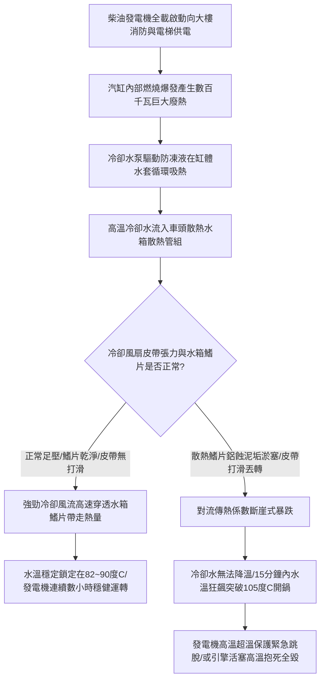

# 全案購屋實戰第八百九十四部：中古大樓社區地下室緊急柴油發電機冷卻水箱散熱鰭片鋁蝕淤塞冷卻風扇皮帶打滑水泵軸封滲漏與過熱高溫抱死體檢工序全書

## 壹、編撰宗旨與極限孤島供電熱力學防線

在現代高層集合住宅大樓（特別是屋齡 20 年至 35 年以上之中大型中古社區，例如台中南區的大安紫金城、長億南園、歌德堡、工學天下、靜園等）的重電機電防禦體系中，設置於地下室最深層的「緊急柴油發電機組（Emergency Diesel Generator Set, EDG）」，是整棟大樓遭遇強烈地震、區域性台電電網大跳電、或者火災突發時，唯一具備獨立運轉能力的「孤島最後生命線電源」。

當市電斷電瞬間，緊急柴油發電機必須在 **10 至 12 秒之內** 完成黑啟動，並全額承擔起緊急消防栓栓管加壓泵、自動撒水泵、防排煙風機、緊急昇降機（消防員電梯）以及全棟緊急梯間照明的龐大電氣負載。

柴油引擎在大功率滿載發電輸出（通常為 $150\text{ kW} \sim 500\text{ kW}$）時，其內部燃料燃燒熱效率約為 $35\% \sim 40\%$。換言之，高達 **$60\% \sim 65\%$ 的化學燃燒熱能**，必須經由引擎汽缸水套（Water Jacket）、潤滑油冷卻器以及車頭前方的「重載熱交換冷卻散熱水箱（Radiator）」以強制對流方式迅速排散至大氣中！

然而，在中古大樓長達 20 至 35 年的潮濕地下室封閉環境中，緊急柴油發電機冷卻散熱系統長態潛伏著四大毀滅性熱力學病變：
1. **水箱外部散熱鰭片（Radiator Fins）在地下室高濕環境與汽車廢氣酸霧長期侵蝕下，產生嚴重的「鋁金屬粉化腐蝕（Aluminum Flaking Corrosion）」與油泥粉塵板結淤塞**，有效空氣散熱截面積銳減 $50\% \sim 70\%$；
2. **冷卻風扇傳動 V 型三角皮帶（Fan Belts）長年受高溫烘烤，橡膠硬化龜裂、張力鬆弛嚴重打滑**，風扇轉速大幅下跌，通過散熱水箱之冷卻風量呈現斷崖式衰減；
3. **發電機冷卻水循環泵浦（Coolant Water Pump）機械軸封硬化滲漏**，且冷卻防凍液長達數十年未更換導致水質酸化，水套內部生成厚厚一層阻熱性極高的碳酸鈣水垢（Scale）；
4. **一旦全社區突發大停電或火災全載運轉，發電機在啟動後短短 10 至 15 分鐘之內，冷卻水溫便會如同火箭般狂飆破百度（$>105^\circ\text{C}$）引發「引擎開鍋沸騰爆管」，進而觸發高溫保護強制跳機，甚至引發活塞拉缸、曲軸軸瓦高溫燒結抱死（Engine Seizure）**，整棟大樓瞬間陷入漆黑無水、消防全癱的滅頂深淵！

本手冊針對中古社區緊急柴油發電機冷卻水箱、傳動風扇皮帶組、循環水泵、節溫器（Thermostat）及冷卻水質，深入解剖傳熱學對流換熱原理、皮帶傳動力學歐拉公式、水垢熱阻分析與現場實務體檢工序，為購屋家庭與管委會建立固若金湯的孤島供電熱力防禦屏障。

---

## 貳、柴油發電機冷卻熱力學架構與熱交換物理機制

### 一、牛頓冷卻定律與散熱水箱傳熱方程式
柴油引擎在滿載發電輸出功率為 $P_e$（$\text{kW}$）時，冷卻水系統必須帶走的廢熱功率 $Q_{\text{heat}}$ 約為：
$$Q_{\text{heat}} \approx (0.8 \sim 1.0) \times P_e \quad (\text{kW})$$
散熱水箱（銅管鋁鰭片或全鋁式熱交換器）內部高溫冷卻水與外部強制對流空氣之熱交換，遵循熱力學綜合傳熱方程式：
$$Q = K \cdot A_{\text{effective}} \cdot \Delta T_{\text{lm}}$$
其中：
- $K$ 為總傳熱係數（$\text{W/m}^2\cdot\text{K}$）；
- $A_{\text{effective}}$ 為散熱水箱外表面之有效散熱面積（包含數萬片波浪形微細鋁鰭片）；
- $\Delta T_{\text{lm}}$ 為對流熱交換之對數平均溫差（Log Mean Temperature Difference, LMTD）：
  $$\Delta T_{\text{lm}} = \frac{(T_{\text{water, in}} - T_{\text{air, out}}) - (T_{\text{water, out}} - T_{\text{air, in}})}{\ln\left[\frac{T_{\text{water, in}} - T_{\text{air, out}}}{T_{\text{water, out}} - T_{\text{air, in}}}\right]}$$
- **水垢熱阻破壞效應**：水垢的導熱係數（$\lambda_{\text{scale}} \approx 0.1 \sim 0.2\text{ W/m}\cdot\text{K}$）僅為純銅管（$\approx 380\text{ W/m}\cdot\text{K}$）的數千分之一。水套與水箱銅管內壁只要沉積薄薄一層厚度僅 **$1.0\text{ mm}$ 的水垢**，熱阻即暴增數倍，總傳熱係數 $K$ 跌破 $40\%$，水箱散熱能力徹底崩潰！

### 二、冷卻風扇傳動三角皮帶摩擦力學（歐拉公式 Euler's Equation）
冷卻風扇通常由柴油機曲軸皮帶輪透過 2 至 4 根並聯之重型 V 型三角皮帶（V-Belts）驅動：
1. **歐拉皮帶摩擦傳力極限方程式**：
   皮帶在皮帶輪上的緊邊拉力 $F_1$ 與鬆邊拉力 $F_2$ 之最大靜摩擦比值遵循歐拉公式：
   $$\frac{F_1}{F_2} \le e^{\mu' \cdot \theta}$$
   其中：
   - $\theta$ 為皮帶在皮帶輪上的包角（通常 $\theta \approx 2.5 \sim 3.0\text{ rad}$，約 $150^\circ \sim 180^\circ$）；
   - $\mu' = \mu / \sin(\beta / 2)$ 為 V 型三角皮帶槽之「當量摩擦係數」（$\beta \approx 36^\circ \sim 38^\circ$ 為皮帶槽楔角，因楔形效應，$\mu'$ 約為平皮帶的 3 倍）。
2. **張力鬆弛與轉速滑差（Slip Ratio）**：
   當皮帶長年老化伸長、初張力 $F_0 = \frac{F_1 + F_2}{2}$ 下降時，可傳遞之最大有效圓周力 $F_t = F_1 - F_2$ 劇降。當風扇負載扭矩超過摩擦極限時，皮帶發生劇烈打滑（Slip）。風扇轉速自正常的 $1800\text{ RPM}$ 崩跌至 $1000\text{ RPM}$ 以下，冷卻風量按轉速立方比（$Q_{\text{air}} \propto n^3$）暴跌超過 $75\%$，散熱體系全面癱瘓。

---

## 參、中古社區發電機冷卻系統三大核心病徵與失靈成因

### 一、散熱鰭片粉化鋁蝕、油泥板結與風阻激增
1. **電化學酸霧鋁蝕與粉化**：地下發電機房常年通風不良，汽車尾氣中的硫化物（$\text{SO}_x$）及氮氧化物（$\text{NO}_x$）與地下室高濕水氣結合形成酸霧，與散熱水箱的薄鋁鰭片發生電化學腐蝕，表面析出大量白色粉末狀的氫氧化鋁與氧化鋁結晶，使厚度僅 0.1mm 的鰭片大面積脆化脫落、斷裂倒伏。
2. **油泥粉塵纖維板結封死風道**：地下室空氣中懸浮的油霧與地表灰塵，在水箱外表面被風扇吸附，形成厚達數毫米如瀝青氈毯般的堅硬黑垢。冷卻空氣完全無法穿透水箱，冷卻風道被徹底封死。

### 二、冷卻風扇三角皮帶硬化龜裂、打滑尖叫與丟轉
1. **熱氧老化與膠層炭化**：發電機房溫度高達 $40^\circ\text{C}$，皮帶長年處於高溫烘烤，丁苯橡膠（SBR）或三元乙丙橡膠（EPDM）交聯老化，皮帶底部齒形開裂、側工作面磨光磨平。
2. **高溫打滑燒毀**：當市電跳電發電機瞬間全載輸出時，風扇巨大慣性阻力使鬆弛的皮帶劇烈打滑摩擦，機房內傳出極端尖銳刺耳的金屬摩擦尖叫聲，並在數分鐘內冒出滾滾焦黑橡膠濃煙，皮帶熔斷甩出！

### 三、循環水泵機械軸封滲漏、節溫器卡死與冷卻水酸化
1. **碳化矽/陶瓷機械軸封水垢磨損**：水泵軸封長年承受高轉速運轉，若水質硬度偏高，碳酸鈣結晶侵入動靜環摩擦面，將石墨環割劃出微觀縱向深溝，防凍液沿水泵洩水孔持續滲漏滴落。
2. **石蠟式節溫器（Thermostat）高溫卡死**：掌控引擎「大循環」與「小循環」切換的核心閥門——節溫器，其內部感溫石蠟在數十年老化後膨脹力衰退，或閥桿被鐵鏽水垢咬死在閉合位置。即便冷卻水溫已飆破 $95^\circ\text{C}$，節溫器依然拒絕打開通往散熱水箱的大循環通道，高溫水只能在汽缸內部小循環死循環，引擎在 5 分鐘內瞬間開鍋過熱！

---

## 肆、發電機冷卻散熱系統標準體檢工序

### 一、散熱水箱外觀透光性、鰭片完整度與除泥工序
1. **強光透光性查驗法（Backlight Inspection）**：
   - 走入發電機車頭前方，在散熱水箱背面放置高亮度 LED 投光燈。
   - 自水箱正面檢視光線穿透度：
     - **優良等級**：光線均勻穿透水箱所有波浪孔隙，通風截面無死角；
     - **嚴重堵塞判定**：若光線被大面積黑褐色油泥遮蔽、或鋁鰭片倒伏倒塌面積超過 **$20\%$**，代表風道已嚴重淤塞，必須進行專業清洗。
2. **中性藥劑低壓水刀清洗工序**：
   - 嚴禁用高壓旋轉水刀直接近距離沖洗（高壓水流會直接打爛倒伏薄鋁片！）。
   - 採用散熱器專用中性鋁金屬除油垢清洗劑均勻噴灑，靜置 15 分鐘軟化油泥；
   - 使用扇形低壓水槍（水壓嚴格限制在 **$3 \sim 5\text{ bar}$** 且垂直於水箱表面）由內向外徹底沖洗，使用專用「散熱鰭片金屬梳（Fin Comb）」逐一梳理扶正倒塌之鋁鰭片。

### 二、傳動三角皮帶張力（Tension）、撓度與滑差精密測量
1. **皮帶張力計撓度量測法（Deflection Method）**：
   - 在兩皮帶輪中央跨距中點，使用「按壓式皮帶張力計（Belt Tension Gauge）」施加垂直按壓力 $F_{\text{press}}$（通常為 $40 \sim 60\text{ N}$）。
   - 測量皮帶產生的撓度（Deflection）$\delta$：
     - **標準合格值**：撓度 $\delta$ 應嚴格維持在跨距長度 $L$ 的 **$1.5\% \sim 2.0\%$**（例如跨距 $L = 500\text{ mm}$，標準下壓撓度應介於 **$7.5 \sim 10.0\text{ mm}$** 之間）。若下壓撓度超過 $15\text{ mm}$，代表皮帶已嚴重鬆弛，必須調整發電機或張緊輪滑軌螺栓。
2. **多根並聯皮帶「同長度匹配（Matched Set）」原則**：
   - 發電機傳動若採用雙排或三排皮帶，所有皮帶必須為原廠同一生產批號之「配對皮帶組」；嚴禁新舊皮帶混用，新舊混用將導致新皮帶單獨承載全部負荷而瞬間撕裂！

### 三、冷卻防凍液理化特性檢驗與節溫器開度驗收
1. **冷卻液冰點與乙二醇濃度檢測**：
   - 引擎冷卻狀態下，旋開水箱壓力蓋。使用光學折射比重計吸取少量防凍液滴入棱鏡。
   - **檢驗標準**：乙二醇（Ethylene Glycol）濃度應維持在 **$40\% \sim 50\%$**，實測冰點應達到 **$-25^\circ\text{C} \sim -35^\circ\text{C}$**；
   - **酸鹼度 pH 值測定**：使用精密 pH 試紙或數位酸度計量測，合格 pH 值必須維持在 **$8.0 \sim 10.0$** 之弱鹼性範圍。若 pH 值跌破 **$7.0$**（酸化呈酸性），防凍液已完全失去防腐防鏽能力，必須立即排空沖洗並更換全新原廠冷卻液！
2. **發電機滿載帶電有載試運轉與水溫平衡測試**：
   - 啟動發電機進行帶載運轉（或接入移動式假負載箱滿載測試），使用紅外線測溫儀連續監測：
     - 觀察冷卻水溫自常溫升至 **$80^\circ\text{C}$** 瞬間，水箱上下進出水管應產生明顯溫差切換，確認節溫器精準開啟大循環；
     - 全載運轉 30 分鐘，引擎水溫必須穩定平衡於 **$82^\circ\text{C} \sim 90^\circ\text{C}$** 之間；若水溫持續攀升突破 **$98^\circ\text{C}$** 且無減緩趨勢，判定為冷卻散熱系統不合格！

---

## 伍、購屋避坑指南與管委會整改預算表

### 一、買方地下室發電機冷卻安全查核關鍵 4 訣
1. **蹲下檢視發電機車頭冷卻水箱底部有無綠/粉色結晶**：
   - 走入發電機房，繞至車頭前方蹲下。用手電筒照射散熱水箱底部與水泵下方排洩孔。若地面有長年滴落形成的綠色或粉紅色螢光結晶斑塊（乙二醇乾涸痕跡），代表水箱或水泵軸封正處於持續滲漏狀態。
2. **雙手大拇指按壓散熱風扇傳動皮帶檢查鬆弛度**：
   - 在引擎靜止斷電安全狀態下，用雙手拇指用力按壓風扇皮帶中央。若輕輕一壓皮帶即深陷超過 2 公分、甚至皮帶內側已佈滿橫向裂紋，代表皮帶早已老化，全載時必打滑停擺。
3. **打開水箱壓力蓋檢視冷卻液顏色與清澈度**：
   - 確認引擎冷機時，戴手套旋開水箱頂部加水口蓋。正常冷卻液應為鮮豔透明的螢光綠色或粉紅色；若呈現如鐵鏽泥漿般的黃褐色、浮滿一層黑油花，代表內部已嚴重生鏽結垢，汽缸墊床甚至可能已燒蝕串氣。
4. **查閱大樓社區「緊急柴油發電機定期保養耗材更換清冊」**：
   - 向管委會調閱近 3 年機電保養紀錄單。確認報告中是否有冷卻水、傳動皮帶、機油及冷卻水濾清器（Water Filter）之具體更換年份。若超過 3 年未換冷卻水，內部管路恐已嚴重鏽蝕。

### 二、發電機冷卻散熱系統專項維修更新預算參考清單

| 維修／改善工程項目 | 技術規範與標準工法 | 預算區間（每台／每組） | 安全重要度等級 |
| :--- | :--- | :--- | :--- |
| **散熱水箱專業拆解低壓化學除泥除垢與鰭片梳理** | 中性鋁金屬除垢劑循環清洗 + 梳理倒伏鰭片 | 12,000 ~ 22,000 元／台 | 極高（消除高溫過熱） |
| **全組汰換重載型銅管鋁鰭散熱水箱總成新品** | 匹配 150kW~300kW 發電機原廠規格散熱水箱 | 65,000 ~ 120,000 元／組 | 極高（水箱穿孔必換） |
| **重載耐熱 V 型冷卻風扇三角皮帶全組更換** | 原廠同批號高張力防靜電耐油耐熱皮帶組（2~4條） | 3,500 ~ 6,500 元／組 | 極高（每2~3年必換） |
| **發電機循環水泵大修更換碳化矽機械軸封與軸承** | 原廠水泵大修套件分解翻修 + 高溫密封墊片 | 15,000 ~ 28,000 元／台 | 高度（根治漏水） |
| **原廠石蠟式高精度雙節溫器（Thermostat）換新** | 標定開啟溫度 82°C 原廠不銹鋼節溫器新品組 | 4,500 ~ 8,000 元／套 | 極高（防止大循環卡死） |
| **冷卻防凍液全面抽換全新 50% 乙二醇弱鹼性原液** | 全系統排空沖洗 + 注入 40~80 公升進口防腐防凍液 | 8,000 ~ 15,000 元／次 | 法定極高（每2~3年必做） |

---

## 陸、本案結語

在狂風暴雨摧毀外部電網、或烈火烈焰阻斷市政常規電力的至暗時刻，地下室那座鋼鐵心臟——緊急柴油發電機組，就是全棟數百戶住戶唯一的逃生光明與消防抽水救命動力。而那具常年靜立於發電機車頭的冷卻散熱水箱，正是守護這座龐大引擎在極限全載運轉中不致高溫自焚的「生命熱盾」。

購屋家庭在評估優質中古大樓時，務必將安全檢驗的目光延伸至這座深藏於地下室的重電冷卻心臟。唯有確保散熱水箱透光無阻、皮帶張力緊固如弓、冷卻水循環通暢無垢，才能確保整棟大樓在面臨極限危機時，發電機隨時能爆發出磅礴穩健的電力洪流，為全家人的世代家園構築起最堅不可摧的生命防禦堡壘！
